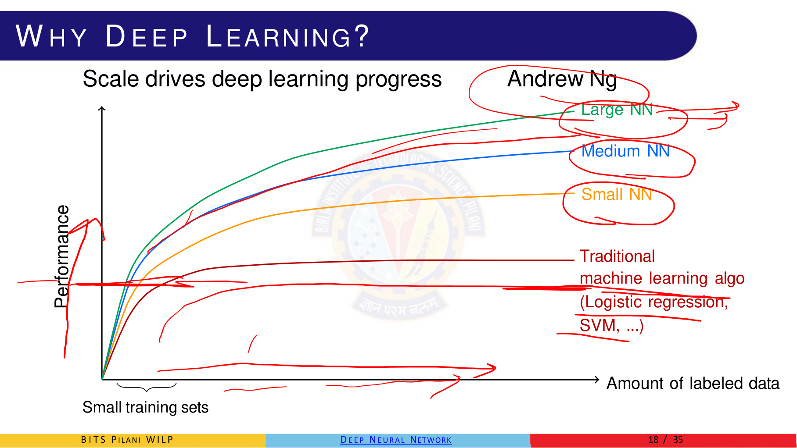

# Module 1: Introduction to Deep Learning

**Course**: AIML ZG511 — Deep Neural Networks  
**Prescribed References**: Zhang et al. (T1, Ch 1); Goodfellow et al. (R1, Ch 1); Jurafsky & Martin (R3, Ch 1)  
**Syllabus module**: **M01** — Introduction to Deep Learning (`Notes/AI Notes/module_map.yaml`)  
**Canonical video**: `Videos/Lecture_01_Introduction_to_Deep_Learning.mp4` (Prof. Shakshi Sharma)  
**Exam reference**: Prof. Mithun Ghosh Question Paper (Q1–Q4)

---

## 1. Executive Summary & Foundational Definitions

**Deep Learning (DL)** is a specialized subfield of **Machine Learning (ML)** and **Artificial Intelligence (AI)** focused on learning multi-level representations of data through layered computational graphs.

Traditional machine learning algorithms depend on **feature engineering** — human domain experts designing manual heuristics (e.g., SIFT or HOG for vision, MFCCs for speech, bag-of-words for NLP). Deep learning replaces this manual step with **representation learning**: raw sensory data is passed into hierarchical non-linear transformations where lower layers learn primitives (edges, textures, phonemes) and higher layers synthesize semantic concepts (object parts, words, full objects).

```
+--------------------------------------------------------------+
| Artificial Intelligence (AI) - 1950s                         |
|   Simulate human intelligence, logic systems, heuristics     |
|   +--------------------------------------------------------+ |
|   | Machine Learning (ML) - 1980s                          | |
|   |   Learn statistical patterns from data with features   | |
|   |   +--------------------------------------------------+ | |
|   |   | Deep Learning (DL) - 2010s                       | | |
|   |   |   Hierarchical feature representations via       | | |
|   |   |   deep multi-layer neural architectures          | | |
|   |   +--------------------------------------------------+ | |
|   +--------------------------------------------------------+ |
+--------------------------------------------------------------+
```

### What Does "Deep" Signify?
The word **"deep"** specifically refers to the **computational depth of the model** — the number of sequential transformation layers between input and prediction.
- A shallow model (e.g., Logistic Regression, Linear Regression, Linear SVM) has depth $d = 1$. It performs an affine projection followed by at most one activation function:
  $$\hat{y} = g(\mathbf{w}^T \mathbf{x} + b)$$
- A deep model chains $L$ parameterized layers ($L \gg 1$):
  $$\mathbf{h}^{[1]} = \sigma(\mathbf{W}^{[1]} \mathbf{x} + \mathbf{b}^{[1]})$$
  $$\mathbf{h}^{[2]} = \sigma(\mathbf{W}^{[2]} \mathbf{h}^{[1]} + \mathbf{b}^{[2]})$$
  $$\dots$$
  $$\hat{\mathbf{y}} = g(\mathbf{W}^{[L]} \mathbf{h}^{[L-1]} + \mathbf{b}^{[L]})$$
Each hidden layer warps the geometry of the feature space so that complex, non-linearly separable distributions become linearly separable at the final layer.

---

## 2. Motivation: Why Deep Learning Now?

### 2.1 The Andrew Ng Scaling Principle
Traditional statistical machine learning models (e.g., Random Forests, Support Vector Machines, Logistic Regression) experience an asymptotic performance ceiling: beyond a certain threshold of data, their limited hypothesis capacity prevents further performance gains. In contrast, large deep neural networks exhibit power-law scaling: performance continues to scale with increases in data volume and compute capacity.


*Figure 1.1: The Andrew Ng Performance Scaling Principle: Traditional ML algorithms plateau as data volume increases, whereas large deep neural networks continue to scale monotonically with increased compute and data (Slide 18, DNN_M1_Introduction.pdf).*

Mathematically, empirical generalization error $\mathcal{E}$ often follows an empirical power law:
$$\mathcal{E}(N) \approx \left(\frac{N_c}{N}\right)^{\alpha_N}$$
where $N$ is dataset size, $N_c$ is a characteristic constant, and $\alpha_N$ is the scaling exponent. For traditional shallow models, $\alpha_N \to 0$ rapidly as capacity saturates; for deep architectures, $\alpha_N > 0$ over several orders of magnitude.

### 2.2 The Convergence of Three Catalysts
1. **Data Availability**: The digital age produced massive empirical datasets (ImageNet, Common Crawl, speech corpora) sufficient to train models with hundreds of millions of parameters without catastrophic overfitting.
2. **Compute Architecture**: Graphical Processing Units (GPUs) and Tensor Processing Units (TPUs) executing massively parallel matrix multiply-accumulate (MAC) operations reduced training cycles from months to hours.
3. **Algorithmic Refinements**:
   - Replacement of saturating activations (Sigmoid, Tanh) with non-saturating piecewise linear activations (ReLU, GELU).
   - Principled weight initialization (He, Xavier/Glorot).
   - Gradient flow stabilization techniques (Batch Normalization, Layer Normalization, Residual Connections).

---

## 3. Four Core Components of Every Deep Learning Problem

Every deep learning framework consists of four coupled mathematical components:

```
[ 1. DATA ]  ===>  [ 2. MODEL ]  ===>  [ 3. OBJECTIVE ]  ===>  [ 4. OPTIMIZER ]
{(x^(i), y^(i))}     y_hat = f(x; θ)      Loss L(y_hat, y)       θ <- θ - η ∇L
```

1. **Data**: The training set $\mathcal{D} = \{(\mathbf{x}^{(i)}, y^{(i)})\}_{i=1}^N$ drawn from a distribution $P(\mathbf{X}, Y)$. Features can be structured tables, raw image tensors, audio spectrograms, or textual tokens.
2. **Model Architecture**: The parameterized hypothesis family $f(\mathbf{x}; \boldsymbol{\theta})$ defining how input vectors are transformed into predictions.
3. **Objective / Loss Function**: A scalar function $\mathcal{L}(\hat{y}, y)$ measuring prediction error. Optimization minimizes the empirical risk:
   $$J(\boldsymbol{\theta}) = \frac{1}{N} \sum_{i=1}^N \mathcal{L}(f(\mathbf{x}^{(i)}; \boldsymbol{\theta}), y^{(i)})$$
4. **Optimization Algorithm**: An algorithm based on gradient descent that updates the parameter tensor $\boldsymbol{\theta}$ in the opposite direction of the loss gradient:
   $$\boldsymbol{\theta}^{(t+1)} = \boldsymbol{\theta}^{(t)} - \eta \nabla_{\boldsymbol{\theta}} J(\boldsymbol{\theta}^{(t)})$$

---

## 4. Motivating Example: Wake Word Detection

In wake-word detection (e.g., *"Hey Siri"*, *"Ok Google"*), an edge system continuously processes incoming audio to detect a target keyphrase:
- **Input Data**: Raw 16 kHz audio segmented into short frames (25 ms with 10 ms hop), converted via Fast Fourier Transform (FFT) into a 2D Log-Mel Spectrogram $\mathbf{X} \in \mathbb{R}^{T \times F}$.
- **Model**: A lightweight Convolutional Neural Network (CNN) or Conv-RNN processing time-frequency patches.
- **Objective**: Weighted Binary Cross-Entropy (BCE) to penalize false negatives (user speaking the word but ignored) differently from false alarms (device triggering unintentionally):
  $$\mathcal{L}_{\text{wake}}(y, \hat{y}) = - \left[ w \cdot y \log \hat{y} + (1 - y) \log(1 - \hat{y}) \right], \quad w > 1$$
- **Optimization**: Mini-batch Adam with learning rate warm-up and cosine decay, followed by post-training INT8 quantization for real-time inference on edge DSPs (< 50 mW power budget).

---

## 5. Supervised Learning Paradigms in Deep Learning

| Task | Input Domain | Output Space | Typical Loss Function | Canonical Deep Architecture |
| :--- | :--- | :--- | :--- | :--- |
| **Regression** | Continuous features, sensor values | Real-valued scalar/vector $y \in \mathbb{R}^k$ | Mean Squared Error (MSE), Huber Loss | Feedforward MLP, 1D CNN |
| **Binary Classification** | Tabular records, diagnostic scans | Discrete binary class $y \in \{0, 1\}$ | Binary Cross-Entropy (Log Loss) | Single neuron with Sigmoid |
| **Multi-class Classification**| High-resolution images | One-hot vector $\mathbf{y} \in \{0, 1\}^C$ | Categorical Cross-Entropy | CNN (ResNet, VGG), ViT |
| **Sequence Tagging** | Token streams, audio frames | Frame-by-frame categorical labels | CTC Loss, Token Cross-Entropy | Bidirectional LSTM, Transformer |
| **Sequence-to-Sequence** | Variable-length source sequence | Variable-length target sequence | Masked Autoregressive Cross-Entropy | Encoder-Decoder Transformer |

---

## 6. Key Takeaways for Examination

- **AI vs ML vs DL**: AI is the broad concept of smart machines; ML is learning patterns from data; DL is multi-layer representation learning without manual feature engineering.
- **Depth**: Measures the length of the longest path in the directed acyclic computational graph between input and prediction.
- **Four Pillars**: Must list and explain Data, Model, Loss Function, and Optimizer for any described application.
