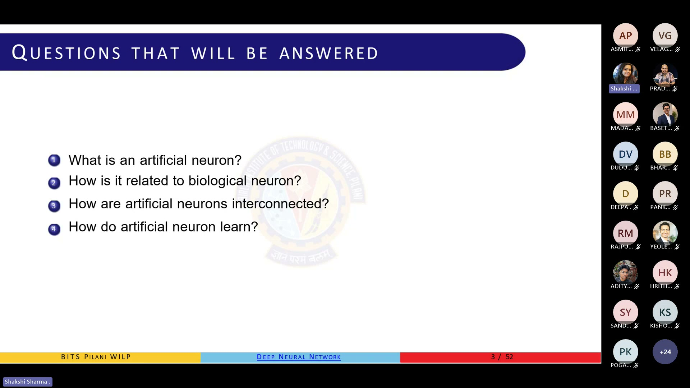
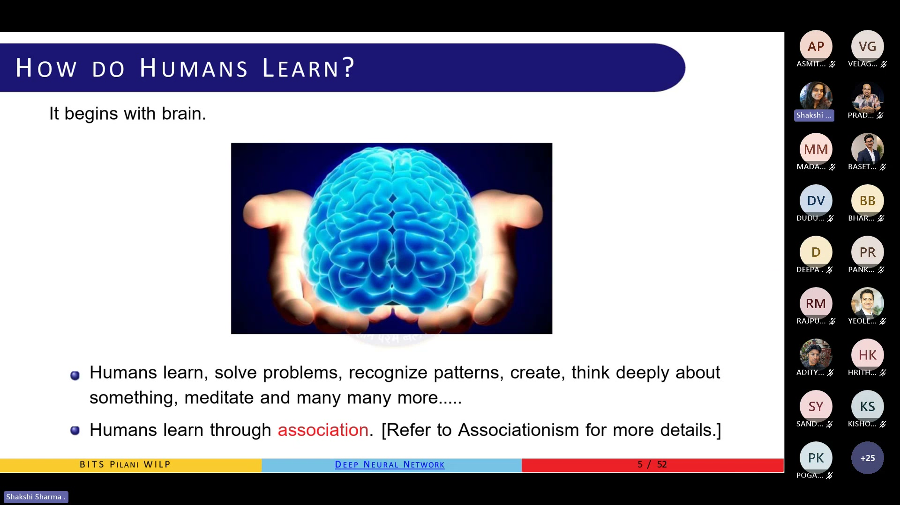
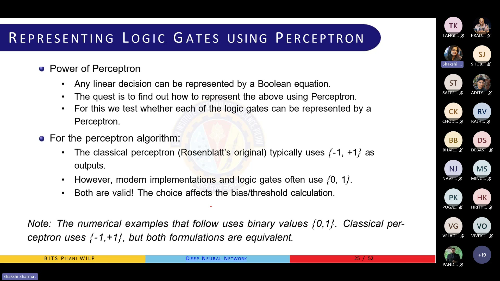

# Module 2: Artificial Neuron and Perceptron

**Course**: AIML ZG511 — Deep Neural Networks  
**Prescribed References**: Zhang et al. (T1, Ch 2); Goodfellow et al. (R1, Ch 1 & Ch 6)  
**Primary Teacher Followed**: Prof. Shakshi Sharma (Session 2: 2026-08-01 & Session 3: 2026-08-08)

---

## 1. Biological Inspiration vs Artificial Neuron

Artificial neural networks draw conceptual inspiration from neurobiology, formalized through the **connectionism model**: cognitive phenomena emerge from the interconnected network of simple, uniform processing units.

*Figure 2.1: Structural comparison between a biological motor neuron and an artificial processing unit (Prof. Shakshi Sharma Lecture 2).*

### Detailed Biological vs Artificial Mapping:

| Biological Neuron Component | Artificial Neuron Equivalent | Mathematical Role |
| :--- | :--- | :--- |
| **Dendrites** | Input features $\mathbf{x} = [x_1, x_2, \dots, x_d]^T$ | Receptive channels carrying external input signals |
| **Synapses (Synaptic Cleft)** | Connection Weights $\mathbf{w} = [w_1, w_2, \dots, w_d]^T$ | Synaptic strengths modulating signal intensity (excitatory $>0$, inhibitory $<0$) |
| **Soma (Cell Body)** | Linear Combiner / Net Input $z = \sum_{j=1}^d w_j x_j + b$ | Algebraic accumulation of inputs shifted by intrinsic bias threshold $b$ |
| **Axon Hillock / Threshold**| Activation Function $g(z)$ | Non-linear thresholding determining whether the neuron fires |
| **Axon & Axon Terminals** | Output signal $\hat{y} = g(z)$ | Propagation of the output activation to downstream neurons |

---

## 2. The Perceptron Architecture (Rosenblatt, 1958)

The **Perceptron**, introduced by Frank Rosenblatt at Cornell Aeronautical Laboratory in 1958, represents the first mathematically rigorous learning algorithm for binary classification.

*Figure 2.2: Perceptron architecture and hyperplane decision boundary in feature space (Prof. Shakshi Sharma Lecture 2).*

### 2.1 Mathematical Formulation
Given an input vector $\mathbf{x} = [x_1, x_2, \dots, x_d]^T \in \mathbb{R}^d$, synaptic weights $\mathbf{w} = [w_1, w_2, \dots, w_d]^T \in \mathbb{R}^d$, and scalar bias $b \in \mathbb{R}$:
1. **Net Input (Affine Sum)**:
   $$z = \mathbf{w}^T \mathbf{x} + b = \sum_{j=1}^d w_j x_j + b$$
2. **Heaviside Step Activation Function**:
   $$g(z) = \begin{cases} 1, & \text{if } z \ge 0 \\ 0, & \text{if } z < 0 \end{cases}$$
3. **Decision Hyperplane**:
   $$\mathbf{w}^T \mathbf{x} + b = 0$$
The hyperplane partitions $\mathbb{R}^d$ into two half-spaces: points where $\mathbf{w}^T \mathbf{x} + b \ge 0$ predict class 1, and points where $\mathbf{w}^T \mathbf{x} + b < 0$ predict class 0. The weight vector $\mathbf{w}$ is orthogonal to the decision boundary.

---

## 3. Representation of Boolean Logic Gates

A single perceptron can represent linearly separable Boolean logic functions:

### 3.1 Two-Input AND Gate
Truth table: $x_1, x_2 \in \{0, 1\}$, target $y = x_1 \land x_2$.
- $x_1=0, x_2=0 \implies w_1(0) + w_2(0) + b < 0 \implies b < 0$
- $x_1=0, x_2=1 \implies w_1(0) + w_2(1) + b < 0 \implies w_2 + b < 0$
- $x_1=1, x_2=0 \implies w_1(1) + w_2(0) + b < 0 \implies w_1 + b < 0$
- $x_1=1, x_2=1 \implies w_1(1) + w_2(1) + b \ge 0 \implies w_1 + w_2 + b \ge 0$

**Valid Parameter Solution**:
Let $w_1 = 1.0$, $w_2 = 1.0$, $b = -1.5$.
- $(0, 0) \implies -1.5 < 0 \implies 0$ (Correct)
- $(0, 1) \implies -0.5 < 0 \implies 0$ (Correct)
- $(1, 0) \implies -0.5 < 0 \implies 0$ (Correct)
- $(1, 1) \implies 0.5 \ge 0 \implies 1$ (Correct)

### 3.2 Two-Input OR Gate
Truth table: $y = x_1 \lor x_2$.
**Valid Parameter Solution**:
Let $w_1 = 1.0$, $w_2 = 1.0$, $b = -0.5$.
- $(0, 0) \implies -0.5 < 0 \implies 0$
- $(0, 1) \implies +0.5 \ge 0 \implies 1$
- $(1, 0) \implies +0.5 \ge 0 \implies 1$
- $(1, 1) \implies +1.5 \ge 0 \implies 1$

### 3.3 One-Input NOT Gate
Truth table: $x_1=0 \implies y=1$; $x_1=1 \implies y=0$.
- $w_1(0) + b \ge 0 \implies b \ge 0$
- $w_1(1) + b < 0 \implies w_1 + b < 0 \implies w_1 < -b$
**Valid Solution**: $w_1 = -1.0, b = 0.5$.

---

## 4. The Perceptron Learning Algorithm (PLA)

The PLA iteratively adjusts parameters whenever a training instance is misclassified.

### 4.1 Update Rules
For learning rate $\eta \in (0, 1]$ and sample $(\mathbf{x}^{(i)}, y^{(i)})$ with prediction $\hat{y}^{(i)} = g(\mathbf{w}^T \mathbf{x}^{(i)} + b)$:
$$\mathbf{w}^{(t+1)} = \mathbf{w}^{(t)} + \eta \left( y^{(i)} - \hat{y}^{(i)} \right) \mathbf{x}^{(i)}$$
$$b^{(t+1)} = b^{(t)} + \eta \left( y^{(i)} - \hat{y}^{(i)} \right)$$

Notice that:
- If $y^{(i)} = \hat{y}^{(i)}$ (correct classification), error $e = 0 \implies$ **no update**.
- If $y^{(i)} = 1, \hat{y}^{(i)} = 0$ (false negative), $e = +1 \implies \mathbf{w} \leftarrow \mathbf{w} + \eta \mathbf{x}^{(i)}$ (rotates weight vector toward $\mathbf{x}^{(i)}$).
- If $y^{(i)} = 0, \hat{y}^{(i)} = 1$ (false positive), $e = -1 \implies \mathbf{w} \leftarrow \mathbf{w} - \eta \mathbf{x}^{(i)}$ (rotates weight vector away from $\mathbf{x}^{(i)}$).

### 4.2 Novikoff's Perceptron Convergence Theorem (1962)
If the training dataset $\mathcal{D}$ is **linearly separable** with geometric margin $\gamma > 0$ (such that $y^{(i)}(\mathbf{w}^{*T}\mathbf{x}^{(i)}) \ge \gamma$ for optimal unit vector $\|\mathbf{w}^*\|=1$) and bounded input norm $\|\mathbf{x}^{(i)}\| \le R$, then the Perceptron Learning Algorithm converges to a separating hyperplane after at most:
$$k \le \left( \frac{R}{\gamma} \right)^2$$
weight updates. If the data is **not linearly separable**, the algorithm will never terminate, oscillating indefinitely.

---

## 5. The XOR Problem & The First AI Winter

In 1969, Marvin Minsky and Seymour Papert published *Perceptrons*, demonstrating the fundamental computational limitation of single-layer perceptrons: they cannot represent non-linearly separable functions such as the exclusive-OR (XOR) logic gate.

*Figure 2.3: Geometric failure of single-layer linear separation for the XOR truth table (Prof. Shakshi Sharma Lecture 3).*

### 5.1 Algebraic Impossibility Proof
For XOR:
1. $(0, 0) \to 0 \implies b < 0$
2. $(1, 1) \to 0 \implies w_1 + w_2 + b < 0$
3. $(0, 1) \to 1 \implies w_2 + b \ge 0$
4. $(1, 0) \to 1 \implies w_1 + b \ge 0$

Summing inequalities (3) and (4):
$$(w_1 + b) + (w_2 + b) \ge 0 \implies w_1 + w_2 + 2b \ge 0$$
Using (1) where $b < 0$:
$$w_1 + w_2 + b > w_1 + w_2 + 2b \ge 0 \implies w_1 + w_2 + b > 0$$
This directly contradicts inequality (2) ($w_1 + w_2 + b < 0$). Thus, **no linear hyperplane exists** that separates XOR in two dimensions.

### 5.2 Resolution: Multi-Layer Perceptrons (MLP)
The XOR problem is resolved by introducing an intermediate **hidden layer**:
$$\text{XOR}(x_1, x_2) = (x_1 \lor x_2) \land \neg(x_1 \land x_2)$$
A hidden layer projects the 2D input space into an intermediate representation space where the classes become linearly separable.

---

## 6. Summary Checklist for Examination

- [x] Biological vs Artificial neuron table (Dendrite, Synapse, Soma, Axon).
- [x] Perceptron equations: net input $z$, Heaviside activation, decision rule.
- [x] Derivation of AND, OR, NOT parameters via inequality systems.
- [x] Perceptron Learning Algorithm update equations and convergence conditions.
- [x] Rigorous mathematical proof of XOR non-separability.
