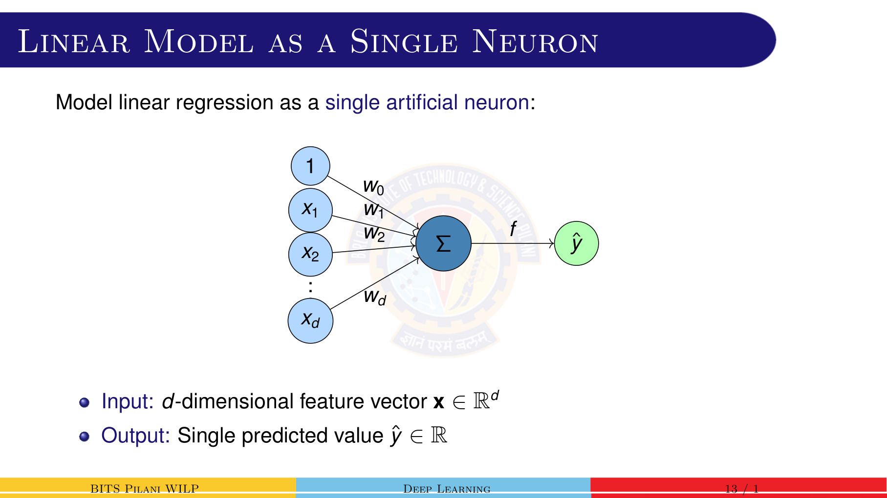

# Module 3: Linear Neural Networks for Regression

**Course**: AIML ZG511 — Deep Neural Networks  
**Prescribed References**: Zhang et al. (T1, Ch 3 & Ch 12); Goodfellow et al. (R1, Ch 5)  
**Syllabus module**: **M03** — Linear Neural Networks for Regression (`module_map.yaml`)  
**Canonical video**: `Videos/Lecture_04_Linear_Regression_and_Gradient_Descent.mp4`  
**Exam Reference**: Prof. Mithun Ghosh Question Paper (Q12, Q13, Q14, Q15, Q16, Q17)

---

## 1. Problem Formulation: Regression

Regression addresses supervised learning tasks where the target variable is a continuous real-valued scalar or vector: $y \in \mathbb{R}$.
- **Typical Questions**: "How much?", "How many?", "What price?", "What duration?"
- **Canonical Examples**: Automobile fuel efficiency prediction (Auto MPG), residential property valuation, temperature forecasting.

---

## 2. Single Neuron Linear Regression Model

A single artificial neuron without non-linear hidden layers implements multivariate linear regression.

*Figure 3.1: Single neuron computational graph for linear regression with identity activation and scalar bias (Slide 13, DNN_M3_Linear NN Regression (1).pdf, Prof. Shakshi Sharma Lecture 4).*

### 2.1 Mathematical Architecture
For feature vector $\mathbf{x} = [x_1, x_2, \dots, x_d]^T \in \mathbb{R}^d$, weight vector $\mathbf{w} = [w_1, w_2, \dots, w_d]^T \in \mathbb{R}^d$, and scalar bias $b \in \mathbb{R}$:
1. **Net Input / Affine Combination**:
   $$z = \mathbf{w}^T \mathbf{x} + b = \sum_{j=1}^d w_j x_j + b$$
2. **Identity Activation Function**:
   $$g(z) = z \implies \hat{y} = g(z) = \mathbf{w}^T \mathbf{x} + b$$
   *Properties of Identity Activation*:
   - Unbounded range: $(-\infty, +\infty)$, preserving the full continuous output spectrum.
   - Constant derivative: $g'(z) = 1$, ensuring uniform gradient flow without saturation.
   - Linear scale preservation.

3. **Matrix / Vectorized Formulation**:
   For a dataset of $N$ observations arranged into design matrix $\mathbf{X} \in \mathbb{R}^{N \times d}$ and target vector $\mathbf{y} \in \mathbb{R}^N$:
   $$\hat{\mathbf{y}} = \mathbf{X} \mathbf{w} + b \mathbf{1}_N$$
   Absorbing bias into weight vector $\tilde{\mathbf{w}} = [b, w_1, \dots, w_d]^T$ with design matrix $\tilde{\mathbf{X}} = [\mathbf{1}_N, \mathbf{X}]$:
   $$\hat{\mathbf{y}} = \tilde{\mathbf{X}} \tilde{\mathbf{w}}$$

---

## 3. Loss Function: Mean Squared Error (MSE)

For an individual sample $i$, the squared loss is defined as:
$$\ell^{(i)}(\mathbf{w}, b) = \frac{1}{2} \left( \hat{y}^{(i)} - y^{(i)} \right)^2 = \frac{1}{2} \left( \mathbf{w}^T \mathbf{x}^{(i)} + b - y^{(i)} \right)^2$$
*(The factor of $\frac{1}{2}$ simplifies calculus by cancelling the exponent 2 during differentiation).*

Over the entire dataset of $N$ instances, the empirical risk is the **Mean Squared Error (MSE)**:
$$J(\mathbf{w}, b) = \frac{1}{N} \sum_{i=1}^N \ell^{(i)}(\mathbf{w}, b) = \frac{1}{2N} \|\mathbf{X}\mathbf{w} + b\mathbf{1} - \mathbf{y}\|_2^2$$

### Why Squared Error?
1. **Maximum Likelihood Justification**: Assuming target values are corrupted by zero-mean additive Gaussian noise $y = f(\mathbf{x}) + \epsilon$, $\epsilon \sim \mathcal{N}(0, \sigma^2)$, minimizing squared error is mathematically equivalent to maximizing log-likelihood.
2. **Strict Convexity**: $J(\mathbf{w}, b)$ has a positive semi-definite Hessian (quadratic bowl), guaranteeing that any local minimum is a global minimum.
3. **Smooth Differentiability**: Continuously differentiable everywhere with linear gradients.

---

## 4. Analytical Solution: Normal Equations

Setting the gradient $\nabla_{\tilde{\mathbf{w}}} J(\tilde{\mathbf{w}}) = \mathbf{0}$:
$$\nabla_{\tilde{\mathbf{w}}} \left( \frac{1}{2N} \|\tilde{\mathbf{X}}\tilde{\mathbf{w}} - \mathbf{y}\|_2^2 \right) = \frac{1}{N} \tilde{\mathbf{X}}^T (\tilde{\mathbf{X}}\tilde{\mathbf{w}} - \mathbf{y}) = \mathbf{0}$$
$$\tilde{\mathbf{X}}^T \tilde{\mathbf{X}} \tilde{\mathbf{w}} = \tilde{\mathbf{X}}^T \mathbf{y}$$
$$\tilde{\mathbf{w}}^* = (\tilde{\mathbf{X}}^T \tilde{\mathbf{X}})^{-1} \tilde{\mathbf{X}}^T \mathbf{y}$$
*Limitation*: Inverting $(\tilde{\mathbf{X}}^T \tilde{\mathbf{X}}) \in \mathbb{R}^{(d+1) \times (d+1)}$ requires $\mathcal{O}(d^3)$ computational complexity, becoming computationally intractable when $d > 10^5$. Hence, iterative gradient descent is required.

---

## 5. Batch Gradient Descent (BGD) for Linear Regression

Batch Gradient Descent computes the exact gradient using all $N$ training examples per step.

### 5.1 Gradient Derivations
$$\frac{\partial J}{\partial \mathbf{w}} = \frac{1}{N} \sum_{i=1}^N (\hat{y}^{(i)} - y^{(i)}) \mathbf{x}^{(i)} = \frac{1}{N} \mathbf{X}^T (\hat{\mathbf{y}} - \mathbf{y})$$
$$\frac{\partial J}{\partial b} = \frac{1}{N} \sum_{i=1}^N (\hat{y}^{(i)} - y^{(i)}) = \frac{1}{N} \mathbf{1}_N^T (\hat{\mathbf{y}} - \mathbf{y})$$

### 5.2 Parameter Update Rules
$$\mathbf{w}^{(t+1)} = \mathbf{w}^{(t)} - \eta \frac{1}{N} \mathbf{X}^T (\hat{\mathbf{y}} - \mathbf{y})$$
$$b^{(t+1)} = b^{(t)} - \eta \frac{1}{N} \sum_{i=1}^N (\hat{y}^{(i)} - y^{(i)})$$
where $\eta > 0$ is the learning rate hyperparameter.

### 5.3 Dynamics of Learning Rate $\eta$
- **Too small ($\eta \ll \eta_{opt}$)**: Extremely slow convergence requiring thousands of iterations.
- **Appropriate**: Monotonically decreasing loss curve converging smoothly to the global minimum.
- **Too large**: Oscillations across the valley; may overshoot and diverge to $\infty$.

---

## 6. Model Evaluation Metrics for Regression

| Metric | Mathematical Formula | Interpretation & Key Characteristics |
| :--- | :--- | :--- |
| **MSE** | $\frac{1}{N}\sum_{i=1}^N (y_i - \hat{y}_i)^2$ | Heavily penalizes large outlier errors due to quadratic squaring |
| **RMSE** | $\sqrt{\frac{1}{N}\sum_{i=1}^N (y_i - \hat{y}_i)^2}$ | Returns error to the original target units ($mpg$, \$), intuitive scale |
| **MAE** | $\frac{1}{N}\sum_{i=1}^N \|y_i - \hat{y}_i\|$ | Robust to extreme outliers; linear penalty across error spectrum |
| **$R^2$ Score** | $1 - \frac{\sum_{i=1}^N (y_i - \hat{y}_i)^2}{\sum_{i=1}^N (y_i - \bar{y})^2}$ | Coefficient of determination: fraction of variance explained by model |

### Interpretation of $R^2$:
- $R^2 = 1.0$: Perfect predictions (residual sum of squares $= 0$).
- $R^2 = 0.0$: Model performs no better than predicting the mean baseline $\bar{y}$.
- $R^2 < 0.0$: Model performs **worse** than predicting the sample mean (severely misspecified).

---

## 7. Worked Numerical Example: BITS Exam Classic (Exam Q16)

**Problem Statement (6 Marks)**:  
A tiny dataset for predicting house price from size is:
- $(x=1, y=2)$
- $(x=2, y=4)$
- $(x=3, y=5)$

Using the model $\hat{y} = w_0 + w_1 x$ with initial weights $w^{(0)} = [0, 0]^T$, learning rate $\eta = 0.1$, and loss $J(w) = \frac{1}{2N} \sum_{i=1}^N (\hat{y}^{(i)} - y^{(i)})^2$:
Perform **ONE iteration** of batch gradient descent: compute the initial loss, the gradient, the updated weights $w^{(1)}$, and the new loss. Comment on the progress.

### Step-by-Step Solution:
Here $N = 3$. At $t=0$, $w_0^{(0)} = 0, w_1^{(0)} = 0$.

1. **Compute Initial Predictions**:
   - $\hat{y}^{(1)} = 0 + 0(1) = 0$
   - $\hat{y}^{(2)} = 0 + 0(2) = 0$
   - $\hat{y}^{(3)} = 0 + 0(3) = 0$

2. **Compute Residual Errors ($e_i = \hat{y}^{(i)} - y^{(i)}$)**:
   - $e_1 = 0 - 2 = -2$
   - $e_2 = 0 - 4 = -4$
   - $e_3 = 0 - 5 = -5$

3. **Compute Initial Loss $J(0, 0)$**:
   $$J^{(0)} = \frac{1}{2(3)} [(-2)^2 + (-4)^2 + (-5)^2] = \frac{1}{6}[4 + 16 + 25] = \frac{45}{6} = 7.50$$

4. **Compute Gradients**:
   $$\frac{\partial J}{\partial w_0} = \frac{1}{N} \sum_{i=1}^3 e_i = \frac{-2 + (-4) + (-5)}{3} = \frac{-11}{3} \approx -3.6667$$
   $$\frac{\partial J}{\partial w_1} = \frac{1}{N} \sum_{i=1}^3 e_i x_i = \frac{(-2)(1) + (-4)(2) + (-5)(3)}{3} = \frac{-2 - 8 - 15}{3} = \frac{-25}{3} \approx -8.3333$$

5. **Update Weights**:
   $$w_0^{(1)} = w_0^{(0)} - \eta \frac{\partial J}{\partial w_0} = 0 - 0.1(-3.6667) = +0.3667$$
   $$w_1^{(1)} = w_1^{(0)} - \eta \frac{\partial J}{\partial w_1} = 0 - 0.1(-8.3333) = +0.8333$$

6. **Compute New Predictions & Errors with $w^{(1)}$**:
   - $\hat{y}^{(1)} = 0.3667 + 0.8333(1) = 1.2000 \implies e_1 = 1.2000 - 2 = -0.8000$
   - $\hat{y}^{(2)} = 0.3667 + 0.8333(2) = 2.0333 \implies e_2 = 2.0333 - 4 = -1.9667$
   - $\hat{y}^{(3)} = 0.3667 + 0.8333(3) = 2.8666 \implies e_3 = 2.8666 - 5 = -2.1334$

7. **Compute New Loss $J(w^{(1)})$**:
   $$J^{(1)} = \frac{1}{2(3)} [(-0.8000)^2 + (-1.9667)^2 + (-2.1334)^2] = \frac{1}{6}[0.6400 + 3.8679 + 4.5514] = \frac{9.0593}{6} \approx 1.5099$$

**Comment on Progress**:
The loss dropped drastically from $7.50$ down to $1.51$ in a single gradient descent step (an 79.9% loss reduction), confirming proper convergence dynamics toward the optimal line ($y \approx 0.67 + 1.5x$).

---

## 8. Summary Checklist for Examination

- [x] Mathematical architecture of a single neuron regression model with identity activation.
- [x] Closed-form derivation of Normal Equations: $\mathbf{w}^* = (\mathbf{X}^T \mathbf{X})^{-1} \mathbf{X}^T \mathbf{y}$ and why gradient descent is required when $d$ is large.
- [x] Mean Squared Error loss definition, convexity properties, and Gaussian maximum likelihood equivalence.
- [x] Batch gradient descent update equations with gradient formulas.
- [x] Complete 6-mark solved numerical calculation (Exam Q16) with all intermediate residuals and loss values.
- [x] Evaluation metrics: MSE, RMSE, MAE, and $R^2$ score interpretation.
