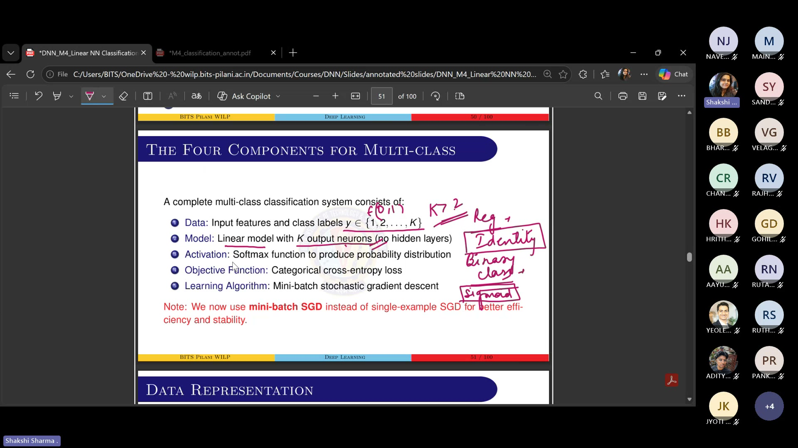

# Module 4: Linear Neural Networks for Classification

**Course**: AIML ZG511 — Deep Neural Networks  
**Prescribed References**: Zhang et al. (T1, Ch 4 & Ch 12); Goodfellow et al. (R1, Ch 6)  
**Primary Teacher Followed**: Prof. Shakshi Sharma (Session 5: 2026-08-22)

---

## 1. Problem Formulation: Classification

Classification assigns an input vector $\mathbf{x} \in \mathbb{R}^d$ to one of $C$ discrete categories:
- **Binary Classification** ($C=2$): Output $y \in \{0, 1\}$ (e.g., Breast Cancer diagnosis: Benign vs Malignant).
- **Multi-class Classification** ($C > 2$): Output $y \in \{1, 2, \dots, C\}$ (e.g., Iris species: Setosa, Versicolor, Virginica).

---

## 2. Binary Classification with Single Neuron & Sigmoid

*Figure 4.1: Logistic neuron with Sigmoid activation function and Bernoulli cross-entropy loss (Prof. Shakshi Sharma Lecture 5).*

### 2.1 The Sigmoid (Logistic) Activation Function
$$\sigma(z) = \frac{1}{1 + e^{-z}}$$
- **Range**: $(0, 1)$, naturally interpreted as the posterior class probability:
  $$P(y = 1 \mid \mathbf{x}) = \hat{y} = \sigma(\mathbf{w}^T \mathbf{x} + b)$$
  $$P(y = 0 \mid \mathbf{x}) = 1 - \hat{y} = 1 - \sigma(\mathbf{w}^T \mathbf{x} + b)$$
- **Symmetry**: $\sigma(-z) = 1 - \sigma(z)$.
- **Derivative**:
  $$\frac{d\sigma(z)}{dz} = \sigma(z)(1 - \sigma(z))$$

### 2.2 Binary Cross-Entropy Loss (Log Loss)
For Bernoulli likelihood $P(y \mid \mathbf{x}) = \hat{y}^y (1 - \hat{y})^{1-y}$, the negative log-likelihood for sample $i$ is:
$$\ell(y^{(i)}, \hat{y}^{(i)}) = - \left[ y^{(i)} \ln \hat{y}^{(i)} + (1 - y^{(i)}) \ln (1 - \hat{y}^{(i)}) \right]$$
Total dataset empirical loss:
$$J(\mathbf{w}, b) = - \frac{1}{N} \sum_{i=1}^N \left[ y^{(i)} \ln \hat{y}^{(i)} + (1 - y^{(i)}) \ln (1 - \hat{y}^{(i)}) \right]$$

### 2.3 Gradient Derivation (The Elegance of Cross-Entropy)
By chain rule:
$$\frac{\partial \ell}{\partial w_j} = \frac{\partial \ell}{\partial \hat{y}} \cdot \frac{\partial \hat{y}}{\partial z} \cdot \frac{\partial z}{\partial w_j}$$
1. $\frac{\partial \ell}{\partial \hat{y}} = -\left( \frac{y}{\hat{y}} - \frac{1-y}{1-\hat{y}} \right) = \frac{\hat{y} - y}{\hat{y}(1 - \hat{y})}$
2. $\frac{\partial \hat{y}}{\partial z} = \sigma'(z) = \hat{y}(1 - \hat{y})$
3. $\frac{\partial z}{\partial w_j} = x_j$

Multiplying together:
$$\frac{\partial \ell}{\partial w_j} = \left( \frac{\hat{y} - y}{\hat{y}(1 - \hat{y})} \right) \cdot [\hat{y}(1 - \hat{y})] \cdot x_j = (\hat{y} - y) x_j$$
$$\nabla_{\mathbf{w}} J = \frac{1}{N} \sum_{i=1}^N (\hat{y}^{(i)} - y^{(i)}) \mathbf{x}^{(i)}$$
*Crucial Observation*: The non-linear saturation terms $\hat{y}(1 - \hat{y})$ cancel out completely. The gradient is directly proportional to prediction error $(\hat{y} - y)$, preventing gradient vanishing for confident wrong predictions!

---

## 3. Multi-Class Classification with Softmax

*Figure 4.2: Multi-neuron output layer with Softmax normalization and categorical cross-entropy (Prof. Shakshi Sharma Lecture 5).*

When distinguishing between $C > 2$ classes, the output layer requires $C$ neurons:
$$\mathbf{z} = \mathbf{W} \mathbf{x} + \mathbf{b} \quad (\mathbf{W} \in \mathbb{R}^{C \times d}, \mathbf{b} \in \mathbb{R}^C)$$
where $z_c$ is the unnormalized logit score for class $c$.

### 3.1 The Softmax Normalization Operator
$$\hat{y}_c = \text{softmax}(\mathbf{z})_c = \frac{e^{z_c}}{\sum_{k=1}^C e^{z_k}} \quad \text{for } c = 1, \dots, C$$
*Fundamental Properties*:
1. Strict positivity: $\hat{y}_c > 0$.
2. Conservation of probability: $\sum_{c=1}^C \hat{y}_c = 1$.
3. Shift invariance: $\text{softmax}(\mathbf{z} - c\mathbf{1}) = \text{softmax}(\mathbf{z})$ (critical for numerical stability against float overflow).

### 3.2 Categorical Cross-Entropy Loss
Representing target label $y$ as one-hot encoded vector $\mathbf{y} \in \{0, 1\}^C$ ($y_c = 1$ if true class is $c$, else $0$):
$$\ell(\mathbf{y}, \hat{\mathbf{y}}) = - \sum_{c=1}^C y_c \ln \hat{y}_c = - \ln \hat{y}_{\text{true}}$$

### 3.3 Gradient with Respect to Logits
$$\frac{\partial \ell}{\partial z_k} = \hat{y}_k - y_k$$
In vector notation:
$$\nabla_{\mathbf{z}} \ell = \hat{\mathbf{y}} - \mathbf{y}$$

---

## 4. Optimization: Comparison of Gradient Descent Variants

| Algorithm | Batch Size Per Step | Computational Complexity per Update | Memory Requirement | Convergence Behavior |
| :--- | :--- | :--- | :--- | :--- |
| **Batch GD (BGD)** | $N$ (Full dataset) | $\mathcal{O}(N \cdot d)$ (Very High) | Large (Requires entire dataset) | Smooth, monotonic, slow per step |
| **Stochastic GD (SGD)**| $1$ (Single sample) | $\mathcal{O}(d)$ (Minimal) | Minimal (1 sample in RAM) | High stochastic noise, escapes saddles |
| **Mini-batch SGD** | $B$ (typically 32 to 512) | $\mathcal{O}(B \cdot d)$ (Balanced) | Moderate (Optimized for GPU SIMD) | Smooth convergence with GPU throughput |

---

## 5. Summary Checklist for Examination

- [x] Sigmoid activation formula, derivation of derivative $\sigma'(z) = \sigma(z)(1-\sigma(z))$.
- [x] Binary cross-entropy loss formulation and step-by-step proof that $\frac{\partial \ell}{\partial \mathbf{w}} = (\hat{y} - y)\mathbf{x}$.
- [x] Softmax definition and justification for multi-class classification.
- [x] Categorical cross-entropy formulation and logit gradient $\nabla_\mathbf{z} \ell = \hat{\mathbf{y}} - \mathbf{y}$.
- [x] Comparison table between BGD, SGD, and Mini-batch SGD.
