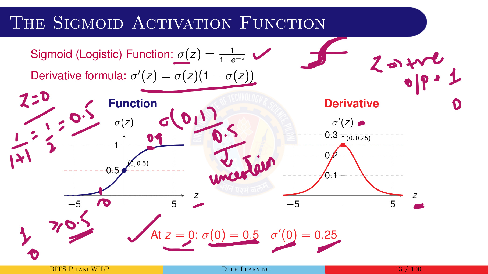

# Module 4: Linear Neural Networks for Classification

**Course**: AIML ZG511 — Deep Neural Networks  
**Prescribed References**: Zhang et al. (T1, Ch 4 & Ch 12); Goodfellow et al. (R1, Ch 6)  
**Primary Teacher Followed**: Prof. Shakshi Sharma (Session 5: 2026-08-22, Recording `Shakshi -- 6.mp4`)  
**Exam Reference**: Prof. Mithun Ghosh Question Paper (Q18, Q19, Q20, Q21, Q22, Q23, Q24, Q25, Q26)

---

## 1. Problem Formulation: Classification

Classification assigns an input vector $\mathbf{x} \in \mathbb{R}^d$ to one of $C$ discrete categories:
- **Binary Classification** ($C=2$): Output $y \in \{0, 1\}$ (e.g., Breast Cancer diagnosis: Benign vs Malignant; loan default prediction).
- **Multi-class Classification** ($C > 2$): Output $y \in \{1, 2, \dots, C\}$ (e.g., Iris species: Setosa, Versicolor, Virginica; handwritten digit recognition: 0–9).

### Why Linear Regression Fails for Classification
1. **Unbounded Outputs**: Linear regression produces unbounded predictions $\hat{y} \in (-\infty, +\infty)$, violating probability axioms $P \in [0, 1]$.
2. **Sensitivity to Extreme Outliers**: A data point lying far from the decision boundary pulls the regression hyperplane, shifting the zero-crossing and causing misclassifications of nearby points.
3. **Arbitrary Numerical Coding in Multi-Class**: Imposing metric distances (e.g., $1 = \text{Cat}, 2 = \text{Dog}, 3 = \text{Car}$) falsely implies that Car is "closer" to Dog than to Cat.

---

## 2. Binary Classification with Single Neuron & Sigmoid

*Figure 4.1: The Sigmoid activation function $\sigma(z) = \frac{1}{1+e^{-z}}$ mapping real-valued inputs to calibrated posterior class probabilities with its derivative $\sigma'(z) = \sigma(z)(1-\sigma(z))$ (Slide 13, DNN_M4_Linear NN Classification.pdf, Prof. Shakshi Sharma Lecture 5).*

### 2.1 The Sigmoid (Logistic) Activation Function
$$\sigma(z) = \frac{1}{1 + e^{-z}}$$
- **Range**: $(0, 1)$, naturally interpreted as the posterior class probability:
  $$P(y = 1 \mid \mathbf{x}) = \hat{y} = \sigma(\mathbf{w}^T \mathbf{x} + b)$$
  $$P(y = 0 \mid \mathbf{x}) = 1 - \hat{y} = 1 - \sigma(\mathbf{w}^T \mathbf{x} + b)$$
- **Symmetry**: $\sigma(-z) = 1 - \sigma(z)$.
- **Derivative**:
  $$\frac{d\sigma(z)}{dz} = \frac{e^{-z}}{(1 + e^{-z})^2} = \left(\frac{1}{1 + e^{-z}}\right) \left(\frac{e^{-z}}{1 + e^{-z}}\right) = \sigma(z)(1 - \sigma(z))$$

### 2.2 Binary Cross-Entropy Loss (Log Loss)
For Bernoulli likelihood $P(y \mid \mathbf{x}) = \hat{y}^y (1 - \hat{y})^{1-y}$, the negative log-likelihood for sample $i$ is:
$$\ell(y^{(i)}, \hat{y}^{(i)}) = - \left[ y^{(i)} \ln \hat{y}^{(i)} + (1 - y^{(i)}) \ln (1 - \hat{y}^{(i)}) \right]$$
Total dataset empirical loss:
$$J(\mathbf{w}, b) = - \frac{1}{N} \sum_{i=1}^N \left[ y^{(i)} \ln \hat{y}^{(i)} + (1 - y^{(i)}) \ln (1 - \hat{y}^{(i)}) \right]$$

### 2.3 Gradient Derivation (The Elegance of Cross-Entropy)
By chain rule:
$$\frac{\partial \ell}{\partial w_j} = \frac{\partial \ell}{\partial \hat{y}} \cdot \frac{\partial \hat{y}}{\partial z} \cdot \frac{\partial z}{\partial w_j}$$
1. $\frac{\partial \ell}{\partial \hat{y}} = -\left( \frac{y}{\hat{y}} - \frac{1-y}{1-\hat{y}} \right) = \frac{\hat{y} - y}{\hat{y}(1 - \hat{y})}$
2. $\frac{\partial \hat{y}}{\partial z} = \sigma'(z) = \hat{y}(1 - \hat{y})$
3. $\frac{\partial z}{\partial w_j} = x_j$

Multiplying together:
$$\frac{\partial \ell}{\partial w_j} = \left( \frac{\hat{y} - y}{\hat{y}(1 - \hat{y})} \right) \cdot [\hat{y}(1 - \hat{y})] \cdot x_j = (\hat{y} - y) x_j$$
$$\nabla_{\mathbf{w}} J = \frac{1}{N} \sum_{i=1}^N (\hat{y}^{(i)} - y^{(i)}) \mathbf{x}^{(i)}$$
*Crucial Observation*: The non-linear saturation terms $\hat{y}(1 - \hat{y})$ cancel out completely. The gradient is directly proportional to prediction error $(\hat{y} - y)$, preventing gradient vanishing for confident wrong predictions!

---

## 3. Multi-Class Classification with Softmax

*Figure 4.2: Multi-class neural network architecture: $C$ output neurons with Softmax activation and categorical cross-entropy loss (Slide 55, DNN_M4_Linear NN Classification.pdf, Prof. Shakshi Sharma Lecture 5).*

When distinguishing between $C > 2$ classes, the output layer requires $C$ neurons:
$$\mathbf{z} = \mathbf{W} \mathbf{x} + \mathbf{b} \quad (\mathbf{W} \in \mathbb{R}^{C \times d}, \mathbf{b} \in \mathbb{R}^C)$$
where $z_c$ is the unnormalized logit score for class $c$.

### 3.1 The Softmax Normalization Operator
$$\hat{y}_c = \text{softmax}(\mathbf{z})_c = \frac{e^{z_c}}{\sum_{k=1}^C e^{z_k}} \quad \text{for } c = 1, \dots, C$$
*Fundamental Properties*:
1. Strict positivity: $\hat{y}_c > 0$.
2. Conservation of probability: $\sum_{c=1}^C \hat{y}_c = 1$.
3. Shift invariance: $\text{softmax}(\mathbf{z} - c\mathbf{1}) = \text{softmax}(\mathbf{z})$ (critical for numerical stability against floating-point overflow).

### 3.2 Categorical Cross-Entropy Loss
Representing target label $y$ as one-hot encoded vector $\mathbf{y} \in \{0, 1\}^C$ ($y_c = 1$ if true class is $c$, else $0$):
$$\ell(\mathbf{y}, \hat{\mathbf{y}}) = - \sum_{c=1}^C y_c \ln \hat{y}_c = - \ln \hat{y}_{\text{true}}$$

### 3.3 Gradient with Respect to Logits
$$\frac{\partial \ell}{\partial z_k} = \hat{y}_k - y_k$$
In vector notation:
$$\nabla_{\mathbf{z}} \ell = \hat{\mathbf{y}} - \mathbf{y}$$

---

## 4. Solved Examination Numerical: Logistic Regression SGD (Exam Q22)

**Problem Statement (6 Marks)**:  
A logistic regression model classifies pass/fail ($y \in \{0, 1\}$) from study hours $x$. Given a tiny dataset:
- Instance 1: $(x=1, y=0)$
- Instance 2: $(x=2, y=0)$
- Instance 3: $(x=4, y=1)$

Using model $\hat{y} = \sigma(w_0 + w_1 x)$ with initial weights $w_0^{(0)} = 0, w_1^{(0)} = 0$, and learning rate $\eta = 0.5$:  
Perform **TWO steps of Stochastic Gradient Descent (SGD)** presenting instances in order:
1. Sample $(x=1, y=0)$
2. Sample $(x=4, y=1)$  
Compute the prediction, loss, gradients, and updated weights after each step.

### Step-by-Step Solution:

#### Step 1: Present Sample $(x=1, y=0)$
- **Net Input**:
  $$z = w_0^{(0)} + w_1^{(0)}(1) = 0 + 0(1) = 0$$
- **Prediction**:
  $$\hat{y} = \sigma(0) = \frac{1}{1 + e^{-0}} = 0.5000$$
- **Binary Cross-Entropy Loss**:
  $$\ell_1 = -[0 \cdot \ln(0.5) + (1 - 0) \cdot \ln(1 - 0.5)] = -\ln(0.5) = \ln(2) \approx 0.6931$$
- **Prediction Error**:
  $$e_1 = \hat{y} - y = 0.5000 - 0 = +0.5000$$
- **Gradients**:
  $$\frac{\partial \ell}{\partial w_0} = (\hat{y} - y) \cdot 1 = 0.5000 \cdot 1 = 0.5000$$
  $$\frac{\partial \ell}{\partial w_1} = (\hat{y} - y) \cdot x = 0.5000 \cdot 1 = 0.5000$$
- **Weight Updates ($\eta = 0.5$)**:
  $$w_0^{(1)} = w_0^{(0)} - \eta \frac{\partial \ell}{\partial w_0} = 0 - 0.5(0.5000) = -0.2500$$
  $$w_1^{(1)} = w_1^{(0)} - \eta \frac{\partial \ell}{\partial w_1} = 0 - 0.5(0.5000) = -0.2500$$

Weights after Step 1: $w_0^{(1)} = -0.2500, w_1^{(1)} = -0.2500$.

---

#### Step 2: Present Sample $(x=4, y=1)$
- **Net Input**:
  $$z = w_0^{(1)} + w_1^{(1)}(4) = -0.2500 + (-0.2500)(4) = -0.2500 - 1.0000 = -1.2500$$
- **Prediction**:
  $$\hat{y} = \sigma(-1.2500) = \frac{1}{1 + e^{1.2500}} = \frac{1}{1 + 3.49034} = \frac{1}{4.49034} \approx 0.2227$$
- **Binary Cross-Entropy Loss**:
  $$\ell_2 = -[1 \cdot \ln(0.2227) + 0 \cdot \ln(1 - 0.2227)] = -\ln(0.2227) \approx 1.5019$$
- **Prediction Error**:
  $$e_2 = \hat{y} - y = 0.2227 - 1.0000 = -0.7773$$
- **Gradients**:
  $$\frac{\partial \ell}{\partial w_0} = (\hat{y} - y) \cdot 1 = -0.7773 \cdot 1 = -0.7773$$
  $$\frac{\partial \ell}{\partial w_1} = (\hat{y} - y) \cdot x = -0.7773 \cdot 4 = -3.1092$$
- **Weight Updates ($\eta = 0.5$)**:
  $$w_0^{(2)} = w_0^{(1)} - \eta \frac{\partial \ell}{\partial w_0} = -0.2500 - 0.5(-0.7773) = -0.2500 + 0.3887 = +0.1387$$
  $$w_1^{(2)} = w_1^{(1)} - \eta \frac{\partial \ell}{\partial w_1} = -0.2500 - 0.5(-3.1092) = -0.2500 + 1.5546 = +1.3046$$

### Final Summary Table:
| Step | Instance $(x, y)$ | Net Input $z$ | $\hat{y} = \sigma(z)$ | Loss $\ell$ | Error $(\hat{y}-y)$ | $\nabla_{w_0}$ | $\nabla_{w_1}$ | Updated $w_0$ | Updated $w_1$ |
| :---: | :---: | :---: | :---: | :---: | :---: | :---: | :---: | :---: | :---: |
| **0** | Initial | — | — | — | — | — | — | $0.0000$ | $0.0000$ |
| **1** | $(1, 0)$ | $0.0000$ | $0.5000$ | $0.6931$ | $+0.5000$ | $+0.5000$ | $+0.5000$ | $-0.2500$ | $-0.2500$ |
| **2** | $(4, 1)$ | $-1.2500$ | $0.2227$ | $1.5019$ | $-0.7773$ | $-0.7773$ | $-3.1092$ | **+0.1387** | **+1.3046** |

**Interpretation**: Notice how $w_1$ shifted from negative ($-0.2500$) to positive ($+1.3046$). Because instance $(4, 1)$ had high study hours and positive label, the large negative gradient correctly rewarded higher study hours with higher pass probability!

---

## 5. Summary Checklist for Examination

- [x] Sigmoid activation formula, derivation of derivative $\sigma'(z) = \sigma(z)(1-\sigma(z))$.
- [x] Binary cross-entropy loss formulation and step-by-step proof that $\frac{\partial \ell}{\partial \mathbf{w}} = (\hat{y} - y)\mathbf{x}$.
- [x] Softmax definition and mathematical properties (positivity, sum-to-one, shift invariance).
- [x] Categorical cross-entropy formulation and logit gradient $\nabla_\mathbf{z} \ell = \hat{\mathbf{y}} - \mathbf{y}$.
- [x] Complete 6-mark solved SGD numerical calculation (Exam Q22) with both steps and weight table.
- [x] Comparison table between BGD, SGD, and Mini-batch SGD.
