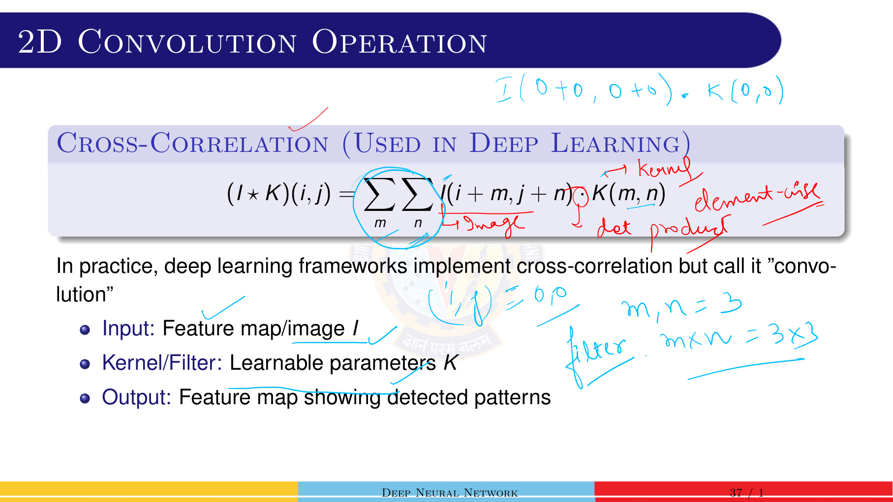
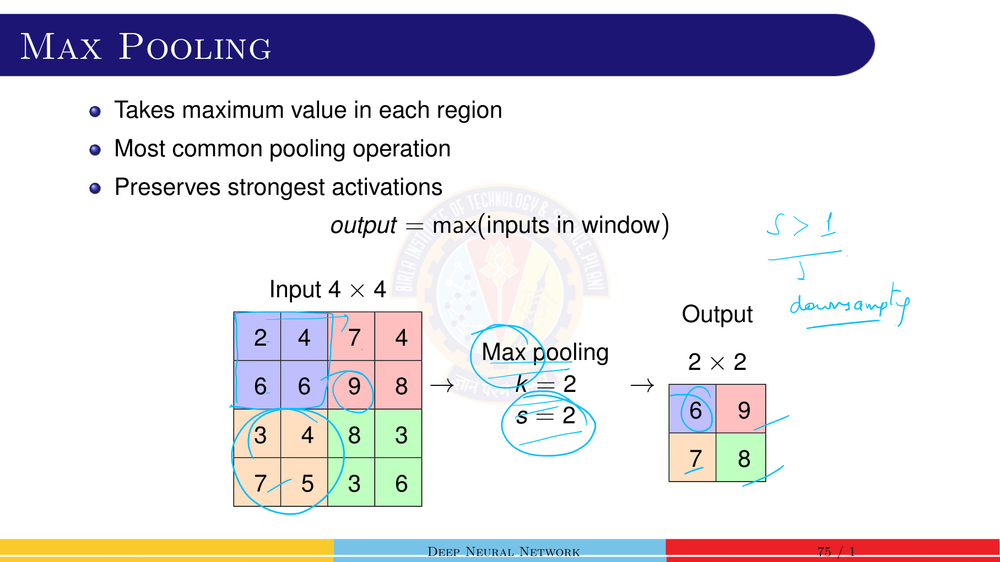

# Module 6: Convolutional Neural Networks (CNN)

**Course**: AIML ZG511 — Deep Neural Networks  
**Prescribed References**: Zhang et al. (T1, Ch 7 & Ch 8); Goodfellow et al. (R1, Ch 9); Companion: `DNN_M6_CNN_Numerical.pdf`  
**Primary Teacher Followed**: Prof. Shakshi Sharma (Session 7: 2026-09-05, Recording `Shakshi -- 8.mp4`)  
**Exam Reference**: Prof. Mithun Ghosh Question Paper (Q35, Q36, Q37, Q38, Q39, Q40, Q41, Q42, Q43)

---

## 1. Why Fully Connected Networks Fail on Images

When a multi-layer perceptron (MLP) is applied to high-resolution image data, three fundamental pathologies emerge:
1. **Parameter Explosion**: Flattening a modest $1000 \times 1000$ RGB image yields $3 \times 10^6$ input values. Connecting this to a single hidden layer of 1,000 neurons requires:
   $$\text{Parameters} = 3 \times 10^6 \times 1000 = 3 \times 10^9 \text{ weights (3 Billion)}$$
   This causes catastrophic overfitting and exceeds GPU memory limits.
2. **Destruction of 2D Spatial Geometry**: Flattening an image tensor into a 1D vector completely destroys the neighborhood topologies and spatial relationships between adjacent pixels.
3. **Lack of Translation Invariance / Equivariance**: In an MLP, an object appearing in the top-left corner activates entirely different weights than if the exact same object appeared in the bottom-right corner.

### The Three Guiding Principles of CNNs:
- **1. Locality (Local Receptive Fields)**: Neurons in early layers connect only to a small, spatially contiguous patch of the input tensor, exploiting the physical principle that nearby pixels are strongly correlated.
- **2. Weight Sharing (Stationarity)**: The same learned convolutional kernel slides across the entire image grid, reusing parameters to detect the same visual feature (e.g., vertical edge) anywhere it appears.
- **3. Translation Equivariance**: Shifting an input pattern shifts the output feature map by the identical displacement:
  $$f(g(x)) = g(f(x))$$

---

## 2. The 2D Discrete Convolution Operation

*Figure 6.1: Discrete 2D cross-correlation sliding window, element-wise multiplication, and feature map accumulation (Slide 37, DNN_M6_CNN.pdf, Prof. Shakshi Sharma Lecture 7).*

Given a single-channel 2D input $\mathbf{X} \in \mathbb{R}^{H \times W}$ and a 2D filter kernel $\mathbf{K} \in \mathbb{R}^{K_h \times K_w}$:
$$S(i, j) = (\mathbf{X} * \mathbf{K})(i, j) = \sum_{m=0}^{K_h - 1} \sum_{n=0}^{K_w - 1} X(i + m, j + n) \cdot K(m, n)$$
*(In deep learning libraries like PyTorch and TensorFlow, this operation is technically cross-correlation without spatial kernel flipping, conventionally termed convolution).*

### High vs Low Feature Map Activations:
- **High Positive Activation**: Indicates strong alignment between the local image patch and the pattern encoded in the filter kernel (e.g., an oriented edge or bright spot).
- **Zero / Negative Activation**: Indicates absence or inverse phase of the target pattern, subsequently zeroed out by ReLU activation.

---

## 3. Padding, Stride, and Output Dimension Formulas

*Figure 6.2: Max pooling spatial reduction and feature map downsampling preserving channel depth (Slide 79, DNN_M6_CNN.pdf, Prof. Shakshi Sharma Lecture 7).*

### 3.1 Master Spatial Dimension Formula
For an input of height $H_{in}$ and width $W_{in}$, kernel size $K_h \times K_w$, total padding $P_h, P_w$ (split evenly across borders), and stride $S_h, S_w$:
$$H_{out} = \left\lfloor \frac{H_{in} - K_h + 2P_h}{S_h} \right\rfloor + 1$$
$$W_{out} = \left\lfloor \frac{W_{in} - K_w + 2P_w}{S_w} \right\rfloor + 1$$

### 3.2 Types of Padding:
- **Valid Padding ($P = 0$)**: No zero-padding added. Spatial dimensions shrink: $H_{out} = H_{in} - K + 1$.
- **Same Padding**: Zero-padding added such that $H_{out} = H_{in}$ when stride $S = 1$:
  $$2P = K - 1 \implies P = \frac{K - 1}{2} \quad (\text{requires odd kernel size } K)$$
  *Example*: For $K = 3 \times 3$, Same padding requires $P = \frac{3-1}{2} = 1$ pixel of zeros on all sides. For $K = 5 \times 5$, $P = 2$.

---

## 4. Multi-Channel Convolutions, Parameter Counting & FLOPs

### 4.1 Multi-Channel Filtering (3D Tensor Operations)
In practical deep neural networks, inputs and intermediate feature maps have channel depth:
- **Input Tensor**: $\mathbf{X} \in \mathbb{R}^{C_{in} \times H_{in} \times W_{in}}$ (e.g., $C_{in} = 3$ for RGB images).
- To produce $C_{out}$ distinct output feature maps, we deploy $C_{out}$ independent 3D filter kernels. Each filter has shape $C_{in} \times K_h \times K_w$:
  $$\mathbf{W} \in \mathbb{R}^{C_{out} \times C_{in} \times K_h \times K_w}, \quad \mathbf{b} \in \mathbb{R}^{C_{out}}$$

### 4.2 Parameter Count Formula
$$\text{Parameters} = C_{out} \times (C_{in} \times K_h \times K_w + 1) = C_{out} \times C_{in} \times K_h \times K_w + C_{out}$$
*(The $+1$ per filter accounts for the learnable additive scalar bias).*

#### Concrete BITS Examination Calculations (Exam Q38):
1. **First Convolutional Layer**:
   - Input: $224 \times 224 \times 3$ ($C_{in} = 3$).
   - Kernels: $5 \times 5$, $C_{out} = 64$ filters.
   $$\text{Weights} = 64 \times (3 \times 5 \times 5) = 64 \times 75 = 4,800$$
   $$\text{Biases} = 64$$
   $$\text{Total Parameters} = 4,800 + 64 = \mathbf{4,864}$$
2. **Deeper Convolutional Layer**:
   - Input: $56 \times 56 \times 128$ ($C_{in} = 128$).
   - Kernels: $3 \times 3$, $C_{out} = 256$ filters.
   $$\text{Weights} = 256 \times (128 \times 3 \times 3) = 256 \times 1,152 = 294,912$$
   $$\text{Biases} = 256$$
   $$\text{Total Parameters} = 294,912 + 256 = \mathbf{295,168}$$
3. **Pooling Layer Parameters**:
   - A $2 \times 2$ max-pooling or average-pooling layer has **0 learnable parameters**, because pooling executes a fixed mathematical operation ($\max$ or mean) with no learned weights or biases.

### 4.3 Computational Complexity: Inference FLOPs
The number of Floating-Point Operations (Multiply-Accumulate as 2 FLOPs) is:
$$\text{FLOPs} = 2 \times H_{out} \times W_{out} \times (C_{in} \times K_h \times K_w) \times C_{out}$$

---

## 5. Receptive Field: Mathematical Formulation & Stacking Principle (Exam Q39)

### 5.1 Receptive Field Definition
The **receptive field (RF)** of a feature unit in layer $l$ is the spatial sub-region in the original input image $\mathbf{X}_0$ that can influence the value of that unit.

### 5.2 Recursive Formula
For layer $l$ with kernel size $K_l$ and stride $S_l$:
$$RF_l = RF_{l-1} + (K_l - 1) \times \prod_{i=1}^{l-1} S_i$$
with base case $RF_0 = 1$ (the raw pixel itself).

### 5.3 Stacking Small $3 \times 3$ Kernels vs One Large Kernel
Consider a stack of small $3 \times 3$ convolutions with stride $S = 1$:
- Layer 1 ($K_1 = 3, S_1 = 1$): $RF_1 = 1 + (3 - 1) = 3$.
- Layer 2 ($K_2 = 3, S_2 = 1$): $RF_2 = 3 + (3 - 1)(1) = 5$.
- Layer 3 ($K_3 = 3, S_3 = 1$): $RF_3 = 5 + (3 - 1)(1) = 7$.
- Layer 4 ($K_4 = 3, S_4 = 1$): $RF_4 = 7 + (3 - 1)(1) = 9$.

**Why Stacking $3 \times 3$ Kernels is Superior to One $9 \times 9$ Kernel (Simonyan & Zisserman, VGGNet)**:
1. **Dramatic Parameter Reduction**:
   - One $9 \times 9$ convolution on $C$ channels:
     $$\text{Weights} = C \times C \times 9 \times 9 = 81 C^2$$
   - Stack of four $3 \times 3$ convolutions on $C$ channels:
     $$\text{Weights} = 4 \times (C \times C \times 3 \times 3) = 4 \times 9 C^2 = 36 C^2$$
     **Savings: 55.6% fewer parameters!**
2. **Greater Non-Linear Representational Power**:
   A stack of four $3 \times 3$ layers introduces four non-linear ReLU activation functions instead of just one, allowing the network to learn significantly more expressive and discriminative features.

---

## 6. The $1 \times 1$ Convolution & Bottleneck Architectures (Exam Q41)

A $1 \times 1$ convolution has spatial kernel size $K_h = K_w = 1$. It performs a linear combination across channels at each pixel location followed by non-linear activation:
$$Y(c_{out}, i, j) = g\left( \sum_{c_{in}=1}^{C_{in}} W(c_{out}, c_{in}) X(c_{in}, i, j) + b(c_{out}) \right)$$

### Key Applications:
1. **Dimensionality Reduction / Expansion**: Projects $C_{in}$ channels down to $C_{out} < C_{in}$ without changing spatial resolution.
2. **Cross-Channel Feature Interaction**: Enables cross-channel pooling with non-linear expressiveness.

### Bottleneck Design Verification:
Replacing a direct $5 \times 5$ convolution on 256 input channels ($C_{out} = 256$) with a bottleneck block:
$$\text{Direct } 5 \times 5: \quad 256 \times 256 \times 5 \times 5 = \mathbf{1,638,400} \text{ parameters}$$
**Bottleneck Pipeline**:
1. $1 \times 1$ Conv ($256 \to 64$): $256 \times 64 \times 1 \times 1 = 16,384$
2. $5 \times 5$ Conv ($64 \to 64$): $64 \times 64 \times 5 \times 5 = 102,400$
3. $1 \times 1$ Conv ($64 \to 256$): $64 \times 256 \times 1 \times 1 = 16,384$
$$\text{Total Parameters} = 16,384 + 102,400 + 16,384 = \mathbf{135,168} \text{ weights}$$
$$\text{Reduction Factor} = \frac{1,638,400}{135,168} \approx \mathbf{12.12\times \text{ fewer parameters!}}$$

---

## 7. Dilated (Atrous) Convolutions (Exam Q42)

Dilated convolution inserts $(r - 1)$ spaces (zeros) between kernel elements, where $r$ is the dilation rate ($r = 1$ is standard convolution).
- **Effective Kernel Size**:
  $$k_{\text{eff}} = k + (k - 1)(r - 1)$$
- For a $3 \times 3$ kernel ($k=3$) with dilation rate $r = 2$:
  $$k_{\text{eff}} = 3 + (3 - 1)(2 - 1) = 3 + 2 = \mathbf{5 \times 5}$$
- **Benefit**: Expands the receptive field exponentially without increasing parameter count or losing spatial resolution (essential for semantic segmentation and WaveNet audio generation).

---

## 8. Solved Numerical: Pooling Operations (Exam Q40)

**Problem Statement (6 Marks)**:  
Given the $4 \times 4$ input matrix:
$$\mathbf{X} = \begin{bmatrix} 2 & 4 & 7 & 4 \\ 6 & 6 & 9 & 8 \\ 3 & 4 & 8 & 3 \\ 7 & 5 & 3 & 6 \end{bmatrix}$$
Compute the output of:
1. $2 \times 2$ Max Pooling with stride $S = 2$.
2. $2 \times 2$ Average Pooling with stride $S = 2$.  
State any three purposes of pooling layers.

### Step-by-Step Solution:
With input $4 \times 4$, pooling window $2 \times 2$, and stride $S = 2$:
$$H_{out} = \frac{4 - 2}{2} + 1 = 2, \quad W_{out} = \frac{4 - 2}{2} + 1 = 2$$
The matrix divides into four non-overlapping $2 \times 2$ sub-regions:
1. **Top-Left Quad** ($i \in \{1, 2\}, j \in \{1, 2\}$): $\begin{bmatrix} 2 & 4 \\ 6 & 6 \end{bmatrix}$
   - $\text{Max} = \max(2, 4, 6, 6) = \mathbf{6}$
   - $\text{Average} = \frac{2 + 4 + 6 + 6}{4} = \frac{18}{4} = \mathbf{4.50}$
2. **Top-Right Quad** ($i \in \{1, 2\}, j \in \{3, 4\}$): $\begin{bmatrix} 7 & 4 \\ 9 & 8 \end{bmatrix}$
   - $\text{Max} = \max(7, 4, 9, 8) = \mathbf{9}$
   - $\text{Average} = \frac{7 + 4 + 9 + 8}{4} = \frac{28}{4} = \mathbf{7.00}$
3. **Bottom-Left Quad** ($i \in \{3, 4\}, j \in \{1, 2\}$): $\begin{bmatrix} 3 & 4 \\ 7 & 5 \end{bmatrix}$
   - $\text{Max} = \max(3, 4, 7, 5) = \mathbf{7}$
   - $\text{Average} = \frac{3 + 4 + 7 + 5}{4} = \frac{19}{4} = \mathbf{4.75}$
4. **Bottom-Right Quad** ($i \in \{3, 4\}, j \in \{3, 4\}$): $\begin{bmatrix} 8 & 3 \\ 3 & 6 \end{bmatrix}$
   - $\text{Max} = \max(8, 3, 3, 6) = \mathbf{8}$
   - $\text{Average} = \frac{8 + 3 + 3 + 6}{4} = \frac{20}{4} = \mathbf{5.00}$

### Final Outputs:
$$\mathbf{Y}_{\text{max}} = \begin{bmatrix} 6 & 9 \\ 7 & 8 \end{bmatrix}, \quad \mathbf{Y}_{\text{avg}} = \begin{bmatrix} 4.50 & 7.00 \\ 4.75 & 5.00 \end{bmatrix}$$

### Three Purposes of Pooling Layers:
1. **Spatial Downsampling**: Reduces feature map height and width, drastically decreasing computational FLOPs and memory footprint in downstream layers.
2. **Translation Invariance**: Slight translations of input features do not alter the maximum activation in the pooling window.
3. **Overfitting Reduction**: Aggregates spatial responses, preventing downstream layers from memorizing exact pixel alignments.

---

## 9. Summary Checklist for Examination

- [x] Three fundamental principles of CNNs: Locality, Weight Sharing, Translation Equivariance.
- [x] Master output spatial dimension formula: $O = \lfloor\frac{W - K + 2P}{S}\rfloor + 1$.
- [x] Total parameter formula for multi-channel conv: $C_{out} \times (C_{in} \cdot K^2 + 1)$.
- [x] Solved parameter count calculations for $224\times 224\times 3$ and $56\times 56\times 128$ layers.
- [x] Receptive field recursive formula and why stacking $3\times 3$ beats $9\times 9$.
- [x] $1\times 1$ conv bottleneck parameter reduction proof ($1.63\text{M} \to 135\text{K}$).
- [x] Dilated convolution effective kernel formula: $k_{\text{eff}} = k + (k-1)(r-1)$.
- [x] Complete solved pooling numerical on $4\times 4$ matrix for Max and Average pooling.
