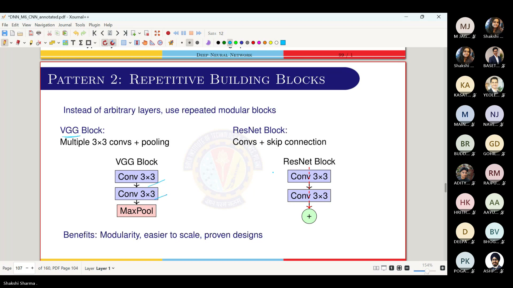

# Module 7: Deep CNN Architectures & Transfer Learning

**Course**: AIML ZG511 — Deep Neural Networks  
**Prescribed References**: Zhang et al. (T1, Ch 8); Goodfellow et al. (R1, Ch 9)  
**Primary Teacher Followed**: Prof. Shakshi Sharma (Session 8: 2026-09-12)

---

## 1. Evolution of Modern Deep CNN Architectures


*Figure 7.1: Evolution from LeNet to AlexNet, VGG blocks, Inception, and ResNet residual highways (Prof. Shakshi Sharma Lecture 8).*

### 1.1 AlexNet (Krizhevsky et al., ImageNet 2012 Winner)
- **Breakthrough**: Cut ImageNet top-5 error rate from 26% to 15.3%.
- **Key Innovations**:
  1. Adoption of **ReLU** instead of Sigmoid/Tanh, speeding up convergence by $6\times$.
  2. Deployment of **Dropout ($p=0.5$)** in fully connected layers to control overfitting.
  3. Overlapping max pooling ($3 \times 3$, stride 2) to reduce spatial blur.
  4. Data augmentation (random crops, horizontal reflections, PCA color jittering).
  5. Multi-GPU parallelization across two NVIDIA GTX 580 GPUs.

### 1.2 VGGNet (Simonyan & Zisserman, 2014)
- **Core Philosophy**: Structural simplicity and uniformity.
- **The $3 \times 3$ Principle**: Replaces large convolutional kernels ($7 \times 7$ or $11 \times 11$) with stacks of consecutive small $3 \times 3$ kernels:
  - Stacking two $3 \times 3$ convolutions gives an effective receptive field of $5 \times 5$.
  - Stacking three $3 \times 3$ convolutions gives an effective receptive field of $7 \times 7$.
  - **Parameter Reduction**:
    - One $7 \times 7$ filter with $C$ channels: $1 \times (C \times 7 \times 7 \times C) = 49 C^2$ weights.
    - Three $3 \times 3$ filters with $C$ channels: $3 \times (C \times 3 \times 3 \times C) = 27 C^2$ weights (**45% fewer parameters**).
  - Incorporates three non-linear activation functions instead of one, significantly boosting model capacity.

### 1.3 GoogLeNet / Inception (Szegedy et al., 2014)
- Introduces **multi-scale processing**: applying $1 \times 1$, $3 \times 3$, $5 \times 5$ convolutions and $3 \times 3$ max pooling in parallel within an Inception block.
- Employs $1 \times 1$ convolutions before expensive $3 \times 3$ and $5 \times 5$ filters as **bottlenecks** to reduce channel dimensions.
- Replaces parameter-heavy dense layers with **Global Average Pooling**, reducing total parameters to just 6.8 million (vs AlexNet's 60M and VGG-16's 138M).

### 1.4 ResNet (Residual Networks — He et al., 2015)
- **The Degradation Problem**: As networks become deeper, training error actually increases (not due to overfitting, but optimization difficulty as gradients vanish/explode through hundreds of matrix multiplications).
- **Residual Learning Formulation**: Instead of hoping a stack of layers fits an underlying mapping $\mathcal{H}(\mathbf{x})$, let the layers fit a residual mapping:
  $$\mathcal{F}(\mathbf{x}) = \mathcal{H}(\mathbf{x}) - \mathbf{x} \implies \mathcal{H}(\mathbf{x}) = \mathcal{F}(\mathbf{x}) + \mathbf{x}$$

```
   x ------------------------------------\ (Identity Shortcut)
   |                                     |
[ Weight Layer ]                         |
   |                                     |
[  ReLU  ]                               |
   |                                     |
[ Weight Layer ]                         |
   |                                     |
   v                                     v
  F(x) --------------------------> ( + )
                                     |
                                 [  ReLU  ]
                                     |
                                     v H(x)
```

- **Gradient Highway**:
  $$\frac{\partial \mathcal{E}}{\partial \mathbf{x}} = \frac{\partial \mathcal{E}}{\partial \mathcal{H}} \frac{\partial \mathcal{H}}{\partial \mathbf{x}} = \frac{\partial \mathcal{E}}{\partial \mathcal{H}} \left( \frac{\partial \mathcal{F}}{\partial \mathbf{x}} + \mathbf{I} \right)$$
  The $+ \mathbf{I}$ term ensures that gradient signals can propagate directly backward to early layers unimpeded, enabling training of networks with 50, 101, or 152+ layers.

---

## 2. Transfer Learning & Fine-Tuning

Training deep networks from scratch requires millions of labeled instances. Transfer learning leverages representations learned on large source datasets (e.g., ImageNet with 1.4M images) for specialized downstream domain tasks.

```
Pre-trained CNN Backbone (ImageNet)             Downstream Domain
[ Conv Block 1 ]  -> Low-level edges, textures   ---> FROZEN (Weights locked)
[ Conv Block 2 ]  -> Textures, corners           ---> FROZEN
[ Conv Block 3 ]  -> Motifs, parts               ---> Fine-tuned / Frozen
[ Conv Block 4 ]  -> Complex object parts        ---> Fine-tuned
[ Linear Head  ]  -> 1000 ImageNet Classes       ---> REPLACED & TRAINED (C classes)
```

### 2.1 Fine-Tuning Decision Matrix

| Target Dataset Size | Target Data Similarity to Source | Recommended Transfer Strategy |
| :--- | :--- | :--- |
| **Small** ($< 1,000$ samples) | **High** (Similar natural images) | **Feature Extractor**: Freeze entire backbone; train only new linear classification head. |
| **Small** | **Low** (Specialized X-rays/SAR) | Train linear classifier on earlier/mid layers (late layers are too source-specific); heavy regularization. |
| **Large** ($> 50,000$ samples) | **High** | **Fine-tuning**: Initialize with pre-trained weights; train entire network with small learning rate ($\eta \approx 10^{-4}$). |
| **Large** | **Low** | Full training initialized from pre-trained weights or from scratch. |
