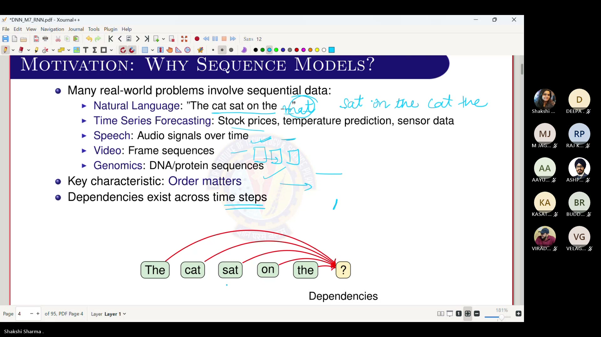

# Module 8: Recurrent Neural Networks (RNN)

**Course**: AIML ZG511 — Deep Neural Networks  
**Prescribed References**: Zhang et al. (T1, Ch 9); Goodfellow et al. (R1, Ch 10); Jurafsky & Martin (R3, Ch 9)  
**Primary Teacher Followed**: Prof. Shakshi Sharma (Session 9: 2026-10-03)

---

## 1. Sequence Modelling & Limitations of Feedforward NNs

Feedforward neural networks assume input vectors $\mathbf{x}^{(i)}$ are independent and identically distributed (i.i.d.). They fail on sequential and temporal data for three reasons:
1. **Fixed Input Dimensions**: Text sentences, audio clips, and financial time series have variable sequence lengths $T$.
2. **No Temporal Memory**: Feedforward networks have no internal state memory to maintain context from previous time steps.
3. **No Temporal Parameter Sharing**: A pattern learned at time $t_1$ is not recognized at time $t_2$ without separate parameters.

---

## 2. Standard RNN Architecture & Hidden States

Recurrent Neural Networks introduce a **cyclical recurrent feedback loop**, maintaining a persistent hidden state vector $\mathbf{h}_t \in \mathbb{R}^H$ that acts as a working memory of all historical tokens up to time $t$.

*Figure 8.1: Unfolding an RNN across time steps and Backpropagation Through Time (BPTT) (Prof. Shakshi Sharma Lecture 9).*

### 2.1 State Transition Equations
At time step $t \in \{1, 2, \dots, T\}$:
1. **Hidden State Update**:
   $$\mathbf{h}_t = \tanh(\mathbf{W}_{hh} \mathbf{h}_{t-1} + \mathbf{W}_{xh} \mathbf{x}_t + \mathbf{b}_h)$$
2. **Output Prediction**:
   $$\hat{\mathbf{y}}_t = \text{softmax}(\mathbf{W}_{hy} \mathbf{h}_t + \mathbf{b}_y)$$
where:
- $\mathbf{x}_t \in \mathbb{R}^D$: Input feature vector at time $t$.
- $\mathbf{h}_t \in \mathbb{R}^H$: Hidden state vector at time $t$.
- $\mathbf{W}_{xh} \in \mathbb{R}^{H \times D}$: Input-to-hidden transition weight matrix.
- $\mathbf{W}_{hh} \in \mathbb{R}^{H \times H}$: Hidden-to-hidden recurrent weight matrix (shared across all time steps).
- $\mathbf{W}_{hy} \in \mathbb{R}^{C \times H}$: Hidden-to-output transition weight matrix.

---

## 3. Backpropagation Through Time (BPTT)

Training an RNN involves unfolding the computation graph over $T$ steps and computing gradients via **Backpropagation Through Time (BPTT)**.

### 3.1 Total Loss
$$L = \sum_{t=1}^T \ell(\hat{\mathbf{y}}_t, \mathbf{y}_t)$$

### 3.2 Gradient with Respect to Recurrent Weights $\mathbf{W}_{hh}$
By the multivariable chain rule, because $\mathbf{h}_t$ depends on $\mathbf{h}_{t-1}$, which depends on $\mathbf{h}_{t-2}$, etc.:
$$\frac{\partial L}{\partial \mathbf{W}_{hh}} = \sum_{t=1}^T \frac{\partial \ell_t}{\partial \mathbf{W}_{hh}} = \sum_{t=1}^T \sum_{k=1}^t \frac{\partial \ell_t}{\partial \hat{\mathbf{y}}_t} \frac{\partial \hat{\mathbf{y}}_t}{\partial \mathbf{h}_t} \left( \frac{\partial \mathbf{h}_t}{\partial \mathbf{h}_k} \right) \frac{\partial^+ \mathbf{h}_k}{\partial \mathbf{W}_{hh}}$$
where the temporal Jacobian chain is:
$$\frac{\partial \mathbf{h}_t}{\partial \mathbf{h}_k} = \prod_{j=k+1}^t \frac{\partial \mathbf{h}_j}{\partial \mathbf{h}_{j-1}} = \prod_{j=k+1}^t \operatorname{diag}(1 - \mathbf{h}_j^2) \mathbf{W}_{hh}^T$$

---

## 4. The Vanishing & Exploding Gradient Dilemma

The long product of Jacobian matrices $\prod_{j=k+1}^t \mathbf{W}_{hh}^T$ leads directly to numerical instability:
- If the largest eigenvalue of $\mathbf{W}_{hh}$ is $|\lambda_{max}| < 1$, the product exponentially decays to zero as temporal gap $(t - k)$ increases:
  $$\left\| \frac{\partial \mathbf{h}_t}{\partial \mathbf{h}_k} \right\| \to 0 \quad (\text{\textbf{Vanishing Gradient}})$$
  *Consequence*: The model cannot learn long-range temporal dependencies; distant past tokens exert zero gradient signal on current weights.
- If $|\lambda_{max}| > 1$, the gradient explodes exponentially:
  $$\left\| \frac{\partial \mathbf{h}_t}{\partial \mathbf{h}_k} \right\| \to \infty \quad (\text{\textbf{Exploding Gradient}})$$
  *Consequence*: Floating point overflow (`NaN`), numerical instability.

### Mitigating Exploding Gradients: Gradient Clipping
When the norm of the total gradient vector $\mathbf{g}$ exceeds threshold $\theta$:
$$\mathbf{g} \leftarrow \begin{cases} \mathbf{g}, & \text{if } \|\mathbf{g}\| \le \theta \\ \theta \frac{\mathbf{g}}{\|\mathbf{g}\|}, & \text{if } \|\mathbf{g}\| > \theta \end{cases}$$

---

## 5. Sequence-to-Sequence (Seq2Seq) & Teacher Forcing

In Seq2Seq tasks (e.g., Machine Translation), an **Encoder RNN** encodes input sequence $(\mathbf{x}_1, \dots, \mathbf{x}_{T_x})$ into a single fixed-size context vector $\mathbf{c} = \mathbf{h}_{T_x}$, which a **Decoder RNN** unfolds to generate target tokens $(\hat{\mathbf{y}}_1, \dots, \hat{\mathbf{y}}_{T_y})$.

### Teacher Forcing
During training, instead of feeding the decoder's own predicted token $\hat{y}_{t-1}$ as input at step $t$, the true ground-truth target token $y_{t-1}$ is fed. This stabilizes early training and accelerates convergence.
