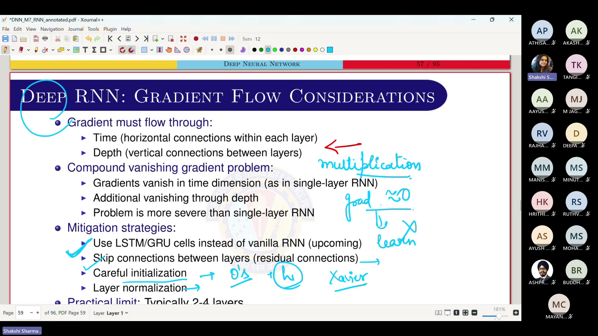
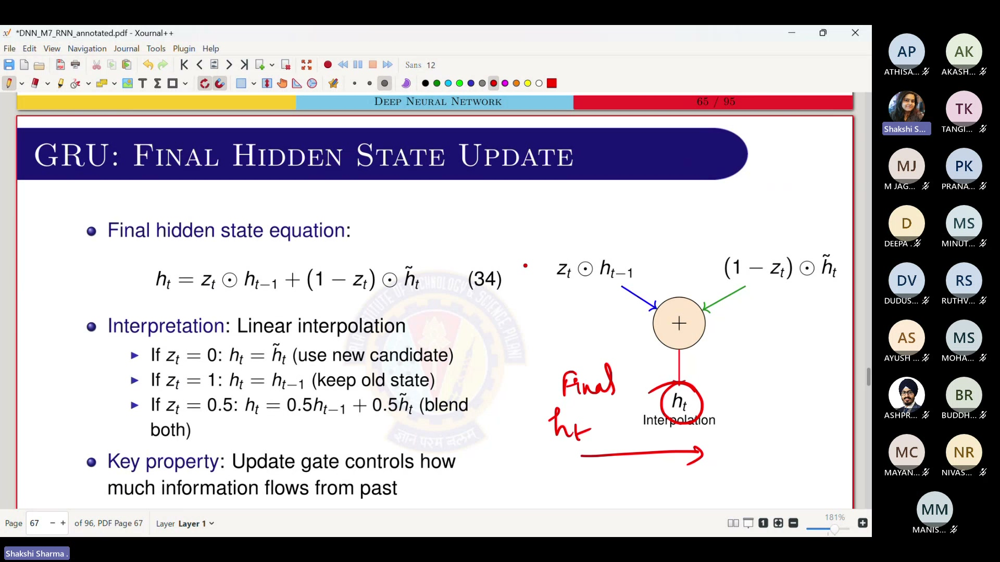

# Module 9: Deep Recurrent Neural Networks (LSTM & GRU)

**Course**: AIML ZG511 — Deep Neural Networks  
**Prescribed References**: Zhang et al. (T1, Ch 10); Goodfellow et al. (R1, Ch 10); Jurafsky & Martin (R3, Ch 9)  
**Primary Teacher Followed**: Prof. Shakshi Sharma (Session 10: 2026-10-10)

---

## 1. Gated Memory Mechanisms: Why LSTM & GRU?

Standard RNNs suffer from vanishing gradients because recurrent hidden states are repeatedly subjected to matrix multiplication and saturating $\tanh$ activations. **Long Short-Term Memory (LSTM)** networks (Hochreiter & Schmidhuber, 1997) resolve this by decoupling memory from output computation through an additive **Cell State highway** ($C_t$), governed by multiplicative gating mechanisms.

---

## 2. Long Short-Term Memory (LSTM) Architecture

*Figure 9.1: The internal gating structure of an LSTM memory cell showing forget, input, and output gates (Prof. Shakshi Sharma Lecture 10).*

### 2.1 The Core Gating Equations
At time step $t$, receiving input $\mathbf{x}_t \in \mathbb{R}^D$ and previous hidden state $\mathbf{h}_{t-1} \in \mathbb{R}^H$:

1. **Forget Gate ($\mathbf{f}_t$)**: Determines what fraction of information to discard from the previous cell state $C_{t-1}$:
   $$\mathbf{f}_t = \sigma(\mathbf{W}_f [\mathbf{h}_{t-1}, \mathbf{x}_t] + \mathbf{b}_f)$$
   *(Output $\approx 0 \implies$ completely erase memory; output $\approx 1 \implies$ completely preserve memory).*

2. **Input Gate ($\mathbf{i}_t$) & Candidate Cell State ($\tilde{\mathbf{C}}_t$)**: Determines what new information to store:
   $$\mathbf{i}_t = \sigma(\mathbf{W}_i [\mathbf{h}_{t-1}, \mathbf{x}_t] + \mathbf{b}_i)$$
   $$\tilde{\mathbf{C}}_t = \tanh(\mathbf{W}_c [\mathbf{h}_{t-1}, \mathbf{x}_t] + \mathbf{b}_c)$$

3. **Cell State Update ($\mathbf{C}_t$)**: The linear additive highway:
   $$\mathbf{C}_t = \mathbf{f}_t \odot \mathbf{C}_{t-1} + \mathbf{i}_t \odot \tilde{\mathbf{C}}_t$$
   *(Because the update is **additive**, gradient signals propagate backward over hundreds of time steps with minimal attenuation).*

4. **Output Gate ($\mathbf{o}_t$) & Hidden State ($\mathbf{h}_t$)**: Determines what parts of the cell state appear in the visible hidden state:
   $$\mathbf{o}_t = \sigma(\mathbf{W}_o [\mathbf{h}_{t-1}, \mathbf{x}_t] + \mathbf{b}_o)$$
   $$\mathbf{h}_t = \mathbf{o}_t \odot \tanh(\mathbf{C}_t)$$

---

## 3. Gated Recurrent Unit (GRU — Cho et al., 2014)

*Figure 9.2: Gated Recurrent Unit (GRU) with merged cell state and coupled reset/update gates (Prof. Shakshi Sharma Lecture 10).*

The GRU simplifies the LSTM cell:
- Merges cell state and hidden state into a single vector $\mathbf{h}_t$.
- Reduces gate count from 3 to 2: **Reset Gate ($\mathbf{r}_t$)** and **Update Gate ($\mathbf{z}_t$)**.
- Fewer parameters ($\approx 25\%$ fewer weights), resulting in faster training on smaller datasets.

### 3.1 GRU Mathematical Formulation
1. **Reset Gate ($\mathbf{r}_t$)**: Dictates how much past memory to consider when computing candidate state:
   $$\mathbf{r}_t = \sigma(\mathbf{W}_r [\mathbf{h}_{t-1}, \mathbf{x}_t] + \mathbf{b}_r)$$
2. **Update Gate ($\mathbf{z}_t$)**: Acts simultaneously as forget gate and input gate ($1 - \mathbf{z}_t$):
   $$\mathbf{z}_t = \sigma(\mathbf{W}_z [\mathbf{h}_{t-1}, \mathbf{x}_t] + \mathbf{b}_z)$$
3. **Candidate Hidden State ($\tilde{\mathbf{h}}_t$)**:
   $$\tilde{\mathbf{h}}_t = \tanh(\mathbf{W} [\mathbf{r}_t \odot \mathbf{h}_{t-1}, \mathbf{x}_t] + \mathbf{b})$$
4. **Hidden State Interpolation**:
   $$\mathbf{h}_t = (1 - \mathbf{z}_t) \odot \mathbf{h}_{t-1} + \mathbf{z}_t \odot \tilde{\mathbf{h}}_t$$

---

## 4. Stacked & Bidirectional Recurrent Architectures

### 4.1 Stacked (Deep) RNNs
Layer $l$ receives the hidden states of layer $l-1$ as sequential inputs:
$$\mathbf{h}_t^{[l]} = \text{LSTM}(\mathbf{h}_t^{[l-1]}, \mathbf{h}_{t-1}^{[l]})$$
Allows the network to learn temporal hierarchies (e.g., lower layers model character combinations; higher layers model sentence semantics).

### 4.2 Bidirectional RNNs (BiLSTM / BiGRU)
A standard causal RNN processes tokens forward from $t=1 \to T$, having no access to future context. A Bidirectional RNN maintains two independent hidden recurrent pathways:
- Forward layer: $\overrightarrow{\mathbf{h}}_t = \text{RNN}_{\text{fwd}}(\mathbf{x}_t, \overrightarrow{\mathbf{h}}_{t-1})$
- Backward layer: $\overleftarrow{\mathbf{h}}_t = \text{RNN}_{\text{bwd}}(\mathbf{x}_t, \overleftarrow{\mathbf{h}}_{t+1})$
- Combined representation: $\mathbf{h}_t = [\overrightarrow{\mathbf{h}}_t; \overleftarrow{\mathbf{h}}_t]$
Essential for speech recognition, named entity recognition, and sentiment analysis where future context disambiguates current tokens.
