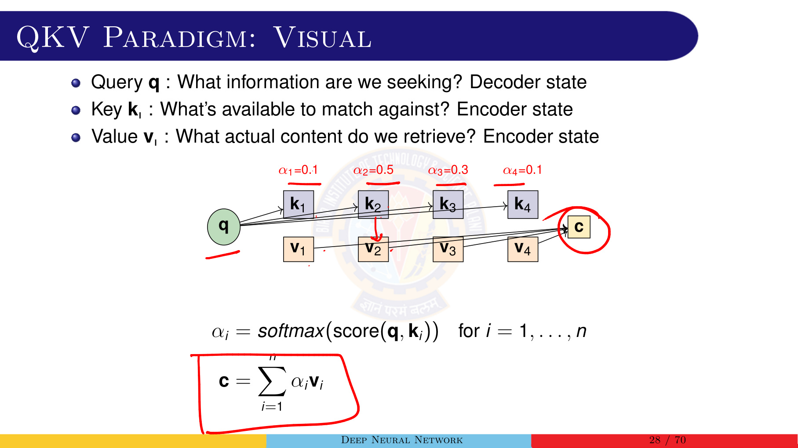
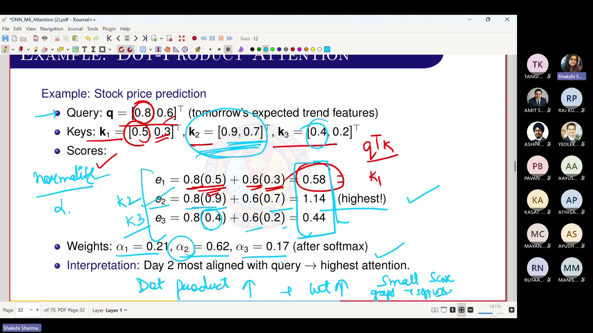

# Module 10: Attention Mechanism

**Course**: AIML ZG511 — Deep Neural Networks  
**Prescribed References**: Zhang et al. (T1, Ch 11); Jurafsky & Martin (R3, Ch 10); Vaswani et al. (2017)  
**Syllabus module**: **M10** — Attention Mechanism (`module_map.yaml`)  
**Canonical video**: `Videos/Lecture_11_Attention_Mechanism_QKV.mp4`  
**Exam Reference**: Prof. Mithun Ghosh Question Paper (Q51) & Course Handout

---

## 1. Motivation: The Information Bottleneck in Seq2Seq

In standard encoder-decoder recurrent networks (e.g., vanilla Seq2Seq), the entire source sentence (regardless of whether it contains 5 words or 100 words) is compressed into a single fixed-length context vector:
$$\mathbf{c} = \mathbf{h}_{T_x}$$
This creates a severe **information bottleneck**:
- For long sentences ($T_x > 15$), fine-grained nuances, numerical quantities, and early syntactic structures decay exponentially as they are squeezed through the hidden state chain.
- The decoder must attempt to reconstruct the entire target sequence from this single static vector.

The **Attention Mechanism** (Bahdanau et al., 2014; Luong et al., 2015; Vaswani et al., 2017) completely eliminates this bottleneck. Instead of compressing the entire history into one static vector, the decoder is provided **direct, dynamic, selective access** to all encoder hidden representations $(\mathbf{h}_1, \dots, \mathbf{h}_{T_x})$ at every decoding step.

---

## 2. The Query, Key, Value (QKV) Conceptual Framework

*Figure 10.1: Information retrieval paradigm for Query, Key, and Value representations (Slide 28, DNN_M8_Attention (2)_annotated.pdf, Prof. Shakshi Sharma Lecture 11).*

The attention mechanism operates as a **differentiable, content-addressable memory lookup**:
- **Query ($\mathbf{q} \in \mathbb{R}^{d_k}$)**: Represents the current state or question seeking relevant information (e.g., the current decoder hidden state).
- **Key ($\mathbf{k}_j \in \mathbb{R}^{d_k}$)**: Serves as the index or label representing the content of stored information item $j$ (e.g., encoder hidden state $j$).
- **Value ($\mathbf{v}_j \in \mathbb{R}^{d_v}$)**: The actual informational payload to be retrieved and combined.

$$\text{Attention}(\mathbf{q}, \mathbf{K}, \mathbf{V}) = \sum_{j=1}^M \alpha(\mathbf{q}, \mathbf{k}_j) \mathbf{v}_j$$
where the attention weight $\alpha(\mathbf{q}, \mathbf{k}_j) \in [0, 1]$ represents the normalized compatibility score between query $\mathbf{q}$ and key $\mathbf{k}_j$, satisfying $\sum_j \alpha(\mathbf{q}, \mathbf{k}_j) = 1$.

---

## 3. Attention Scoring Functions & The $\frac{1}{\sqrt{d_k}}$ Proof (Exam Q51)

| Scoring Name | Mathematical Function $a(\mathbf{q}, \mathbf{k})$ | Parameter Cost | Key Characteristics |
| :--- | :--- | :--- | :--- |
| **Dot-Product** | $\mathbf{q}^T \mathbf{k}$ | $0$ (No weights) | Extremely fast; requires matching dimensions $d_q = d_k$. |
| **Scaled Dot-Product** | $\frac{\mathbf{q}^T \mathbf{k}}{\sqrt{d_k}}$ | $0$ (No weights) | **Modern Gold Standard**; scaling prevents softmax gradient vanishing. |
| **Bahdanau (Additive)** | $\mathbf{v}_a^T \tanh(\mathbf{W}_q \mathbf{q} + \mathbf{W}_k \mathbf{k})$ | $\mathcal{O}(d_a(d_q + d_k))$ | Can handle differing $d_q, d_k$; slower due to matrix adds. |
| **Bilinear / General** | $\mathbf{q}^T \mathbf{W}_a \mathbf{k}$ | $\mathcal{O}(d_q \cdot d_k)$ | Multiplicative learned alignment matrix $\mathbf{W}_a$. |

### Mathematical Proof: Why Divide by $\sqrt{d_k}$?
Assume the components of query $\mathbf{q}$ and key $\mathbf{k}$ are independent random variables with zero mean and unit variance:
$$\mathbb{E}[q_i] = 0, \quad \operatorname{Var}(q_i) = 1, \quad \mathbb{E}[k_i] = 0, \quad \operatorname{Var}(k_i) = 1$$
The unscaled dot product is:
$$z = \mathbf{q}^T \mathbf{k} = \sum_{i=1}^{d_k} q_i k_i$$
Computing expectation and variance:
$$\mathbb{E}[z] = \sum_{i=1}^{d_k} \mathbb{E}[q_i] \mathbb{E}[k_i] = 0$$
$$\operatorname{Var}(z) = \sum_{i=1}^{d_k} \operatorname{Var}(q_i k_i) = \sum_{i=1}^{d_k} \left( \operatorname{Var}(q_i)\operatorname{Var}(k_i) + \operatorname{Var}(q_i)\mathbb{E}[k_i]^2 + \operatorname{Var}(k_i)\mathbb{E}[q_i]^2 \right)$$
$$\operatorname{Var}(z) = \sum_{i=1}^{d_k} (1 \cdot 1 + 0 + 0) = d_k \implies \operatorname{StdDev}(z) = \sqrt{d_k}$$

**Consequence for Large $d_k$**:
For typical modern hidden dimensions (e.g., $d_k = 64, 512, 1024$), the magnitude $|z|$ grows as $\sqrt{d_k} \approx 8$ to $32$.
- When input to Softmax, large scores push the exponential function into extreme saturation regions ($e^{32} \approx 7.89 \times 10^{13}$).
- In saturated regions, the softmax derivative $\frac{\partial \text{softmax}(z)_i}{\partial z_j} = \hat{y}_i(\delta_{ij} - \hat{y}_j) \to 0$.
- **Result**: Softmax behaves like an argmax step-function, and gradients vanish completely!
- **The Solution**: Dividing by $\sqrt{d_k}$ scales variance back to $\operatorname{Var}\left(\frac{z}{\sqrt{d_k}}\right) = \frac{d_k}{(\sqrt{d_k})^2} = \mathbf{1.0}$, ensuring healthy, non-vanishing gradient flow throughout training.

---

## 4. Scaled Dot-Product Attention in Matrix Form

*Figure 10.2: Scaled Dot-Product Attention computational architecture (Slide 33, DNN_M8_Attention (2)_annotated.pdf, Prof. Shakshi Sharma Lecture 11).*

In practice, attention is computed across entire matrices simultaneously:
Given query matrix $\mathbf{Q} \in \mathbb{R}^{N \times d_k}$, key matrix $\mathbf{K} \in \mathbb{R}^{M \times d_k}$, and value matrix $\mathbf{V} \in \mathbb{R}^{M \times d_v}$:
$$\operatorname{Attention}(\mathbf{Q}, \mathbf{K}, \mathbf{V}) = \operatorname{softmax}\left( \frac{\mathbf{Q} \mathbf{K}^T}{\sqrt{d_k}} \right) \mathbf{V}$$
- $\mathbf{Q} \mathbf{K}^T \in \mathbb{R}^{N \times M}$: Unnormalized similarity matrix between all $N$ queries and $M$ keys.
- $\mathbf{A} = \operatorname{softmax}\left( \frac{\mathbf{Q} \mathbf{K}^T}{\sqrt{d_k}} \right) \in \mathbb{R}^{N \times M}$: Row-stochastic attention weight matrix (each row sums to 1.0).
- $\text{Output} = \mathbf{A} \mathbf{V} \in \mathbb{R}^{N \times d_v}$: Contextualized representations for each query.

---

## 5. Solved Step-by-Step Numerical Walkthrough (Exam Archetype)

**Problem Statement (6 Marks)**:  
Given a 2-token sequence with dimension $d_k = 2$:
$$\mathbf{Q} = \begin{bmatrix} 1 & 0 \\ 0 & 2 \end{bmatrix}, \quad \mathbf{K} = \begin{bmatrix} 1 & 1 \\ 0 & 1 \end{bmatrix}, \quad \mathbf{V} = \begin{bmatrix} 10 & 20 \\ 30 & 40 \end{bmatrix}$$
Using Scaled Dot-Product Attention with scale factor $\sqrt{d_k} = \sqrt{2} \approx 1.4142$, compute:
1. The raw compatibility matrix $\mathbf{S} = \mathbf{Q} \mathbf{K}^T$.
2. The scaled score matrix $\tilde{\mathbf{S}} = \mathbf{S} / \sqrt{2}$.
3. The row-wise Softmax attention weights $\mathbf{A}$.
4. The final attention output context matrix $\mathbf{O} = \mathbf{A} \mathbf{V}$.

### Step-by-Step Calculation:
1. **Raw Dot-Product Matrix $\mathbf{S} = \mathbf{Q} \mathbf{K}^T$**:
   $$\mathbf{K}^T = \begin{bmatrix} 1 & 0 \\ 1 & 1 \end{bmatrix}$$
   $$\mathbf{S} = \begin{bmatrix} 1 & 0 \\ 0 & 2 \end{bmatrix} \begin{bmatrix} 1 & 0 \\ 1 & 1 \end{bmatrix} = \begin{bmatrix} 1(1) + 0(1) & 1(0) + 0(1) \\ 0(1) + 2(1) & 0(0) + 2(1) \end{bmatrix} = \begin{bmatrix} 1 & 0 \\ 2 & 2 \end{bmatrix}$$

2. **Scaled Matrix $\tilde{\mathbf{S}} = \mathbf{S} / \sqrt{2}$ ($\sqrt{2} \approx 1.4142$)**:
   $$\tilde{\mathbf{S}} = \begin{bmatrix} \frac{1}{1.4142} & \frac{0}{1.4142} \\ \frac{2}{1.4142} & \frac{2}{1.4142} \end{bmatrix} \approx \begin{bmatrix} 0.7071 & 0.0000 \\ 1.4142 & 1.4142 \end{bmatrix}$$

3. **Row-wise Softmax Attention Weights $\mathbf{A}$**:
   - **Row 1**:
     $$e^{0.7071} \approx 2.0281, \quad e^{0.0000} = 1.0000 \implies \sum = 3.0281$$
     $$\alpha_{11} = \frac{2.0281}{3.0281} \approx \mathbf{0.6698}, \quad \alpha_{12} = \frac{1.0000}{3.0281} \approx \mathbf{0.3302}$$
   - **Row 2**:
     $$e^{1.4142} \approx 4.1132, \quad e^{1.4142} \approx 4.1132 \implies \sum = 8.2264$$
     $$\alpha_{21} = \frac{4.1132}{8.2264} = \mathbf{0.5000}, \quad \alpha_{22} = \frac{4.1132}{8.2264} = \mathbf{0.5000}$$
   $$\mathbf{A} = \begin{bmatrix} 0.6698 & 0.3302 \\ 0.5000 & 0.5000 \end{bmatrix}$$

4. **Final Attention Output $\mathbf{O} = \mathbf{A} \mathbf{V}$**:
   $$\mathbf{O} = \begin{bmatrix} 0.6698 & 0.3302 \\ 0.5000 & 0.5000 \end{bmatrix} \begin{bmatrix} 10 & 20 \\ 30 & 40 \end{bmatrix}$$
   - *Row 1*:
     $$O_{11} = 0.6698(10) + 0.3302(30) = 6.698 + 9.906 = \mathbf{16.604}$$
     $$O_{12} = 0.6698(20) + 0.3302(40) = 13.396 + 13.208 = \mathbf{26.604}$$
   - *Row 2*:
     $$O_{21} = 0.5000(10) + 0.5000(30) = 5.0 + 15.0 = \mathbf{20.000}$$
     $$O_{22} = 0.5000(20) + 0.5000(40) = 10.0 + 20.0 = \mathbf{30.000}$$
   $$\mathbf{O} = \begin{bmatrix} 16.604 & 26.604 \\ 20.000 & 30.000 \end{bmatrix}$$

---

## 6. Multi-Head Attention (MHA)

Instead of performing single-head attention with dimension $d_{\text{model}}$, Multi-Head Attention linearly projects queries, keys, and values $h$ times with learned projection matrices:
$$\operatorname{MultiHead}(\mathbf{Q}, \mathbf{K}, \mathbf{V}) = \operatorname{Concat}(\text{head}_1, \dots, \text{head}_h) \mathbf{W}^O$$
$$\text{where } \text{head}_i = \operatorname{Attention}(\mathbf{Q} \mathbf{W}_i^Q, \mathbf{K} \mathbf{W}_i^K, \mathbf{V} \mathbf{W}_i^V)$$
- Projections: $\mathbf{W}_i^Q \in \mathbb{R}^{d_{\text{model}} \times d_k}$, $\mathbf{W}_i^K \in \mathbb{R}^{d_{\text{model}} \times d_k}$, $\mathbf{W}_i^V \in \mathbb{R}^{d_{\text{model}} \times d_v}$, $\mathbf{W}^O \in \mathbb{R}^{h d_v \times d_{\text{model}}}$.
- Standard sizing: $d_k = d_v = d_{\text{model}} / h$ (e.g., $d_{\text{model}} = 512, h = 8 \implies d_k = 64$).
- **Total Compute Cost**: Exactly equivalent to single-head attention with full dimensionality, but permits the model to simultaneously attend to information from different representation subspaces (e.g., grammar, coreference, factual relations).

---

## 7. Computational Complexity Comparison

| Layer Type | Complexity per Layer | Sequential Operations | Maximum Path Length |
| :--- | :--- | :--- | :--- |
| **Self-Attention** | $\mathcal{O}(n^2 \cdot d)$ | $\mathcal{O}(1)$ (Fully Parallelizable) | $\mathcal{O}(1)$ (Direct connection between any two tokens) |
| **Recurrent (RNN)**| $\mathcal{O}(n \cdot d^2)$ | $\mathcal{O}(n)$ (Sequential dependency) | $\mathcal{O}(n)$ (Vanishing gradients across sequence) |
| **Convolutional** | $\mathcal{O}(k \cdot n \cdot d^2)$ | $\mathcal{O}(1)$ | $\mathcal{O}(\log_k(n))$ |

*Conclusion*: For typical sequence lengths $n < d$, Self-Attention is computationally faster than RNNs and provides $\mathcal{O}(1)$ path length between any pair of tokens, making gradient learning instantaneous!

---

## 8. Summary Checklist for Examination

- [x] Problem of Seq2Seq information bottleneck and why static context vectors $\mathbf{c} = \mathbf{h}_T$ fail for long sentences.
- [x] Differentiable database lookup analogy for Query, Key, and Value (QKV).
- [x] Four primary attention scoring functions: Dot-product, Scaled dot-product, Bahdanau additive, Bilinear.
- [x] Mathematical proof of variance preservation $\operatorname{Var}(\mathbf{q}^T \mathbf{k}/\sqrt{d_k}) = 1.0$ and why scaling prevents softmax saturation (Exam Q51).
- [x] Matrix formulation: $\operatorname{Attention}(\mathbf{Q}, \mathbf{K}, \mathbf{V}) = \operatorname{softmax}\left(\frac{\mathbf{Q}\mathbf{K}^T}{\sqrt{d_k}}\right)\mathbf{V}$.
- [x] Complete 6-mark solved numerical calculation with concrete 2-token matrices.
- [x] Multi-Head Attention formulation and computational complexity comparison table.
