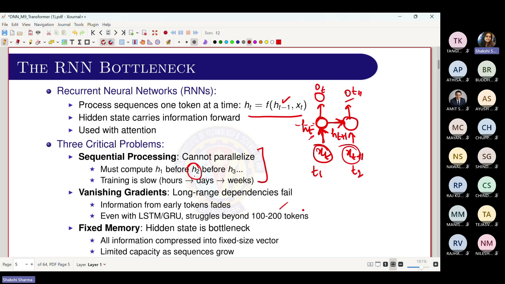

# Module 11: Transformers & Vision Transformers (ViT)

**Course**: AIML ZG511 — Deep Neural Networks  
**Prescribed References**: Zhang et al. (T1, Ch 11); Jurafsky & Martin (R3, Ch 10)  
**Primary Teacher Followed**: Prof. Shakshi Sharma (Session 12: 2026-10-24 & Session 13: 2026-10-31)

---

## 1. The Transformer Paradigm ("Attention Is All You Need", 2017)

Before 2017, sequence models relied on recurrent or convolutional backbones. The Transformer architecture discarded recurrence entirely, relying exclusively on multi-head self-attention.
- **Advantage over RNNs**: Total elimination of sequential dependency. All tokens in a sequence are processed in parallel ($\mathcal{O}(1)$ sequential operations vs $\mathcal{O}(T)$ for RNNs), maximizing GPU parallelization.
- **Direct Context Modeling**: Path length between any two tokens across the sequence is $\mathcal{O}(1)$, eliminating long-range decay.

---

## 2. Transformer Architecture: Encoder & Decoder Blocks

*Figure 11.1: Detailed schema of the Transformer Encoder and Decoder blocks with residual connections and LayerNorm (Prof. Shakshi Sharma Lecture 12).*

### 2.1 The Transformer Encoder Block
Each encoder layer comprises two primary sub-layers:
1. **Multi-Head Self-Attention**:
   $$\mathbf{x}_{\text{attn}} = \operatorname{LayerNorm}(\mathbf{x} + \operatorname{MultiHead}(\mathbf{x}, \mathbf{x}, \mathbf{x}))$$
2. **Position-wise Feed-Forward Network (FFN)**: Applied to each position identically and separately:
   $$\operatorname{FFN}(\mathbf{z}) = \max(0, \mathbf{z} \mathbf{W}_1 + \mathbf{b}_1) \mathbf{W}_2 + \mathbf{b}_2 = \operatorname{GELU}(\mathbf{z} \mathbf{W}_1 + \mathbf{b}_1) \mathbf{W}_2 + \mathbf{b}_2$$
   $$\mathbf{x}_{\text{out}} = \operatorname{LayerNorm}(\mathbf{x}_{\text{attn}} + \operatorname{FFN}(\mathbf{x}_{\text{attn}}))$$
   *(Typically the inner dimension expands by $4\times$: $d_{\text{ff}} = 4 \times d_{\text{model}}$)*.

### 2.2 The Transformer Decoder Block
Contains three sub-layers:
1. **Masked Multi-Head Self-Attention**: Prevents positions from attending to subsequent future tokens (enforces causality for autoregressive generation).
2. **Cross-Attention (Encoder-Decoder Attention)**: Queries come from the previous decoder layer; Keys and Values come from the final encoder output.
3. **Position-wise Feed-Forward Network (FFN)**.

---

## 3. Positional Encoding

Because multi-head attention is permutation-invariant (treating inputs as an unordered set of tokens), explicit order information must be injected.

### Sinusoidal Positional Encoding (Vaswani et al., 2017):
For token position $pos \in [0, T-1]$ and feature dimension index $i \in [0, d/2 - 1]$:
$$PE_{(pos, 2i)} = \sin\left( \frac{pos}{10000^{2i / d_{\text{model}}}} \right)$$
$$PE_{(pos, 2i + 1)} = \cos\left( \frac{pos}{10000^{2i / d_{\text{model}}}} \right)$$
- **Property**: For any fixed offset $k$, $PE_{pos + k}$ can be expressed as a linear function of $PE_{pos}$ via trigonometric angle-addition identities, enabling the model to learn relative position relationships.

---

## 4. Vision Transformers (ViT — Dosovitskiy et al., 2020)

*Figure 11.2: End-to-end Vision Transformer (ViT) pipeline: patch splitting, linear projection, [CLS] token, and Transformer Encoder (Prof. Shakshi Sharma Lecture 13).*

Vision Transformers demonstrate that pure Transformer architectures can outperform CNNs on image classification when pre-trained at scale.

### 4.1 The Patch Extraction Pipeline
1. Input image $\mathbf{X} \in \mathbb{R}^{H \times W \times C}$.
2. Segment image into a grid of non-overlapping patches of spatial size $P \times P$ (e.g., $16 \times 16$).
3. Total number of patches:
   $$N = \frac{H \cdot W}{P^2}$$
4. Flatten each patch into a vector $\mathbf{x}_p^{(i)} \in \mathbb{R}^{P^2 \cdot C}$ (e.g., $16 \times 16 \times 3 = 768$).
5. Linearly project each patch into embedding dimension $D$ via matrix $\mathbf{E} \in \mathbb{R}^{(P^2 C) \times D}$.
6. Prepend a learnable classification token $\mathbf{x}_{\text{class}} \in \mathbb{R}^D$ (`[CLS]`).
7. Add 1D learnable positional embeddings $\mathbf{E}_{\text{pos}} \in \mathbb{R}^{(N+1) \times D}$:
   $$\mathbf{z}_0 = [\mathbf{x}_{\text{class}}; \mathbf{x}_p^{(1)}\mathbf{E}; \dots; \mathbf{x}_p^{(N)}\mathbf{E}] + \mathbf{E}_{\text{pos}}$$
8. Pass $\mathbf{z}_0$ into a standard Transformer Encoder. The representation of the `[CLS]` token at layer $L$ is passed to an MLP head for classification.

### 4.2 CNN vs ViT: Inductive Bias Comparison
- **CNNs**: Possess strong hardcoded inductive biases — **locality** (pixels close together are related) and **translation equivariance** (features are identical anywhere in the image). Consequently, CNNs train effectively on modest datasets.
- **ViTs**: Possess **no spatial inductive bias**. Every patch attends globally to every other patch from layer 1. ViTs require large-scale pre-training (JFT-300M, ImageNet-21k) to learn spatial locality from scratch, but achieve superior capacity at large scale.
