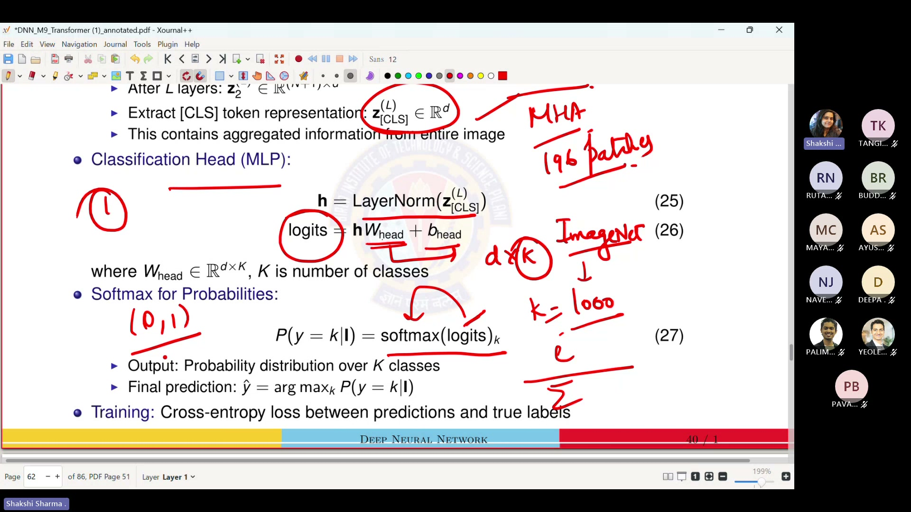

# Module 12: Optimization & Regularization for Deep Models

**Course**: AIML ZG511 — Deep Neural Networks  
**Prescribed References**: Zhang et al. (T1, Ch 3.6-3.7, 4.6-4.7, Ch 12); Goodfellow et al. (R1, Ch 7 & Ch 8)  
**Syllabus module**: **M12** — Optimization & Regularization (`module_map.yaml`)  
**Canonical video**: `Videos/Lecture_13_Vision_Transformers_Optimization_Regularization.mp4`  
**Exam Reference**: Prof. Mithun Ghosh Question Paper (Q53) & Companion Optimizers HTML Module

---

## 1. Challenges in Deep Model Optimization

Unlike linear models where loss surfaces are strictly convex bowls guaranteeing that every local minimum is a global minimum, deep neural network loss surfaces are complex, non-convex, high-dimensional terrains characterized by four major pathologies:
1. **Ill-conditioned Curvature (Ravines)**: The Hessian matrix $\mathbf{H} = \nabla^2 J$ has a condition number $\kappa = \frac{\lambda_{\max}}{\lambda_{\min}} \gg 1$. Gradients oscillate violently across the steep walls rather than moving along the gentle base toward the minimum.
2. **Saddle Points**: Points where $\nabla J = \mathbf{0}$, but the Hessian has mixed positive and negative eigenvalues. In high dimensions, saddle points surround plateaus and vastly outnumber local minima.
3. **Plateaus & Vanishing Gradients**: Broad flat regions where $\|\nabla J\| \approx 0$, causing standard gradient descent to stall.
4. **Stochastic Gradient Variance**: Mini-batch gradients introduce sampling noise that causes jitter near optimal parameters.

---

## 2. Advanced First-Order Optimizers

*Figure 12.1: Comparison of optimization algorithms: SGD, Momentum, RMSprop, and Adam (Slide 53, DNN_M10_Optimizers (2)_261010_111225.pdf, Prof. Shakshi Sharma Lecture 13).*

### 2.1 SGD with Momentum (Polyak, 1964)
Standard SGD oscillates perpendicular to the target valley. Momentum accelerates progress along persistent directions while cancelling high-frequency orthogonal oscillations:
$$\mathbf{v}_t = \beta \mathbf{v}_{t-1} + (1 - \beta) \mathbf{g}_t \quad (\text{typically } \beta = 0.9)$$
$$\boldsymbol{\theta}_{t+1} = \boldsymbol{\theta}_t - \eta \mathbf{v}_t$$
- **Physical Analogy**: A heavy ball rolling down a frictionless hill, building velocity in continuous downward directions and rolling over small local bumps.

### 2.2 RMSprop (Root Mean Square Propagation — Hinton, 2012)
RMSprop resolves ill-conditioned curvature by dividing the learning rate by an exponentially decaying average of squared gradients, adapting the step size per parameter:
$$\mathbf{s}_t = \beta_2 \mathbf{s}_{t-1} + (1 - \beta_2) \mathbf{g}_t^{\odot 2} \quad (\text{typically } \beta_2 = 0.99)$$
$$\boldsymbol{\theta}_{t+1} = \boldsymbol{\theta}_t - \frac{\eta}{\sqrt{\mathbf{s}_t + \epsilon}} \odot \mathbf{g}_t$$
- **Key Property**: Parameters with consistently large historical gradients receive small updates; parameters with sparse or tiny gradients receive larger updates, smoothing anisotropic ravines.

---

## 3. Adam (Adaptive Moment Estimation — Kingma & Ba, 2014)

Adam combines the advantages of Momentum (exponential moving average of past gradients: 1st moment) and RMSprop (exponential moving average of squared gradients: 2nd uncentered moment), augmented with **initialization bias correction**.

### 3.1 Algorithm Formulation
Given learning rate $\eta$, decay factors $\beta_1 = 0.9, \beta_2 = 0.999$, smoothing constant $\epsilon = 10^{-8}$, and initial moment vectors $\mathbf{m}_0 = \mathbf{0}, \mathbf{v}_0 = \mathbf{0}$:
At iteration $t$:
1. **Compute Gradient**:
   $$\mathbf{g}_t = \nabla_{\boldsymbol{\theta}} \mathcal{L}(\boldsymbol{\theta}_t)$$
2. **Update Biased 1st Moment (Mean)**:
   $$\mathbf{m}_t = \beta_1 \mathbf{m}_{t-1} + (1 - \beta_1) \mathbf{g}_t$$
3. **Update Biased 2nd Moment (Uncentered Variance)**:
   $$\mathbf{v}_t = \beta_2 \mathbf{v}_{t-1} + (1 - \beta_2) \mathbf{g}_t^{\odot 2}$$
4. **Compute Bias-Corrected Moments**:
   $$\hat{\mathbf{m}}_t = \frac{\mathbf{m}_t}{1 - \beta_1^t}, \quad \hat{\mathbf{v}}_t = \frac{\mathbf{v}_t}{1 - \beta_2^t}$$
5. **Update Parameter Vector**:
   $$\boldsymbol{\theta}_{t+1} = \boldsymbol{\theta}_t - \frac{\eta}{\sqrt{\hat{\mathbf{v}}_t} + \epsilon} \odot \hat{\mathbf{m}}_t$$

---

## 4. Mathematical Proof: Adam's Bias Correction

Because $\mathbf{m}_0 = \mathbf{0}$, the moment vector $\mathbf{m}_t$ is biased toward zero during early iterations (especially when $\beta_1 \approx 0.9$ or $\beta_2 \approx 0.999$).

### Derivation for 1st Moment $\mathbf{m}_t$:
Unrolling the recurrence $\mathbf{m}_t = \beta_1 \mathbf{m}_{t-1} + (1 - \beta_1) \mathbf{g}_t$:
$$\mathbf{m}_t = (1 - \beta_1) \sum_{i=1}^t \beta_1^{t - i} \mathbf{g}_i$$
Take expectations of both sides under the assumption that the true gradient $\mathbb{E}[\mathbf{g}_i] \approx \mathbf{g}$ is relatively stationary over early steps:
$$\mathbb{E}[\mathbf{m}_t] = \mathbb{E}\left[ (1 - \beta_1) \sum_{i=1}^t \beta_1^{t - i} \mathbf{g}_i \right] \approx \mathbf{g} (1 - \beta_1) \sum_{i=1}^t \beta_1^{t - i}$$
The summation is a finite geometric series with ratio $\beta_1$ and $t$ terms:
$$\sum_{i=1}^t \beta_1^{t - i} = \sum_{k=0}^{t-1} \beta_1^k = \frac{1 - \beta_1^t}{1 - \beta_1}$$
Substituting back:
$$\mathbb{E}[\mathbf{m}_t] \approx \mathbf{g} (1 - \beta_1) \left( \frac{1 - \beta_1^t}{1 - \beta_1} \right) = \mathbf{g} \left( 1 - \beta_1^t \right)$$

Notice the discrepancy factor $(1 - \beta_1^t) < 1$:
- At $t=1$: $1 - \beta_1^1 = 1 - 0.9 = 0.1$. $\mathbb{E}[\mathbf{m}_1] = 0.1 \mathbf{g}$ (underestimating the true gradient by $10\times$!).
- By defining the **bias-corrected estimator**:
  $$\hat{\mathbf{m}}_t \triangleq \frac{\mathbf{m}_t}{1 - \beta_1^t} \implies \mathbb{E}[\hat{\mathbf{m}}_t] = \frac{\mathbb{E}[\mathbf{m}_t]}{1 - \beta_1^t} = \mathbf{g}$$
  $\hat{\mathbf{m}}_t$ is an **exact, unbiased estimator** of the true first moment $\mathbb{E}[\mathbf{g}]$! The identical algebraic proof holds for the second moment $\hat{\mathbf{v}}_t = \frac{\mathbf{v}_t}{1 - \beta_2^t}$.

### 4.1 AdamW: Decoupled Weight Decay (Loshchilov & Hutter, 2017)
In standard SGD, $L_2$ regularization is mathematically identical to weight decay:
$$\nabla \mathcal{L}_{\text{reg}} = \nabla \mathcal{L} + \lambda \boldsymbol{\theta} \implies \boldsymbol{\theta}_{t+1} = (1 - \eta \lambda) \boldsymbol{\theta}_t - \eta \nabla \mathcal{L}$$
In Adam, however, adding $L_2$ regularization to the loss injects $\lambda \boldsymbol{\theta}$ directly into the moments $\mathbf{m}_t$ and $\mathbf{v}_t$. As a result, parameters with large historical gradients receive disproportionately *smaller* weight decay!

**The AdamW Solution**: Decouples weight decay completely from the adaptive gradient moment updates:
$$\boldsymbol{\theta}_{t+1} = \boldsymbol{\theta}_t - \eta \lambda \boldsymbol{\theta}_t - \frac{\eta}{\sqrt{\hat{\mathbf{v}}_t} + \epsilon} \hat{\mathbf{m}}_t$$
AdamW is now the standard optimizer used to train modern Transformers (BERT, GPT, ViT, LLaMA).

---

## 5. Regularization Techniques for Deep Networks

### 5.1 Dropout (Srivastava et al., 2014)
- **During Training**: Randomly sets neuron activations to zero with probability $p$ independently at each step.
  $$\tilde{\mathbf{a}} = \frac{1}{1 - p} \left( \mathbf{m} \odot \mathbf{a} \right), \quad m_i \sim \operatorname{Bernoulli}(1 - p)$$
  *(Inverted dropout scales by $\frac{1}{1 - p}$ during training, ensuring that test-time execution requires zero changes: $\mathbf{a}_{\text{test}} = \mathbf{a}$)*.
- **Pedagogical Intuition**: Prevents complex co-adaptations where neurons rely on specific partner neurons to correct errors; mathematically equivalent to training an implicit ensemble of $2^M$ thinned sub-networks.

### 5.2 Batch Normalization (Ioffe & Szegedy, 2015) vs Layer Normalization (Ba et al., 2016) (Exam Q53)

| Criterion | Batch Normalization (BN) | Layer Normalization (LN) |
| :--- | :--- | :--- |
| **Normalization Slice** | Normalized along the **mini-batch dimension $B$** for each feature channel independently. | Normalized across all **feature channels $D$** for each individual instance independently. |
| **Batch Size Dependency** | Strictly requires batch size $B \ge 16$ to compute stable statistical estimates of mean and variance. Fails when $B \le 4$. | **Zero dependency on batch size**; functions identically for $B = 1$ during single-sample inference. |
| **Test-Time Mechanics** | Freezes running averages ($\mu_{\text{running}}, \sigma^2_{\text{running}}$) accumulated via momentum during training. | Computes exact mean and variance directly on the single test instance at runtime. |
| **Sequence Data Behavior**| Struggles with variable-length sequences because sequence padding skews batch statistics. | Naturally handles variable-length sequence data because each token vector is normalized independently. |
| **Primary Domain** | **Convolutional Neural Networks (CNNs)** (ResNet, VGG, MobileNet). | **Transformers** (BERT, GPT, ViT) and **Recurrent Neural Networks (RNNs)**. |

#### Mathematical Formulation of Layer Normalization:
Given an activation vector $\mathbf{x} \in \mathbb{R}^D$ for a single sample:
1. **Compute Sample Mean & Variance**:
   $$\mu = \frac{1}{D} \sum_{i=1}^D x_i, \quad \sigma^2 = \frac{1}{D} \sum_{i=1}^D (x_i - \mu)^2$$
2. **Normalize**:
   $$\hat{\mathbf{x}} = \frac{\mathbf{x} - \mu}{\sqrt{\sigma^2 + \epsilon}}$$
3. **Scale and Shift (Learnable Parameters $\boldsymbol{\gamma}, \boldsymbol{\beta} \in \mathbb{R}^D$)**:
   $$\mathbf{y} = \boldsymbol{\gamma} \odot \hat{\mathbf{x}} + \boldsymbol{\beta}$$

---

## 6. Summary Checklist for Examination

- [x] Four pathologies of deep optimization landscapes (Ill-conditioned curvature, saddle points, plateaus, gradient variance).
- [x] Momentum update equations and oscillation suppression mechanics.
- [x] RMSprop per-parameter adaptive learning rate formula.
- [x] Complete Adam algorithm formulation including 1st moment, 2nd moment, and update rules.
- [x] Rigorous mathematical proof of Adam's initialization bias correction ($\hat{\mathbf{m}}_t = \frac{\mathbf{m}_t}{1-\beta_1^t}$).
- [x] AdamW decoupled weight decay formulation and justification.
- [x] Inverted Dropout scaling by $\frac{1}{1-p}$ and ensemble interpretation.
- [x] Five-point comparative analysis between Batch Normalization and Layer Normalization (Exam Q53).
- [x] Mathematical equations for LayerNorm: mean, variance, normalization, and affine parameters $(\boldsymbol{\gamma}, \boldsymbol{\beta})$.
