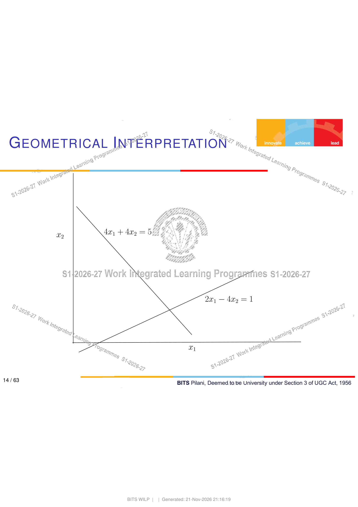
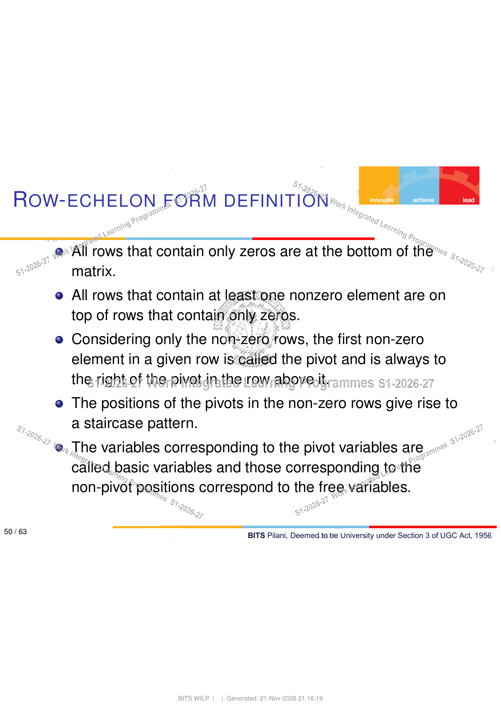

# Module 01: Systems of Linear Equations and Gaussian Elimination

**Course**: AIML ZC416 — Mathematical Foundations for Machine Learning  
**Prescribed Textbooks**: T1 Deisenroth, Faisal & Ong (*Mathematics for Machine Learning*, Ch 2.1–2.3); R1 Boyd & Vandenberghe (*VMLS*, Ch 1–2)  
**Primary Faculty**: Prof. Mandar Vijay Datar (Lead Instructor) | **Companion**: Prof. Saurabh (`Lecture_1_Companion.pdf`, `Lecture_2_Companion.pdf`)  
**Exam Weight**: High (Appears in Mid-Semester Closed Book Q1 & Q2; fundamental prerequisite for all subsequent modules)

---

## 1. Executive Summary & Foundational Concepts

A system of linear equations is a collection of $m$ linear equations involving the same set of $n$ variables $x_1, x_2, \dots, x_n$:
$$\begin{aligned}
a_{11} x_1 + a_{12} x_2 + \cdots + a_{1n} x_n &= b_1 \\
a_{21} x_1 + a_{22} x_2 + \cdots + a_{2n} x_n &= b_2 \\
&\;\;\vdots \\
a_{m1} x_1 + a_{m2} x_2 + \cdots + a_{mn} x_n &= b_m
\end{aligned}$$

In compact matrix notation, this is expressed as:
$$A x = b$$
where $A \in \mathbb{R}^{m \times n}$ is the coefficient matrix, $x \in \mathbb{R}^n$ is the unknown parameter vector, and $b \in \mathbb{R}^m$ is the target/measurement vector.

```
       A (m × n)             x (n × 1)      b (m × 1)
┌───────────────────────┐   ┌───────┐     ┌───────┐
│ a11   a12  ...   a1n  │   │  x1   │     │  b1   │
│ a21   a22  ...   a2n  │ · │  x2   │  =  │  b2   │
│  :     :    :     :   │   │   :   │     │   :   │
│ am1   am2  ...   amn  │   │  xn   │     │  bm   │
└───────────────────────┘   └───────┘     └───────┘
```



### Three Fundamental Perspectives
1. **Row Picture**: Each equation defines a hyperplane of dimension $n-1$ in $\mathbb{R}^n$. The solution set represents the intersection of these $m$ hyperplanes.
2. **Column Picture**: The system represents a linear combination of the column vectors of $A$ equal to $b$:
   $$\sum_{j=1}^n x_j a_{:, j} = x_1 \begin{bmatrix} a_{11} \\ \vdots \\ a_{m1} \end{bmatrix} + x_2 \begin{bmatrix} a_{12} \\ \vdots \\ a_{m2} \end{bmatrix} + \cdots + x_n \begin{bmatrix} a_{1n} \\ \vdots \\ a_{mn} \end{bmatrix} = \begin{bmatrix} b_1 \\ \vdots \\ b_m \end{bmatrix}$$
   A solution exists if and only if $b$ lies in the column space $\mathcal{C}(A)$.
3. **Geometric Transformation**: The matrix $A$ represents a linear mapping $T: \mathbb{R}^n \to \mathbb{R}^m$. Solving $Ax = b$ finds the pre-image of $b$ under $T$.

---

## 2. Solution Sets & The Rouché-Capelli Theorem

For any linear system $Ax = b$, exactly one of three mutually exclusive possibilities holds:
1. **Unique Solution**: The hyperplanes intersect at exactly one point ($\text{rank}(A) = \text{rank}([A \mid b]) = n$).
2. **Infinitely Many Solutions**: The system is consistent with at least one free variable ($\text{rank}(A) = \text{rank}([A \mid b]) = r < n$). The solution space is an affine manifold of dimension $n - r$:
   $$x = x_p + \sum_{k=1}^{n-r} c_k v_k, \quad c_k \in \mathbb{R}$$
   where $x_p$ is a **particular solution** and $\{v_1, \dots, v_{n-r}\}$ forms a basis for the null space $\mathcal{N}(A)$ (**direction vectors**).
3. **No Solution (Inconsistent)**: The hyperplanes are parallel or do not have a common intersection point ($\text{rank}(A) < \text{rank}([A \mid b])$).

```
                      ┌─────────────────────────────────┐
                      │ Augmented Matrix Rank Analysis  │
                      └────────────────┬────────────────┘
                                       │
            ┌──────────────────────────┴──────────────────────────┐
            ▼                                                     ▼
   rank(A) == rank([A|b])                                rank(A) < rank([A|b])
      [CONSISTENT]                                          [INCONSISTENT]
            │                                                     │
     ┌──────┴──────┐                                              ▼
     ▼             ▼                                         NO SOLUTION
  rank == n     rank < n                                (Hyperplanes do not meet)
 UNIQUE        INFINITE
SOLUTION      SOLUTIONS
(r = n)      (n - r free vars)
```

---

## 3. Gaussian Elimination & Echelon Forms

Solving $Ax = b$ systematically is achieved by constructing the augmented matrix $[A \mid b] \in \mathbb{R}^{m \times (n+1)}$ and applying **Elementary Row Operations (EROs)**:
1. **Row Swap**: $R_i \leftrightarrow R_j$
2. **Row Scaling**: $R_i \leftarrow c R_i$ ($c \ne 0$)
3. **Row Replacement**: $R_i \leftarrow R_i + c R_j$ ($i \ne j$)



### Row Echelon Form (REF)
A matrix is in REF if:
1. All zero rows are strictly at the bottom of the matrix.
2. The leading non-zero entry (pivot) of each non-zero row is strictly to the right of the leading entry of the row above it.
3. All entries in a column below a pivot are zero.

### Reduced Row Echelon Form (RREF)
A matrix is in RREF if it satisfies REF and additionally:
1. Each leading entry (pivot) is equal to $1$.
2. Each pivot is the only non-zero entry in its column (all entries above and below the pivot are zero).

---

## 4. Solved Examination Numericals (BITS Pilani Regular & Makeup Tests)

### Problem 1: BITS Mid-Semester Test (Regular Paper 1, Q1 — 4 Marks)
**Statement**: Consider the system of linear equations $Ax = b$ where:
$$A = \begin{bmatrix} 1 & 1 & 2 \\ 2 & 3 & 4 \\ 1 & 2 & 5 \end{bmatrix}, \quad b = \begin{bmatrix} 5 \\ 11 \\ 9 \end{bmatrix}$$
(a) Form $[A \mid b]$ and reduce to row echelon form, clearly stating each elementary row operation. [2 M]  
(b) Determine the solution type and find the complete solution. [2 M]

#### Step-by-Step Analytical Solution:
**(a) Augmented Matrix Formulation and Row Reduction**:
Form the initial augmented matrix:
$$[A \mid b] = \left[\begin{array}{ccc|c} 1 & 1 & 2 & 5 \\ 2 & 3 & 4 & 11 \\ 1 & 2 & 5 & 9 \end{array}\right]$$

Apply row replacement operations to eliminate entries below pivot $a_{11} = 1$:
- $R_2 \leftarrow R_2 - 2 R_1$:
  $$\begin{bmatrix} 2 - 2(1) & 3 - 2(1) & 4 - 2(2) & \mid & 11 - 2(5) \end{bmatrix} = \begin{bmatrix} 0 & 1 & 0 & \mid & 1 \end{bmatrix}$$
- $R_3 \leftarrow R_3 - R_1$:
  $$\begin{bmatrix} 1 - 1 & 2 - 1 & 5 - 2 & \mid & 9 - 5 \end{bmatrix} = \begin{bmatrix} 0 & 1 & 3 & \mid & 4 \end{bmatrix}$$

Matrix after Phase 1:
$$\left[\begin{array}{ccc|c} 1 & 1 & 2 & 5 \\ 0 & 1 & 0 & 1 \\ 0 & 1 & 3 & 4 \end{array}\right]$$

Eliminate entry below second pivot $a_{22} = 1$:
- $R_3 \leftarrow R_3 - R_2$:
  $$\begin{bmatrix} 0 & 1 - 1 & 3 - 0 & \mid & 4 - 1 \end{bmatrix} = \begin{bmatrix} 0 & 0 & 3 & \mid & 3 \end{bmatrix}$$

Matrix in Row Echelon Form (REF):
$$\left[\begin{array}{ccc|c} 1 & 1 & 2 & 5 \\ 0 & 1 & 0 & 1 \\ 0 & 0 & 3 & 3 \end{array}\right]$$

**(b) Determination of Solution Type & Complete Solution**:
- Non-zero rows in $A$: $3 \implies \text{rank}(A) = 3$.
- Non-zero rows in $[A \mid b]$: $3 \implies \text{rank}([A \mid b]) = 3$.
- Number of variables: $n = 3$.
Since $\text{rank}(A) = \text{rank}([A \mid b]) = n = 3$, the system is **consistent with a unique solution**.

Back-substitution:
1. From Row 3: $3 x_3 = 3 \implies x_3 = 1$.
2. From Row 2: $x_2 + 0 x_3 = 1 \implies x_2 = 1$.
3. From Row 1: $x_1 + x_2 + 2 x_3 = 5 \implies x_1 + 1 + 2(1) = 5 \implies x_1 = 2$.

$$\mathbf{x} = \begin{bmatrix} 2 \\ 1 \\ 1 \end{bmatrix}$$

---

### Problem 2: BITS Mid-Semester Test (Regular Paper 1, Q2 — 4 Marks)
**Statement**: Consider $Ax = b$ where:
$$A = \begin{bmatrix} 1 & 2 & 1 \\ 1 & 1 & 2 \\ 2 & 3 & 3 \end{bmatrix}, \quad b = \begin{bmatrix} 4 \\ 3 \\ 7 \end{bmatrix}$$
(a) Reduce $[A \mid b]$ to row echelon form; determine the ranks. [2 M]  
(b) Find the complete general solution (particular + direction vectors). [2 M]

#### Step-by-Step Analytical Solution:
**(a) Row Reduction to REF**:
$$[A \mid b] = \left[\begin{array}{ccc|c} 1 & 2 & 1 & 4 \\ 1 & 1 & 2 & 3 \\ 2 & 3 & 3 & 7 \end{array}\right]$$

Apply $R_2 \leftarrow R_2 - R_1$ and $R_3 \leftarrow R_3 - 2 R_1$:
$$\left[\begin{array}{ccc|c} 1 & 2 & 1 & 4 \\ 0 & -1 & 1 & -1 \\ 0 & -1 & 1 & -1 \end{array}\right]$$

Apply $R_3 \leftarrow R_3 - R_2$:
$$\left[\begin{array}{ccc|c} 1 & 2 & 1 & 4 \\ 0 & -1 & 1 & -1 \\ 0 & 0 & 0 & 0 \end{array}\right]$$

Multiply Row 2 by $-1$ ($R_2 \leftarrow -R_2$):
$$\left[\begin{array}{ccc|c} 1 & 2 & 1 & 4 \\ 0 & 1 & -1 & 1 \\ 0 & 0 & 0 & 0 \end{array}\right]$$

Ranks:
- Non-zero rows in $A$: $2 \implies \text{rank}(A) = 2$.
- Non-zero rows in $[A \mid b]$: $2 \implies \text{rank}([A \mid b]) = 2$.
Since $\text{rank}(A) = \text{rank}([A \mid b]) = 2 < 3$, the system has **infinitely many solutions** with $3 - 2 = 1$ free variable.

**(b) General Solution Decomposition (Particular + Direction Vector)**:
Identify pivots and variables:
- Pivot columns: Columns 1 and 2 $\implies x_1, x_2$ are **pivot variables**.
- Non-pivot column: Column 3 $\implies x_3$ is a **free variable**. Let $x_3 = t \in \mathbb{R}$.

From Row 2:
$$x_2 - x_3 = 1 \implies x_2 = 1 + x_3 = 1 + t$$

From Row 1:
$$x_1 + 2 x_2 + x_3 = 4 \implies x_1 = 4 - 2(1 + t) - t = 4 - 2 - 2t - t = 2 - 3t$$

Assemble the vector $x$:
$$x = \begin{bmatrix} x_1 \\ x_2 \\ x_3 \end{bmatrix} = \begin{bmatrix} 2 - 3t \\ 1 + t \\ t \end{bmatrix} = \begin{bmatrix} 2 \\ 1 \\ 0 \end{bmatrix} + t \begin{bmatrix} -3 \\ 1 \\ 1 \end{bmatrix}, \quad t \in \mathbb{R}$$

- **Particular Solution**: $x_p = \begin{bmatrix} 2 & 1 & 0 \end{bmatrix}^\top$
- **Direction Vector (Null Space Basis)**: $v = \begin{bmatrix} -3 & 1 & 1 \end{bmatrix}^\top$

$$\mathbf{x} = \mathbf{x}_p + t \mathbf{v}$$

---

## 5. Python Implementation from Scratch

```python
import numpy as np

def rref(A: np.ndarray, b: np.ndarray):
    """
    Computes Reduced Row Echelon Form (RREF) of augmented matrix [A | b]
    and extracts particular solution and null space direction vectors.
    """
    Ab = np.hstack([A.astype(float), b.reshape(-1, 1).astype(float)])
    m, n_plus_1 = Ab.shape
    n = n_plus_1 - 1
    
    pivot_cols = []
    curr_row = 0
    
    for col in range(n):
        if curr_row >= m:
            break
        # Partial pivoting: select largest absolute value in column
        pivot_idx = curr_row + np.argmax(np.abs(Ab[curr_row:, col]))
        if np.isclose(Ab[pivot_idx, col], 0):
            continue  # Free variable column
            
        # Swap rows
        Ab[[curr_row, pivot_idx]] = Ab[[pivot_idx, curr_row]]
        
        # Scale pivot to 1
        Ab[curr_row] /= Ab[curr_row, col]
        
        # Eliminate all other entries in this column
        for r in range(m):
            if r != curr_row:
                Ab[r] -= Ab[r, col] * Ab[curr_row]
                
        pivot_cols.append(col)
        curr_row += 1
        
    rank_A = len(pivot_cols)
    # Check consistency: if any row has zero coefficients but non-zero target
    inconsistent = any(np.all(np.isclose(Ab[r, :n], 0)) and not np.isclose(Ab[r, n], 0) for r in range(curr_row, m))
    
    return Ab, pivot_cols, not inconsistent

# Test on BITS Midterm Problem 2
A = np.array([[1, 2, 1], [1, 1, 2], [2, 3, 3]])
b = np.array([4, 3, 7])
Ab_rref, pivots, consistent = rref(A, b)
print("RREF Augmented Matrix:\n", np.round(Ab_rref, 4))
print("Pivot columns:", pivots)
print("Is Consistent:", consistent)
```

---

## 6. Exam Tips & Failure Modes

1. **Failure to Express Direction Vectors**: On university closed-book exams, leaving the solution as parametric formulas ($x_1 = 2 - 3t$) without writing the explicit vector decomposition $x = x_p + t v_1$ leads to losing 1 to 2 marks.
2. **Arithmetic Errors in Row Replacement**: When computing $R_i \leftarrow R_i - c R_j$, always double-check the augmented column entry. A single arithmetic error in column $b$ invalidates all back-substitution steps.
3. **Pivots Must Never Be Zero**: If $a_{kk} = 0$, you **must** perform a row swap with a lower row where $a_{ik} \ne 0$. Never divide by zero.
4. **Rank Equality is Both Necessary and Sufficient**: A system is consistent if and only if the augmented column contains no pivot.
