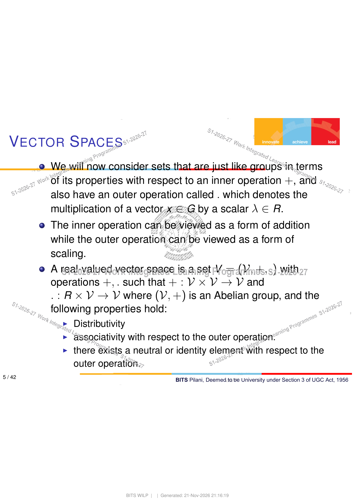

# Module 02: Vector Spaces, Subspaces, and Bases

**Course**: AIML ZC416 — Mathematical Foundations for Machine Learning  
**Prescribed Textbooks**: T1 Deisenroth, Faisal & Ong (*Mathematics for Machine Learning*, Ch 2.4–2.6); R1 Boyd & Vandenberghe (*VMLS*, Ch 5–6)  
**Syllabus module**: **M02** — Vector Spaces, Subspaces, and Bases (see `Notes/AI Notes/module_map.yaml`)  
**Canonical video**: `Inbox/Prof. Mandar Datar/Recordings/MFML_Mandar Datar_3.mp4`  
**Contact sessions** (reference only): Contact Sessions 3–4 (Prof. Mandar Vijay Datar). Companion: Prof. Saurabh (`Lecture_3_Companion.pdf`, `Lecture_4_Companion.pdf`), Prof. Upendar Mendu.
**Exam Weight**: Very High (Appears in Mid-Semester Closed Book Q2 & Q3, and Comprehensive Exam Q1)

---

## 1. Executive Summary & Algebraic Foundations

A **vector space** over the real field $\mathbb{R}$ is a mathematical structure consisting of a non-empty set $V$ equipped with two operations:
1. **Vector Addition** $+ : V \times V \to V$, $(u, v) \mapsto u + v$
2. **Scalar Multiplication** $\cdot : \mathbb{R} \times V \to V$, $(\alpha, v) \mapsto \alpha v$

such that for all $u, v, w \in V$ and all scalars $\alpha, \beta \in \mathbb{R}$, the following **8 axioms** hold:
- **A1 (Additive Commutativity)**: $u + v = v + u$
- **A2 (Additive Associativity)**: $(u + v) + w = u + (v + w)$
- **A3 (Additive Identity)**: $\exists \mathbf{0} \in V$ such that $v + \mathbf{0} = v$ for all $v \in V$
- **A4 (Additive Inverse)**: $\forall v \in V$, $\exists (-v) \in V$ such that $v + (-v) = \mathbf{0}$
- **A5 (Distributivity over Vectors)**: $\alpha(u + v) = \alpha u + \alpha v$
- **A6 (Distributivity over Scalars)**: $(\alpha + \beta)v = \alpha v + \beta v$
- **A7 (Multiplicative Associativity)**: $\alpha(\beta v) = (\alpha \beta)v$
- **A8 (Multiplicative Identity)**: $1 \cdot v = v$



### Vector Subspaces
A subset $U \subseteq V$ is a **vector subspace** of $V$ (written $U \le V$) if $U$ is itself a vector space under the operations inherited from $V$.

#### Subspace Theorem (Two-Step Test):
A non-empty subset $U \subseteq V$ is a subspace of $V$ if and only if:
1. **Contains Zero**: $\mathbf{0} \in U$
2. **Closed under Linear Combinations**: $\forall u, v \in U$ and $\forall \alpha, \beta \in \mathbb{R}$, $\alpha u + \beta v \in U$

---

## 2. Linear Independence, Basis & Dimension

### Linear Combinations & Span
Given a set of vectors $S = \{v_1, v_2, \dots, v_k\} \subset V$, a **linear combination** is any vector of the form:
$$v = \sum_{i=1}^k c_i v_i = c_1 v_1 + c_2 v_2 + \cdots + c_k v_k, \quad c_i \in \mathbb{R}$$
The **span** of $S$, denoted $\text{span}(S)$, is the set of all possible linear combinations of vectors in $S$. $\text{span}(S)$ is always a subspace of $V$.

### Linear Independence
The vectors $\{v_1, \dots, v_k\}$ are **linearly independent** if the only scalars satisfying:
$$c_1 v_1 + c_2 v_2 + \cdots + c_k v_k = \mathbf{0}$$
are the trivial scalars:
$$c_1 = c_2 = \cdots = c_k = 0$$
If there exist scalars, not all zero, such that $\sum c_i v_i = \mathbf{0}$, the vectors are **linearly dependent**. In that case, at least one vector can be expressed as a linear combination of the others.

### Basis & Dimension
A set of vectors $\mathcal{B} = \{b_1, b_2, \dots, b_d\} \subset V$ is a **basis** of $V$ if:
1. $\mathcal{B}$ is **linearly independent**.
2. $\mathcal{B}$ **spans** $V$ ($\text{span}(\mathcal{B}) = V$).

- **Minimal Spanning Property**: Removing any vector from a basis causes it to no longer span $V$.
- **Maximal Independent Property**: Adding any vector from $V$ to a basis makes the set linearly dependent.
- **Dimension**: The number of vectors in any basis of $V$ is an invariant called the **dimension** of $V$, denoted $\dim(V)$.

---

## 3. The Four Fundamental Subspaces of a Matrix

For any matrix $A \in \mathbb{R}^{m \times n}$:

```
     Column Space C(A) ⊆ ℝᵐ             Null Space N(A) ⊆ ℝⁿ
┌───────────────────────────────┐   ┌───────────────────────────────┐
│ dim = r = rank(A)             │   │ dim = n - r = nullity(A)      │
│ span of column vectors of A   │   │ solutions to Ax = 0           │
│ {y ∈ ℝᵐ : y = Ax for some x}  │   │ {x ∈ ℝⁿ : Ax = 0}             │
└───────────────┬───────────────┘   └───────────────┬───────────────┘
                │ Orthogonal                        │ Orthogonal
                │ Complement                        │ Complement
                ▼                                   ▼
┌───────────────────────────────┐   ┌───────────────────────────────┐
│ Left Null Space N(Aᵀ) ⊆ ℝᵐ    │   │ Row Space R(A) ⊆ ℝⁿ           │
│ dim = m - r                   │   │ dim = r = rank(A)             │
│ {y ∈ ℝᵐ : Aᵀy = 0}            │   │ span of row vectors of A      │
└───────────────────────────────┘   └───────────────────────────────┘
```

### The Rank-Nullity Theorem (Fundamental Theorem of Linear Algebra)
For any linear mapping represented by matrix $A \in \mathbb{R}^{m \times n}$:
$$\dim(\mathcal{C}(A)) + \dim(\mathcal{N}(A)) = n \implies \text{rank}(A) + \text{nullity}(A) = n$$

---

## 4. Solved Examination Numericals (BITS Pilani Midterm Tests)

### Problem 1: BITS Mid-Semester Test (Regular Paper 1, Q3 — 4 Marks)
**Statement**: Let $b_1, b_2, b_3, b_4, b_5 \in \mathbb{R}^5$ be linearly independent vectors, and define:
$$\begin{aligned}
x_1 &= b_1 + b_2 + 2b_3 \\
x_2 &= 2b_1 - b_2 + b_4 \\
x_3 &= b_1 + 3b_2 + b_3 + b_5 \\
x_4 &= 4b_1 + b_2 + 2b_4 - b_5
\end{aligned}$$
Determine whether the set $\{x_1, x_2, x_3, x_4\}$ is linearly independent.

#### Step-by-Step Analytical Solution:
Consider the linear combination equation:
$$c_1 x_1 + c_2 x_2 + c_3 x_3 + c_4 x_4 = \mathbf{0}$$

Substitute the expressions for $x_1, x_2, x_3, x_4$ in terms of the basis vectors $\{b_1, \dots, b_5\}$:
$$\begin{aligned}
&c_1 (b_1 + b_2 + 2b_3) + c_2 (2b_1 - b_2 + b_4) + c_3 (b_1 + 3b_2 + b_3 + b_5) + c_4 (4b_1 + b_2 + 2b_4 - b_5) = \mathbf{0} \\
\iff &(c_1 + 2c_2 + c_3 + 4c_4) b_1 + (c_1 - c_2 + 3c_3 + c_4) b_2 + (2c_1 + c_3) b_3 + (c_2 + 2c_4) b_4 + (c_3 - c_4) b_5 = \mathbf{0}
\end{aligned}$$

Since $\{b_1, \dots, b_5\}$ are given to be linearly independent, the coefficients of each $b_i$ must vanish simultaneously:
1. $b_1: c_1 + 2c_2 + c_3 + 4c_4 = 0$
2. $b_2: c_1 - c_2 + 3c_3 + c_4 = 0$
3. $b_3: 2c_1 + c_3 = 0 \implies c_3 = -2c_1$
4. $b_4: c_2 + 2c_4 = 0 \implies c_2 = -2c_4$
5. $b_5: c_3 - c_4 = 0 \implies c_3 = c_4$

From (5) and (3):
$$c_4 = c_3 = -2c_1$$
From (4):
$$c_2 = -2c_4 = -2(-2c_1) = 4c_1$$

Now substitute $c_2 = 4c_1, c_3 = -2c_1, c_4 = -2c_1$ into Equation (1):
$$c_1 + 2(4c_1) + (-2c_1) + 4(-2c_1) = c_1 + 8c_1 - 2c_1 - 8c_1 = -c_1 = 0 \implies c_1 = 0$$

Since $c_1 = 0$:
$$c_2 = 4(0) = 0, \quad c_3 = -2(0) = 0, \quad c_4 = -2(0) = 0$$

The only solution is the trivial solution $c_1 = c_2 = c_3 = c_4 = 0$.  
Therefore, the set $\{x_1, x_2, x_3, x_4\}$ is **linearly independent**.

---

### Problem 2: BITS Mid-Semester Test (Regular Paper, EC-2 Q3 — 4 Marks)
**Statement**: Consider the vectors in $\mathbb{R}^4$:
$$u_1 = \begin{bmatrix} 1 \\ 0 \\ 1 \\ 0 \end{bmatrix}, \quad u_2 = \begin{bmatrix} 0 \\ 1 \\ 0 \\ 1 \end{bmatrix}, \quad u_3 = \begin{bmatrix} 1 \\ 1 \\ 1 \\ 1 \end{bmatrix}$$
(a) Show that the set $\{u_1, u_2, u_3\}$ is linearly dependent. [1 M]  
(b) Let $W = \text{span}\{u_1, u_2\}$.
(i) Prove that $W$ is a subspace of $\mathbb{R}^4$. [2 M]  
(ii) Find a basis for $W$ and state $\dim(W)$. [1 M]

#### Step-by-Step Analytical Solution:
**(a) Showing Linear Dependence**:
Observe by direct inspection:
$$u_1 + u_2 = \begin{bmatrix} 1 \\ 0 \\ 1 \\ 0 \end{bmatrix} + \begin{bmatrix} 0 \\ 1 \\ 0 \\ 1 \end{bmatrix} = \begin{bmatrix} 1 \\ 1 \\ 1 \\ 1 \end{bmatrix} = u_3$$
Rearranging gives:
$$1 \cdot u_1 + 1 \cdot u_2 - 1 \cdot u_3 = \mathbf{0}$$
Since there exists a non-trivial linear combination with scalars $c_1 = 1, c_2 = 1, c_3 = -1 \ne 0$ yielding $\mathbf{0}$, the set $\{u_1, u_2, u_3\}$ is **linearly dependent**.

**(b)(i) Proving $W = \text{span}\{u_1, u_2\}$ is a Subspace of $\mathbb{R}^4$**:
By definition:
$$W = \{x \in \mathbb{R}^4 : x = \alpha_1 u_1 + \alpha_2 u_2, \; \alpha_1, \alpha_2 \in \mathbb{R}\}$$
We verify the two subspace conditions:
1. **Contains Zero Vector**:
   Choose $\alpha_1 = 0, \alpha_2 = 0$. Then $\mathbf{0} = 0 \cdot u_1 + 0 \cdot u_2 \in W$.
2. **Closed under Linear Combinations**:
   Let $x, y \in W$ and $c, d \in \mathbb{R}$. Then $x = \alpha_1 u_1 + \alpha_2 u_2$ and $y = \beta_1 u_1 + \beta_2 u_2$ for some scalars $\alpha_1, \alpha_2, \beta_1, \beta_2 \in \mathbb{R}$.
   $$\begin{aligned}
   c x + d y &= c(\alpha_1 u_1 + \alpha_2 u_2) + d(\beta_1 u_1 + \beta_2 u_2) \\
   &= (c \alpha_1 + d \beta_1) u_1 + (c \alpha_2 + d \beta_2) u_2
   \end{aligned}$$
   Since $\gamma_1 = c \alpha_1 + d \beta_1 \in \mathbb{R}$ and $\gamma_2 = c \alpha_2 + d \beta_2 \in \mathbb{R}$, $cx + dy = \gamma_1 u_1 + \gamma_2 u_2 \in W$.
Thus, $W$ is a **subspace of $\mathbb{R}^4$**.

**(b)(ii) Basis and Dimension of $W$**:
$W$ is spanned by $\{u_1, u_2\}$ by definition. We test whether $\{u_1, u_2\}$ is linearly independent:
$$c_1 u_1 + c_2 u_2 = \begin{bmatrix} c_1 \\ c_2 \\ c_1 \\ c_2 \end{bmatrix} = \begin{bmatrix} 0 \\ 0 \\ 0 \\ 0 \end{bmatrix} \implies c_1 = 0, \; c_2 = 0$$
Since $\{u_1, u_2\}$ is linearly independent and spans $W$, it forms a **basis for $W$**:
$$\mathcal{B}_W = \left\{ \begin{bmatrix} 1 \\ 0 \\ 1 \\ 0 \end{bmatrix}, \begin{bmatrix} 0 \\ 1 \\ 0 \\ 1 \end{bmatrix} \right\}$$
$$\dim(W) = |\mathcal{B}_W| = \mathbf{2}$$

---

## 5. Python Implementation from Scratch

```python
import numpy as np

def check_linear_independence(vectors: list[np.ndarray]) -> tuple[bool, int]:
    """
    Given a list of vectors in R^n, returns True if linearly independent,
    along with the rank of the spanning matrix.
    """
    # Stack vectors as columns
    A = np.column_stack(vectors).astype(float)
    # Compute rank via singular values
    rank = np.linalg.matrix_rank(A)
    is_independent = (rank == len(vectors))
    return is_independent, rank

# Test BITS Exam Problem 2
u1 = np.array([1, 0, 1, 0])
u2 = np.array([0, 1, 0, 1])
u3 = np.array([1, 1, 1, 1])

ind_3, rank_3 = check_linear_independence([u1, u2, u3])
print(f"Set {{u1, u2, u3}}: Independent = {ind_3}, Rank = {rank_3}")

ind_2, rank_2 = check_linear_independence([u1, u2])
print(f"Set {{u1, u2}}: Independent = {ind_2}, Rank = {rank_2} (Dimension = {rank_2})")
```

---

## 6. Exam Tips & Failure Modes

1. **Subspace Proof Shortcuts**: On written university exams, simply stating "a span is always a subspace" is insufficient when asked to *prove* it is a subspace. Always show $\mathbf{0} \in W$ and closure under $c x + d y$ explicitly.
2. **Dimension vs Number of Components**: A subspace in $\mathbb{R}^4$ does **not** have dimension 4; its dimension is the number of basis vectors (here, 2). Do not confuse vector length with subspace dimension!
3. **Rank-Nullity Verification**: Always cross-check that $\text{rank}(A) + \text{nullity}(A) = \text{number of columns}$. If $A \in \mathbb{R}^{3 \times 3}$ has rank 2, its null space must have dimension exactly $3 - 2 = 1$.
