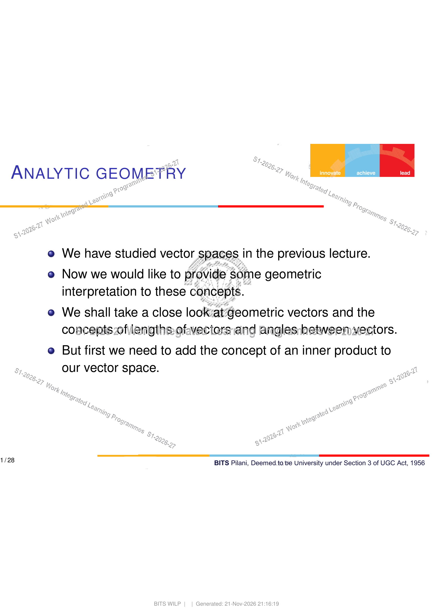
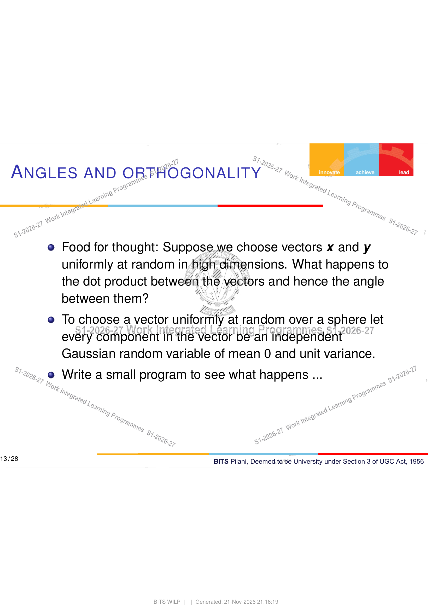

# Module 03: Inner Products, Norms, and Analytic Geometry

**Course**: AIML ZC416 — Mathematical Foundations for Machine Learning  
**Prescribed Textbooks**: T1 Deisenroth, Faisal & Ong (*Mathematics for Machine Learning*, Ch 3.1–3.8); R1 Boyd & Vandenberghe (*VMLS*, Ch 3)  
**Syllabus module**: **M03** — Inner Products, Norms, and Analytic Geometry (see `Notes/AI Notes/module_map.yaml`)  
**Canonical video**: `Inbox/Prof. Mandar Datar/Recordings/MFML_Mandar Datar_5.mp4`  
**Contact sessions** (reference only): Contact Sessions 5–6 (Prof. Mandar Vijay Datar). Companion: Prof. Saurabh (`Lecture_5_Companion.pdf`, `Lecture_6_Companion.pdf`), Prof. Michael Alphonse.
**Exam Weight**: Very High (Featured in Midterm Regular Q4, Midterm EC-2 Q5, and Comprehensive Exam EC-3 Q2)

---

## 1. Executive Summary & Foundational Definitions

Geometric concepts such as lengths, distances, angles, and orthogonality are not innate properties of general vector spaces; they are introduced through an additional algebraic structure called an **inner product**.



### Formal Definition of an Inner Product
Let $V$ be a real vector space. An **inner product** on $V$ is a binary mapping $\langle \cdot, \cdot \rangle : V \times V \to \mathbb{R}$ satisfying three axioms for all $x, y, z \in V$ and $\alpha \in \mathbb{R}$:
1. **Positive Definiteness**:
   $$\langle x, x \rangle \ge 0, \quad \text{and} \quad \langle x, x \rangle = 0 \iff x = \mathbf{0}$$
2. **Symmetry**:
   $$\langle x, y \rangle = \langle y, x \rangle$$
3. **Linearity in the First Argument**:
   $$\langle \alpha x + z, y \rangle = \alpha \langle x, y \rangle + \langle z, y \rangle$$

A real vector space equipped with an inner product is an **inner product space** (or Euclidean space if finite-dimensional).

---

## 2. Matrix-Induced Inner Products & Positive Definiteness

The standard Euclidean dot product in $\mathbb{R}^n$ is:
$$\langle x, y \rangle_{\text{dot}} = x^\top y = \sum_{i=1}^n x_i y_i$$

A generalized bilinear form on $\mathbb{R}^n$ is defined using an $n \times n$ matrix $A$:
$$\langle x, y \rangle_A = x^\top A y$$

### Theorem (Matrix-Induced Inner Product Criterion)
$\langle x, y \rangle_A = x^\top A y$ defines a valid inner product on $\mathbb{R}^n$ if and only if $A$ is **Symmetric Positive Definite (SPD)**:
1. **Symmetric**: $A = A^\top$ (ensures symmetry $\langle x, y \rangle = \langle y, x \rangle$)
2. **Positive Definite ($A \succ 0$)**: $x^\top A x > 0$ for all $x \in \mathbb{R}^n \setminus \{\mathbf{0}\}$ (ensures positive definiteness)

### Sylvester's Criterion for Positive Definiteness
A symmetric matrix $A \in \mathbb{R}^{n \times n}$ is positive definite if and only if all its **leading principal minors** $\Delta_k$ are strictly positive:
$$\Delta_1 = a_{11} > 0, \quad \Delta_2 = \det\begin{bmatrix} a_{11} & a_{12} \\ a_{21} & a_{22} \end{bmatrix} > 0, \quad \dots, \quad \Delta_n = \det(A) > 0$$

---

## 3. Norms, Metrics, Angles & Fundamental Inequalities

Every inner product naturally induces geometric measurements:

### Induced Norm & Distance
- **Induced Norm**:
  $$\|x\|_A = \sqrt{\langle x, x \rangle_A} = \sqrt{x^\top A x}$$
- **Induced Distance Metric**:
  $$d_A(x, y) = \|x - y\|_A = \sqrt{(x - y)^\top A (x - y)}$$

### Angle & Orthogonality
The angle $\theta \in [0, \pi]$ between non-zero vectors $x$ and $y$ is defined via:
$$\cos \theta = \frac{\langle x, y \rangle_A}{\|x\|_A \|y\|_A} = \frac{x^\top A y}{\sqrt{x^\top A x} \sqrt{y^\top A y}}$$
Two vectors are **orthogonal** ($x \perp_A y$) with respect to inner product $\langle \cdot, \cdot \rangle_A$ if and only if:
$$\langle x, y \rangle_A = x^\top A y = 0$$

### Fundamental Inequalities
1. **Cauchy-Schwarz Inequality**:
   $$|\langle x, y \rangle_A| \le \|x\|_A \|y\|_A$$
   Equality holds if and only if $x$ and $y$ are linearly dependent ($x = c y$).
2. **Triangle Inequality**:
   $$\|x + y\|_A \le \|x\|_A + \|y\|_A$$
   Equality holds if and only if one vector is a non-negative scalar multiple of the other.

---

## 4. Orthogonal Projections & The Gram-Schmidt Process



### The Gram-Schmidt Orthonormalization Algorithm
Given a set of linearly independent vectors $\{v_1, v_2, \dots, v_k\}$ in an inner product space $(V, \langle \cdot, \cdot \rangle_A)$:

1. **Step 1**:
   $$u_1 = v_1, \quad e_1 = \frac{u_1}{\|u_1\|_A}$$
2. **Step 2**:
   $$u_2 = v_2 - \langle v_2, e_1 \rangle_A e_1, \quad e_2 = \frac{u_2}{\|u_2\|_A}$$
3. **General Step $i$**:
   $$u_i = v_i - \sum_{j=1}^{i-1} \langle v_i, e_j \rangle_A e_j, \quad e_i = \frac{u_i}{\|u_i\|_A}$$

The resulting set $\{e_1, e_2, \dots, e_k\}$ is **orthonormal**:
$$\langle e_i, e_j \rangle_A = \delta_{ij} = \begin{cases} 1 & \text{if } i = j \\ 0 & \text{if } i \ne j \end{cases}$$

---

## 5. Solved Examination Numericals (BITS Pilani Midterm & Comprehensive Tests)

### Problem 1: BITS Mid-Semester Test (Regular Paper, EC-2 Q5 — 4 Marks)
**Statement**: Consider the matrix $A \in \mathbb{R}^{3 \times 3}$ defined as:
$$A = \begin{bmatrix} 2 & 0 & -1 \\ 0 & 2 & 0 \\ -1 & 0 & 2 \end{bmatrix}$$
and two vectors $x_1 = [1, \alpha, 1]^\top$ and $x_2 = [1, 1, 1]^\top$ in $\mathbb{R}^3$. Define the inner product on $\mathbb{R}^3$ by $\langle x, y \rangle = x^\top A y$.
(a) Find the value of $\alpha$ such that the angle between $x_1$ and $x_2$ in this inner product space is $45^\circ$. [2 M]  
(b) Using the value of $\alpha$ found in (a), compute the distance $d(x_1, x_2) = \|x_1 - x_2\|$, where $\|\cdot\|$ is the norm induced by the inner product. [2 M]

#### Step-by-Step Analytical Solution:
**(a) Finding $\alpha$ for $\theta = 45^\circ$**:
First verify that $A$ is symmetric: $A^\top = A$ (Yes).  
Leading principal minors:
- $\Delta_1 = 2 > 0$
- $\Delta_2 = \det \begin{bmatrix} 2 & 0 \\ 0 & 2 \end{bmatrix} = 4 > 0$
- $\Delta_3 = \det(A) = 2(4 - 0) - 0 - 1(0 - (-2)) = 8 - 2 = 6 > 0$  
Thus, $A \succ 0$, so $\langle x, y \rangle_A = x^\top A y$ is a valid inner product.

Now compute the required matrix products:
1. **Inner product $\langle x_1, x_2 \rangle_A$**:
   $$A x_2 = \begin{bmatrix} 2 & 0 & -1 \\ 0 & 2 & 0 \\ -1 & 0 & 2 \end{bmatrix} \begin{bmatrix} 1 \\ 1 \\ 1 \end{bmatrix} = \begin{bmatrix} 2(1) - 1(1) \\ 2(1) \\ -1(1) + 2(1) \end{bmatrix} = \begin{bmatrix} 1 \\ 2 \\ 1 \end{bmatrix}$$
   $$\langle x_1, x_2 \rangle_A = x_1^\top (A x_2) = \begin{bmatrix} 1 & \alpha & 1 \end{bmatrix} \begin{bmatrix} 1 \\ 2 \\ 1 \end{bmatrix} = 1(1) + \alpha(2) + 1(1) = 2\alpha + 2$$

2. **Norm squared $\|x_1\|_A^2$**:
   $$A x_1 = \begin{bmatrix} 2 & 0 & -1 \\ 0 & 2 & 0 \\ -1 & 0 & 2 \end{bmatrix} \begin{bmatrix} 1 \\ \alpha \\ 1 \end{bmatrix} = \begin{bmatrix} 1 \\ 2\alpha \\ 1 \end{bmatrix}$$
   $$\|x_1\|_A^2 = x_1^\top A x_1 = \begin{bmatrix} 1 & \alpha & 1 \end{bmatrix} \begin{bmatrix} 1 \\ 2\alpha \\ 1 \end{bmatrix} = 1 + 2\alpha^2 + 1 = 2\alpha^2 + 2$$

3. **Norm squared $\|x_2\|_A^2$**:
   $$\|x_2\|_A^2 = x_2^\top A x_2 = \begin{bmatrix} 1 & 1 & 1 \end{bmatrix} \begin{bmatrix} 1 \\ 2 \\ 1 \end{bmatrix} = 1 + 2 + 1 = 4 \implies \|x_2\|_A = \sqrt{4} = 2$$

4. **Angle Equation**:
   $$\cos 45^\circ = \frac{\sqrt{2}}{2} = \frac{1}{\sqrt{2}}$$
   $$\cos 45^\circ = \frac{\langle x_1, x_2 \rangle_A}{\|x_1\|_A \|x_2\|_A} \implies \frac{1}{\sqrt{2}} = \frac{2\alpha + 2}{\sqrt{2\alpha^2 + 2} \cdot 2} = \frac{2(\alpha + 1)}{2 \sqrt{2(\alpha^2 + 1)}} = \frac{\alpha + 1}{\sqrt{2}\sqrt{\alpha^2 + 1}}$$
   Multiply both sides by $\sqrt{2}$:
   $$1 = \frac{\alpha + 1}{\sqrt{\alpha^2 + 1}} \implies \sqrt{\alpha^2 + 1} = \alpha + 1$$
   Square both sides:
   $$\alpha^2 + 1 = (\alpha + 1)^2 = \alpha^2 + 2\alpha + 1 \implies 2\alpha = 0 \implies \mathbf{\alpha = 0}$$
   Check: For $\alpha = 0$, $\alpha + 1 = 1 > 0$, so $\frac{0 + 1}{\sqrt{0^2 + 1}} = 1$. Valid!

**(b) Computing the Induced Distance $d_A(x_1, x_2)$**:
For $\alpha = 0$:
$$x_1 = \begin{bmatrix} 1 \\ 0 \\ 1 \end{bmatrix}, \quad x_2 = \begin{bmatrix} 1 \\ 1 \\ 1 \end{bmatrix}$$
The difference vector is:
$$v = x_1 - x_2 = \begin{bmatrix} 1 - 1 \\ 0 - 1 \\ 1 - 1 \end{bmatrix} = \begin{bmatrix} 0 \\ -1 \\ 0 \end{bmatrix}$$
Compute the induced norm $\|v\|_A$:
$$A v = \begin{bmatrix} 2 & 0 & -1 \\ 0 & 2 & 0 \\ -1 & 0 & 2 \end{bmatrix} \begin{bmatrix} 0 \\ -1 \\ 0 \end{bmatrix} = \begin{bmatrix} 0 \\ -2 \\ 0 \end{bmatrix}$$
$$\|v\|_A^2 = v^\top A v = \begin{bmatrix} 0 & -1 & 0 \end{bmatrix} \begin{bmatrix} 0 \\ -2 \\ 0 \end{bmatrix} = (-1)(-2) = 2$$
$$d_A(x_1, x_2) = \|x_1 - x_2\|_A = \mathbf{\sqrt{2}} \approx 1.4142$$

---

### Problem 2: BITS Comprehensive Examination (EC-3 Makeup, Q2 — 8 Marks)
**Statement**: 
(a) Prove that the matrix $A = \begin{bmatrix} 3 & 1 & 0 \\ 1 & 1 & 0 \\ 0 & 0 & 2 \end{bmatrix}$ is symmetric positive definite. [2 M]  
(b) Using this matrix, define an inner product on $\mathbb{R}^3$. [1 M]  
(c) Show that the vectors $v_1 = [1, 2, -1]^\top$ and $v_2 = [2, -1, 0]^\top$ are not orthogonal with respect to the inner product defined in (b). [2 M]  
(d) Using the Gram-Schmidt orthonormalization process, construct an orthonormal set from $\{v_1, v_2\}$ with respect to this inner product. [3 M]

#### Step-by-Step Analytical Solution:
**(a) Proving $A$ is Symmetric Positive Definite**:
1. Symmetry: $A^\top = \begin{bmatrix} 3 & 1 & 0 \\ 1 & 1 & 0 \\ 0 & 0 & 2 \end{bmatrix} = A$. (Symmetric)
2. Leading Principal Minors:
   - $\Delta_1 = a_{11} = 3 > 0$
   - $\Delta_2 = \det \begin{bmatrix} 3 & 1 \\ 1 & 1 \end{bmatrix} = (3)(1) - (1)(1) = 2 > 0$
   - $\Delta_3 = \det(A) = 2 \cdot \det \begin{bmatrix} 3 & 1 \\ 1 & 1 \end{bmatrix} = 2(2) = 4 > 0$
   By Sylvester's criterion, all leading principal minors are strictly positive $\implies A \succ 0$ (SPD).

**(b) Defining Inner Product on $\mathbb{R}^3$**:
For any $x = [x_1, x_2, x_3]^\top, y = [y_1, y_2, y_3]^\top \in \mathbb{R}^3$:
$$\langle x, y \rangle_A = x^\top A y = 3 x_1 y_1 + x_1 y_2 + x_2 y_1 + x_2 y_2 + 2 x_3 y_3$$

**(c) Showing Non-Orthogonality of $v_1$ and $v_2$**:
$$v_1 = \begin{bmatrix} 1 \\ 2 \\ -1 \end{bmatrix}, \quad v_2 = \begin{bmatrix} 2 \\ -1 \\ 0 \end{bmatrix}$$
Compute $A v_2$:
$$A v_2 = \begin{bmatrix} 3 & 1 & 0 \\ 1 & 1 & 0 \\ 0 & 0 & 2 \end{bmatrix} \begin{bmatrix} 2 \\ -1 \\ 0 \end{bmatrix} = \begin{bmatrix} 3(2) + 1(-1) \\ 1(2) + 1(-1) \\ 2(0) \end{bmatrix} = \begin{bmatrix} 5 \\ 1 \\ 0 \end{bmatrix}$$
$$\langle v_1, v_2 \rangle_A = v_1^\top (A v_2) = \begin{bmatrix} 1 & 2 & -1 \end{bmatrix} \begin{bmatrix} 5 \\ 1 \\ 0 \end{bmatrix} = 1(5) + 2(1) + (-1)(0) = 5 + 2 = \mathbf{7} \ne 0$$
Since $\langle v_1, v_2 \rangle_A = 7 \ne 0$, the vectors $v_1$ and $v_2$ are **not orthogonal**.

**(d) Gram-Schmidt Orthonormalization**:
- **Step 1: Normalize $v_1$**:
  $$A v_1 = \begin{bmatrix} 3 & 1 & 0 \\ 1 & 1 & 0 \\ 0 & 0 & 2 \end{bmatrix} \begin{bmatrix} 1 \\ 2 \\ -1 \end{bmatrix} = \begin{bmatrix} 3(1) + 1(2) \\ 1(1) + 1(2) \\ 2(-1) \end{bmatrix} = \begin{bmatrix} 5 \\ 3 \\ -2 \end{bmatrix}$$
  $$\|v_1\|_A^2 = v_1^\top A v_1 = 1(5) + 2(3) + (-1)(-2) = 5 + 6 + 2 = 13 \implies \|v_1\|_A = \sqrt{13}$$
  $$e_1 = \frac{v_1}{\|v_1\|_A} = \frac{1}{\sqrt{13}} \begin{bmatrix} 1 \\ 2 \\ -1 \end{bmatrix}$$

- **Step 2: Orthogonalize $v_2$ against $e_1$**:
  $$u_2 = v_2 - \langle v_2, e_1 \rangle_A e_1 = v_2 - \frac{\langle v_2, v_1 \rangle_A}{\|v_1\|_A^2} v_1 = \begin{bmatrix} 2 \\ -1 \\ 0 \end{bmatrix} - \frac{7}{13} \begin{bmatrix} 1 \\ 2 \\ -1 \end{bmatrix}$$
  $$u_2 = \begin{bmatrix} 2 - 7/13 \\ -1 - 14/13 \\ 0 + 7/13 \end{bmatrix} = \begin{bmatrix} 19/13 \\ -27/13 \\ 7/13 \end{bmatrix} = \frac{1}{13} \begin{bmatrix} 19 \\ -27 \\ 7 \end{bmatrix}$$

- **Step 3: Normalize $u_2$**:
  Let $w = 13 u_2 = \begin{bmatrix} 19 & -27 & 7 \end{bmatrix}^\top$. Compute $\|w\|_A^2$:
  $$A w = \begin{bmatrix} 3 & 1 & 0 \\ 1 & 1 & 0 \\ 0 & 0 & 2 \end{bmatrix} \begin{bmatrix} 19 \\ -27 \\ 7 \end{bmatrix} = \begin{bmatrix} 3(19) - 27 \\ 19 - 27 \\ 2(7) \end{bmatrix} = \begin{bmatrix} 30 \\ -8 \\ 14 \end{bmatrix}$$
  $$\|w\|_A^2 = w^\top (A w) = 19(30) + (-27)(-8) + 7(14) = 570 + 216 + 98 = 884$$
  Therefore, $\|u_2\|_A = \frac{\sqrt{884}}{13}$.
  $$e_2 = \frac{u_2}{\|u_2\|_A} = \frac{\frac{1}{13} w}{\frac{\sqrt{884}}{13}} = \frac{1}{\sqrt{884}} \begin{bmatrix} 19 \\ -27 \\ 7 \end{bmatrix}$$

The orthonormal set is:
$$\left\{ \frac{1}{\sqrt{13}} \begin{bmatrix} 1 \\ 2 \\ -1 \end{bmatrix}, \; \frac{1}{\sqrt{884}} \begin{bmatrix} 19 \\ -27 \\ 7 \end{bmatrix} \right\}$$

---

## 6. Python Implementation from Scratch

```python
import numpy as np

def gram_schmidt_matrix_inner_product(V: list[np.ndarray], A: np.ndarray):
    """
    Gram-Schmidt orthonormalization under matrix-induced inner product <x, y>_A = x^T A y.
    """
    orthonormal_vectors = []
    
    for v in V:
        u = v.copy().astype(float)
        for e in orthonormal_vectors:
            # Projection coefficient under <., .>_A
            inner_prod = np.dot(u, A @ e)
            u -= inner_prod * e
            
        norm_u = np.sqrt(np.dot(u, A @ u))
        assert norm_u > 1e-12, "Linearly dependent vectors encountered!"
        e_new = u / norm_u
        orthonormal_vectors.append(e_new)
        
    return orthonormal_vectors

# Test on BITS Comprehensive Exam Problem 2
A = np.array([[3, 1, 0], [1, 1, 0], [0, 0, 2]], dtype=float)
v1 = np.array([1, 2, -1], dtype=float)
v2 = np.array([2, -1, 0], dtype=float)

ortho_basis = gram_schmidt_matrix_inner_product([v1, v2], A)
print("e1:", ortho_basis[0])
print("e2:", ortho_basis[1])

# Verify orthonormality under A
print("Check <e1, e1>_A:", np.dot(ortho_basis[0], A @ ortho_basis[0]))
print("Check <e2, e2>_A:", np.dot(ortho_basis[1], A @ ortho_basis[1]))
print("Check <e1, e2>_A:", np.dot(ortho_basis[0], A @ ortho_basis[1]))
```

---

## 7. Exam Tips & Failure Modes

1. **Forgetting Matrix $A$ in Gram-Schmidt**: The most common error in BITS exams is computing standard dot products $v_2 \cdot e_1$ instead of the matrix inner product $v_2^\top A e_1$. Always write out the $A$ matrix explicitly in every inner product step.
2. **Sylvester's Leading Minors vs Arbitrary Minors**: Leading principal minors start from the top-left $1 \times 1$ and expand downward along the main diagonal ($[1,1], [1..2, 1..2], [1..3, 1..3]$). Never test off-diagonal minors.
3. **Square Roots in Distance**: The induced distance is $d(x, y) = \sqrt{\langle x - y, x - y \rangle_A}$. Do not forget the final square root!
