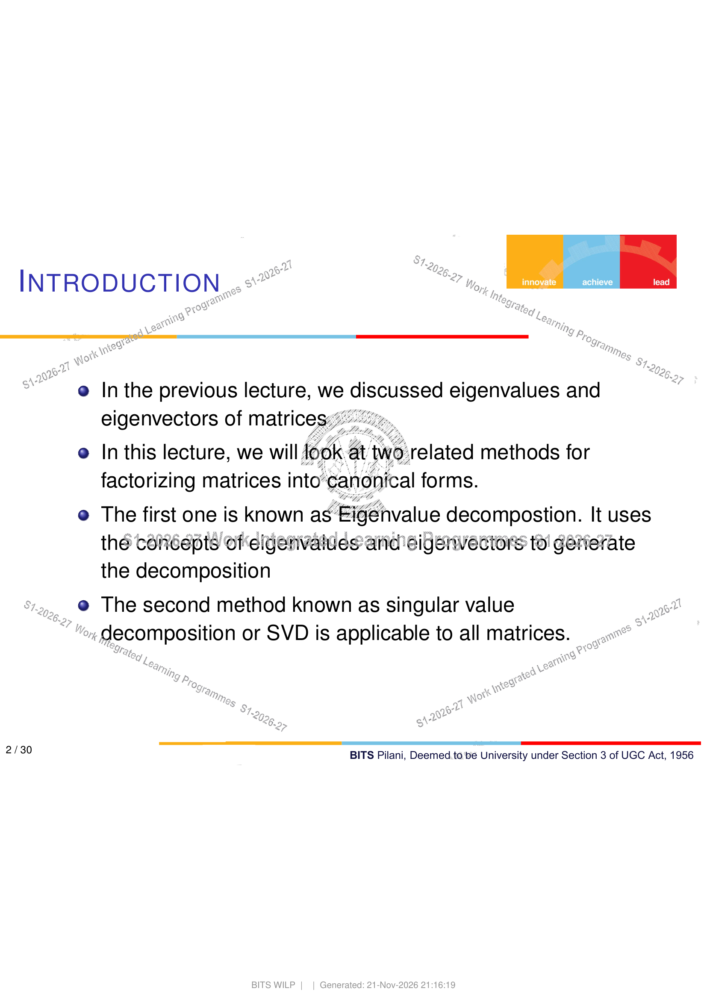
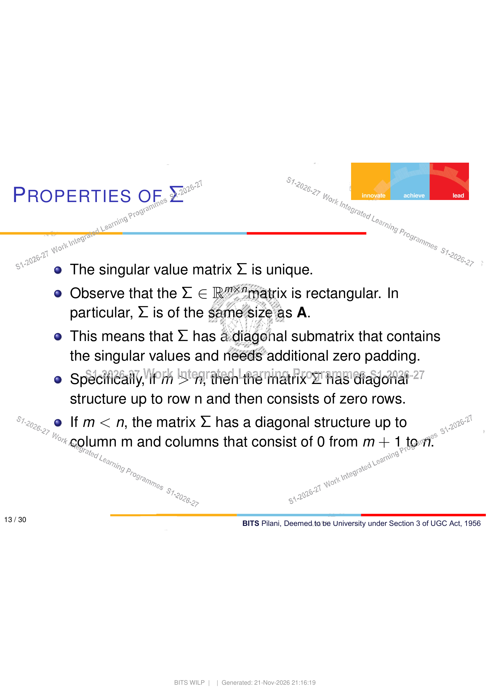

# Module 05: Singular Value Decomposition (SVD) and Spectral Theory

**Course**: AIML ZC416 — Mathematical Foundations for Machine Learning  
**Prescribed Textbooks**: T1 Deisenroth, Faisal & Ong (*Mathematics for Machine Learning*, Ch 4.5); R1 Boyd & Vandenberghe (*VMLS*, Ch 10)  
**Syllabus module**: **M05** — Singular Value Decomposition (SVD) and Spectral Theory (see `Notes/AI Notes/module_map.yaml`)  
**Canonical video**: `Inbox/Prof. Mandar Datar/Recordings/Mathematical Foundations for Machine Learning (S1-26_AIMLZC416) - Prof. Mandar Datar-20261003_103042-Meeting Recording.mp4`  
**Contact sessions** (reference only): Contact Session 9 (Prof. Mandar Vijay Datar). Companion: Prof. Saurabh (`Lecture_9_Companion.pdf`), Prof. Michael Alphonse.
**Exam Weight**: Very High (Direct 6-Marks Problem in Midterm EC-2 Makeup Q3; foundational for PCA and Low-Rank Approximations)

---

## 1. Executive Summary & Geometric Foundations

While eigenvalue decomposition $A = P D P^{-1}$ is strictly confined to square, non-defective matrices, the **Singular Value Decomposition (SVD)** is the universal factorization of linear algebra: it exists for **any arbitrary rectangular matrix** $A \in \mathbb{R}^{m \times n}$.



### The SVD Theorem
Every real matrix $A \in \mathbb{R}^{m \times n}$ can be factored into the product of three matrices:
$$A = U \Sigma V^\top$$
where:
1. $U \in \mathbb{R}^{m \times m}$ is an **orthogonal matrix** ($U^\top U = U U^\top = I_m$). Its columns $u_1, \dots, u_m$ are called the **left singular vectors** of $A$.
2. $V \in \mathbb{R}^{n \times n}$ is an **orthogonal matrix** ($V^\top V = V V^\top = I_n$). Its columns $v_1, \dots, v_n$ are called the **right singular vectors** of $A$.
3. $\Sigma \in \mathbb{R}^{m \times n}$ is a **rectangular diagonal matrix** whose diagonal entries are the **singular values** $\sigma_i$, conventionally arranged in descending order:
   $$\sigma_1 \ge \sigma_2 \ge \cdots \ge \sigma_r > \sigma_{r+1} = \cdots = 0$$
   where $r = \text{rank}(A) \le \min(m, n)$.

---

## 2. Geometric Interpretation & Gram Matrices



### SVD as a Composition of Geometric Maps
The mapping $x \mapsto A x = U \Sigma V^\top x$ decomposes the action of $A$ on the unit sphere in $\mathbb{R}^n$ into three distinct, intuitive geometric transformations:
1. **$V^\top$ (Rotation/Reflection in $\mathbb{R}^n$)**: Rotates the standard coordinate frame to align with the principal orthogonal directions $v_i$.
2. **$\Sigma$ (Axis Scaling & Dimension Change)**: Stretches the vector along coordinate axis $i$ by factor $\sigma_i$, transforming the unit sphere into a hyperellipsoid. Zero singular values collapse dimensions.
3. **$U$ (Rotation/Reflection in $\mathbb{R}^m$)**: Rotates the resulting hyperellipsoid to align its principal semi-axes with the left singular vectors $u_i$.

### Gram Matrices & Derivation of Singular Vectors
Consider the symmetric Gram matrices:
1. **$A^\top A \in \mathbb{R}^{n \times n}$**:
   $$A^\top A = (U \Sigma V^\top)^\top (U \Sigma V^\top) = V \Sigma^\top U^\top U \Sigma V^\top = V (\Sigma^\top \Sigma) V^\top$$
   - Since $V$ is orthogonal, this is the orthogonal eigendecomposition of $A^\top A$!
   - The **right singular vectors** $v_i$ are the orthonormal eigenvectors of $A^\top A$.
   - The eigenvalues of $A^\top A$ are $\lambda_i(A^\top A) = \sigma_i^2 \ge 0 \implies \sigma_i = \sqrt{\lambda_i(A^\top A)}$.

2. **$A A^\top \in \mathbb{R}^{m \times m}$**:
   $$A A^\top = (U \Sigma V^\top) (U \Sigma V^\top)^\top = U \Sigma V^\top V \Sigma^\top U^\top = U (\Sigma \Sigma^\top) U^\top$$
   - The **left singular vectors** $u_i$ are the orthonormal eigenvectors of $A A^\top$.
   - The non-zero eigenvalues of $A A^\top$ are identical to those of $A^\top A$.

### Outer Product Form (Dyadic Expansion)
The SVD can be written as a sum of $r$ rank-1 outer product matrices:
$$A = \sum_{i=1}^r \sigma_i u_i v_i^\top$$
where each $u_i v_i^\top \in \mathbb{R}^{m \times n}$ has rank exactly 1 and $\|u_i v_i^\top\|_2 = 1$.

---

## 3. The Moore-Penrose Pseudo-Inverse

When $A$ is singular or rectangular, the standard matrix inverse $A^{-1}$ does not exist. The **Moore-Penrose pseudo-inverse** $A^+ \in \mathbb{R}^{n \times m}$ is uniquely defined via the SVD:
$$A^+ = V \Sigma^+ U^\top$$
where $\Sigma^+ \in \mathbb{R}^{n \times m}$ is formed by taking the reciprocal of each non-zero singular value:
$$\Sigma^+ = \text{diag}\left(\frac{1}{\sigma_1}, \frac{1}{\sigma_2}, \dots, \frac{1}{\sigma_r}, 0, \dots, 0\right)$$

### Application to Least Squares ($Ax = b$)
For an over-determined system $Ax = b$ with no exact solution, the vector:
$$x_{\text{LS}} = A^+ b = \sum_{i=1}^r \frac{u_i^\top b}{\sigma_i} v_i$$
is the unique solution that minimizes the residual norm $\|A x - b\|_2$, and among all minimizers, has the **minimal Euclidean norm** $\|x\|_2$.

---

## 4. Solved Examination Numerical (BITS Pilani Midterm EC-2 Makeup, Q3 — 6 Marks)

### Problem Statement:
**Find the Singular Value Decomposition (SVD) of the matrix:**
$$A = \begin{bmatrix} 5 & 0 \\ 5 & 0 \\ 0 & -10 \end{bmatrix} \in \mathbb{R}^{3 \times 2}$$

---

### Step-by-Step Analytical Solution:

#### Step 1: Compute $A^\top A$ and its Eigenvalues
Matrix dimensions: $m = 3, n = 2$.
Compute the transpose:
$$A^\top = \begin{bmatrix} 5 & 5 & 0 \\ 0 & 0 & -10 \end{bmatrix}$$
Compute the $2 \times 2$ Gram matrix $A^\top A$:
$$A^\top A = \begin{bmatrix} 5 & 5 & 0 \\ 0 & 0 & -10 \end{bmatrix} \begin{bmatrix} 5 & 0 \\ 5 & 0 \\ 0 & -10 \end{bmatrix} = \begin{bmatrix} 5(5) + 5(5) + 0 & 5(0) + 5(0) + 0 \\ 0(5) + 0(5) + 0 & 0(0) + 0(0) + (-10)(-10) \end{bmatrix} = \begin{bmatrix} 50 & 0 \\ 0 & 100 \end{bmatrix}$$

Notice that $A^\top A$ is already diagonal!
Its eigenvalues are the diagonal entries:
$$\lambda_1 = 100, \quad \lambda_2 = 50$$

#### Step 2: Determine Singular Values $\sigma_i$
Arrange in descending order:
$$\sigma_1 = \sqrt{\lambda_1} = \sqrt{100} = \mathbf{10}$$
$$\sigma_2 = \sqrt{\lambda_2} = \sqrt{50} = \mathbf{5\sqrt{2}} \approx 7.071$$

The $3 \times 2$ singular value matrix $\Sigma$ is:
$$\Sigma = \begin{bmatrix} \sigma_1 & 0 \\ 0 & \sigma_2 \\ 0 & 0 \end{bmatrix} = \begin{bmatrix} 10 & 0 \\ 0 & 5\sqrt{2} \\ 0 & 0 \end{bmatrix}$$

#### Step 3: Compute Right Singular Vectors $V = [v_1 \mid v_2]$
1. **For $\lambda_1 = 100$**:
   $$(A^\top A - 100 I) v_1 = \begin{bmatrix} 50 - 100 & 0 \\ 0 & 100 - 100 \end{bmatrix} \begin{bmatrix} x_1 \\ x_2 \end{bmatrix} = \begin{bmatrix} -50 & 0 \\ 0 & 0 \end{bmatrix} \begin{bmatrix} x_1 \\ x_2 \end{bmatrix} = \begin{bmatrix} 0 \\ 0 \end{bmatrix}$$
   $\implies -50 x_1 = 0 \implies x_1 = 0$, $x_2$ free. Normalized eigenvector:
   $$v_1 = \begin{bmatrix} 0 \\ 1 \end{bmatrix}$$

2. **For $\lambda_2 = 50$**:
   $$(A^\top A - 50 I) v_2 = \begin{bmatrix} 0 & 0 \\ 0 & 50 \end{bmatrix} \begin{bmatrix} x_1 \\ x_2 \end{bmatrix} = \begin{bmatrix} 0 \\ 0 \end{bmatrix}$$
   $\implies 50 x_2 = 0 \implies x_2 = 0$, $x_1$ free. Normalized eigenvector:
   $$v_2 = \begin{bmatrix} 1 \\ 0 \end{bmatrix}$$

Thus, the orthogonal matrix $V \in \mathbb{R}^{2 \times 2}$ is:
$$V = \begin{bmatrix} 0 & 1 \\ 1 & 0 \end{bmatrix} \implies V^\top = \begin{bmatrix} 0 & 1 \\ 1 & 0 \end{bmatrix}$$

#### Step 4: Compute Left Singular Vectors $U = [u_1 \mid u_2 \mid u_3]$
Using the fundamental relationship $A v_i = \sigma_i u_i \implies u_i = \frac{1}{\sigma_i} A v_i$:

1. **For $u_1$ ($\sigma_1 = 10$)**:
   $$A v_1 = \begin{bmatrix} 5 & 0 \\ 5 & 0 \\ 0 & -10 \end{bmatrix} \begin{bmatrix} 0 \\ 1 \end{bmatrix} = \begin{bmatrix} 0 \\ 0 \\ -10 \end{bmatrix}$$
   $$u_1 = \frac{1}{10} \begin{bmatrix} 0 \\ 0 \\ -10 \end{bmatrix} = \begin{bmatrix} 0 \\ 0 \\ -1 \end{bmatrix}$$

2. **For $u_2$ ($\sigma_2 = 5\sqrt{2}$)**:
   $$A v_2 = \begin{bmatrix} 5 & 0 \\ 5 & 0 \\ 0 & -10 \end{bmatrix} \begin{bmatrix} 1 \\ 0 \end{bmatrix} = \begin{bmatrix} 5 \\ 5 \\ 0 \end{bmatrix}$$
   $$u_2 = \frac{1}{5\sqrt{2}} \begin{bmatrix} 5 \\ 5 \\ 0 \end{bmatrix} = \frac{1}{\sqrt{2}} \begin{bmatrix} 1 \\ 1 \\ 0 \end{bmatrix} = \begin{bmatrix} 1/\sqrt{2} \\ 1/\sqrt{2} \\ 0 \end{bmatrix}$$

3. **For $u_3$ (Completing the orthonormal basis for $\mathbb{R}^3$)**:
   $u_3$ must be a unit vector orthogonal to both $u_1$ and $u_2$:
   - $u_1^\top u_3 = 0 \implies -z = 0 \implies z = 0$
   - $u_2^\top u_3 = 0 \implies \frac{1}{\sqrt{2}} x + \frac{1}{\sqrt{2}} y = 0 \implies y = -x$
   - Normalized $\|u_3\| = 1 \implies x^2 + (-x)^2 + 0^2 = 1 \implies 2x^2 = 1 \implies x = \frac{1}{\sqrt{2}}$
   $$u_3 = \begin{bmatrix} 1/\sqrt{2} \\ -1/\sqrt{2} \\ 0 \end{bmatrix}$$

Thus, the orthogonal matrix $U \in \mathbb{R}^{3 \times 3}$ is:
$$U = \begin{bmatrix} 0 & 1/\sqrt{2} & 1/\sqrt{2} \\ 0 & 1/\sqrt{2} & -1/\sqrt{2} \\ -1 & 0 & 0 \end{bmatrix}$$

#### Step 5: Verification of the Decomposition
Multiply $U \Sigma V^\top$:
$$U \Sigma = \begin{bmatrix} 0 & 1/\sqrt{2} & 1/\sqrt{2} \\ 0 & 1/\sqrt{2} & -1/\sqrt{2} \\ -1 & 0 & 0 \end{bmatrix} \begin{bmatrix} 10 & 0 \\ 0 & 5\sqrt{2} \\ 0 & 0 \end{bmatrix} = \begin{bmatrix} 0 & 5 \\ 0 & 5 \\ -10 & 0 \end{bmatrix}$$
$$(U \Sigma) V^\top = \begin{bmatrix} 0 & 5 \\ 0 & 5 \\ -10 & 0 \end{bmatrix} \begin{bmatrix} 0 & 1 \\ 1 & 0 \end{bmatrix} = \begin{bmatrix} 5 & 0 \\ 5 & 0 \\ 0 & -10 \end{bmatrix} = A \quad \text{(Verified!)}$$

---

## 5. Python Implementation from Scratch

```python
import numpy as np

def compute_svd(A: np.ndarray):
    """
    Computes SVD of arbitrary rectangular matrix A from first principles.
    Returns U, Sigma, Vt.
    """
    m, n = A.shape
    AtA = A.T @ A
    
    # 1. Eigendecomposition of A^T A
    eigvals, V = np.linalg.eigh(AtA)
    
    # Sort in descending order
    idx = np.argsort(eigvals)[::-1]
    eigvals = eigvals[idx]
    V = V[:, idx]
    
    # Clamp negative eigenvalues due to numerical precision
    eigvals = np.maximum(eigvals, 0)
    singular_values = np.sqrt(eigvals)
    
    # 2. Form Sigma matrix (m x n)
    Sigma = np.zeros((m, n))
    for i in range(min(m, n)):
        Sigma[i, i] = singular_values[i]
        
    # 3. Compute left singular vectors u_i = A v_i / sigma_i
    U = np.zeros((m, m))
    rank = np.sum(singular_values > 1e-10)
    for i in range(rank):
        U[:, i] = (A @ V[:, i]) / singular_values[i]
        
    # Complete orthonormal basis of U via QR if rank < m
    if rank < m:
        # Find orthogonal complement
        null_space_U = np.eye(m) - U[:, :rank] @ U[:, :rank].T
        q, _ = np.linalg.qr(null_space_U)
        U[:, rank:] = q[:, :m - rank]
        
    return U, Sigma, V.T

# Test on BITS Midterm Problem
A = np.array([[5, 0], [5, 0], [0, -10]], dtype=float)
U, S, Vt = compute_svd(A)

print("U:\n", np.round(U, 4))
print("Sigma:\n", np.round(S, 4))
print("V^T:\n", np.round(Vt, 4))
print("Reconstruction check:\n", np.round(U @ S @ Vt, 4))
```

---

## 6. Exam Tips & Failure Modes

1. **Ordering of Singular Values**: Singular values **must** be sorted in non-increasing order ($\sigma_1 \ge \sigma_2 \ge \dots$). If you swap $\sigma_1$ and $\sigma_2$, the corresponding columns in $U$ and $V$ will be misaligned, leading to zero marks.
2. **Dimension of $\Sigma$**: Remember that $\Sigma \in \mathbb{R}^{m \times n}$ has the **exact same shape** as $A$. For $A \in \mathbb{R}^{3 \times 2}$, $\Sigma$ must be $3 \times 2$ (not square $2 \times 2$ or $3 \times 3$).
3. **Completing Left Singular Vectors**: When $m > n$, you can only compute $n$ left singular vectors via $u_i = \frac{1}{\sigma_i} A v_i$. The remaining $m - n$ columns of $U$ span $\mathcal{N}(A^\top)$ and must be found by Gram-Schmidt or null space solution.

---

## 7. Faculty Pedagogy, Lecture Transcripts & Classroom Insights (Prof. Mandar Vijay Datar)

### 7.1 Primary Lecture Alignment
- **Live Contact Sessions**: CS 9 (2026-10-03).
- **Recordings & Transcripts**: `Inbox/Prof. Mandar Datar/Recordings/Mathematical Foundations for Machine Learning (S1-26_AIMLZC416) - Prof. Mandar Datar-20261003_103042-Meeting Recording.mp4`.
- **Official Annotated Decks**: `Inbox/Prof. Mandar Datar/Annotated Slides/Decomposition_annotated.pdf`. Companion: Prof. Saurabh (`Lecture_8.pdf`, `Lecture_9_Companion.pdf`).

### 7.2 Core Classroom Takeaways & Whiteboard Proofs
1. **Universality of SVD**: Unlike eigenvalue decomposition which requires square, non-defective matrices, SVD exists for **every** rectangular matrix $A \in \mathbb{R}^{m \times n}$.
2. **Geometric Factorization Paradigm**: Prof. Mandar Datar breaks SVD into three consecutive geometric transformations:
   $$A = U \Sigma V^T : \quad \mathbb{R}^n \xrightarrow{V^T \text{ (Rotation)}} \mathbb{R}^n \xrightarrow{\Sigma \text{ (Axis Stretch)}} \mathbb{R}^m \xrightarrow{U \text{ (Rotation)}} \mathbb{R}^m$$
3. **Phase Synchronization Rule**: Right singular vectors $v_i$ are orthonormal eigenvectors of $A^T A$. Prof. Datar insists that left singular vectors **must** be computed via:
   $$u_i = \frac{1}{\sigma_i} A v_i$$
   Independent eigenvector calculation of $A A^T$ can introduce an arbitrary sign flip ($\pm u_i$), causing $U \Sigma V^T = -A$.

### 7.3 BITS Examination Traps & Evaluation Directives
- **Eigenvalues vs. Singular Values**: Singular values $\sigma_i = \sqrt{\lambda_i(A^T A)}$ are strictly non-negative real numbers arranged in descending order: $\sigma_1 \ge \sigma_2 \ge \dots \ge \sigma_r > 0$. Eigenvalues can be negative or complex.
- **Compact vs. Full SVD**: If asked for Full SVD of an $m \times n$ matrix ($m \ne n$), you must extend the orthonormal sets $\{u_1, \dots, u_r\}$ and $\{v_1, \dots, v_r\}$ to complete orthonormal bases of $\mathbb{R}^m$ and $\mathbb{R}^n$ using Gram-Schmidt on the respective null spaces.
