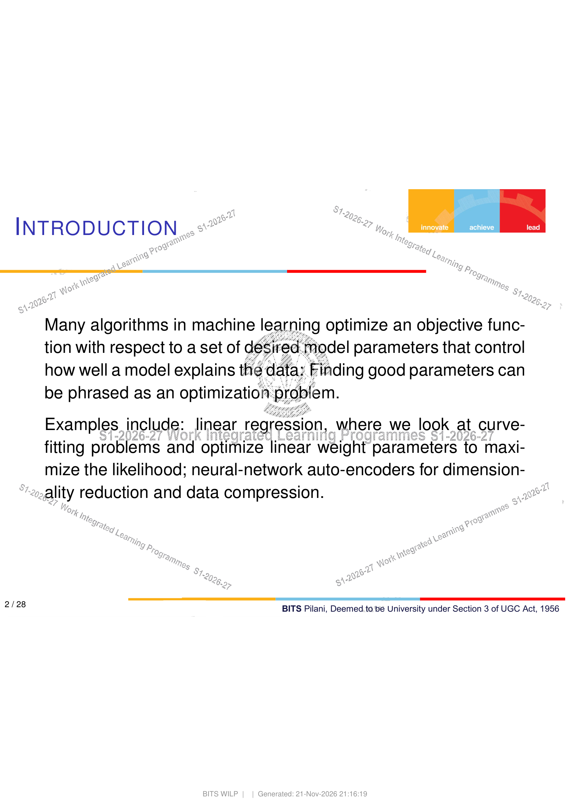

# Module 06: Vector Calculus, Gradients, Jacobians, and Hessians

**Course**: AIML ZC416 — Mathematical Foundations for Machine Learning  
**Prescribed Textbooks**: T1 Deisenroth, Faisal & Ong (*Mathematics for Machine Learning*, Ch 5.1–5.4); R1 Boyd & Vandenberghe (*VMLS*, Appendix A)  
**Primary Faculty**: Prof. Mandar Vijay Datar | **Companion**: Prof. Saurabh (`Lecture_10_Companion.pdf`), Prof. Michael Alphonse  
**Exam Weight**: High (Direct question in Midterm Regular Q6 and EC-2 Makeup Q5; prerequisite for optimization, Taylor expansions, and backpropagation)

---

## 1. Executive Summary & Foundational Definitions

Multivariable calculus provides the mathematical apparatus for calculating sensitivities, optimizing loss functions, and updating parameters in machine learning algorithms.



### Functions in Machine Learning
1. **Scalar-Valued Functions (Loss Functions)**:
   $$f: \mathbb{R}^n \to \mathbb{R}, \quad x = [x_1, \dots, x_n]^\top \mapsto f(x)$$
   Examples: Mean Squared Error (MSE), Cross-Entropy loss.
2. **Vector-Valued Functions (Layers / Activations)**:
   $$f: \mathbb{R}^n \to \mathbb{R}^m, \quad x \mapsto f(x) = \begin{bmatrix} f_1(x) \\ \vdots \\ f_m(x) \end{bmatrix}$$
   Examples: Softmax function, linear neural layer $f(x) = W x + b$.

---

## 2. Gradients, Jacobians, and Hessians

### The Gradient Vector ($\nabla f$)
For a differentiable scalar function $f: \mathbb{R}^n \to \mathbb{R}$, the **gradient** is the vector of all first-order partial derivatives:
$$\nabla f(x) = \begin{bmatrix} \frac{\partial f}{\partial x_1} \\ \frac{\partial f}{\partial x_2} \\ \vdots \\ \frac{\partial f}{\partial x_n} \end{bmatrix} \in \mathbb{R}^{n \times 1}$$

- **Direction of Steepest Ascent**: The gradient $\nabla f(x)$ points in the direction of maximum instantaneous rate of increase of $f$ at $x$.
- **Magnitude**: $\|\nabla f(x)\|_2$ represents the maximum directional derivative at $x$.
- **Directional Derivative**: In any unit direction $v \in \mathbb{R}^n$ ($\|v\|_2 = 1$):
  $$D_v f(x) = \lim_{t \to 0} \frac{f(x + t v) - f(x)}{t} = \nabla f(x)^\top v = \langle \nabla f(x), v \rangle$$

---

### The Jacobian Matrix ($J_f$)
For a vector-valued function $f: \mathbb{R}^n \to \mathbb{R}^m$, the **Jacobian matrix** collects all first-order partial derivatives:
$$J_f(x) = \begin{bmatrix} \frac{\partial f_1}{\partial x_1} & \frac{\partial f_1}{\partial x_2} & \cdots & \frac{\partial f_1}{\partial x_n} \\ \frac{\partial f_2}{\partial x_1} & \frac{\partial f_2}{\partial x_2} & \cdots & \frac{\partial f_2}{\partial x_n} \\ \vdots & \vdots & \ddots & \vdots \\ \frac{\partial f_m}{\partial x_1} & \frac{\partial f_m}{\partial x_2} & \cdots & \frac{\partial f_m}{\partial x_n} \end{bmatrix} \in \mathbb{R}^{m \times n}$$
The $i$-th row of $J_f(x)$ is the transposed gradient of the $i$-th component function: $\nabla f_i(x)^\top$.

---

### The Hessian Matrix ($H_f$)
For a twice-differentiable scalar function $f: \mathbb{R}^n \to \mathbb{R}$, the **Hessian matrix** collects all second-order partial derivatives:
$$H_f(x) = \begin{bmatrix} \frac{\partial^2 f}{\partial x_1^2} & \frac{\partial^2 f}{\partial x_1 \partial x_2} & \cdots & \frac{\partial^2 f}{\partial x_1 \partial x_n} \\ \frac{\partial^2 f}{\partial x_2 \partial x_1} & \frac{\partial^2 f}{\partial x_2^2} & \cdots & \frac{\partial^2 f}{\partial x_2 \partial x_n} \\ \vdots & \vdots & \ddots & \vdots \\ \frac{\partial^2 f}{\partial x_n \partial x_1} & \frac{\partial^2 f}{\partial x_n \partial x_2} & \cdots & \frac{\partial^2 f}{\partial x_n^2} \end{bmatrix} \in \mathbb{R}^{n \times n}$$

#### Schwarz's Theorem (Symmetry of Second Derivatives):
If all second partial derivatives of $f$ are continuous ($f \in C^2$), then mixed partial derivatives are equal:
$$\frac{\partial^2 f}{\partial x_i \partial x_j} = \frac{\partial^2 f}{\partial x_j \partial x_i} \implies H_f(x) = H_f(x)^\top \quad (\text{Hessian is always symmetric!})$$

---

## 3. Essential Matrix Calculus Identities

In machine learning derivations, applying component-wise limits is too slow. The following algebraic identities should be committed to memory:

| Scalar Function $f(x)$ | Gradient $\nabla_x f(x)$ | Dimension | Notes |
| :--- | :--- | :---: | :--- |
| $a^\top x$ | $a$ | $n \times 1$ | Linear form |
| $x^\top a$ | $a$ | $n \times 1$ | Symmetric |
| $x^\top x = \|x\|_2^2$ | $2x$ | $n \times 1$ | Squared Euclidean norm |
| $x^\top A x$ | $(A + A^\top)x$ | $n \times 1$ | General quadratic form |
| $x^\top A x$ (with $A = A^\top$) | $2Ax$ | $n \times 1$ | Symmetric quadratic form |
| $\|Ax - b\|_2^2$ | $2A^\top(Ax - b)$ | $n \times 1$ | Linear least squares loss |
| $\text{trace}(A X B)$ | $A^\top B^\top$ | shape of $X$ | Matrix derivative $\frac{\partial}{\partial X}$ |
| $\log \det(X)$ ($X \succ 0$) | $X^{-1}$ | shape of $X$ | Gaussian log-likelihood |

### The Multivariable Chain Rule
Let $x \in \mathbb{R}^n$, $y = f(x) \in \mathbb{R}^m$, and $z = g(y) \in \mathbb{R}^p$. The Jacobian of the composite mapping $h = g \circ f: \mathbb{R}^n \to \mathbb{R}^p$ is the matrix product of Jacobians:
$$J_h(x) = J_g(f(x)) \cdot J_f(x) \in \mathbb{R}^{p \times n}$$

For a scalar loss function $L(y) \in \mathbb{R}$ where $y = f(x) \in \mathbb{R}^m$:
$$\nabla_x L = J_f(x)^\top \nabla_y L$$

---

## 4. Solved Examination Numericals (BITS Pilani Midterm Tests)

### Problem 1: BITS Mid-Semester Test (Regular Paper 1, Q6 — 4 Marks)
**Statement**: Let $f(x) = A x$ and $g(z) = \frac{1}{2} \|z\|^2$, where:
$$A = \begin{bmatrix} 3 & 1 \\ 0 & 2 \end{bmatrix}, \quad x = \begin{bmatrix} 1 \\ 2 \end{bmatrix}$$
(a) Compute $\nabla_z g$ at $z = A x$ and state its dimension. [2 M]  
(b) Compute the Jacobian $J_f(x)$. [2 M]

#### Step-by-Step Analytical Solution:
**(a) Computing $\nabla_z g$ at $z = A x$**:
First compute the evaluation vector $z = A x$:
$$z = \begin{bmatrix} 3 & 1 \\ 0 & 2 \end{bmatrix} \begin{bmatrix} 1 \\ 2 \end{bmatrix} = \begin{bmatrix} 3(1) + 1(2) \\ 0(1) + 2(2) \end{bmatrix} = \begin{bmatrix} 5 \\ 4 \end{bmatrix} \in \mathbb{R}^2$$

Now consider $g(z) = \frac{1}{2} \|z\|^2 = \frac{1}{2} (z_1^2 + z_2^2)$.
Compute the partial derivatives with respect to $z_1$ and $z_2$:
$$\frac{\partial g}{\partial z_1} = \frac{1}{2} (2 z_1) = z_1, \qquad \frac{\partial g}{\partial z_2} = \frac{1}{2} (2 z_2) = z_2$$
Thus, the gradient function is:
$$\nabla_z g(z) = \begin{bmatrix} z_1 \\ z_2 \end{bmatrix} = z$$
Evaluating at $z = \begin{bmatrix} 5 \\ 4 \end{bmatrix}$:
$$\nabla_z g(Ax) = \begin{bmatrix} 5 \\ 4 \end{bmatrix}$$
- **Dimension**: $\nabla_z g \in \mathbb{R}^{2 \times 1}$ (or $\mathbb{R}^2$, a 2-dimensional column vector).

**(b) Computing the Jacobian $J_f(x)$**:
The mapping is linear: $f(x) = A x$.
Component-wise:
$$f(x) = \begin{bmatrix} f_1(x_1, x_2) \\ f_2(x_1, x_2) \end{bmatrix} = \begin{bmatrix} 3 x_1 + x_2 \\ 2 x_2 \end{bmatrix}$$
Compute the Jacobian matrix:
$$J_f(x) = \begin{bmatrix} \frac{\partial f_1}{\partial x_1} & \frac{\partial f_1}{\partial x_2} \\ \frac{\partial f_2}{\partial x_1} & \frac{\partial f_2}{\partial x_2} \end{bmatrix} = \begin{bmatrix} 3 & 1 \\ 0 & 2 \end{bmatrix} = \mathbf{A}$$
- **Result**: The Jacobian of any linear transformation $f(x) = A x$ is identically the transformation matrix $\mathbf{A} \in \mathbb{R}^{2 \times 2}$ for all $x$.

---

### Problem 2: BITS Midterm Test (EC-2 Makeup, Q5 — 5 Marks)
**Statement**: Let $f(x, y, z) = x y^2 + y z^2 + z x^2$.
(a) Find the gradient of $f(x, y, z)$. [2 M]  
(b) Find all the critical points of the function $g(x, y) = f(x, y, 0)$. [1 M]  
(c) Is it possible to use the second derivative test here? Why? [2 M]

#### Step-by-Step Analytical Solution:
**(a) Gradient of $f(x, y, z)$**:
Compute partial derivatives:
- $\frac{\partial f}{\partial x} = y^2 + 2zx$
- $\frac{\partial f}{\partial y} = 2xy + z^2$
- $\frac{\partial f}{\partial z} = 2yz + x^2$

$$\nabla f(x, y, z) = \begin{bmatrix} y^2 + 2zx \\ 2xy + z^2 \\ 2yz + x^2 \end{bmatrix}$$

**(b) Critical Points of $g(x, y) = f(x, y, 0)$**:
Substitute $z = 0$ into $f$:
$$g(x, y) = f(x, y, 0) = x y^2 + y(0)^2 + 0(x^2) = x y^2$$
Compute the gradient of $g(x, y)$:
$$\nabla g(x, y) = \begin{bmatrix} \frac{\partial g}{\partial x} \\ \frac{\partial g}{\partial y} \end{bmatrix} = \begin{bmatrix} y^2 \\ 2xy \end{bmatrix} = \begin{bmatrix} 0 \\ 0 \end{bmatrix}$$
1. From Row 1: $y^2 = 0 \implies \mathbf{y = 0}$.
2. Substitute $y = 0$ into Row 2: $2x(0) = 0$, which is satisfied for **all $x \in \mathbb{R}$**.

Therefore, the critical points are all points lying along the $x$-axis:
$$\text{Critical Points} = \{(x, 0) : x \in \mathbb{R}\}$$

**(c) Applicability of the Second Derivative Test**:
Compute the Hessian matrix of $g(x, y)$:
$$H_g(x, y) = \begin{bmatrix} \frac{\partial^2 g}{\partial x^2} & \frac{\partial^2 g}{\partial x \partial y} \\ \frac{\partial^2 g}{\partial y \partial x} & \frac{\partial^2 g}{\partial y^2} \end{bmatrix} = \begin{bmatrix} 0 & 2y \\ 2y & 2x \end{bmatrix}$$
Evaluate $H_g$ at any critical point $(x, 0)$:
$$H_g(x, 0) = \begin{bmatrix} 0 & 0 \\ 0 & 2x \end{bmatrix}$$
Compute the determinant of the Hessian:
$$\det(H_g(x, 0)) = 0(2x) - 0(0) = \mathbf{0}$$

**Conclusion**:
It is **not possible** to use the second derivative test to classify the critical points.  
**Reason**: The determinant of the Hessian vanishes identically ($\det(H) = 0$), which means the second derivative test is **inconclusive**. (The eigenvalue 0 corresponds to the non-isolated flat ridge along $y = 0$).

---

## 5. Python Implementation from Scratch

```python
import numpy as np

def numerical_gradient(f, x, eps=1e-6):
    """
    Computes numerical gradient of scalar function f at x via central differences.
    """
    grad = np.zeros_like(x, dtype=float)
    for i in range(len(x)):
        x_plus = x.copy().astype(float)
        x_minus = x.copy().astype(float)
        x_plus[i] += eps
        x_minus[i] -= eps
        grad[i] = (f(x_plus) - f(x_minus)) / (2 * eps)
    return grad

def numerical_hessian(f, x, eps=1e-4):
    """
    Computes numerical Hessian matrix of scalar function f at x.
    """
    n = len(x)
    H = np.zeros((n, n), dtype=float)
    for i in range(n):
        for j in range(n):
            x_pp = x.copy().astype(float)
            x_pm = x.copy().astype(float)
            x_mp = x.copy().astype(float)
            x_mm = x.copy().astype(float)
            
            x_pp[i] += eps; x_pp[j] += eps
            x_pm[i] += eps; x_pm[j] -= eps
            x_mp[i] -= eps; x_mp[j] += eps
            x_mm[i] -= eps; x_mm[j] -= eps
            
            H[i, j] = (f(x_pp) - f(x_pm) - f(x_mp) + f(x_mm)) / (4 * eps * eps)
    return H

# Test function g(x, y) = x * y^2
g = lambda v: v[0] * (v[1]**2)
x_eval = np.array([2.0, 0.0])
print("Numerical Gradient at (2, 0):", numerical_gradient(g, x_eval))
print("Numerical Hessian at (2, 0):\n", np.round(numerical_hessian(g, x_eval), 4))
```

---

## 6. Exam Tips & Failure Modes

1. **Jacobian vs Gradient Orientation**: If $f: \mathbb{R}^n \to \mathbb{R}$, $\nabla f(x)$ is a column vector $n \times 1$, whereas the Jacobian $J_f(x)$ is a row vector $1 \times n$. Be careful when mixing gradient and Jacobian notation in multivariable chain rules.
2. **Inconclusive Second Derivative Test**: Whenever $\det(H) = 0$, you must explicitly state that the test is **inconclusive** and state *why* (zero eigenvalue; degenerate critical point). Do not guess local minimum or maximum.
3. **Linear Form Derivatives**: The derivative of $x^\top A x$ is $(A + A^\top)x$. Only if $A$ is symmetric does this simplify to $2 A x$. If $A$ is asymmetric, omitting $A^\top$ is an immediate grading penalty.
