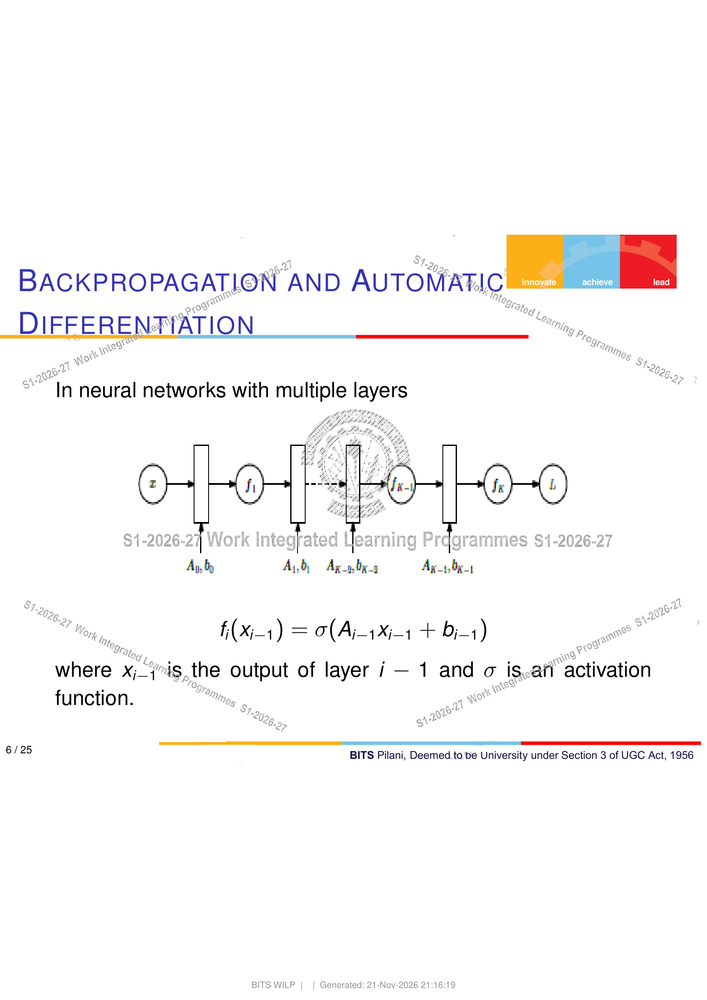

# Module 07: Automatic Differentiation and Backpropagation

**Course**: AIML ZC416 — Mathematical Foundations for Machine Learning  
**Prescribed Textbooks**: T1 Deisenroth, Faisal & Ong (*Mathematics for Machine Learning*, Ch 5.5–5.6)  
**Syllabus module**: **M07** — Automatic Differentiation and Backpropagation (see `Notes/AI Notes/module_map.yaml`)  
**Canonical video**: `Inbox/Prof. Mandar Datar/Recordings/Mathematical Foundations for Machine Learning (S1-26_AIMLZC416) - Prof. Mandar Datar-20261017_103001-Meeting Recording.mp4`  
**Contact sessions** (reference only): Contact Session 11 (Prof. Mandar Vijay Datar). Companion: Prof. Saurabh (`Lecture_11_Companion_Part1.pdf`), Prof. Upendar Mendu.
**Exam Weight**: High (Directly tested in Midterm EC-2 Q6; theoretical foundation of Deep Learning training)

---

## 1. Executive Summary & Differentiation Paradigms

Training modern machine learning architectures requires evaluating gradients of scalar loss functions with respect to millions or billions of parameters. Classical approaches fail in high dimensions:

1. **Numerical Differentiation (Finite Differences)**:
   $$\frac{\partial f}{\partial x_i} \approx \frac{f(x + \epsilon e_i) - f(x - \epsilon e_i)}{2\epsilon}$$
   - *Flaws*: Requires $2n$ full function evaluations; vulnerable to floating-point catastrophic cancellation and truncation errors.
2. **Symbolic Differentiation (Computer Algebra)**:
   - *Flaws*: Suffers from exponential **expression swell**; fails to reuse common subexpressions, resulting in prohibitive memory consumption.
3. **Automatic Differentiation (Autodiff / AD)**:
   - Evaluates exact derivatives numerically by executing the chain rule at the level of elementary machine instructions (addition, multiplication, exponentials). Computes derivatives to machine precision with **zero truncation error**.



---

## 2. Computational Graphs & Modes of Autodiff

A **computational graph** is a Directed Acyclic Graph (DAG) $\mathcal{G} = (\mathcal{V}, \mathcal{E})$ where:
- **Source Nodes**: Represent input variables and parameters ($x_1, x_2, \dots$).
- **Intermediate Nodes**: Represent elementary mathematical operations ($v_i = \phi(v_j, v_k)$).
- **Target Node**: Represents the final output or scalar loss $L$.

```
   x1 ─────( · )² ─────> a ─────( · )² ─────> a² 
             ▲           ▲                     │
             │           │                     ▼
   x2 ───────┴───────────┤                   ( + ) ─────> f
                         │                     ▲
                         ▼                     │
                        ( · ) ──> b ───────────┘
```

---

### Forward Mode AD (Tangent Accumulation)
In forward mode, we compute the directional derivative of all intermediate variables with respect to a designated input variable $x_j$:
$$\dot{v}_i = \frac{\partial v_i}{\partial x_j}$$
- Propagates sensitivities **forward** alongside the function evaluation.
- To compute the full gradient of $f: \mathbb{R}^n \to \mathbb{R}$, forward mode requires **$n$ separate forward passes** (one for each input component).
- **Ideal For**: Functions with few inputs and many outputs ($f: \mathbb{R} \to \mathbb{R}^m$, e.g., robot trajectories).

---

### Reverse Mode AD (Adjoint Accumulation / Backpropagation)
In reverse mode, we define the **adjoint** (or sensitivity) of an intermediate node $v_i$ with respect to the final scalar loss $L$:
$$\bar{v}_i = \frac{\partial L}{\partial v_i}$$

#### The Adjoint Propagation Rule:
By the multivariable chain rule, the adjoint of node $v_i$ is the sum of contributions from all its downstream children $\text{Children}(v_i)$:
$$\bar{v}_i = \sum_{j \in \text{Children}(v_i)} \bar{v}_j \frac{\partial v_j}{\partial v_i}$$

- **Forward Pass**: Evaluate operations from inputs to output, storing intermediate values in memory (the tape).
- **Backward Pass**: Initialize $\bar{L} = \frac{\partial L}{\partial L} = 1$, and propagate adjoints $\bar{v}_i$ backward to all inputs.
- **Complexity**: Computes the **entire gradient vector $\nabla_x L \in \mathbb{R}^n$ in a single backward pass**, taking at most $3\times$ the computational cost of the forward pass!
- **Ideal For**: Machine learning loss functions ($f: \mathbb{R}^n \to \mathbb{R}$, where $n \gg 1$).

---

## 3. Matrix Backpropagation Equations

For neural network layers with matrix variables:

1. **Affine Layer $y = W x + b$** ($x \in \mathbb{R}^n, W \in \mathbb{R}^{m \times n}, b \in \mathbb{R}^m$):
   Given output sensitivity $\bar{y} = \frac{\partial L}{\partial y} \in \mathbb{R}^{m \times 1}$:
   $$\bar{x} = \frac{\partial L}{\partial x} = W^\top \bar{y} \in \mathbb{R}^{n \times 1}$$
   $$\bar{W} = \frac{\partial L}{\partial W} = \bar{y} x^\top \in \mathbb{R}^{m \times n}$$
   $$\bar{b} = \frac{\partial L}{\partial b} = \bar{y} \in \mathbb{R}^{m \times 1}$$

2. **Mini-batch Matrix Affine Layer $Y = X W + \mathbf{1} b^\top$** ($X \in \mathbb{R}^{B \times n}, W \in \mathbb{R}^{n \times m}, Y \in \mathbb{R}^{B \times m}$):
   Given $\bar{Y} \in \mathbb{R}^{B \times m}$:
   $$\bar{X} = \bar{Y} W^\top \in \mathbb{R}^{B \times n}$$
   $$\bar{W} = X^\top \bar{Y} \in \mathbb{R}^{n \times m}$$
   $$\bar{b} = \bar{Y}^\top \mathbf{1}_B = \sum_{i=1}^B \bar{Y}_{i, :} \in \mathbb{R}^{m \times 1}$$

---

## 4. Solved Examination Numerical (BITS Pilani Midterm EC-2, Q6 — 4 Marks)

### Problem Statement:
A scalar function $f(x_1, x_2)$ is computed through the following intermediate variables:
$$\begin{aligned}
a &= x_1^2 + x_2 \\
b &= x_1 x_2 \\
f &= a^2 + b
\end{aligned}$$
(a) Treating $f$ as a function of the intermediate variables $a$ and $b$, compute $\frac{\partial f}{\partial a}$ and $\frac{\partial f}{\partial b}$. [1 M]  
(b) Compute the partial derivatives $\frac{\partial a}{\partial x_1}, \frac{\partial a}{\partial x_2}, \frac{\partial b}{\partial x_1}, \frac{\partial b}{\partial x_2}$. [1 M]  
(c) Using the chain rule, compute the gradient $\nabla f(x_1, x_2)$ and evaluate it at $(x_1, x_2) = (1, 2)$. [2 M]

---

### Step-by-Step Analytical Solution:

#### (a) Partial Derivatives with respect to Intermediate Variables:
Given $f(a, b) = a^2 + b$:
$$\frac{\partial f}{\partial a} = \mathbf{2a}$$
$$\frac{\partial f}{\partial b} = \mathbf{1}$$

#### (b) Partial Derivatives of Intermediate Variables with respect to Inputs:
Given $a(x_1, x_2) = x_1^2 + x_2$:
$$\frac{\partial a}{\partial x_1} = \mathbf{2x_1}, \qquad \frac{\partial a}{\partial x_2} = \mathbf{1}$$

Given $b(x_1, x_2) = x_1 x_2$:
$$\frac{\partial b}{\partial x_1} = \mathbf{x_2}, \qquad \frac{\partial b}{\partial x_2} = \mathbf{x_1}$$

#### (c) Gradient Computation via the Chain Rule and Evaluation at $(1, 2)$:
Apply the multivariable chain rule:
$$\begin{aligned}
\frac{\partial f}{\partial x_1} &= \frac{\partial f}{\partial a} \frac{\partial a}{\partial x_1} + \frac{\partial f}{\partial b} \frac{\partial b}{\partial x_1} = (2a)(2x_1) + (1)(x_2) = 4 a x_1 + x_2 \\
\frac{\partial f}{\partial x_2} &= \frac{\partial f}{\partial a} \frac{\partial a}{\partial x_2} + \frac{\partial f}{\partial b} \frac{\partial b}{\partial x_2} = (2a)(1) + (1)(x_1) = 2a + x_1
\end{aligned}$$

Substitute $a = x_1^2 + x_2$ into the expressions:
$$\begin{aligned}
\frac{\partial f}{\partial x_1} &= 4(x_1^2 + x_2)x_1 + x_2 = 4x_1^3 + 4x_1 x_2 + x_2 \\
\frac{\partial f}{\partial x_2} &= 2(x_1^2 + x_2) + x_1 = 2x_1^2 + 2x_2 + x_1
\end{aligned}$$

Now evaluate at the point $(x_1, x_2) = (1, 2)$:
First evaluate intermediate variable $a$:
$$a = (1)^2 + 2 = 1 + 2 = 3$$

Evaluate partial derivatives:
$$\frac{\partial f}{\partial x_1}(1, 2) = 4(3)(1) + 2 = 12 + 2 = \mathbf{14}$$
$$\frac{\partial f}{\partial x_2}(1, 2) = 2(3) + 1 = 6 + 1 = \mathbf{7}$$

$$\nabla f(1, 2) = \begin{bmatrix} \frac{\partial f}{\partial x_1} \\ \frac{\partial f}{\partial x_2} \end{bmatrix} = \begin{bmatrix} \mathbf{14} \\ \mathbf{7} \end{bmatrix}$$

---

## 5. Python Implementation: Minimal Reverse-Mode Autodiff Engine

```python
class Node:
    """Minimal Autograd Scalar Node for reverse-mode automatic differentiation."""
    def __init__(self, val, children=(), op=""):
        self.val = float(val)
        self.grad = 0.0
        self._backward = lambda: None
        self._prev = set(children)
        self._op = op

    def __add__(self, other):
        other = other if isinstance(other, Node) else Node(other)
        out = Node(self.val + other.val, (self, other), "+")
        def _backward():
            self.grad += 1.0 * out.grad
            other.grad += 1.0 * out.grad
        out._backward = _backward
        return out

    def __mul__(self, other):
        other = other if isinstance(other, Node) else Node(other)
        out = Node(self.val * other.val, (self, other), "*")
        def _backward():
            self.grad += other.val * out.grad
            other.grad += self.val * out.grad
        out._backward = _backward
        return out

    def __pow__(self, p):
        out = Node(self.val ** p, (self,), f"**{p}")
        def _backward():
            self.grad += (p * (self.val ** (p - 1))) * out.grad
        out._backward = _backward
        return out

    def backward(self):
        # Topological sort of the computational graph
        topo = []
        visited = set()
        def build_topo(v):
            if v not in visited:
                visited.add(v)
                for child in v._prev:
                    build_topo(child)
                topo.append(v)
        build_topo(self)
        
        self.grad = 1.0
        for node in reversed(topo):
            node._backward()

# Execute BITS Exam Problem
x1 = Node(1.0)
x2 = Node(2.0)

a = (x1 ** 2) + x2
b = x1 * x2
f = (a ** 2) + b

# Run backpropagation
f.backward()

print("Forward Value f(1, 2):", f.val)
print("df / dx1:", x1.grad, "(Expected: 14.0)")
print("df / dx2:", x2.grad, "(Expected: 7.0)")
```

---

## 6. Exam Tips & Failure Modes

1. **Summing Adjoints Across Multiple Paths**: When an input variable feeds into multiple intermediate nodes (e.g., $x_1$ branches into both $a$ and $b$), its partial derivative is the **sum** of contributions along all paths ($\frac{\partial f}{\partial a} \frac{\partial a}{\partial x_1} + \frac{\partial f}{\partial b} \frac{\partial b}{\partial x_1}$). Forgetting one branch loses half the marks.
2. **Matrix Derivative Transposition**: For $y = W x$, remember $\frac{\partial L}{\partial W} = \bar{y} x^\top$ (outer product $m \times n$). It is **never** $x \bar{y}^\top$ ($n \times m$). Check matrix dimensions religiously.
3. **Evaluating vs Symbolic Formulation**: When an exam question specifies "evaluate at $(1, 2)$", compute the intermediate numeric value $a(1, 2) = 3$ first to perform the arithmetic rapidly without expanding giant polynomials.
