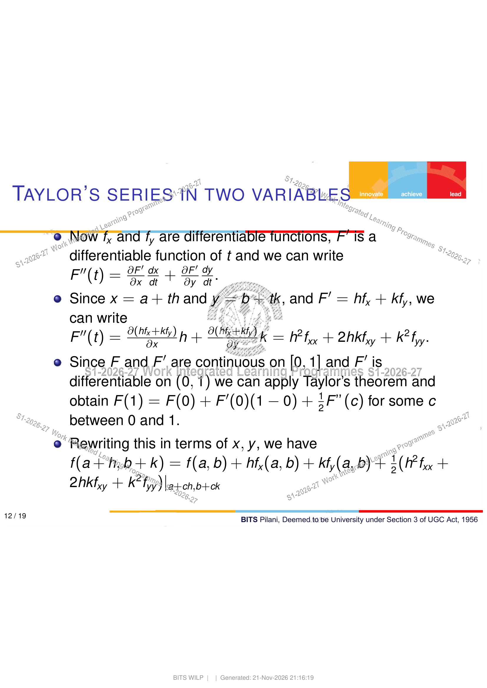

# Module 08: Multivariate Taylor Series and Linearization

**Course**: AIML ZC416 — Mathematical Foundations for Machine Learning  
**Prescribed Textbooks**: T1 Deisenroth, Faisal & Ong (*Mathematics for Machine Learning*, Ch 5.7–5.8)  
**Syllabus module**: **M08** — Multivariate Taylor Series and Linearization (see `Notes/AI Notes/module_map.yaml`)  
**Canonical video**: `Inbox/Prof. Mandar Datar/Recordings/Mathematical Foundations for Machine Learning (S1-26_AIMLZC416) - Prof. Mandar Datar-20261024_103206-Meeting Recording.mp4`  
**Contact sessions** (reference only): Contact Session 12 (Prof. Mandar Vijay Datar). Companion: Prof. Saurabh (`Lecture_11_Companion_Part2.pdf`), Prof. Michael Alphonse.
**Exam Weight**: Very High (Major 6-Marks Problem in Midterm Regular Q7, Midterm EC-2 Q7, and EC-2 Makeup Q6)

---

## 1. Executive Summary & Mathematical Foundations

Nonlinear functions in machine learning are rarely tractable in closed form. **Taylor's Theorem** allows us to approximate an arbitrarily complex differentiable function $f: \mathbb{R}^n \to \mathbb{R}$ locally around an operating point $x_0 \in \mathbb{R}^n$ using low-degree polynomials.



### First-Order Taylor Approximation (Linearization)
The tangent plane approximation of $f$ near $x_0$:
$$f(x) \approx T_1(x) = f(x_0) + \nabla f(x_0)^\top (x - x_0)$$
- Used in first-order optimization algorithms (Gradient Descent).
- Replaces curved level sets locally with affine hyperplanes.

### Second-Order Taylor Approximation (Quadratic Model)
The local quadratic model incorporating curvature:
$$f(x) \approx T_2(x) = f(x_0) + \nabla f(x_0)^\top (x - x_0) + \frac{1}{2} (x - x_0)^\top H_f(x_0) (x - x_0)$$
where:
- $\nabla f(x_0) \in \mathbb{R}^n$ is the gradient vector evaluated at $x_0$.
- $H_f(x_0) \in \mathbb{R}^{n \times n}$ is the symmetric Hessian matrix evaluated at $x_0$.
- Underpins second-order optimization methods (Newton-Raphson, Quasi-Newton, BFGS).

---

## 2. Stationary Points & The Second-Derivative Test

A point $x^* \in \mathbb{R}^n$ is a **stationary point** (or critical point) of a differentiable function $f$ if:
$$\nabla f(x^*) = \mathbf{0}$$

At a stationary point, the linear term in the Taylor expansion vanishes ($\nabla f(x^*)^\top (x - x^*) = 0$), so the local behavior is entirely governed by the quadratic form $\frac{1}{2} \Delta x^\top H_f(x^*) \Delta x$:
$$f(x^* + \Delta x) - f(x^*) \approx \frac{1}{2} \Delta x^\top H_f(x^*) \Delta x$$

### Classification via Hessian Eigenvalues $\lambda_i(H_f(x^*))$:
1. **Strict Local Minimum**:
   $H_f(x^*) \succ 0$ (Symmetric Positive Definite, all $\lambda_i > 0$).  
   $\Delta x^\top H \Delta x > 0$ for all $\Delta x \ne \mathbf{0}$, meaning $f(x^* + \Delta x) > f(x^*)$ locally.
2. **Strict Local Maximum**:
   $H_f(x^*) \prec 0$ (Symmetric Negative Definite, all $\lambda_i < 0$).  
   $\Delta x^\top H \Delta x < 0$ for all $\Delta x \ne \mathbf{0}$, meaning $f(x^* + \Delta x) < f(x^*)$ locally.
3. **Saddle Point**:
   $H_f(x^*)$ is **indefinite** (has at least one strictly positive eigenvalue $\lambda_i > 0$ and at least one strictly negative eigenvalue $\lambda_j < 0$). The function curves upward in some directions and downward in others.
4. **Inconclusive / Degenerate**:
   $\det(H_f(x^*)) = 0$ (at least one eigenvalue $\lambda_k = 0$) and no negative eigenvalues for a minimum test. Higher-order Taylor terms must be analyzed.

---

## 3. Solved Examination Numericals (BITS Pilani Midterm Tests)

### Problem 1: BITS Mid-Semester Test (Regular Paper 1, Q7 — 6 Marks)
**Statement**: Consider the function:
$$f(x, y) = 2x^2 + 2y^2 + 2xy - 6x - 6y$$
(a) Find the stationary point of $f$, compute the Hessian, and determine whether it is positive definite. [2.5 M]  
(b) Write the exact quadratic Taylor expansion of $f$ about this stationary point. [2 M]  
(c) Find the linearization of $f$ about the same point, and comment on the unusual result you obtain. [1.5 M]

#### Step-by-Step Analytical Solution:
**(a) Finding the Stationary Point and Testing Hessian Positive Definiteness**:
Compute first partial derivatives:
$$\frac{\partial f}{\partial x} = 4x + 2y - 6$$
$$\frac{\partial f}{\partial y} = 4y + 2x - 6$$

Set gradient $\nabla f = \mathbf{0}$:
$$\begin{aligned}
4x + 2y &= 6 \implies 2x + y = 3 \\
2x + 4y &= 6 \implies x + 2y = 3
\end{aligned}$$
Subtract the two equations:
$$(2x + y) - (x + 2y) = 0 \implies x - y = 0 \implies x = y$$
Substitute $y = x$ into $2x + x = 3 \implies 3x = 3 \implies x = 1, y = 1$.
The unique stationary point is:
$$(x^*, y^*) = (\mathbf{1}, \mathbf{1})$$

Compute the second-order partial derivatives for the Hessian:
$$\frac{\partial^2 f}{\partial x^2} = 4, \quad \frac{\partial^2 f}{\partial y^2} = 4, \quad \frac{\partial^2 f}{\partial x \partial y} = 2$$
$$H_f(x, y) = \begin{bmatrix} 4 & 2 \\ 2 & 4 \end{bmatrix}$$
Notice that $H_f$ is constant across all $\mathbb{R}^2$.  
Test for positive definiteness via Sylvester's criterion:
1. $\Delta_1 = 4 > 0$
2. $\Delta_2 = \det(H) = (4)(4) - (2)(2) = 16 - 4 = 12 > 0$

Since all leading principal minors are strictly positive, $H_f \succ 0$ (**Positive Definite**).  
Therefore, $(1, 1)$ is a **strict global minimum**.

---

**(b) Exact Quadratic Taylor Expansion About $(1, 1)$**:
Evaluate the function at $(1, 1)$:
$$f(1, 1) = 2(1)^2 + 2(1)^2 + 2(1)(1) - 6(1) - 6(1) = 2 + 2 + 2 - 6 - 6 = -6$$
At $(1, 1)$, $\nabla f(1, 1) = \begin{bmatrix} 0 \\ 0 \end{bmatrix}$.

The second-order Taylor expansion about $(x_0, y_0) = (1, 1)$ is:
$$T_2(x, y) = f(1, 1) + \nabla f(1, 1)^\top \begin{bmatrix} x - 1 \\ y - 1 \end{bmatrix} + \frac{1}{2} \begin{bmatrix} x - 1 & y - 1 \end{bmatrix} \begin{bmatrix} 4 & 2 \\ 2 & 4 \end{bmatrix} \begin{bmatrix} x - 1 \\ y - 1 \end{bmatrix}$$
$$T_2(x, y) = -6 + 0 + \frac{1}{2} \left[ 4(x - 1)^2 + 4(y - 1)^2 + 4(x - 1)(y - 1) \right]$$
$$T_2(x, y) = \mathbf{-6 + 2(x - 1)^2 + 2(y - 1)^2 + 2(x - 1)(y - 1)}$$

*Note*: Expanding this algebraic expression yields exactly $2x^2 + 2y^2 + 2xy - 6x - 6y = f(x, y)$. Because $f$ is already a polynomial of degree 2, its second-order Taylor expansion is **exact everywhere in $\mathbb{R}^2$**!

---

**(c) Linearization About $(1, 1)$ and Analysis of the Unusual Result**:
The linearization is the first-order Taylor polynomial:
$$T_1(x, y) = f(1, 1) + \nabla f(1, 1)^\top \begin{bmatrix} x - 1 \\ y - 1 \end{bmatrix}$$
Since $(1, 1)$ is a stationary point, $\nabla f(1, 1) = \begin{bmatrix} 0 \\ 0 \end{bmatrix}$.
Therefore:
$$T_1(x, y) = -6 + 0(x - 1) + 0(y - 1) = \mathbf{-6}$$

**Commentary on the Unusual Result**:
The linearization $T_1(x, y) = -6$ is a **constant function** (a horizontal plane $z = -6$).  
*Reason*: At any critical point, the tangent plane to the surface has zero slope in every direction. Hence, the linear approximation carries **zero information about the variables $x$ and $y$**, illustrating why second-order curvature terms ($H_f$) are strictly mandatory to analyze behavior near extrema.

---

### Problem 2: BITS Mid-Semester Test (Regular Paper, EC-2 Q7 — 6 Marks)
**Statement**: Consider the function:
$$f(x, y) = x^3 + y^3 - 3xy$$
(a) Compute the gradient $\nabla f(x, y)$ and the Hessian matrix $H(x, y)$ of $f$. [1.5 M]  
(b) Find all critical points of $f$, and classify each one as a local minimum, local maximum, or saddle point using the second-derivative test. [2.5 M]  
(c) Write the second-order (quadratic) Taylor approximation of $f$ about the point $(1, 1)$. [2 M]

#### Step-by-Step Analytical Solution:
**(a) Gradient and Hessian**:
$$\frac{\partial f}{\partial x} = 3x^2 - 3y, \qquad \frac{\partial f}{\partial y} = 3y^2 - 3x$$
$$\nabla f(x, y) = \begin{bmatrix} 3x^2 - 3y \\ 3y^2 - 3x \end{bmatrix}$$

Hessian matrix:
$$\frac{\partial^2 f}{\partial x^2} = 6x, \quad \frac{\partial^2 f}{\partial y^2} = 6y, \quad \frac{\partial^2 f}{\partial x \partial y} = -3$$
$$H(x, y) = \begin{bmatrix} 6x & -3 \\ -3 & 6y \end{bmatrix}$$

**(b) Finding and Classifying Critical Points**:
Set $\nabla f = \mathbf{0}$:
1. $3x^2 - 3y = 0 \implies y = x^2$
2. $3y^2 - 3x = 0 \implies y^2 = x$

Substitute (1) into (2):
$$(x^2)^2 = x \implies x^4 - x = 0 \implies x(x^3 - 1) = 0 \implies x(x - 1)(x^2 + x + 1) = 0$$
Real solutions: $x = 0$ or $x = 1$.
- If $x = 0 \implies y = 0^2 = 0 \implies \mathbf{P_1 = (0, 0)}$
- If $x = 1 \implies y = 1^2 = 1 \implies \mathbf{P_2 = (1, 1)}$

Now evaluate the Hessian at each critical point:
1. **At $P_1 = (0, 0)$**:
   $$H(0, 0) = \begin{bmatrix} 0 & -3 \\ -3 & 0 \end{bmatrix}$$
   $$\det(H(0, 0)) = 0 - (-3)^2 = -9 < 0$$
   Eigenvalues satisfy $\det(H - \lambda I) = \lambda^2 - 9 = 0 \implies \lambda = \pm 3$.
   Since the Hessian has both positive and negative eigenvalues, $(0, 0)$ is a **saddle point**.

2. **At $P_2 = (1, 1)$**:
   $$H(1, 1) = \begin{bmatrix} 6 & -3 \\ -3 & 6 \end{bmatrix}$$
   Leading principal minors:
   - $\Delta_1 = 6 > 0$
   - $\Delta_2 = \det(H(1, 1)) = (6)(6) - (-3)(-3) = 36 - 9 = 27 > 0$
   Both minors are strictly positive $\implies H(1, 1) \succ 0$ (Positive Definite).  
   Eigenvalues: $\lambda_1 = 9, \lambda_2 = 3$ (both $> 0$).  
   Therefore, $(1, 1)$ is a **strict local minimum**.

**(c) Second-Order Taylor Approximation About $(1, 1)$**:
Evaluate $f(1, 1) = 1^3 + 1^3 - 3(1)(1) = 1 + 1 - 3 = -1$.  
At $(1, 1)$, $\nabla f(1, 1) = \begin{bmatrix} 0 \\ 0 \end{bmatrix}$.
$$T_2(x, y) = -1 + 0 + \frac{1}{2} \begin{bmatrix} x - 1 & y - 1 \end{bmatrix} \begin{bmatrix} 6 & -3 \\ -3 & 6 \end{bmatrix} \begin{bmatrix} x - 1 \\ y - 1 \end{bmatrix}$$
$$T_2(x, y) = \mathbf{-1 + 3(x - 1)^2 + 3(y - 1)^2 - 3(x - 1)(y - 1)}$$

---

## 4. Python Implementation from Scratch

```python
import numpy as np

def taylor_approximation_2d(f_val, grad, H, x0, x_grid, y_grid):
    """
    Computes quadratic Taylor approximation surface over a 2D grid.
    """
    X_diff = x_grid - x0[0]
    Y_diff = y_grid - x0[1]
    
    # Linear term
    linear = grad[0] * X_diff + grad[1] * Y_diff
    
    # Quadratic term: 1/2 [dx, dy] @ H @ [dx, dy]^T
    quad = 0.5 * (H[0, 0] * (X_diff**2) + 2 * H[0, 1] * (X_diff * Y_diff) + H[1, 1] * (Y_diff**2))
    
    return f_val + linear + quad

# Classify Hessian eigenvalues
H_saddle = np.array([[0, -3], [-3, 0]])
H_min = np.array([[6, -3], [-3, 6]])

print("Saddle eigenvalues:", np.linalg.eigvals(H_saddle))
print("Local min eigenvalues:", np.linalg.eigvals(H_min))
```

---

## 5. Exam Tips & Failure Modes

1. **Forgetting the $\frac{1}{2}$ in Taylor Expansion**: The quadratic Taylor expansion has coefficient $\frac{1}{2}$ multiplying the Hessian term: $\frac{1}{2} \Delta x^\top H \Delta x$. Forgetting $\frac{1}{2}$ changes the quadratic coefficients by a factor of 2.
2. **Determinant Negative vs Positive for Saddle Points**: In 2D, if $\det(H) < 0$, the eigenvalues have opposite signs ($\lambda_1 \lambda_2 < 0$), so the point is **immediately a saddle point**. Do not confuse $\det(H) < 0$ with negative definite!
3. **Negative Definite Requirements**: A $2 \times 2$ matrix is negative definite if and only if $\Delta_1 < 0$ **AND** $\Delta_2 = \det(H) > 0$.

---

## 7. Faculty Pedagogy, Lecture Transcripts & Classroom Insights (Prof. Mandar Vijay Datar)

### 7.1 Primary Lecture Alignment
- **Live Contact Sessions**: CS 12 (2026-10-24).
- **Recordings & Transcripts**: `Inbox/Prof. Mandar Datar/Recordings/Mathematical Foundations for Machine Learning (S1-26_AIMLZC416) - Prof. Mandar Datar-20261024_103206-Meeting Recording.mp4`.
- **Official Annotated Decks**: `calculus_annotated_notes-II.pdf`. Companion: Prof. Saurabh (`Lecture_11_Companion_Part2.pdf`), Prof. Michael Alphonse.

### 7.2 Core Classroom Takeaways & Whiteboard Proofs
1. **Multivariate Polynomial Approximation**: Prof. Mandar Datar presents the 2nd-order Taylor expansion around point $x_0$:
   $$f(x_0 + h) = f(x_0) + \nabla f(x_0)^T h + \frac{1}{2} h^T H_f(x_0) h + \mathcal{O}(\|h\|^3)$$
   Linearization retains the first two terms; quadratic optimization methods (Newton-Raphson) leverage the full quadratic model.
2. **Definiteness and Curvature**: At stationary points where $\nabla f(x^*) = \mathbf{0}$, the local behavior is completely governed by the quadratic form $h^T H_f(x^*) h$:
   - $H_f(x^*) \succ 0$ (all eigenvalues $\lambda_i > 0$) $\implies$ Bowl-shaped local minimum.
   - $H_f(x^*) \prec 0$ (all eigenvalues $\lambda_i < 0$) $\implies$ Dome-shaped local maximum.
   - Indefinite (eigenvalues of mixed signs) $\implies$ Saddle point (mountain pass geometry).
3. **Degenerate Hessians**: If $\det(H_f(x^*)) = 0$ with at least one zero eigenvalue, the 2nd-derivative test is inconclusive; higher-order directional derivatives must be examined.

### 7.3 BITS Examination Traps & Evaluation Directives
- **Symmetric Factor $\frac{1}{2}$**: In the quadratic term $h^T H h$, students often forget the factor $\frac{1}{2}$. This doubles the estimated quadratic growth and invalidates Newton step calculations.
- **Evaluation Point Centering**: When finding Taylor series of $g(x) = f(x, 1)$ at $x = 1$, expand in powers of $(x - 1)$, not powers of $x$.
