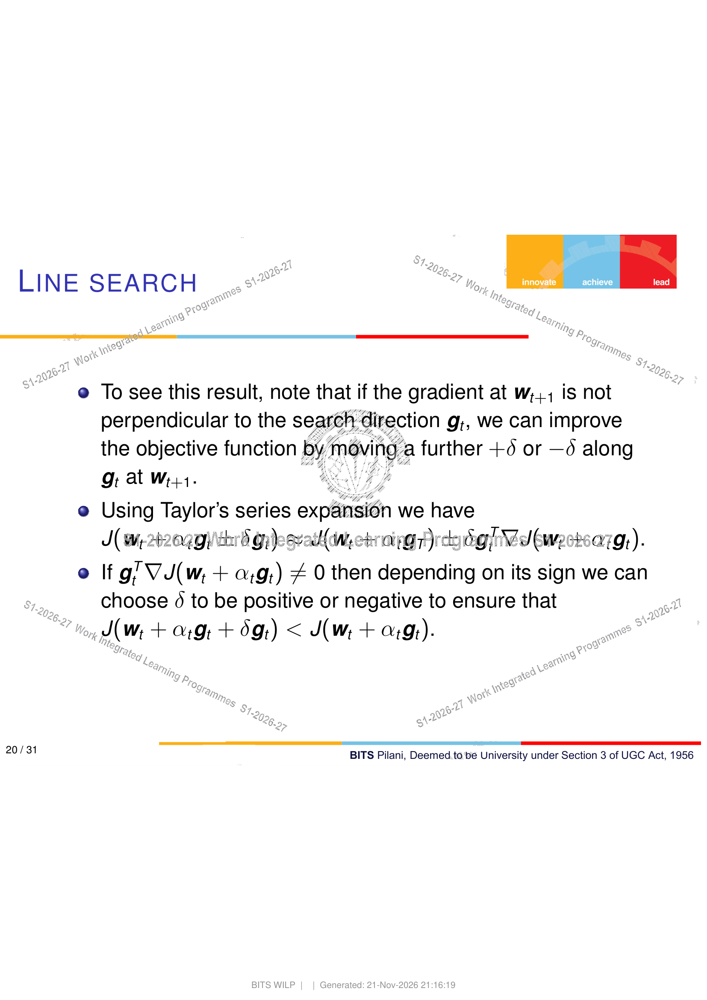

# Module 09: Unconstrained Optimization and Gradient Descent

**Course**: AIML ZC416 — Mathematical Foundations for Machine Learning  
**Prescribed Textbooks**: T1 Deisenroth, Faisal & Ong (*Mathematics for Machine Learning*, Ch 7.1–7.2); R2 Boyd & Vandenberghe (*Convex Optimization*, Ch 9)  
**Primary Faculty**: Prof. Mandar Vijay Datar | **Companion**: Prof. Saurabh (`Lecture_12_Companion_Part1.pdf`), Prof. Michael Alphonse  
**Exam Weight**: Very High (Major 7-Marks Problem in Comprehensive Exam EC-3 Makeup Q3)

---

## 1. Executive Summary & Optimization Formulation

The canonical unconstrained optimization problem in machine learning seeks a parameter vector $x^* \in \mathbb{R}^n$ that minimizes an objective (or loss) function $f: \mathbb{R}^n \to \mathbb{R}$:
$$\min_{x \in \mathbb{R}^n} f(x)$$



### First- and Second-Order Optimality Conditions
1. **First-Order Necessary Condition (FONC)**:
   If $x^*$ is a local minimizer and $f$ is continuously differentiable, then:
   $$\nabla f(x^*) = \mathbf{0}$$
2. **Second-Order Sufficient Condition (SOSC)**:
   If $\nabla f(x^*) = \mathbf{0}$ and the Hessian matrix is strictly positive definite:
   $$H_f(x^*) \succ 0$$
   then $x^*$ is a **strict local minimizer**.

---

## 2. Gradient Descent & Step-Size Selection

The **Gradient Descent (GD)** algorithm generates a sequence of iterates by taking steps in the direction of steepest descent ($d_k = -\nabla f(x^{(k)})$):
$$x^{(k+1)} = x^{(k)} - \alpha_k \nabla f(x^{(k)})$$
where $\alpha_k > 0$ is the **step size** (or learning rate).

### The Line Search Function $\phi(\alpha)$
At iterate $x^{(k)}$ with descent direction $d_k = -\nabla f(x^{(k)})$, the multidimensional minimization is reduced to a one-dimensional problem along the ray $x^{(k)} + \alpha d_k$:
$$\phi(\alpha) = f(x^{(k)} + \alpha d_k), \quad \alpha \ge 0$$

- **Exact Line Search**:
  $$\alpha_k^* = \arg\min_{\alpha > 0} \phi(\alpha)$$
  At the exact minimizer, the gradient at the new iterate is orthogonal to the search direction:
  $$\phi'(\alpha_k^*) = \nabla f(x^{(k+1)})^\top d_k = 0 \implies \nabla f(x^{(k+1)}) \perp \nabla f(x^{(k)})$$
  This orthogonality causes gradient descent to exhibit characteristic 90-degree zig-zag oscillations in narrow ravines.

---

### Step-Size Determination Algorithms
1. **Backtracking Line Search (Armijo Rule)**:
   Starts with $\alpha = \alpha_0$ and shrinks $\alpha \leftarrow \tau \alpha$ ($\tau \in (0, 1)$) until:
   $$f(x^{(k)} + \alpha d_k) \le f(x^{(k)}) + c_1 \alpha \nabla f(x^{(k)})^\top d_k$$
2. **Binary Search / Bisection Method**:
   Used to bracket the root of $\phi'(\alpha) = 0$ on a closed interval $[a, b]$ by evaluating $\phi$ at the midpoint $m = \frac{a + b}{2}$ and a slight perturbation $m + \delta$.

---

## 3. Convergence & The Condition Number

For a strictly convex quadratic objective $f(x) = \frac{1}{2} x^\top A x - b^\top x$ where $A \succ 0$:
$$\|x^{(k+1)} - x^*\|_A \le \left(\frac{\kappa(A) - 1}{\kappa(A) + 1}\right) \|x^{(k)} - x^*\|_A$$
where $\kappa(A) = \frac{\lambda_{\max}(A)}{\lambda_{\min}(A)}$ is the **condition number** of the Hessian matrix $A$.

```
Well-conditioned (κ ≈ 1):         Ill-conditioned (κ ≫ 1):
Circular Contours                Elongated Elliptical Ravine
Direct convergence to minimum    Violent zig-zagging oscillations
```

---

## 4. Solved Examination Numerical (BITS Comprehensive Exam EC-3 Makeup, Q3 — 7 Marks)

### Problem Statement:
Consider the loss function:
$$L(w_1, w_2) = w_1^4 + w_2^4 - (w_1 + w_2)$$
Suppose we want to minimize this function using the Gradient Descent algorithm with initial point $(w_1^0, w_2^0) = (0, 0)$. Define the line search function $\phi(\alpha) = L((w_1^0, w_2^0) + \alpha d)$ where $d = -\nabla L(0, 0)$.

(a) Apply the binary search method on the interval $[0, 2]$ to determine the learning rate. At each iteration, compare the function values $\phi(m)$ and $\phi(m + 10^{-3})$, where $m$ is the midpoint of the current interval. Compute the reduced interval after two iterations. [4 M]  
(b) Using the second derivative test, determine the analytical minimum of $\phi(\alpha)$ and verify whether the reduced interval obtained in part (a) is shrinking toward the optimal value. [3 M]

---

### Step-by-Step Analytical Solution:

#### Step 1: Compute Gradient at Initial Point and Descent Direction
Compute partial derivatives of $L(w_1, w_2)$:
$$\frac{\partial L}{\partial w_1} = 4w_1^3 - 1, \qquad \frac{\partial L}{\partial w_2} = 4w_2^3 - 1$$
Evaluate at $(w_1^0, w_2^0) = (0, 0)$:
$$\nabla L(0, 0) = \begin{bmatrix} 4(0)^3 - 1 \\ 4(0)^3 - 1 \end{bmatrix} = \begin{bmatrix} -1 \\ -1 \end{bmatrix}$$
The descent direction is:
$$d = -\nabla L(0, 0) = -\begin{bmatrix} -1 \\ -1 \end{bmatrix} = \begin{bmatrix} 1 \\ 1 \end{bmatrix}$$

#### Step 2: Formulate the Line Search Function $\phi(\alpha)$
$$(w_1, w_2) = (w_1^0, w_2^0) + \alpha d = (0, 0) + \alpha (1, 1) = (\alpha, \alpha)$$
Substitute into $L(w_1, w_2)$:
$$\phi(\alpha) = L(\alpha, \alpha) = \alpha^4 + \alpha^4 - (\alpha + \alpha) = \mathbf{2\alpha^4 - 2\alpha}$$

---

#### Step 3: Part (a) — Binary Search Execution (2 Iterations on $[0, 2]$)
Let $\delta = 10^{-3} = 0.001$.

##### Iteration 1:
- Current interval: $[a_1, b_1] = [0, 2]$
- Midpoint: $m_1 = \frac{0 + 2}{2} = \mathbf{1.0}$
- Test point: $m_1 + \delta = 1.0 + 0.001 = \mathbf{1.001}$

Evaluate $\phi(\alpha) = 2\alpha^4 - 2\alpha$:
$$\phi(1.0) = 2(1.0)^4 - 2(1.0) = 2 - 2 = \mathbf{0.0}$$
$$\begin{aligned}
\phi(1.001) &= 2(1.001)^4 - 2(1.001) \approx 2(1 + 4(0.001)) - 2.002 \\
&= 2(1.004006) - 2.002 = 2.008012 - 2.002 = \mathbf{+0.006012}
\end{aligned}$$

Compare values:
$$\phi(m_1 + \delta) > \phi(m_1) \quad (0.006012 > 0.0)$$
Since the function value is **increasing** to the right of $m_1$, the slope is positive ($\phi'(m_1) > 0$), meaning the minimum lies to the **left** of $m_1$.
Therefore, update the right endpoint: $b_2 = m_1 = 1.0$.
$$\text{Interval after Iteration 1: } [\mathbf{0}, \mathbf{1.0}]$$

---

##### Iteration 2:
- Current interval: $[a_2, b_2] = [0, 1.0]$
- Midpoint: $m_2 = \frac{0 + 1.0}{2} = \mathbf{0.5}$
- Test point: $m_2 + \delta = 0.5 + 0.001 = \mathbf{0.501}$

Evaluate $\phi(\alpha)$:
$$\phi(0.5) = 2(0.5)^4 - 2(0.5) = 2(0.0625) - 1.0 = 0.125 - 1.0 = \mathbf{-0.875}$$
$$\begin{aligned}
\phi(0.501) &= 2(0.501)^4 - 2(0.501) = 2(0.063003) - 1.002 \\
&= 0.126006 - 1.002 = \mathbf{-0.875994}
\end{aligned}$$

Compare values:
$$\phi(m_2 + \delta) < \phi(m_2) \quad (-0.875994 < -0.875000)$$
Since the function value is **decreasing** to the right of $m_2$, the slope is negative ($\phi'(m_2) < 0$), meaning the minimum lies to the **right** of $m_2$.
Therefore, update the left endpoint: $a_3 = m_2 = 0.5$.
$$\text{Interval after Iteration 2: } [\mathbf{0.5}, \mathbf{1.0}]$$

---

#### Step 4: Part (b) — Analytical Minimization and Verification
Given $\phi(\alpha) = 2\alpha^4 - 2\alpha$:
1. **First Derivative**:
   $$\phi'(\alpha) = \frac{d}{d\alpha}(2\alpha^4 - 2\alpha) = 8\alpha^3 - 2$$
   Set $\phi'(\alpha) = 0$:
   $$8\alpha^3 - 2 = 0 \implies \alpha^3 = \frac{2}{8} = \frac{1}{4} \implies \alpha^* = \left(\frac{1}{4}\right)^{1/3} = \frac{1}{\sqrt[3]{4}} \approx \mathbf{0.62996}$$

2. **Second Derivative Test**:
   $$\phi''(\alpha) = \frac{d^2}{d\alpha^2}(2\alpha^4 - 2\alpha) = 24\alpha^2$$
   Evaluate at $\alpha^* = 0.6300$:
   $$\phi''(0.6300) = 24(0.6300)^2 \approx 24(0.3969) = 9.5256 > 0$$
   Since $\phi''(\alpha^*) > 0$, $\alpha^* \approx \mathbf{0.6300}$ is a **strict local minimum**.

3. **Verification**:
   The reduced interval after two iterations is $[0.5, 1.0]$.
   Since:
   $$0.5 \le 0.62996 \le 1.0$$
   The analytical optimal learning rate $\alpha^* \approx 0.6300$ lies strictly within the reduced interval $[0.5, 1.0]$.
   **Conclusion**: The interval $[0, 2] \to [0, 1.0] \to [0.5, 1.0]$ is **strictly shrinking toward the optimal learning rate**.

---

## 5. Python Implementation from Scratch

```python
import numpy as np

def line_search_binary(phi, a, b, delta=1e-3, num_iters=2):
    """
    Executes binary search on line search function phi over interval [a, b].
    """
    history = [(a, b)]
    for i in range(num_iters):
        m = (a + b) / 2.0
        val_m = phi(m)
        val_m_delta = phi(m + delta)
        
        if val_m_delta > val_m:
            # Slope is positive, minimum is to the left
            b = m
        else:
            # Slope is negative, minimum is to the right
            a = m
        history.append((a, b))
        print(f"Iter {i+1}: m={m:.4f}, phi(m)={val_m:.6f}, phi(m+d)={val_m_delta:.6f} -> [{a:.4f}, {b:.4f}]")
    return a, b, history

# Test on BITS Problem
phi = lambda alpha: 2 * (alpha ** 4) - 2 * alpha
a_opt, b_opt, _ = line_search_binary(phi, 0.0, 2.0, delta=1e-3, num_iters=2)

exact_alpha = (1.0 / 4.0) ** (1.0 / 3.0)
print(f"Analytical Minimum: {exact_alpha:.5f}")
print(f"Is {exact_alpha:.5f} in [{a_opt}, {b_opt}]?: {a_opt <= exact_alpha <= b_opt}")
```

---

## 6. Exam Tips & Failure Modes

1. **Direction of Binary Search Updates**:
   - If $\phi(m + \delta) > \phi(m) \implies$ function is going UP to the right $\implies$ minimum is on LEFT $\implies b = m$.
   - If $\phi(m + \delta) < \phi(m) \implies$ function is going DOWN to the right $\implies$ minimum is on RIGHT $\implies a = m$.
   Swapping these conditions breaks the entire interval reduction.
2. **Descent Direction Negative Sign**: The descent direction is $d = -\nabla L$. When $\nabla L = [-1, -1]^\top$, $d = [1, 1]^\top$ (positive). Forgetting the minus sign results in walking in the direction of steepest *ascent*.
3. **Interval Precision**: Always write the exact interval brackets $[a_k, b_k]$ after each iteration so the examiner can award step marks directly.
