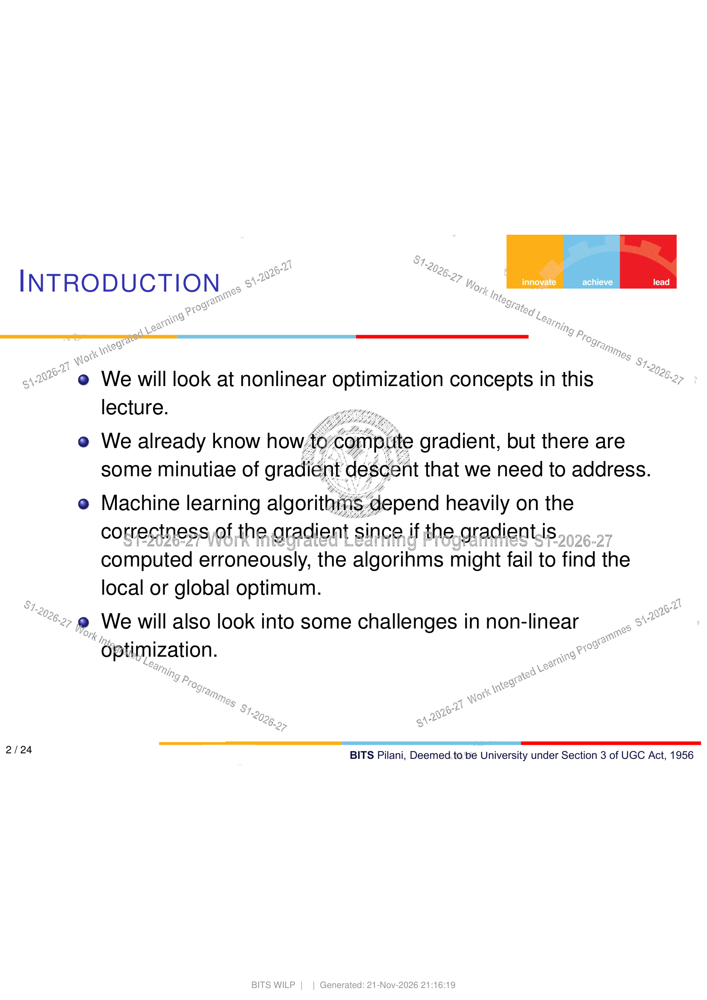

# Module 10: Constrained Optimization, Lagrange Multipliers, and KKT Conditions

**Course**: AIML ZC416 — Mathematical Foundations for Machine Learning  
**Prescribed Textbooks**: T1 Deisenroth, Faisal & Ong (*Mathematics for Machine Learning*, Ch 7.3); R2 Boyd & Vandenberghe (*Convex Optimization*, Ch 5)  
**Syllabus module**: **M10** — Constrained Optimization, Lagrange Multipliers, and KKT Conditions (see `Notes/AI Notes/module_map.yaml`)  
**Canonical video**: `Inbox/Prof. Mandar Datar/Recordings/Mathematical Foundations for Machine Learning (S1-26_AIMLZC416) - Prof. Mandar Datar - Webinar-20261013_193116-Meeting Recording.mp4`  
**Contact sessions** (reference only): Contact Session 14 (Prof. Mandar Vijay Datar). Annotated deck: `constraint-optimization.pdf`, `Problem-KKT.pdf`.
**Exam Weight**: Very High (Essential for Support Vector Machines, Regularization, and BITS Comprehensive Exams)

---

## 1. Executive Summary & Problem Formulation

In machine learning, optimization problems frequently enforce constraints on parameters (e.g., non-negative weights, bounded norms, or classification margin boundaries). The standard constrained minimization problem is defined as:

$$\begin{aligned}
\min_{x \in \mathbb{R}^n} \quad & f(x) \\
\text{subject to} \quad & g_i(x) \le 0, \quad i = 1, \dots, m \quad (\text{Inequality constraints}) \\
& h_j(x) = 0, \quad j = 1, \dots, p \quad (\text{Equality constraints})
\end{aligned}$$



### The Feasible Set
The set of all candidate vectors satisfying all constraints simultaneously:
$$\mathcal{F} = \{x \in \mathbb{R}^n : g_i(x) \le 0 \; \forall i, \; h_j(x) = 0 \; \forall j\}$$

---

## 2. Geometric Intuition of Lagrange Multipliers

### Equality Constraints ($h(x) = 0$)
Consider minimizing $f(x)$ subject to a single equality constraint $h(x) = 0$.
At an optimal point $x^*$, you cannot step along the contour curve of $h(x) = 0$ and decrease $f(x)$. This means the level curve of $f$ must be **tangent** to the constraint curve $h(x) = 0$.

Because the gradient of a function is orthogonal to its level curves, the gradient of the objective $\nabla f(x^*)$ and the gradient of the constraint $\nabla h(x^*)$ must be **collinear**:
$$\nabla f(x^*) = -\lambda^* \nabla h(x^*) \iff \nabla f(x^*) + \lambda^* \nabla h(x^*) = \mathbf{0}$$
where $\lambda^* \in \mathbb{R}$ is the **Lagrange multiplier**.

---

## 3. The Karush-Kuhn-Tucker (KKT) Conditions

To handle both equality and inequality constraints, we define the **Lagrangian function** $L: \mathbb{R}^n \times \mathbb{R}^p \times \mathbb{R}^m \to \mathbb{R}$:
$$L(x, \lambda, \mu) = f(x) + \sum_{j=1}^p \lambda_j h_j(x) + \sum_{i=1}^m \mu_i g_i(x)$$
where $\lambda_j \in \mathbb{R}$ are multipliers for equality constraints, and $\mu_i \in \mathbb{R}$ are multipliers for inequality constraints.

### The Four KKT First-Order Necessary Conditions
If $x^*$ is a local minimizer satisfying regularity conditions (e.g., Slater's condition), there exist multipliers $\lambda^* \in \mathbb{R}^p$ and $\mu^* \in \mathbb{R}^m$ such that:

1. **Stationarity**:
   $$\nabla_x L(x^*, \lambda^*, \mu^*) = \nabla f(x^*) + \sum_{j=1}^p \lambda_j^* \nabla h_j(x^*) + \sum_{i=1}^m \mu_i^* \nabla g_i(x^*) = \mathbf{0}$$
2. **Primal Feasibility**:
   $$g_i(x^*) \le 0 \quad \forall i = 1, \dots, m$$
   $$h_j(x^*) = 0 \quad \forall j = 1, \dots, p$$
3. **Dual Feasibility**:
   $$\mu_i^* \ge 0 \quad \forall i = 1, \dots, m$$
4. **Complementary Slackness**:
   $$\mu_i^* g_i(x^*) = 0 \quad \forall i = 1, \dots, m$$

---

### Active vs Inactive Constraints
The complementary slackness condition $\mu_i^* g_i(x^*) = 0$ creates two mutually exclusive scenarios for each inequality constraint $g_i$:

```
                       ┌───────────────────────────────┐
                       │   Complementary Slackness     │
                       │        μᵢ · gᵢ(x) = 0         │
                       └───────────────┬───────────────┘
                                       │
            ┌──────────────────────────┴──────────────────────────┐
            ▼                                                     ▼
     INACTIVE CONSTRAINT                                   ACTIVE CONSTRAINT
      gᵢ(x*) < 0  ⟹  μᵢ* = 0                               μᵢ* > 0  ⟹  gᵢ(x*) = 0
The constraint does not bind.                         The solution lies on the boundary.
Optimum is in interior of feasible region.            Constraint directly restricts optimum.
Multiplier drops out of stationarity.                 Acts exactly like equality constraint.
```

### Convexity & Strong Duality
- If the objective $f(x)$ is convex, the inequality constraints $g_i(x)$ are convex, and equality constraints $h_j(x)$ are affine ($A x - b = 0$), then the optimization problem is **convex**.
- Under Slater's condition (there exists a strictly feasible point where $g_i(x) < 0$ for all non-affine constraints), **Strong Duality** holds:
  $$d^* = \max_{\lambda, \mu \ge 0} \inf_x L(x, \lambda, \mu) = \min_{x \in \mathcal{F}} f(x) = p^*$$
- For convex problems, the KKT conditions are **both necessary and sufficient** for global optimality!

---

## 4. Solved Examination Numerical (BITS Pilani Master Practice Set — Prof. Mandar Datar)

### Problem Statement:
Using the KKT conditions discussed in class, obtain all candidate strict local minima for the following nonlinear optimization problem:
$$\begin{aligned}
\max_{x_1, x_2} \quad & -x_1^2 - 2x_2^2 \\
\text{subject to} \quad & x_1 + x_2 \ge 3 \\
& x_2 - x_1^2 \ge 1
\end{aligned}$$
Examine all candidate cases systematically.

---

### Step-by-Step Analytical Solution:

#### Step 1: Standard Minimization Form
Convert the maximization problem into standard minimization form ($\min f(x) \iff \max -f(x)$) with $\le 0$ constraints:
- Objective:
  $$\min \quad f(x_1, x_2) = x_1^2 + 2x_2^2$$
- Constraints:
  $$x_1 + x_2 \ge 3 \iff -(x_1 + x_2 - 3) \le 0 \implies g_1(x_1, x_2) = -x_1 - x_2 + 3 \le 0$$
  $$x_2 - x_1^2 \ge 1 \iff -(x_2 - x_1^2 - 1) \le 0 \implies g_2(x_1, x_2) = -x_2 + x_1^2 + 1 \le 0$$

#### Step 2: Construct the Lagrangian
$$L(x_1, x_2, \mu_1, \mu_2) = x_1^2 + 2x_2^2 + \mu_1 (-x_1 - x_2 + 3) + \mu_2 (-x_2 + x_1^2 + 1)$$

#### Step 3: Write the Complete KKT Conditions
1. **Stationarity w.r.t $x_1$**:
   $$\frac{\partial L}{\partial x_1} = 2x_1 - \mu_1 + 2\mu_2 x_1 = 2x_1(1 + \mu_2) - \mu_1 = 0$$
2. **Stationarity w.r.t $x_2$**:
   $$\frac{\partial L}{\partial x_2} = 4x_2 - \mu_1 - \mu_2 = 0 \implies \mu_1 + \mu_2 = 4x_2$$
3. **Primal Feasibility**:
   $$-x_1 - x_2 + 3 \le 0 \iff x_1 + x_2 \ge 3$$
   $$-x_2 + x_1^2 + 1 \le 0 \iff x_2 \ge x_1^2 + 1$$
4. **Dual Feasibility**:
   $$\mu_1 \ge 0, \quad \mu_2 \ge 0$$
5. **Complementary Slackness**:
   $$\mu_1 (-x_1 - x_2 + 3) = 0$$
   $$\mu_2 (-x_2 + x_1^2 + 1) = 0$$

---

#### Step 4: Systematic Case Analysis

##### Case 1: Both Constraints Inactive ($\mu_1 = 0, \mu_2 = 0$)
From stationarity:
- $2x_1(1 + 0) - 0 = 0 \implies x_1 = 0$
- $4x_2 - 0 - 0 = 0 \implies x_2 = 0$

Check primal feasibility at $(0, 0)$:
$$g_1(0, 0) = -0 - 0 + 3 = 3 \not\le 0 \quad (\text{VIOLATED!})$$
Thus, Case 1 yields **no candidate minimum**.

---

##### Case 2: Constraint 1 Active, Constraint 2 Inactive ($\mu_1 > 0, \mu_2 = 0$)
By complementary slackness, $\mu_1 > 0 \implies -x_1 - x_2 + 3 = 0 \implies x_1 + x_2 = 3$.  
With $\mu_2 = 0$, the stationarity equations become:
1. $2x_1 - \mu_1 = 0 \implies \mu_1 = 2x_1$
2. $4x_2 - \mu_1 = 0 \implies \mu_1 = 4x_2$

Equating the two expressions for $\mu_1$:
$$2x_1 = 4x_2 \implies x_1 = 2x_2$$
Substitute into $x_1 + x_2 = 3$:
$$2x_2 + x_2 = 3 \implies 3x_2 = 3 \implies x_2 = 1, \quad x_1 = 2(1) = 2$$
Check dual feasibility: $\mu_1 = 2(2) = 4 > 0$ (Valid).

Check primal feasibility of constraint 2 at $(2, 1)$:
$$g_2(2, 1) = -x_2 + x_1^2 + 1 = -(1) + 2^2 + 1 = -1 + 4 + 1 = 4 \not\le 0 \quad (\text{VIOLATED!})$$
Thus, Case 2 yields **no candidate minimum**.

---

##### Case 3: Constraint 1 Inactive, Constraint 2 Active ($\mu_1 = 0, \mu_2 > 0$)
By complementary slackness, $\mu_2 > 0 \implies -x_2 + x_1^2 + 1 = 0 \implies x_2 = x_1^2 + 1$.  
With $\mu_1 = 0$, the stationarity equations become:
1. $2x_1(1 + \mu_2) = 0$
   Since $\mu_2 > 0$, $(1 + \mu_2) > 1 \ne 0 \implies \mathbf{x_1 = 0}$.
2. $4x_2 - \mu_2 = 0 \implies \mu_2 = 4x_2$.

Substitute $x_1 = 0$ into constraint 2:
$$x_2 = 0^2 + 1 = 1$$
Check dual feasibility: $\mu_2 = 4(1) = 4 > 0$ (Valid).

Check primal feasibility of constraint 1 at $(0, 1)$:
$$g_1(0, 1) = -0 - 1 + 3 = 2 \not\le 0 \quad (\text{VIOLATED!})$$
Thus, Case 3 yields **no candidate minimum**.

---

##### Case 4: Both Constraints Active ($\mu_1 > 0, \mu_2 > 0$)
By complementary slackness, both constraints must hold with equality:
1. $x_1 + x_2 = 3 \implies x_2 = 3 - x_1$
2. $x_2 = x_1^2 + 1$

Equating the two expressions for $x_2$:
$$3 - x_1 = x_1^2 + 1 \implies x_1^2 + x_1 - 2 = 0$$
Factor the quadratic polynomial:
$$(x_1 + 2)(x_1 - 1) = 0 \implies x_1 = -2 \quad \text{or} \quad x_1 = 1$$

Now test each candidate sub-point:
- **Sub-point 4A: $x_1 = -2$**:
  $$x_2 = 3 - (-2) = 5$$
  Test stationarity condition 1:
  $$2(-2)(1 + \mu_2) - \mu_1 = 0 \implies -4(1 + \mu_2) = \mu_1 \implies \mu_1 = -4 - 4\mu_2$$
  Since $\mu_1 > 0$ and $\mu_2 > 0$, the left side is strictly positive ($\mu_1 > 0$), but the right side is strictly negative ($-4 - 4\mu_2 < 0$).
  This is a contradiction! Dual feasibility is violated. Sub-point 4A is **inadmissible**.

- **Sub-point 4B: $x_1 = 1$**:
  $$x_2 = 3 - (1) = 2$$
  Substitute $(x_1, x_2) = (1, 2)$ into the stationarity equations:
  1. $2(1) - \mu_1 + 2\mu_2(1) = 0 \implies \mu_1 - 2\mu_2 = 2$
  2. $4(2) - \mu_1 - \mu_2 = 0 \implies \mu_1 + \mu_2 = 8$

  Subtract equation (1) from equation (2):
  $$(\mu_1 + \mu_2) - (\mu_1 - 2\mu_2) = 8 - 2 \implies 3\mu_2 = 6 \implies \mathbf{\mu_2^* = 2 > 0}$$
  Substitute $\mu_2^* = 2$ into (2):
  $$\mu_1^* + 2 = 8 \implies \mathbf{\mu_1^* = 6 > 0}$$

Both multipliers are strictly positive ($\mu_1^* = 6 > 0, \mu_2^* = 2 > 0$), satisfying dual feasibility and complementary slackness!

---

#### Step 5: Final Conclusion
The unique candidate point satisfying all KKT conditions is:
$$\mathbf{x_1^* = 1}, \quad \mathbf{x_2^* = 2}$$
with optimal Lagrange multipliers:
$$\mathbf{\mu_1^* = 6}, \quad \mathbf{\mu_2^* = 2}$$
Optimal objective value:
$$f(1, 2) = 1^2 + 2(2)^2 = 1 + 8 = \mathbf{9}$$
(For the original maximization problem, the maximum value is $-9$).

---

## 5. Python Implementation from Scratch (SciPy & Analytical Verification)

```python
import numpy as np
from scipy.optimize import minimize

# Define objective and constraints
def objective(x):
    return x[0]**2 + 2 * x[1]**2

# Constraints in standard SciPy form: c(x) >= 0
constraints = [
    {'type': 'ineq', 'fun': lambda x: x[0] + x[1] - 3.0},       # x1 + x2 >= 3
    {'type': 'ineq', 'fun': lambda x: x[1] - x[0]**2 - 1.0}     # x2 - x1^2 >= 1
]

res = minimize(objective, x0=[0.5, 0.5], constraints=constraints, method='SLSQP')
print("Optimization Success:", res.success)
print("Optimal x*:", np.round(res.x, 4), "(Expected: [1.0, 2.0])")
print("Optimal f(x*):", np.round(res.fun, 4), "(Expected: 9.0)")
```

---

## 6. Exam Tips & Failure Modes

1. **Systematic 4-Case Protocol**: In university written examinations, omitting any of the 4 cases ($\mu_1=\mu_2=0$, $\mu_1>0, \mu_2=0$, $\mu_1=0, \mu_2>0$, $\mu_1>0, \mu_2>0$) results in an immediate loss of marks, even if you find the correct point. Show the contradiction in each discarded case.
2. **Dual Multiplier Sign Convention**: For minimization problems with $g(x) \le 0$, the multiplier must be non-negative: $\mu \ge 0$. If an algebraic solution yields $\mu < 0$, that point is a local *maximum* or saddle, and must be rejected.
3. **Quadratic Extraneous Roots**: When solving intersection polynomials (here, $x_1^2 + x_1 - 2 = 0$), always test both roots against the stationarity equations to discard spurious roots like $x_1 = -2$.
