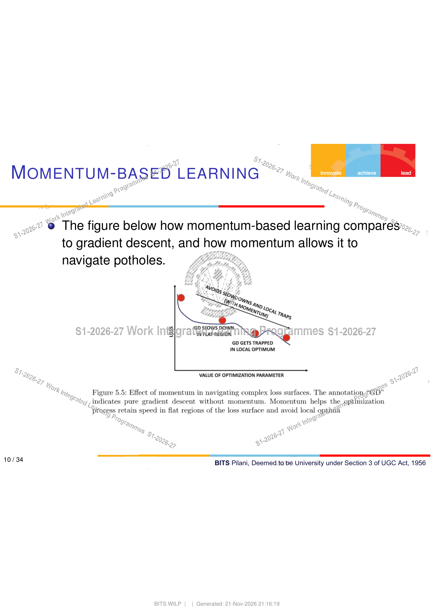

# Module 11: First- and Second-Order Optimizers: Momentum, RMSProp, and Adam

**Course**: AIML ZC416 — Mathematical Foundations for Machine Learning  
**Prescribed Textbooks**: T1 Deisenroth, Faisal & Ong (*Mathematics for Machine Learning*, Ch 7.1–7.2); Goodfellow, Bengio & Courville (*Deep Learning*, Ch 8)  
**Syllabus module**: **M11** — First- and Second-Order Optimizers: Momentum, RMSProp, and Adam (see `Notes/AI Notes/module_map.yaml`)  
**Canonical video**: `Inbox/Prof. Mandar Datar/Recordings/Mathematical Foundations for Machine Learning (S1-26_AIMLZC416) - Prof. Mandar Datar-20261031_103140-Meeting Recording.mp4`  
**Contact sessions** (reference only): Contact Session 13 (Prof. Mandar Vijay Datar). Companion: Prof. Saurabh (`Lecture_12_Companion_Part1.pdf`), Prof. Michael Alphonse.
**Exam Weight**: High (Direct 4-Marks Step-by-Step Problem in Comprehensive Exam EC-3 Makeup Q4)

---

## 1. Executive Summary & Optimization Pathologies

Standard vanilla Gradient Descent ($w_{t+1} = w_t - \eta \nabla f(w_t)$) suffers from severe failure modes when navigating high-dimensional machine learning loss surfaces:



1. **Pathological Curvature (Ravines)**: In narrow elongated valleys where the condition number $\kappa(H) = \frac{\lambda_{\max}}{\lambda_{\min}} \gg 1$, the gradient points almost orthogonally to the direction of the minimum, causing violent transverse oscillations and negligible progress along the base.
2. **Saddle Points & Flat Plateaus**: Gradient norms vanish ($\|\nabla f\| \approx 0$) on flat plateaus and near saddles, stalling standard gradient descent for thousands of iterations.
3. **Noisy Stochastic Gradients**: In mini-batch training, noisy gradient estimates introduce random drift away from the true descending trajectory.

---

## 2. Advanced First-Order Optimizers

### 1. Momentum Gradient Descent (Polyak Heavy-Ball Method)
Inspired by classical Newtonian mechanics, momentum introduces a velocity vector $v_t$ that accumulates past gradients:
$$\begin{aligned}
v_{t+1} &= \beta v_t + \eta \nabla f(w_t) \\
w_{t+1} &= w_t - v_{t+1}
\end{aligned}$$
where $\beta \in [0, 1)$ is the momentum decay factor (typically $0.9$ or $0.5$).
- **Mechanism**: Oscillating orthogonal gradient components cancel out through summation, while consistent forward components amplify, accelerating traversal through ravines.

---

### 2. AdaGrad (Adaptive Gradient Algorithm)
AdaGrad dynamically scales the learning rate per parameter inversely proportional to the square root of historical squared gradients:
$$G_t = G_{t-1} + g_t \odot g_t$$
$$w_{t+1} = w_t - \frac{\eta}{\sqrt{G_t} + \epsilon} \odot g_t$$
- **Flaw**: $G_t$ accumulates monotonically without decay, causing the effective step size $\frac{\eta}{\sqrt{G_t}}$ to shrink prematurely to zero before reaching the minimum.

---

### 3. RMSProp (Root Mean Square Propagation)
RMSProp resolves AdaGrad's premature stalling by replacing the cumulative sum with an **exponentially decaying moving average**:
$$v_t = \beta v_{t-1} + (1 - \beta) g_t \odot g_t$$
$$w_{t+1} = w_t - \frac{\eta}{\sqrt{v_t} + \epsilon} \odot g_t$$
where $\beta \approx 0.9$ and $\epsilon \approx 10^{-8}$.

---

### 4. Adam (Adaptive Moment Estimation)
Adam combines the advantages of **Momentum** (first raw moment / exponentially decaying average of gradients) and **RMSProp** (second uncentered moment / exponentially decaying average of squared gradients):

$$\begin{aligned}
m_t &= \beta_1 m_{t-1} + (1 - \beta_1) g_t \quad (\text{First moment estimation}) \\
v_t &= \beta_2 v_{t-1} + (1 - \beta_2) g_t^2 \quad (\text{Second moment estimation})
\end{aligned}$$

#### Bias Correction:
Because $m_0 = \mathbf{0}$ and $v_0 = \mathbf{0}$, the moment estimates are heavily biased toward zero during the initial iterations. Unbiased estimators are derived as:
$$\hat{m}_t = \frac{m_t}{1 - \beta_1^t}, \qquad \hat{v}_t = \frac{v_t}{1 - \beta_2^t}$$

#### Parameter Update:
$$w_{t+1} = w_t - \frac{\eta}{\sqrt{\hat{v}_t} + \epsilon} \hat{m}_t$$
- **Standard Hyperparameters**: $\beta_1 = 0.9, \beta_2 = 0.999, \epsilon = 10^{-8}, \eta = 10^{-3}$.

---

## 3. Second-Order Optimization (Newton's Method)

Newton's method fits a local quadratic Taylor model at iterate $w_t$:
$$f(w_t + \Delta w) \approx f(w_t) + \nabla f(w_t)^\top \Delta w + \frac{1}{2} \Delta w^\top H_f(w_t) \Delta w$$
Minimizing this quadratic model with respect to $\Delta w$ yields:
$$\Delta w = -[H_f(w_t)]^{-1} \nabla f(w_t)$$
$$w_{t+1} = w_t - [H_f(w_t)]^{-1} \nabla f(w_t)$$

- **Advantages**: Quadratic convergence near local minima; affine invariant; zero tuning required for quadratic objectives.
- **Drawbacks**: Requires inverting an $n \times n$ Hessian matrix ($O(n^3)$ cost per step); readily attracted to saddle points where $\det(H) < 0$.

---

## 4. Solved Examination Numerical (BITS Comprehensive Exam EC-3 Makeup, Q4 — 4 Marks)

### Problem Statement:
Consider the function:
$$J(w_0, w_1) = (w_0 - 3)^2 + (w_1 - 3)^2$$
We wish to minimize $J(w_0, w_1)$ using the Gradient Descent algorithm with momentum. The initial parameter values are $(w_0^0, w_1^0) = (2, 2)$, the learning rate is $\eta = 0.05$, the momentum parameter is $\beta = 0.5$, and the initial velocity vector is $(v_0^0, v_1^0) = (0, 0)$.  
Compute the parameter value $(w_0^1, w_1^1)$ after the first iteration and $(w_0^2, w_1^2)$ after the second iteration. [4 M]

---

### Step-by-Step Analytical Solution:

#### Mathematical Form of Momentum Equations:
At iteration $t$:
$$v^{(t+1)} = \beta v^{(t)} + \eta \nabla J(w^{(t)})$$
$$w^{(t+1)} = w^{(t)} - v^{(t+1)}$$

#### Compute Gradient Function:
$$\frac{\partial J}{\partial w_0} = 2(w_0 - 3), \qquad \frac{\partial J}{\partial w_1} = 2(w_1 - 3)$$
$$\nabla J(w_0, w_1) = \begin{bmatrix} 2(w_0 - 3) \\ 2(w_1 - 3) \end{bmatrix}$$

---

#### Iteration 1:
- Given initial state: $w^{(0)} = \begin{bmatrix} 2 \\ 2 \end{bmatrix}$, $v^{(0)} = \begin{bmatrix} 0 \\ 0 \end{bmatrix}$
- Parameters: $\eta = 0.05$, $\beta = 0.5$

1. **Evaluate Gradient at $w^{(0)}$**:
   $$\nabla J(2, 2) = \begin{bmatrix} 2(2 - 3) \\ 2(2 - 3) \end{bmatrix} = \begin{bmatrix} -2 \\ -2 \end{bmatrix}$$

2. **Compute New Velocity $v^{(1)}$**:
   $$v^{(1)} = \beta v^{(0)} + \eta \nabla J(w^{(0)}) = 0.5 \begin{bmatrix} 0 \\ 0 \end{bmatrix} + 0.05 \begin{bmatrix} -2 \\ -2 \end{bmatrix} = \begin{bmatrix} -0.1 \\ -0.1 \end{bmatrix}$$

3. **Update Parameters $w^{(1)}$**:
   $$w^{(1)} = w^{(0)} - v^{(1)} = \begin{bmatrix} 2 \\ 2 \end{bmatrix} - \begin{bmatrix} -0.1 \\ -0.1 \end{bmatrix} = \begin{bmatrix} 2 - (-0.1) \\ 2 - (-0.1) \end{bmatrix} = \begin{bmatrix} \mathbf{2.1} \\ \mathbf{2.1} \end{bmatrix}$$

**Result after Iteration 1**:
$$(w_0^1, w_1^1) = (\mathbf{2.1}, \mathbf{2.1}), \qquad (v_0^1, v_1^1) = (-0.1, -0.1)$$

---

#### Iteration 2:
- Current state: $w^{(1)} = \begin{bmatrix} 2.1 \\ 2.1 \end{bmatrix}$, $v^{(1)} = \begin{bmatrix} -0.1 \\ -0.1 \end{bmatrix}$

1. **Evaluate Gradient at $w^{(1)}$**:
   $$\nabla J(2.1, 2.1) = \begin{bmatrix} 2(2.1 - 3) \\ 2(2.1 - 3) \end{bmatrix} = \begin{bmatrix} 2(-0.9) \\ 2(-0.9) \end{bmatrix} = \begin{bmatrix} -1.8 \\ -1.8 \end{bmatrix}$$

2. **Compute New Velocity $v^{(2)}$**:
   $$\begin{aligned}
   v^{(2)} &= \beta v^{(1)} + \eta \nabla J(w^{(1)}) \\
   &= 0.5 \begin{bmatrix} -0.1 \\ -0.1 \end{bmatrix} + 0.05 \begin{bmatrix} -1.8 \\ -1.8 \end{bmatrix} \\
   &= \begin{bmatrix} -0.05 \\ -0.05 \end{bmatrix} + \begin{bmatrix} -0.09 \\ -0.09 \end{bmatrix} = \begin{bmatrix} \mathbf{-0.14} \\ \mathbf{-0.14} \end{bmatrix}
   \end{aligned}$$

3. **Update Parameters $w^{(2)}$**:
   $$w^{(2)} = w^{(1)} - v^{(2)} = \begin{bmatrix} 2.1 \\ 2.1 \end{bmatrix} - \begin{bmatrix} -0.14 \\ -0.14 \end{bmatrix} = \begin{bmatrix} 2.1 + 0.14 \\ 2.1 + 0.14 \end{bmatrix} = \begin{bmatrix} \mathbf{2.24} \\ \mathbf{2.24} \end{bmatrix}$$

**Result after Iteration 2**:
$$(w_0^2, w_1^2) = (\mathbf{2.24}, \mathbf{2.24}), \qquad (v_0^2, v_1^2) = (-0.14, -0.14)$$

Notice that $w$ is making rapid, accelerating progress toward the true minimizer $w^* = (3, 3)$!

---

## 5. Python Implementation from Scratch

```python
import numpy as np

def momentum_gradient_descent(grad_fn, w0, v0, eta, beta, num_steps=2):
    """
    Executes Momentum Gradient Descent step-by-step.
    """
    w = np.array(w0, dtype=float)
    v = np.array(v0, dtype=float)
    
    history = [w.copy()]
    for t in range(num_steps):
        g = grad_fn(w)
        v = beta * v + eta * g
        w = w - v
        history.append(w.copy())
        print(f"Step {t+1}: grad={g}, v={v}, w={w}")
    return w, history

# Test on BITS Exam Problem
grad_J = lambda w: 2 * (w - 3.0)
w_opt, _ = momentum_gradient_descent(grad_J, [2.0, 2.0], [0.0, 0.0], eta=0.05, beta=0.5, num_steps=2)
print("Final w after 2 steps:", np.round(w_opt, 4), "(Expected: [2.24, 2.24])")
```

---

## 6. Exam Tips & Failure Modes

1. **Velocity Sign Convention in Updates**: In the standard formulation $v_{t+1} = \beta v_t + \eta \nabla J(w_t)$, the gradient has a positive sign in $v$, so the parameter update uses **subtraction**: $w_{t+1} = w_t - v_{t+1}$. If you define $v$ with a negative gradient ($v = \beta v - \eta \nabla J$), you must use **addition** ($w = w + v$). Mixing conventions causes divergence.
2. **Double Negative in $w - (-v)$**: Notice that when $\nabla J$ is negative ($-2$), $v$ is negative ($-0.1$), so subtracting $v$ results in **adding** $0.1$ to $w$ ($2 - (-0.1) = 2.1$). Always check that the parameter is moving in the correct downhill direction toward $(3, 3)$.
3. **Adam Bias Correction Power $t$**: In Adam, the powers in the denominator are $\beta_1^t$ and $\beta_2^t$, where $t$ is the current step index ($1, 2, \dots$). Do not confuse the step power $t$ with the decay constants.
