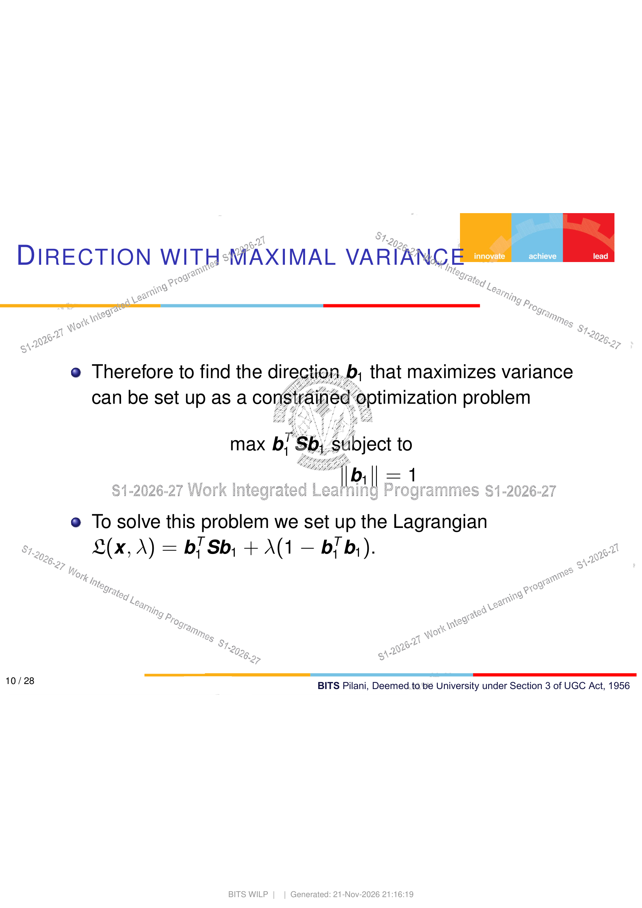

# Module 12: Principal Component Analysis (PCA) and Dimensionality Reduction

**Course**: AIML ZC416 — Mathematical Foundations for Machine Learning  
**Prescribed Textbooks**: T1 Deisenroth, Faisal & Ong (*Mathematics for Machine Learning*, Ch 10.1–10.4); R1 Boyd & Vandenberghe (*VMLS*, Ch 10)  
**Syllabus module**: **M12** — Principal Component Analysis (PCA) and Dimensionality Reduction (see `Notes/AI Notes/module_map.yaml`)  
**Canonical video**: `Inbox/Prof. Mandar Datar/Recordings/Mathematical Foundations for Machine Learning (S1-26_AIMLZC416) - Prof. Mandar Datar-20261114_103156-Meeting Recording.mp4`  
**Contact sessions** (reference only): Contact Session 15 (Prof. Mandar Vijay Datar). Companion: Prof. Saurabh (`PCA_Companion_Lecture13_AIMLCZC416_1.pdf`), Prof. Upendar Mendu.
**Exam Weight**: Very High (Major 7-Marks Problem in Comprehensive Exam EC-3 Makeup Q5)

---

## 1. Executive Summary & Problem Formulation

High-dimensional data in machine learning often lies approximately on a lower-dimensional affine subspace. **Principal Component Analysis (PCA)** is an unsupervised, linear technique that projects data from $\mathbb{R}^D$ to a lower-dimensional subspace $\mathbb{R}^M$ ($M < D$) while preserving the maximum possible variance of the dataset.



### The Data Matrix & Centering
Given a dataset of $N$ observations in $D$ dimensions:
$$\mathcal{D} = \{x_1, x_2, \dots, x_N\}, \quad x_n \in \mathbb{R}^D$$
Represented as a data matrix $X \in \mathbb{R}^{N \times D}$ where rows are observations:
$$X = \begin{bmatrix} x_1^\top \\ x_2^\top \\ \vdots \\ x_N^\top \end{bmatrix} = \begin{bmatrix} x_{11} & x_{12} & \cdots & x_{1D} \\ x_{21} & x_{22} & \cdots & x_{2D} \\ \vdots & \vdots & \ddots & \vdots \\ x_{N1} & x_{N2} & \cdots & x_{ND} \end{bmatrix}$$

1. **Empirical Mean Vector ($\mu \in \mathbb{R}^D$)**:
   $$\mu = \frac{1}{N} \sum_{n=1}^N x_n$$
2. **Mean-Centered Data Matrix ($\tilde{X} \in \mathbb{R}^{N \times D}$)**:
   $$\tilde{x}_n = x_n - \mu \implies \tilde{X} = X - \mathbf{1}_N \mu^\top$$
3. **Sample Covariance Matrix ($S \in \mathbb{R}^{D \times D}$)**:
   $$S = \frac{1}{N-1} \sum_{n=1}^N (x_n - \mu)(x_n - \mu)^\top = \frac{1}{N-1} \tilde{X}^\top \tilde{X}$$
   *(Note: The unbiased sample covariance divides by $N-1$; population covariance divides by $N$. Both share identical eigenvectors!)*

---

## 2. Derivation of PCA: Maximum Variance Perspective

Consider projecting the centered data onto a one-dimensional subspace defined by a unit direction vector $u_1 \in \mathbb{R}^D$ ($\|u_1\|_2^2 = u_1^\top u_1 = 1$).

The scalar projection of observation $x_n$ is $z_{n1} = u_1^\top x_n$.  
The sample variance of the projected data is:
$$\sigma_{u_1}^2 = \frac{1}{N-1} \sum_{n=1}^N (u_1^\top x_n - u_1^\top \mu)^2 = \frac{1}{N-1} \sum_{n=1}^N u_1^\top (x_n - \mu)(x_n - \mu)^\top u_1 = u_1^\top S u_1$$

### Constrained Optimization via Lagrange Multipliers:
We maximize the projected variance subject to the unit-norm constraint:
$$\max_{u_1} \quad u_1^\top S u_1 \quad \text{subject to} \quad u_1^\top u_1 = 1$$

Construct the Lagrangian:
$$\mathcal{L}(u_1, \lambda_1) = u_1^\top S u_1 - \lambda_1 (u_1^\top u_1 - 1)$$
Take the gradient with respect to $u_1$ and set to zero:
$$\nabla_{u_1} \mathcal{L} = 2 S u_1 - 2 \lambda_1 u_1 = \mathbf{0} \implies S u_1 = \lambda_1 u_1$$

### Fundamental Conclusion:
1. $u_1$ must be an **eigenvector** of the sample covariance matrix $S$.
2. The projected variance is:
   $$\sigma_{u_1}^2 = u_1^\top S u_1 = u_1^\top (\lambda_1 u_1) = \lambda_1 (u_1^\top u_1) = \lambda_1$$
   To maximize variance, $\lambda_1$ must be the **largest eigenvalue** of $S$, and $u_1$ is its corresponding normalized eigenvector (the **first principal component**).
3. Subsequent principal components $u_2, \dots, u_M$ are the eigenvectors corresponding to the $M$ largest eigenvalues $\lambda_1 \ge \lambda_2 \ge \dots \ge \lambda_M$, satisfying orthogonality $u_i^\top u_j = 0$ ($i \ne j$).

---

## 3. Projection, Reconstruction & Variance Explained

### Data Projection
To project a centered observation $\tilde{x} = x - \mu \in \mathbb{R}^D$ into the $M$-dimensional principal subspace:
$$z = U_M^\top \tilde{x} = U_M^\top (x - \mu) \in \mathbb{R}^M$$
where $U_M = [u_1 \mid u_2 \mid \dots \mid u_M] \in \mathbb{R}^{D \times M}$.

### Data Reconstruction
The reconstructed approximation in the original $D$-dimensional space is:
$$\hat{x} = \mu + U_M z = \mu + \sum_{j=1}^M z_j u_j \in \mathbb{R}^D$$

### Proportion of Variance Explained (PVE)
The total variance of the dataset is the trace of the covariance matrix:
$$\text{Total Variance} = \text{trace}(S) = \sum_{j=1}^D \lambda_j$$
The fraction of variance retained by the top $M$ components is:
$$\text{PVE}(M) = \frac{\sum_{i=1}^M \lambda_i}{\sum_{j=1}^D \lambda_j}$$
In practice, $M$ is chosen such that $\text{PVE}(M) \ge 0.90$ or $0.95$.

---

## 4. Solved Examination Numerical (BITS Comprehensive Exam EC-3 Makeup, Q5 — 7 Marks)

### Problem Statement:
Consider the dataset:
$$X = \begin{bmatrix} 0 & 3 \\ 1 & 5 \\ 2 & 7 \end{bmatrix} \in \mathbb{R}^{3 \times 2}$$
where each row represents an observation in $\mathbb{R}^2$ and the columns represent features.  
1. Compute the covariance matrix $S$ of the dataset $X$. [2 M]  
2. Determine the eigenvalues and eigenvectors of $S$. [3 M]  
3. Using Principal Component Analysis (PCA), identify the one-dimensional principal subspace of $\mathbb{R}^2$ onto which the data should be projected. [2 M]

---

### Step-by-Step Analytical Solution:

#### Step 1: Compute Empirical Mean and Centered Data Matrix
Number of observations $N = 3$, feature dimension $D = 2$.
Observations:
$$x_1 = \begin{bmatrix} 0 \\ 3 \end{bmatrix}, \quad x_2 = \begin{bmatrix} 1 \\ 5 \end{bmatrix}, \quad x_3 = \begin{bmatrix} 2 \\ 7 \end{bmatrix}$$

1. **Mean Vector $\mu$**:
   $$\mu = \frac{1}{3} (x_1 + x_2 + x_3) = \frac{1}{3} \left( \begin{bmatrix} 0 \\ 3 \end{bmatrix} + \begin{bmatrix} 1 \\ 5 \end{bmatrix} + \begin{bmatrix} 2 \\ 7 \end{bmatrix} \right) = \frac{1}{3} \begin{bmatrix} 3 \\ 15 \end{bmatrix} = \begin{bmatrix} \mathbf{1} \\ \mathbf{5} \end{bmatrix}$$

2. **Mean-Centered Observations**:
   $$\tilde{x}_1 = x_1 - \mu = \begin{bmatrix} 0 - 1 \\ 3 - 5 \end{bmatrix} = \begin{bmatrix} -1 \\ -2 \end{bmatrix}$$
   $$\tilde{x}_2 = x_2 - \mu = \begin{bmatrix} 1 - 1 \\ 5 - 5 \end{bmatrix} = \begin{bmatrix} 0 \\ 0 \end{bmatrix}$$
   $$\tilde{x}_3 = x_3 - \mu = \begin{bmatrix} 2 - 1 \\ 7 - 5 \end{bmatrix} = \begin{bmatrix} 1 \\ 2 \end{bmatrix}$$

Centered data matrix $\tilde{X}$:
$$\tilde{X} = \begin{bmatrix} -1 & -2 \\ 0 & 0 \\ 1 & 2 \end{bmatrix}$$

---

#### Step 2: Compute the Sample Covariance Matrix $S$
Using the unbiased sample covariance formula ($N - 1 = 3 - 1 = 2$):
$$S = \frac{1}{2} \tilde{X}^\top \tilde{X} = \frac{1}{2} \sum_{n=1}^3 \tilde{x}_n \tilde{x}_n^\top$$

Compute the outer products:
$$\tilde{x}_1 \tilde{x}_1^\top = \begin{bmatrix} -1 \\ -2 \end{bmatrix} \begin{bmatrix} -1 & -2 \end{bmatrix} = \begin{bmatrix} 1 & 2 \\ 2 & 4 \end{bmatrix}$$
$$\tilde{x}_2 \tilde{x}_2^\top = \begin{bmatrix} 0 \\ 0 \end{bmatrix} \begin{bmatrix} 0 & 0 \end{bmatrix} = \begin{bmatrix} 0 & 0 \\ 0 & 0 \end{bmatrix}$$
$$\tilde{x}_3 \tilde{x}_3^\top = \begin{bmatrix} 1 \\ 2 \end{bmatrix} \begin{bmatrix} 1 & 2 \end{bmatrix} = \begin{bmatrix} 1 & 2 \\ 2 & 4 \end{bmatrix}$$

Sum of outer products:
$$\tilde{X}^\top \tilde{X} = \begin{bmatrix} 1 + 0 + 1 & 2 + 0 + 2 \\ 2 + 0 + 2 & 4 + 0 + 4 \end{bmatrix} = \begin{bmatrix} 2 & 4 \\ 4 & 8 \end{bmatrix}$$

Divide by $N - 1 = 2$:
$$S = \frac{1}{2} \begin{bmatrix} 2 & 4 \\ 4 & 8 \end{bmatrix} = \begin{bmatrix} \mathbf{1} & \mathbf{2} \\ \mathbf{2} & \mathbf{4} \end{bmatrix}$$

*(Note: If using population covariance with divisor $N = 3$, $S_{\text{pop}} = \begin{bmatrix} 2/3 & 4/3 \\ 4/3 & 8/3 \end{bmatrix}$. Both have identical eigenvectors!)*

---

#### Step 3: Determine Eigenvalues and Eigenvectors of $S$
Compute the characteristic polynomial:
$$\det(S - \lambda I) = \det \begin{bmatrix} 1 - \lambda & 2 \\ 2 & 4 - \lambda \end{bmatrix} = (1 - \lambda)(4 - \lambda) - (2)(2) = 0$$
$$\lambda^2 - 5\lambda + 4 - 4 = 0 \implies \lambda^2 - 5\lambda = 0 \implies \lambda(\lambda - 5) = 0$$

The eigenvalues are:
$$\mathbf{\lambda_1 = 5}, \qquad \mathbf{\lambda_2 = 0}$$

##### Eigenvector for $\lambda_1 = 5$:
$$(S - 5I) v_1 = \begin{bmatrix} 1 - 5 & 2 \\ 2 & 4 - 5 \end{bmatrix} \begin{bmatrix} v_{11} \\ v_{12} \end{bmatrix} = \begin{bmatrix} -4 & 2 \\ 2 & -1 \end{bmatrix} \begin{bmatrix} v_{11} \\ v_{12} \end{bmatrix} = \begin{bmatrix} 0 \\ 0 \end{bmatrix}$$
From row 1: $-4 v_{11} + 2 v_{12} = 0 \implies v_{12} = 2 v_{11}$.  
Choose $v_{11} = 1 \implies v_{12} = 2$.
Unnormalized vector: $\begin{bmatrix} 1 \\ 2 \end{bmatrix}$.  
Normalize to unit length $\|u_1\|_2 = \sqrt{1^2 + 2^2} = \sqrt{5}$:
$$u_1 = \frac{1}{\sqrt{5}} \begin{bmatrix} 1 \\ 2 \end{bmatrix} = \begin{bmatrix} \mathbf{1/\sqrt{5}} \\ \mathbf{2/\sqrt{5}} \end{bmatrix}$$

##### Eigenvector for $\lambda_2 = 0$:
$$(S - 0I) v_2 = \begin{bmatrix} 1 & 2 \\ 2 & 4 \end{bmatrix} \begin{bmatrix} v_{21} \\ v_{22} \end{bmatrix} = \begin{bmatrix} 0 \\ 0 \end{bmatrix}$$
$v_{21} + 2 v_{22} = 0 \implies v_{21} = -2 v_{22}$.  
Choose $v_{22} = 1 \implies v_{21} = -2$.  
Normalize to unit length:
$$u_2 = \frac{1}{\sqrt{5}} \begin{bmatrix} -2 \\ 1 \end{bmatrix} = \begin{bmatrix} \mathbf{-2/\sqrt{5}} \\ \mathbf{1/\sqrt{5}} \end{bmatrix}$$

---

#### Step 4: Identify the 1D Principal Subspace
The first principal component corresponds to the largest eigenvalue $\lambda_1 = 5$.
The one-dimensional principal subspace onto which data should be projected is the span of $u_1$:
$$\mathcal{W} = \text{span}\left\{ \frac{1}{\sqrt{5}} \begin{bmatrix} 1 \\ 2 \end{bmatrix} \right\} = \left\{ c \begin{bmatrix} 1 \\ 2 \end{bmatrix} : c \in \mathbb{R} \right\}$$

#### Geometric Insight:
Notice that all three data points $(0, 3), (1, 5), (2, 7)$ satisfy $x_2 = 2x_1 + 3$ (they lie **perfectly on a straight line** in $\mathbb{R}^2$ with slope 2!).
- The direction of the line is $\begin{bmatrix} 1 \\ 2 \end{bmatrix}$.
- Therefore, the data is intrinsically 1-dimensional!
- $\lambda_1 = 5$ captures **100% of the variance**:
  $$\text{PVE}(1) = \frac{\lambda_1}{\lambda_1 + \lambda_2} = \frac{5}{5 + 0} = \mathbf{1.0 \quad (100\%)}$$
- The second eigenvalue $\lambda_2 = 0$ confirms that the orthogonal projection onto $\mathcal{W}$ suffers **zero reconstruction loss**!

---

## 5. Python Implementation from Scratch

```python
import numpy as np

def compute_pca(X: np.ndarray, n_components: int = 1):
    """
    Computes PCA on data matrix X from first principles.
    """
    N, D = X.shape
    # 1. Compute empirical mean
    mu = np.mean(X, axis=0)
    
    # 2. Mean-center data
    X_tilde = X - mu
    
    # 3. Sample covariance matrix (unbiased: N - 1)
    S = (X_tilde.T @ X_tilde) / (N - 1)
    
    # 4. Eigendecomposition of S
    eigvals, eigvecs = np.linalg.eigh(S)
    
    # Sort descending
    idx = np.argsort(eigvals)[::-1]
    eigvals = eigvals[idx]
    eigvecs = eigvecs[:, idx]
    
    # Select top components
    U_M = eigvecs[:, :n_components]
    
    # 5. Project data
    Z = X_tilde @ U_M
    
    # 6. Reconstruct data
    X_rec = Z @ U_M.T + mu
    
    pve = np.sum(eigvals[:n_components]) / np.sum(eigvals)
    return mu, S, eigvals, U_M, Z, X_rec, pve

# Test on BITS Exam Dataset
X = np.array([[0, 3], [1, 5], [2, 7]], dtype=float)
mu, S, eigvals, U_M, Z, X_rec, pve = compute_pca(X, n_components=1)

print("Mean Vector:", mu)
print("Sample Covariance S:\n", S)
print("Eigenvalues:", eigvals)
print("Principal Direction u1:\n", U_M)
print("PVE (Variance Explained):", pve)
print("Reconstruction Error:", np.linalg.norm(X - X_rec))
```

---

## 6. Exam Tips & Failure Modes

1. **Forgetting to Center Data**: Computing $S = \frac{1}{N-1} X^\top X$ without subtracting the mean vector $\mu$ yields uncentered raw second moments, completely distorting the principal axes. Always center the data first!
2. **Normalizing Principal Components**: Eigenvectors must always be normalized to unit Euclidean length ($\|u_i\|_2 = 1$). Writing $u_1 = [1, 2]^\top$ without dividing by $\sqrt{5}$ will lose marks on BITS examinations.
3. **Divisor $N-1$ vs $N$**: In BITS hand numericals, $N-1$ is the standard textbook sample covariance formula. Always specify which divisor you are using.
