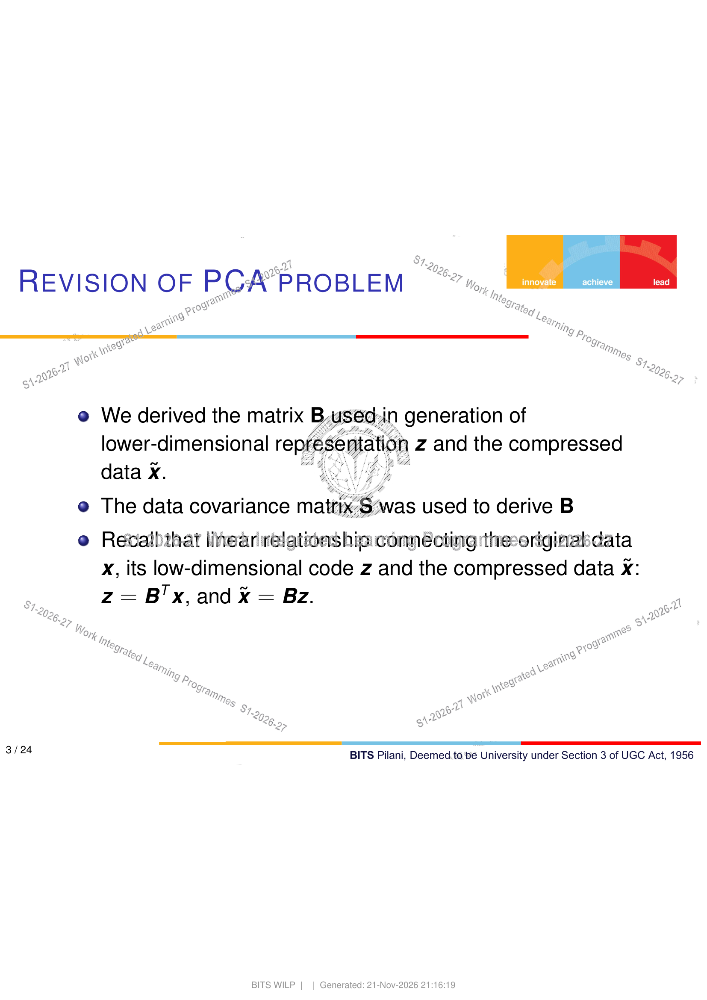

# Module 13: Low-Rank Matrix Approximations and the Eckart-Young Theorem

**Course**: AIML ZC416 — Mathematical Foundations for Machine Learning  
**Prescribed Textbooks**: T1 Deisenroth, Faisal & Ong (*Mathematics for Machine Learning*, Ch 4.5, Ch 10.4); R1 Boyd & Vandenberghe (*VMLS*, Ch 10)  
**Syllabus module**: **M13** — Low-Rank Matrix Approximations and the Eckart-Young Theorem (see `Notes/AI Notes/module_map.yaml`)  
**Canonical video**: `Inbox/Prof. Mandar Datar/Recordings/Mathematical Foundations for Machine Learning (S1-26_AIMLZC416) - Prof. Mandar Datar-20261114_103156-Meeting Recording.mp4`  
**Contact sessions** (reference only): Contact Session 15 (Prof. Mandar Vijay Datar). Companion: Prof. Saurabh (`PCA_Companion_Lecture13_AIMLCZC416_1.pdf`).
**Exam Weight**: High (Theoretical bridge connecting SVD to PCA, Matrix Factorization, and Latent Semantic Analysis)

---

## 1. Executive Summary & Problem Formulation

In machine learning and data science, matrices representing large datasets, image frames, customer-product ratings, or term-document frequencies are typically high-rank and corrupted by noise. A central objective is finding a structured matrix $B$ of low rank $k \ll \min(m, n)$ that approximates the original matrix $A \in \mathbb{R}^{m \times n}$ with minimal reconstruction error:

$$\min_{B \in \mathbb{R}^{m \times n}} \|A - B\| \quad \text{subject to} \quad \text{rank}(B) \le k$$



### Matrix Norms
1. **Frobenius Norm**:
   $$\|A\|_F = \sqrt{\sum_{i=1}^m \sum_{j=1}^n a_{ij}^2} = \sqrt{\text{trace}(A^\top A)} = \sqrt{\sum_{i=1}^r \sigma_i^2}$$
2. **Spectral ($L_2$) Norm**:
   $$\|A\|_2 = \max_{x \ne \mathbf{0}} \frac{\|A x\|_2}{\|x\|_2} = \sigma_1 \quad (\text{Largest singular value})$$

---

## 2. The Eckart-Young-Mirsky Theorem

### Theorem Formulation
Let $A \in \mathbb{R}^{m \times n}$ have singular value decomposition (SVD):
$$A = U \Sigma V^\top = \sum_{i=1}^r \sigma_i u_i v_i^\top$$
where $\sigma_1 \ge \sigma_2 \ge \dots \ge \sigma_r > 0$ are the singular values, and $u_i \in \mathbb{R}^m, v_i \in \mathbb{R}^n$ are the orthonormal left and right singular vectors.

For any integer $k$ with $1 \le k < r$, the **unique optimal rank-$k$ approximation** to $A$ under both the Frobenius norm and the Spectral norm is the **truncated SVD**:
$$A_k = U_k \Sigma_k V_k^\top = \sum_{i=1}^k \sigma_i u_i v_i^\top$$
where $U_k \in \mathbb{R}^{m \times k}, \Sigma_k \in \mathbb{R}^{k \times k}, V_k \in \mathbb{R}^{n \times k}$.

---

### Minimal Approximation Errors

1. **Frobenius Norm Error**:
   $$\min_{\text{rank}(B) \le k} \|A - B\|_F^2 = \|A - A_k\|_F^2 = \sum_{j=k+1}^r \sigma_j^2$$
   The squared error in the Frobenius norm is exactly the sum of the squares of the discarded singular values.

2. **Spectral Norm Error**:
   $$\min_{\text{rank}(B) \le k} \|A - B\|_2 = \|A - A_k\|_2 = \sigma_{k+1}$$
   The error in the spectral norm is exactly equal to the first discarded singular value $\sigma_{k+1}$.

---

## 3. The Grand Unification: SVD, Low-Rank Approximation & PCA

There is an exact mathematical correspondence between Principal Component Analysis and the Singular Value Decomposition of the centered data matrix:

Let $X \in \mathbb{R}^{N \times D}$ be the data matrix, and let $\tilde{X} = X - \mathbf{1}_N \mu^\top \in \mathbb{R}^{N \times D}$ be the mean-centered data.  
Compute the SVD of the scaled centered data matrix:
$$\frac{1}{\sqrt{N-1}} \tilde{X} = U \Sigma V^\top$$

Then the sample covariance matrix $S$ is:
$$S = \left(\frac{1}{\sqrt{N-1}} \tilde{X}\right)^\top \left(\frac{1}{\sqrt{N-1}} \tilde{X}\right) = (U \Sigma V^\top)^\top (U \Sigma V^\top) = V (\Sigma^\top \Sigma) V^\top = V \Sigma^2 V^\top$$

### Equivalence Table:
| PCA Concept | SVD Dual | Mathematical Relation |
| :--- | :--- | :--- |
| Sample Covariance Eigenvectors | Right Singular Vectors | Columns of $V$ are principal directions $u_i$ |
| Covariance Eigenvalues $\lambda_i$ | Singular Values $\sigma_i$ | $\lambda_i = \sigma_i^2$ |
| Projected Coordinates $Z$ | Scaled Left Singular Vectors | $Z = \tilde{X} V = \sqrt{N-1} U \Sigma$ |
| Total Dataset Variance | Sum of Squared Singular Values | $\text{trace}(S) = \sum \sigma_i^2$ |
| Optimal Low-Rank Subspace | Truncated SVD Projection | $X_k = \mathbf{1} \mu^\top + \tilde{X} V_k V_k^\top$ |

---

## 4. Solved Examination Numerical (Exam-Pattern Model Problem)

### Problem Statement:
Consider the matrix:
$$A = \begin{bmatrix} 3 & 2 & 2 \\ 2 & 3 & -2 \end{bmatrix} \in \mathbb{R}^{2 \times 3}$$
(a) Compute the singular values and SVD of $A$.  
(b) Construct the best rank-1 approximation $A_1$ of $A$ according to the Eckart-Young theorem.  
(c) Compute the approximation error in both the Frobenius norm $\|A - A_1\|_F$ and the Spectral norm $\|A - A_1\|_2$.

---

### Step-by-Step Analytical Solution:

#### (a) Singular Values and SVD of $A$
Matrix dimensions: $m = 2, n = 3$.
Compute the $2 \times 2$ Gram matrix $A A^\top$:
$$A A^\top = \begin{bmatrix} 3 & 2 & 2 \\ 2 & 3 & -2 \end{bmatrix} \begin{bmatrix} 3 & 2 \\ 2 & 3 \\ 2 & -2 \end{bmatrix} = \begin{bmatrix} 3^2 + 2^2 + 2^2 & 3(2) + 2(3) + 2(-2) \\ 2(3) + 3(2) + (-2)(2) & 2^2 + 3^2 + (-2)^2 \end{bmatrix} = \begin{bmatrix} 17 & 8 \\ 8 & 17 \end{bmatrix}$$

Find the eigenvalues of $A A^\top$:
$$\det(A A^\top - \lambda I) = \det \begin{bmatrix} 17 - \lambda & 8 \\ 8 & 17 - \lambda \end{bmatrix} = (17 - \lambda)^2 - 64 = 0$$
$$(17 - \lambda)^2 = 64 \implies 17 - \lambda = \pm 8 \implies \lambda_1 = 25, \quad \lambda_2 = 9$$

Singular values:
$$\sigma_1 = \sqrt{25} = \mathbf{5}, \qquad \sigma_2 = \sqrt{9} = \mathbf{3}$$
$$\Sigma = \begin{bmatrix} 5 & 0 & 0 \\ 0 & 3 & 0 \end{bmatrix} \in \mathbb{R}^{2 \times 3}$$

Left singular vectors $U = [u_1 \mid u_2]$ (eigenvectors of $A A^\top$):
1. **For $\lambda_1 = 25$**:
   $$\begin{bmatrix} 17 - 25 & 8 \\ 8 & 17 - 25 \end{bmatrix} u_1 = \begin{bmatrix} -8 & 8 \\ 8 & -8 \end{bmatrix} u_1 = \mathbf{0} \implies u_1 = \frac{1}{\sqrt{2}} \begin{bmatrix} 1 \\ 1 \end{bmatrix}$$
2. **For $\lambda_2 = 9$**:
   $$\begin{bmatrix} 17 - 9 & 8 \\ 8 & 17 - 9 \end{bmatrix} u_2 = \begin{bmatrix} 8 & 8 \\ 8 & 8 \end{bmatrix} u_2 = \mathbf{0} \implies u_2 = \frac{1}{\sqrt{2}} \begin{bmatrix} 1 \\ -1 \end{bmatrix}$$

Right singular vectors $v_i = \frac{1}{\sigma_i} A^\top u_i$:
1. **For $v_1$ ($\sigma_1 = 5$)**:
   $$v_1 = \frac{1}{5} \begin{bmatrix} 3 & 2 \\ 2 & 3 \\ 2 & -2 \end{bmatrix} \begin{bmatrix} 1/\sqrt{2} \\ 1/\sqrt{2} \end{bmatrix} = \frac{1}{5\sqrt{2}} \begin{bmatrix} 3 + 2 \\ 2 + 3 \\ 2 - 2 \end{bmatrix} = \frac{1}{5\sqrt{2}} \begin{bmatrix} 5 \\ 5 \\ 0 \end{bmatrix} = \frac{1}{\sqrt{2}} \begin{bmatrix} 1 \\ 1 \\ 0 \end{bmatrix}$$
2. **For $v_2$ ($\sigma_2 = 3$)**:
   $$v_2 = \frac{1}{3} \begin{bmatrix} 3 & 2 \\ 2 & 3 \\ 2 & -2 \end{bmatrix} \begin{bmatrix} 1/\sqrt{2} \\ -1/\sqrt{2} \end{bmatrix} = \frac{1}{3\sqrt{2}} \begin{bmatrix} 3 - 2 \\ 2 - 3 \\ 2 - (-2) \end{bmatrix} = \frac{1}{3\sqrt{2}} \begin{bmatrix} 1 \\ -1 \\ 4 \end{bmatrix}$$

---

#### (b) Best Rank-1 Approximation $A_1$
By the Eckart-Young theorem, $A_1 = \sigma_1 u_1 v_1^\top$:
$$A_1 = 5 \left( \frac{1}{\sqrt{2}} \begin{bmatrix} 1 \\ 1 \end{bmatrix} \right) \left( \frac{1}{\sqrt{2}} \begin{bmatrix} 1 & 1 & 0 \end{bmatrix} \right) = \frac{5}{2} \begin{bmatrix} 1 \\ 1 \end{bmatrix} \begin{bmatrix} 1 & 1 & 0 \end{bmatrix}$$
$$A_1 = \frac{5}{2} \begin{bmatrix} 1 & 1 & 0 \\ 1 & 1 & 0 \end{bmatrix} = \begin{bmatrix} \mathbf{2.5} & \mathbf{2.5} & \mathbf{0} \\ \mathbf{2.5} & \mathbf{2.5} & \mathbf{0} \end{bmatrix}$$

Notice:
- $\text{rank}(A_1) = 1$ (Rows are identical).

---

#### (c) Approximation Errors
1. **Frobenius Norm Error**:
   By Eckart-Young:
   $$\|A - A_1\|_F = \sqrt{\sum_{j=2}^2 \sigma_j^2} = \sqrt{\sigma_2^2} = \sigma_2 = \mathbf{3}$$
   *Verification by difference matrix*:
   $$A - A_1 = \begin{bmatrix} 3 - 2.5 & 2 - 2.5 & 2 - 0 \\ 2 - 2.5 & 3 - 2.5 & -2 - 0 \end{bmatrix} = \begin{bmatrix} 0.5 & -0.5 & 2 \\ -0.5 & 0.5 & -2 \end{bmatrix}$$
   $$\|A - A_1\|_F^2 = (0.5)^2 + (-0.5)^2 + 2^2 + (-0.5)^2 + (0.5)^2 + (-2)^2 = 0.25 + 0.25 + 4 + 0.25 + 0.25 + 4 = 9$$
   $$\|A - A_1\|_F = \sqrt{9} = \mathbf{3} \quad (\text{Exact match!})$$

2. **Spectral Norm Error**:
   $$\|A - A_1\|_2 = \sigma_{k+1} = \sigma_2 = \mathbf{3}$$

---

## 5. Python Implementation from Scratch

```python
import numpy as np

def low_rank_approximation(A: np.ndarray, k: int):
    """
    Computes best rank-k approximation of A using SVD via Eckart-Young theorem.
    """
    U, S, Vt = np.linalg.svd(A, full_matrices=False)
    
    # Truncate to top k components
    U_k = U[:, :k]
    S_k = S[:k]
    Vt_k = Vt[:k, :]
    
    A_k = U_k @ np.diag(S_k) @ Vt_k
    
    # Errors
    frob_error = np.sqrt(np.sum(S[k:]**2))
    spectral_error = S[k] if k < len(S) else 0.0
    
    return A_k, frob_error, spectral_error

# Test on Exam Problem
A = np.array([[3, 2, 2], [2, 3, -2]], dtype=float)
A_1, err_F, err_2 = low_rank_approximation(A, k=1)

print("Original A:\n", A)
print("Rank-1 Approximation A1:\n", np.round(A_1, 4))
print(f"Frobenius Error: {err_F:.4f} (Actual: {np.linalg.norm(A - A_1, 'fro'):.4f})")
print(f"Spectral Error: {err_2:.4f} (Actual: {np.linalg.norm(A - A_1, 2):.4f})")
```

---

## 6. Exam Tips & Failure Modes

1. **Frobenius Error Formulation**: Remember that the Frobenius error is $\sqrt{\sigma_{k+1}^2 + \dots + \sigma_r^2}$. It is **not** simply $\sigma_{k+1}$ unless there is only one discarded singular value!
2. **Spectral Error Formulation**: The spectral norm error is **always exactly equal to the single first discarded singular value** $\sigma_{k+1}$.
3. **Outer Product Order**: When reconstructing $A_k = \sum_{i=1}^k \sigma_i u_i v_i^\top$, make sure the outer product is $u_i v_i^\top$ ($m \times n$). Writing $v_i u_i^\top$ transposes the approximation to $n \times m$.

---

## 7. Faculty Pedagogy, Lecture Transcripts & Classroom Insights (Prof. Mandar Vijay Datar)

### 7.1 Primary Lecture Alignment
- **Live Contact Sessions**: CS 15 (2026-11-14).
- **Recordings & Transcripts**: `Inbox/Prof. Mandar Datar/Recordings/Mathematical Foundations for Machine Learning (S1-26_AIMLZC416) - Prof. Mandar Datar-20261114_103156-Meeting Recording.mp4`.
- **Official Annotated Decks**: `linear-algebra-optimization-notes.pdf`. Companion: Prof. Saurabh (`Lecture_14.pdf`).

### 7.2 Core Classroom Takeaways & Whiteboard Proofs
1. **The Eckart–Young–Mirsky Optimality**: Prof. Mandar Datar explains that among all possible rank-$k$ matrices in $\mathbb{R}^{m \times n}$, truncated SVD $A_k = \sum_{i=1}^k \sigma_i u_i v_i^T$ is the globally optimal projection under both Spectral ($L_2$) and Frobenius norms.
2. **Analytical Error Residuals**:
   $$\|A - A_k\|_2 = \sigma_{k+1} \quad \text{and} \quad \|A - A_k\|_F = \sqrt{\sum_{i=k+1}^r \sigma_i^2}$$
3. **Data Compression Ratio**: Storing $A \in \mathbb{R}^{m \times n}$ takes $mn$ memory slots. Storing rank-$k$ SVD takes $k(m + n + 1)$ slots. For image compression ($1000 \times 1000$ image, $k=50$), storage collapses from $1,000,000$ to $100,050$ numbers (a $90\%$ savings).

### 7.3 BITS Examination Traps & Evaluation Directives
- **Rank Identification**: In rank-$k$ approximation questions, ensure $k < \text{rank}(A)$. Setting $k \ge \text{rank}(A)$ yields exact matrix reconstruction with zero approximation error.
- **Outer Product Summation**: When writing $A_k$, compute each rank-1 outer product $\sigma_i u_i v_i^T$ explicitly before adding them to form the final approximated matrix.
