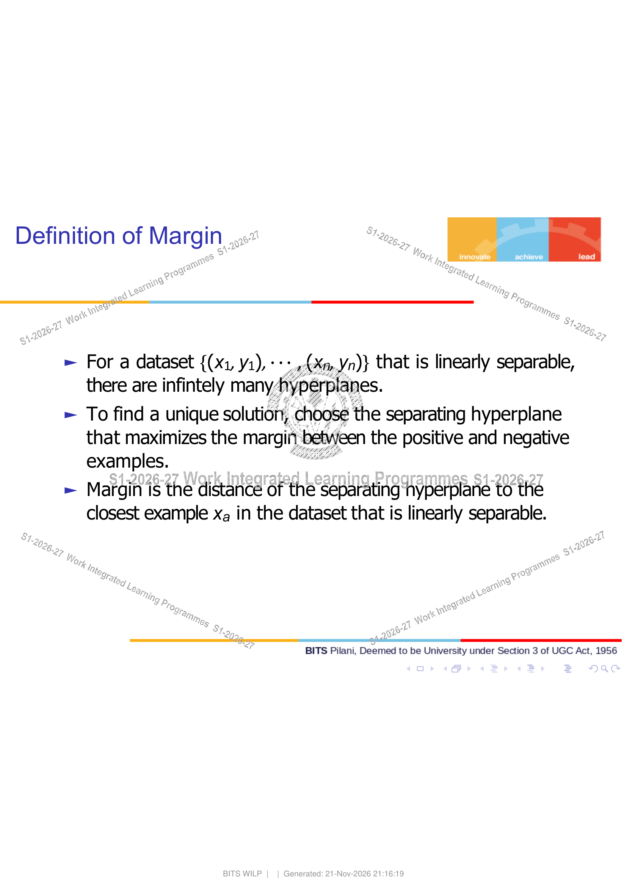
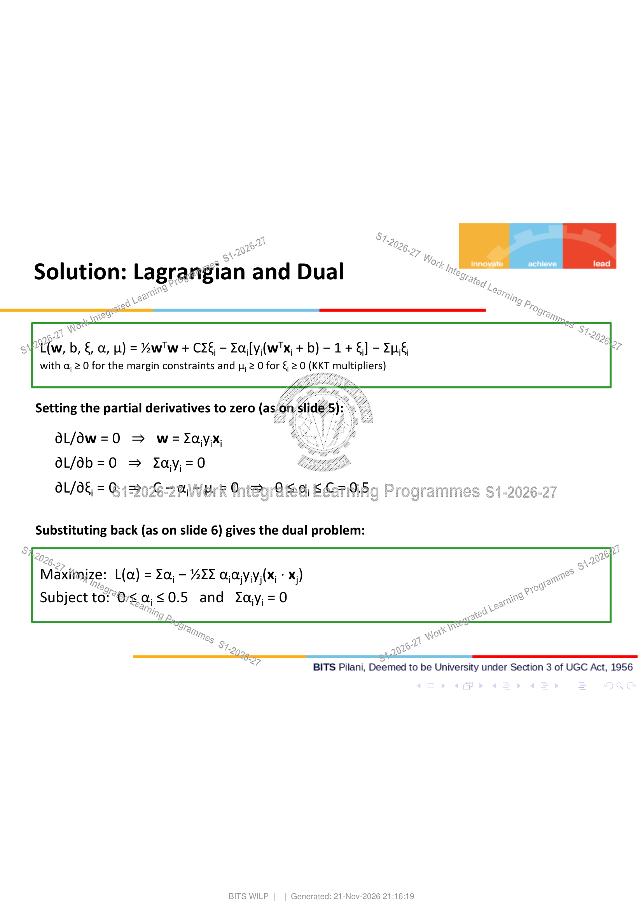

# Module 14: Classification with Support Vector Machines (SVM) and Kernels

**Course**: AIML ZC416 — Mathematical Foundations for Machine Learning  
**Prescribed Textbooks**: T1 Deisenroth, Faisal & Ong (*Mathematics for Machine Learning*, Ch 12.1–12.4); R2 Boyd & Vandenberghe (*Convex Optimization*, Ch 5)  
**Syllabus module**: **M14** — Classification with Support Vector Machines (SVM) and Kernels (see `Notes/AI Notes/module_map.yaml`)  
**Canonical video**: `Inbox/Prof. Mandar Datar/Recordings/Mathematical Foundations for Machine Learning (S1-26_AIMLZC416) - Prof. Mandar Datar-20261121_103646-Meeting Recording.mp4`  
**Contact sessions** (reference only): Contact Session 16 (Prof. Mandar Vijay Datar). Companion: Prof. Michael Alphonse (`EC3M_AIMLCZC416.pdf`), Prof. Saurabh.
**Exam Weight**: Very High (Major 7-Marks Problem in Comprehensive Exam EC-3 Makeup Q6)

---

## 1. Executive Summary & Geometric Foundations

Classification in supervised machine learning seeks a decision boundary that partitions feature space into distinct class regions. For binary classification with labels $y_i \in \{-1, +1\}$, a **linear classifier** is defined by a hyperplane:
$$\mathcal{H} = \{x \in \mathbb{R}^D : w^\top x + b = 0\}$$
where $w \in \mathbb{R}^D$ is the weight vector (normal to the hyperplane) and $b \in \mathbb{R}$ is the bias term.

The decision rule is:
$$\hat{y} = \text{sign}(w^\top x + b)$$



### Geometric Margin & Margin Maximization
The signed perpendicular Euclidean distance from any data point $x_i$ to the hyperplane is:
$$\gamma_i = \frac{y_i (w^\top x_i + b)}{\|w\|_2}$$

The **margin** of the classifier is the minimum distance from the hyperplane to any training point:
$$\gamma = \min_{i=1,\dots,N} \gamma_i$$

Support Vector Machines seek the unique hyperplane that **maximizes the margin** $\gamma$. By setting the functional margin at the closest points to 1 ($y_i(w^\top x_i + b) = 1$), the margin becomes $\frac{1}{\|w\|_2}$. Maximizing $\frac{1}{\|w\|_2}$ is equivalent to minimizing $\frac{1}{2} \|w\|_2^2$.

---

## 2. Primal Formulations: Hard vs Soft Margin

### 1. Hard-Margin SVM (Linearly Separable Data)
$$\begin{aligned}
\min_{w, b} \quad & \frac{1}{2} \|w\|_2^2 \\
\text{subject to} \quad & y_i(w^\top x_i + b) \ge 1, \quad i = 1, \dots, N
\end{aligned}$$

---

### 2. Soft-Margin SVM (Non-Separable or Noisy Data)
When data is not strictly linearly separable, we introduce non-negative **slack variables** $\xi_i \ge 0$ that measure the margin violation of point $x_i$:
$$\begin{aligned}
\min_{w, b, \xi} \quad & \frac{1}{2} \|w\|_2^2 + C \sum_{i=1}^N \xi_i \\
\text{subject to} \quad & y_i(w^\top x_i + b) \ge 1 - \xi_i, \quad i = 1, \dots, N \\
& \xi_i \ge 0, \quad i = 1, \dots, N
\end{aligned}$$
where $C > 0$ is the regularization hyperparameter controlling the trade-off between maximizing the margin width ($\frac{1}{2}\|w\|^2$) and penalizing training classification errors ($C \sum \xi_i$).

---

### 3. Equivalence to Unconstrained Hinge Loss Minimization
The constraint $y_i(w^\top x_i + b) \ge 1 - \xi_i$ with $\xi_i \ge 0$ implies:
$$\xi_i \ge 1 - y_i(w^\top x_i + b) \quad \text{and} \quad \xi_i \ge 0 \implies \xi_i^* = \max(0, 1 - y_i(w^\top x_i + b))$$

Substituting $\xi_i^*$ directly into the objective transforms the constrained problem into an unconstrained empirical risk minimization problem with **Hinge Loss**:
$$\min_{w, b} \quad \frac{1}{2} \|w\|_2^2 + C \sum_{i=1}^N \max(0, 1 - y_i(w^\top x_i + b))$$

```
Hinge Loss: ℓ(y, f(x)) = max(0, 1 - y · f(x))
           Loss
            ▲
          2 │      /
            │     /
          1 │    /
            │   /
          0 └──/───────────► Functional Margin y · f(x)
              0    1
            Misclassified | Correct & Beyond Margin
```

---

## 3. The Wolfe Dual Formulation & The Kernel Trick



### The Lagrangian Function
Introduce Lagrange multipliers $\alpha_i \ge 0$ and $\mu_i \ge 0$:
$$L(w, b, \xi, \alpha, \mu) = \frac{1}{2} w^\top w + C \sum_{i=1}^N \xi_i - \sum_{i=1}^N \alpha_i \left[ y_i(w^\top x_i + b) - 1 + \xi_i \right] - \sum_{i=1}^N \mu_i \xi_i$$

### Stationarity Conditions:
1. $\nabla_w L = w - \sum_{i=1}^N \alpha_i y_i x_i = \mathbf{0} \implies w^* = \sum_{i=1}^N \alpha_i^* y_i x_i$
2. $\frac{\partial L}{\partial b} = -\sum_{i=1}^N \alpha_i y_i = 0 \implies \sum_{i=1}^N \alpha_i^* y_i = 0$
3. $\frac{\partial L}{\partial \xi_i} = C - \alpha_i - \mu_i = 0 \implies \alpha_i^* + \mu_i^* = C \implies 0 \le \alpha_i^* \le C$

---

### The Dual Optimization Problem
Substitute the stationarity results back into the Lagrangian to obtain the **Wolfe Dual**:
$$\begin{aligned}
\max_{\alpha} \quad & \sum_{i=1}^N \alpha_i - \frac{1}{2} \sum_{i=1}^N \sum_{j=1}^N \alpha_i \alpha_j y_i y_j (x_i^\top x_j) \\
\text{subject to} \quad & 0 \le \alpha_i \le C, \quad i = 1, \dots, N \\
& \sum_{i=1}^N \alpha_i y_i = 0
\end{aligned}$$

### Support Vectors & Complementary Slackness:
The KKT condition $\alpha_i [y_i(w^\top x_i + b) - 1 + \xi_i] = 0$ reveals:
- **Non-Support Vectors ($\alpha_i = 0$)**: $y_i(w^\top x_i + b) > 1$. Point lies strictly beyond the margin; has zero influence on the decision boundary.
- **Marginal Support Vectors ($0 < \alpha_i < C$)**: $\xi_i = 0$, $y_i(w^\top x_i + b) = 1$. Point lies exactly on the margin boundary.
- **Non-Marginal Support Vectors ($\alpha_i = C$)**: $\xi_i > 0$. Point violates the margin or is misclassified.

---

### The Kernel Trick
Notice that the dual optimization problem and the final decision function depend on the training data **exclusively through inner products $x_i^\top x_j$**:
$$\hat{y}(x) = \text{sign}\left( \sum_{i \in \text{SV}} \alpha_i^* y_i (x_i^\top x) + b^* \right)$$

By Mercer's theorem, we can replace the inner product $x_i^\top x_j$ with a non-linear **kernel function** $k(x_i, x_j) = \phi(x_i)^\top \phi(x_j)$ that implicitly maps data to an infinite-dimensional feature space without ever explicitly computing $\phi(x)$:
1. **Linear Kernel**: $k(x, z) = x^\top z$
2. **Polynomial Kernel**: $k(x, z) = (x^\top z + c)^d$
3. **Radial Basis Function (RBF / Gaussian Kernel)**:
   $$k(x, z) = \exp\left(-\gamma \|x - z\|_2^2\right) = \exp\left(-\frac{\|x - z\|_2^2}{2\sigma^2}\right)$$

---

## 4. Solved Examination Numerical (BITS Comprehensive Exam EC-3 Makeup, Q6 — 7 Marks)

### Problem Statement:
Consider the following training dataset in $\mathbb{R}^2$:

| Point | $x_1$ | $x_2$ | Class $y$ |
| :---: | :---: | :---: | :---: |
| $X_1$ | 3 | 3 | $+1$ |
| $X_2$ | 5 | 5 | $+1$ |
| $X_3$ | 3 | 0 | $-1$ |
| $X_4$ | 5 | 0 | $-1$ |

(a) Let $w = (w_1, w_2)^\top \in \mathbb{R}^2$ be the weight vector, $b \in \mathbb{R}$ be the bias term, $\xi_i \ge 0$ ($i = 1, 2, 3, 4$) be the slack variables, and $C > 0$ be the regularization parameter. Write the primal optimization problem for the soft-margin Support Vector Machine for the given dataset. [1 M]  
(b) Show that the soft-margin SVM problem can be written in the unconstrained form:
$$\min_{w, b} \frac{1}{2} \|w\|^2 + C \sum_{i=1}^4 \max(0, 1 - y_i(w^\top X_i + b)) \quad [2\text{ M}]$$
(c) Suppose $w = (1, -1)^\top$ and $b = 0$.
1. Compute $y_i(w^\top X_i + b)$ for each data point. [2 M]  
2. Compute the hinge loss for each point. [1 M]  
3. Determine the total objective value for $C = 1$. [1 M]

---

### Step-by-Step Analytical Solution:

#### (a) Primal Optimization Problem for Soft-Margin SVM
Given the 4 training points $X_1 = [3, 3]^\top, X_2 = [5, 5]^\top, X_3 = [3, 0]^\top, X_4 = [5, 0]^\top$:

$$\min_{w_1, w_2, b, \xi} \quad \frac{1}{2} (w_1^2 + w_2^2) + C (\xi_1 + \xi_2 + \xi_3 + \xi_4)$$
$$\text{subject to:} \quad \begin{cases}
+1 \cdot (3 w_1 + 3 w_2 + b) \ge 1 - \xi_1 \\
+1 \cdot (5 w_1 + 5 w_2 + b) \ge 1 - \xi_2 \\
-1 \cdot (3 w_1 + 0 w_2 + b) \ge 1 - \xi_3 \\
-1 \cdot (5 w_1 + 0 w_2 + b) \ge 1 - \xi_4 \\
\xi_1 \ge 0, \; \xi_2 \ge 0, \; \xi_3 \ge 0, \; \xi_4 \ge 0
\end{cases}$$

---

#### (b) Derivation of Unconstrained Hinge Loss Formulation
For each data point $i \in \{1, 2, 3, 4\}$, the constraints are:
$$y_i(w^\top X_i + b) \ge 1 - \xi_i \iff \xi_i \ge 1 - y_i(w^\top X_i + b)$$
together with the non-negativity constraint:
$$\xi_i \ge 0$$

Combining these two inequalities gives:
$$\xi_i \ge \max(0, 1 - y_i(w^\top X_i + b))$$

Because $C > 0$, the objective function is strictly monotonically increasing with respect to each $\xi_i$. Therefore, at the optimal solution, each slack variable $\xi_i$ will take the smallest possible value that satisfies the lower bound:
$$\xi_i^* = \max(0, 1 - y_i(w^\top X_i + b))$$

Substituting $\xi_i^*$ into the primal objective yields the unconstrained formulation:
$$\min_{w, b} \quad \mathbf{\frac{1}{2} \|w\|^2 + C \sum_{i=1}^4 \max(0, 1 - y_i(w^\top X_i + b))}$$

---

#### (c) Calculations for $w = (1, -1)^\top$ and $b = 0$:

##### Part 1: Compute Functional Margins $y_i(w^\top X_i + b)$
Given $w = \begin{bmatrix} 1 \\ -1 \end{bmatrix}, b = 0$.
The linear combination is $w^\top X_i + b = 1 \cdot x_{i1} - 1 \cdot x_{i2} + 0 = x_{i1} - x_{i2}$.

1. **For $X_1 = (3, 3), y_1 = +1$**:
   $$w^\top X_1 + b = 3 - 3 = 0$$
   $$y_1(w^\top X_1 + b) = (+1)(0) = \mathbf{0}$$

2. **For $X_2 = (5, 5), y_2 = +1$**:
   $$w^\top X_2 + b = 5 - 5 = 0$$
   $$y_2(w^\top X_2 + b) = (+1)(0) = \mathbf{0}$$

3. **For $X_3 = (3, 0), y_3 = -1$**:
   $$w^\top X_3 + b = 3 - 0 = 3$$
   $$y_3(w^\top X_3 + b) = (-1)(3) = \mathbf{-3}$$

4. **For $X_4 = (5, 0), y_4 = -1$**:
   $$w^\top X_4 + b = 5 - 0 = 5$$
   $$y_4(w^\top X_4 + b) = (-1)(5) = \mathbf{-5}$$

---

##### Part 2: Compute Hinge Loss $\ell_i = \max(0, 1 - y_i(w^\top X_i + b))$
1. **Point $X_1$**:
   $$\ell_1 = \max(0, 1 - 0) = \max(0, 1) = \mathbf{1}$$
2. **Point $X_2$**:
   $$\ell_2 = \max(0, 1 - 0) = \max(0, 1) = \mathbf{1}$$
3. **Point $X_3$**:
   $$\ell_3 = \max(0, 1 - (-3)) = \max(0, 1 + 3) = \mathbf{4}$$
4. **Point $X_4$**:
   $$\ell_4 = \max(0, 1 - (-5)) = \max(0, 1 + 5) = \mathbf{6}$$

---

##### Part 3: Determine Total Objective Value for $C = 1$
1. **Regularization Term**:
   $$\|w\|^2 = w_1^2 + w_2^2 = (1)^2 + (-1)^2 = 1 + 1 = 2$$
   $$\frac{1}{2} \|w\|^2 = \frac{1}{2}(2) = \mathbf{1}$$

2. **Sum of Hinge Losses**:
   $$\sum_{i=1}^4 \ell_i = \ell_1 + \ell_2 + \ell_3 + \ell_4 = 1 + 1 + 4 + 6 = \mathbf{12}$$

3. **Total Objective Value**:
   $$\text{Total Objective} = \frac{1}{2} \|w\|^2 + C \sum_{i=1}^4 \ell_i = 1 + (1)(12) = \mathbf{13}$$

---

## 5. Python Implementation from Scratch

```python
import numpy as np

def svm_hinge_loss_objective(w, b, X, y, C=1.0):
    """
    Evaluates SVM unconstrained objective value with Hinge Loss.
    """
    w = np.array(w, dtype=float)
    X = np.array(X, dtype=float)
    y = np.array(y, dtype=float)
    
    # 1. Compute functional margins y_i * (w^T x_i + b)
    margins = y * (X @ w + b)
    
    # 2. Hinge losses max(0, 1 - margin)
    hinge_losses = np.maximum(0.0, 1.0 - margins)
    
    # 3. Regularization term
    reg_term = 0.5 * np.dot(w, w)
    
    # 4. Total objective
    total_loss = reg_term + C * np.sum(hinge_losses)
    
    return margins, hinge_losses, reg_term, total_loss

# Test on BITS Exam Dataset
X_train = np.array([[3, 3], [5, 5], [3, 0], [5, 0]])
y_train = np.array([1, 1, -1, -1])
w_test = np.array([1.0, -1.0])
b_test = 0.0

margins, losses, reg, total = svm_hinge_loss_objective(w_test, b_test, X_train, y_train, C=1.0)

print("Functional Margins:", margins, "(Expected: [0, 0, -3, -5])")
print("Hinge Losses:", losses, "(Expected: [1, 1, 4, 6])")
print("Regularization Term:", reg, "(Expected: 1.0)")
print("Total Objective Value:", total, "(Expected: 13.0)")
```

---

## 6. Exam Tips & Failure Modes

1. **Hinge Loss Sign Convention**: The functional margin has a minus sign in the hinge loss: $\ell = \max(0, 1 - y_i(w^\top x_i + b))$. When $y_i(w^\top x_i + b) = -3$, $1 - (-3) = 1 + 3 = 4$. Do not forget the double negative.
2. **Support Vectors Lie on Dual Bounds**:
   - $\alpha_i = 0 \implies$ correct classification, strictly outside margin.
   - $0 < \alpha_i < C \implies$ strictly on the margin boundary ($\xi_i = 0$).
   - $\alpha_i = C \implies$ inside the margin or misclassified ($\xi_i > 0$).
3. **Kernel Matrix (Gram Matrix) Properties**: A valid kernel function $k(x, z)$ must generate a Symmetric Positive Semidefinite (SPSD) Gram matrix $K_{ij} = k(x_i, x_j)$ for any dataset (Mercer's Condition).

---

## 7. Faculty Pedagogy, Lecture Transcripts & Classroom Insights (Prof. Mandar Vijay Datar)

### 7.1 Primary Lecture Alignment
- **Live Contact Sessions**: CS 16 (2026-11-21).
- **Recordings & Transcripts**: `Inbox/Prof. Mandar Datar/Recordings/Mathematical Foundations for Machine Learning (S1-26_AIMLZC416) - Prof. Mandar Datar-20261121_103646-Meeting Recording.mp4`.
- **Official Annotated Decks**: `Annotated Slides/SVM_annotated.pdf`, `Lecture_14.pdf`. Companion: Prof. Michael Alphonse (`EC3M_AIMLCZC416.pdf`), Prof. Saurabh (`Lecture_15.pdf`).

### 7.2 Core Classroom Takeaways & Whiteboard Proofs
1. **Geometric Margin & Hyperplane Invariance**: Prof. Mandar Datar proves that scaling $w$ and $b$ arbitrarily changes the functional margin $y_i(w^T x_i + b)$, but leaves the physical distance to the hyperplane invariant: $\gamma_i = \frac{y_i(w^T x_i + b)}{\|w\|_2}$. Fixing the canonical margin to $1$ leads to minimizing $\frac{1}{2}\|w\|_2^2$.
2. **Slack Variables and Soft-Margin Duality**: For non-separable data, introducing slack $\xi_i \ge 0$ creates the box constraint in the Wolfe Dual:
   $$0 \le \alpha_i \le C \quad \text{and} \quad \sum_{i=1}^N \alpha_i y_i = 0$$
   - Support vectors on the margin boundary: $0 < \alpha_i < C, \xi_i = 0$.
   - Margin violators / misclassified points: $\alpha_i = C, \xi_i > 0$.
   - Non-support vectors: $\alpha_i = 0, \xi_i = 0$.
3. **The Mercer Kernel Trick**: Prof. Datar emphasizes that the Wolfe dual objective depends *exclusively* on pairwise dot products $\langle x_i, x_j \rangle$. Replacing $\langle x_i, x_j \rangle$ with a valid Mercer kernel $k(x_i, x_j)$ projects data into an implicit high-dimensional space without ever computing coordinates $\phi(x)$.

### 7.3 BITS Examination Traps & Evaluation Directives
- **Hinge Loss Unconstrained Form**: In BITS Comprehensive Exam EC-3 Makeup Q6, students must rewrite the soft-margin primal as unconstrained hinge loss:
  $$\min_{w, b} \frac{1}{2}\|w\|_2^2 + C \sum_{i=1}^N \max(0, 1 - y_i(w^T x_i + b))$$
  Evaluating hinge loss for given $(w, b, C)$ requires checking each data point individually and applying $\max(0, \dots)$.
- **Bias Term Recovery**: In the dual formulation, bias $b^*$ must be calculated using a free support vector ($0 < \alpha_k < C$) via $b^* = y_k - \sum_{i \in SV} \alpha_i y_i k(x_i, x_k)$.
