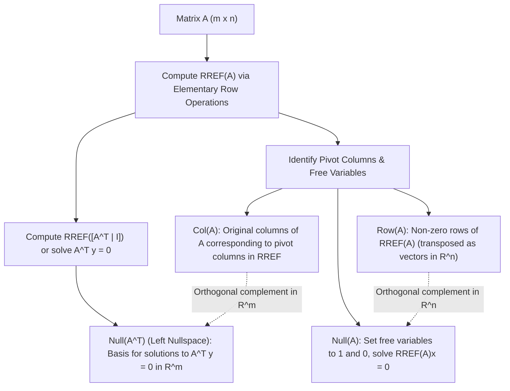
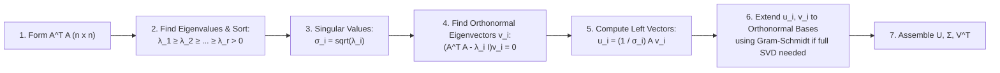
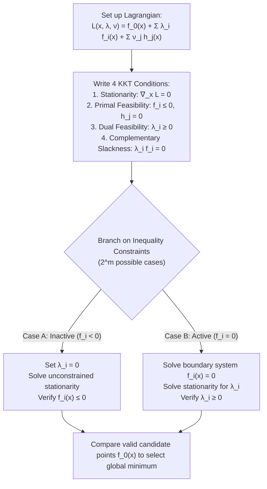

# AIML ZC416: Mathematical Foundations for Machine Learning — Master Formula Sheet & Quick Study Guide

**Course**: AIML ZC416 / ZG514 — Mathematical Foundations for Machine Learning  
**Target Audience**: Mid-Semester (Closed Book, Modules 1–7), Comprehensive (Open/Closed Book, Modules 1–14), Viva Voce / Oral Defense, Quick Revision  
**Primary Faculty Followed**: Prof. Mandar Vijay Datar (Lead MFML, BITS Pilani WILP)  
**Companion Faculty**: Prof. Saurabh  
**Prescribed References**: Deisenroth, Faisal & Ong (T1: *Mathematics for Machine Learning*); Boyd & Vandenberghe (R1: *Applied Linear Algebra*, R2: *Convex Optimization*)

---

## 1. Master Formula Reference Table

| Module & Concept | Canonical Mathematical Formulation | Key Parameters & Dimensions | Operational Bounds & Remarks |
| :--- | :--- | :--- | :--- |
| **M01: Linear System** | $\mathbf{A}\mathbf{x} = \mathbf{b}$ | $\mathbf{A} \in \mathbb{R}^{m \times n}, \mathbf{x} \in \mathbb{R}^n, \mathbf{b} \in \mathbb{R}^m$ | Consistent $\iff \mathrm{rank}(\mathbf{A}) = \mathrm{rank}([\mathbf{A} \mid \mathbf{b}])$ |
| **M01: Rouché–Capelli** | Unique: $\mathrm{rank}(\mathbf{A}) = \mathrm{rank}([\mathbf{A}\mid\mathbf{b}]) = n$; Inf: $\mathrm{rank} < n$; None: $\mathrm{rank}(\mathbf{A}) < \mathrm{rank}([\mathbf{A}\mid\mathbf{b}])$ | $n =$ number of variables | Free variables $= n - \mathrm{rank}(\mathbf{A})$ |
| **M01: Matrix Inverse ($2 \times 2$)** | $\begin{bmatrix} a & b \\ c & d \end{bmatrix}^{-1} = \frac{1}{ad-bc}\begin{bmatrix} d & -b \\ -c & a \end{bmatrix}$ | $\det(\mathbf{A}) = ad - bc \neq 0$ | Singular if $\det(\mathbf{A}) = 0$ |
| **M02: Linear Independence** | $\sum_{i=1}^k c_i \mathbf{v}_i = \mathbf{0} \implies c_1 = \dots = c_k = 0$ | $\mathbf{v}_i \in V$ | If non-zero $c_i$ exist, vectors are linearly dependent |
| **M02: Rank-Nullity Theorem** | $\mathrm{rank}(\mathbf{A}) + \mathrm{nullity}(\mathbf{A}) = n$ | $\mathbf{A} \in \mathbb{R}^{m \times n}$ | $\dim(\mathrm{Col}(\mathbf{A})) + \dim(\mathrm{Null}(\mathbf{A})) = n$ |
| **M02: Fundamental Subspaces** | $\mathrm{Col}(\mathbf{A}) \perp \mathrm{Null}(\mathbf{A}^T)$ in $\mathbb{R}^m$, $\mathrm{Row}(\mathbf{A}) \perp \mathrm{Null}(\mathbf{A})$ in $\mathbb{R}^n$ | $\mathbb{R}^n = \mathrm{Row}(\mathbf{A}) \oplus \mathrm{Null}(\mathbf{A})$ | Orthogonal complements partition domain and codomain |
| **M03: Inner Product** | $\langle \mathbf{x}, \mathbf{y} \rangle = \mathbf{x}^T \mathbf{y} = \sum_{i=1}^n x_i y_i$ (Euclidean standard) | $\langle \mathbf{x}, \mathbf{y} \rangle_{\mathbf{A}} = \mathbf{x}^T \mathbf{A} \mathbf{y}$ | Positive definite $\mathbf{A} \succ 0$ required for valid metric |
| **M03: Cauchy–Schwarz** | $|\langle \mathbf{x}, \mathbf{y} \rangle| \le \|\mathbf{x}\| \, \|\mathbf{y}\|$ | Equality $\iff \mathbf{x} = c\mathbf{y}$ | Defines angle: $\cos \theta = \frac{\mathbf{x}^T \mathbf{y}}{\|\mathbf{x}\|_2 \|\mathbf{y}\|_2}$ |
| **M03: Vector Norms ($L_p$)** | $\|\mathbf{x}\|_p = \left(\sum_{i=1}^n |x_i|^p\right)^{1/p}$; $\|\mathbf{x}\|_1 = \sum |x_i|$; $\|\mathbf{x}\|_\infty = \max |x_i|$ | $p \ge 1$ for triangle inequality | $L_1$ induces sparsity; $L_2$ rotational invariance |
| **M03: Matrix Frobenius Norm** | $\|\mathbf{A}\|_F = \sqrt{\sum_{i=1}^m \sum_{j=1}^n A_{ij}^2} = \sqrt{\mathrm{Tr}(\mathbf{A}^T \mathbf{A})} = \sqrt{\sum_{i=1}^r \sigma_i^2}$ | $\mathbf{A} \in \mathbb{R}^{m \times n}$ | Equivalent to Euclidean norm on vectorized $\mathrm{vec}(\mathbf{A})$ |
| **M03: Matrix Spectral Norm** | $\|\mathbf{A}\|_2 = \max_{\mathbf{x} \neq \mathbf{0}} \frac{\|\mathbf{A}\mathbf{x}\|_2}{\|\mathbf{x}\|_2} = \sigma_{\max}(\mathbf{A}) = \sqrt{\lambda_{\max}(\mathbf{A}^T \mathbf{A})}$ | Operator norm induced by $L_2$ | Largest singular value |
| **M03: Gram–Schmidt Step** | $\mathbf{u}_k = \mathbf{v}_k - \sum_{j=1}^{k-1} \frac{\langle \mathbf{v}_k, \mathbf{u}_j \rangle}{\|\mathbf{u}_j\|^2} \mathbf{u}_j$; $\mathbf{e}_k = \frac{\mathbf{u}_k}{\|\mathbf{u}_k\|}$ | Orthogonal basis $\{\mathbf{u}_k\} \to$ orthonormal $\{\mathbf{e}_k\}$ | Yields $\mathbf{A} = \mathbf{Q}\mathbf{R}$ where $\mathbf{Q}^T \mathbf{Q} = \mathbf{I}$, $\mathbf{R}$ upper triangular |
| **M03: Projection onto Subspace** | $\mathbf{P}_U = \mathbf{A}(\mathbf{A}^T \mathbf{A})^{-1}\mathbf{A}^T$; $\hat{\mathbf{x}} = \mathbf{P}_U \mathbf{b}$ | $\mathbf{A}$ has linearly independent cols | $\mathbf{P}^2 = \mathbf{P}$ (idempotent), $\mathbf{P}^T = \mathbf{P}$ (symmetric) |
| **M04: Eigenvalue Equation** | $\mathbf{A}\mathbf{v} = \lambda \mathbf{v} \iff (\mathbf{A} - \lambda \mathbf{I})\mathbf{v} = \mathbf{0}$ | $\mathbf{v} \neq \mathbf{0}, \mathbf{A} \in \mathbb{R}^{n \times n}$ | Characteristic poly: $p(\lambda) = \det(\mathbf{A} - \lambda \mathbf{I}) = 0$ |
| **M04: Trace and Determinant** | $\mathrm{Tr}(\mathbf{A}) = \sum_{i=1}^n \lambda_i = \sum_{i=1}^n A_{ii}$; $\det(\mathbf{A}) = \prod_{i=1}^n \lambda_i$ | Invariant under similarity transforms | Singular $\iff \det(\mathbf{A}) = 0 \iff$ at least one $\lambda_i = 0$ |
| **M04: Diagonalization** | $\mathbf{A} = \mathbf{P} \mathbf{D} \mathbf{P}^{-1} \implies \mathbf{A}^k = \mathbf{P} \mathbf{D}^k \mathbf{P}^{-1}$ | Columns of $\mathbf{P}$ are lin. indep. eigenvectors | Diagonalizable $\iff$ geometric mult $=$ algebraic mult $\forall \lambda_i$ |
| **M04: Spectral Theorem** | $\mathbf{A} = \mathbf{Q} \mathbf{\Lambda} \mathbf{Q}^T = \sum_{i=1}^n \lambda_i \mathbf{q}_i \mathbf{q}_i^T$ | Symmetric $\mathbf{A} = \mathbf{A}^T, \mathbf{Q}^T \mathbf{Q} = \mathbf{I}$ | Real eigenvalues $\lambda_i \in \mathbb{R}$; orthogonal eigenvectors $\mathbf{q}_i$ |
| **M04: Quadratic Form & Definiteness** | $q(\mathbf{x}) = \mathbf{x}^T \mathbf{A} \mathbf{x} = \sum_{i=1}^n \sum_{j=1}^n A_{ij} x_i x_j$ | Assumes symmetric $\mathbf{A}$ | Positive Definite ($\mathbf{A} \succ 0$) $\iff$ all $\lambda_i > 0$; Semidefinite $\iff \lambda_i \ge 0$ |
| **M05: SVD (Full & Compact)** | $\mathbf{A} = \mathbf{U} \mathbf{\Sigma} \mathbf{V}^T = \sum_{i=1}^r \sigma_i \mathbf{u}_i \mathbf{v}_i^T$ | $\mathbf{U} \in \mathbb{R}^{m \times m}, \mathbf{\Sigma} \in \mathbb{R}^{m \times n}, \mathbf{V} \in \mathbb{R}^{n \times n}$ | $\sigma_1 \ge \sigma_2 \ge \dots \ge \sigma_r > 0$; $\sigma_i = \sqrt{\lambda_i(\mathbf{A}^T \mathbf{A})}$ |
| **M05: Singular Vectors** | $\mathbf{A}\mathbf{v}_i = \sigma_i \mathbf{u}_i$; $\mathbf{A}^T \mathbf{u}_i = \sigma_i \mathbf{v}_i$ | $\mathbf{A}^T \mathbf{A} \mathbf{v}_i = \sigma_i^2 \mathbf{v}_i$; $\mathbf{A} \mathbf{A}^T \mathbf{u}_i = \sigma_i^2 \mathbf{u}_i$ | Left singular $\mathbf{U}$, right singular $\mathbf{V}$ (orthonormal bases) |
| **M05: Moore–Penrose Inverse** | $\mathbf{A}^+ = \mathbf{V} \mathbf{\Sigma}^+ \mathbf{U}^T = \sum_{i=1}^r \frac{1}{\sigma_i} \mathbf{v}_i \mathbf{u}_i^T$ | $\mathbf{\Sigma}^+ = \mathrm{diag}(1/\sigma_1, \dots, 1/\sigma_r, 0, \dots)$ | Solves min-norm least squares: $\mathbf{x}_{\mathrm{LS}} = \mathbf{A}^+ \mathbf{b}$ |
| **M05: Condition Number** | $\kappa_2(\mathbf{A}) = \|\mathbf{A}\|_2 \, \|\mathbf{A}^{-1}\|_2 = \frac{\sigma_{\max}(\mathbf{A})}{\sigma_{\min}(\mathbf{A})}$ | $\kappa \ge 1$; large $\kappa \implies$ ill-conditioned | Relative error amplification: $\frac{\|\delta \mathbf{x}\|}{\|\mathbf{x}\|} \le \kappa(\mathbf{A}) \frac{\|\delta \mathbf{b}\|}{\|\mathbf{b}\|}$ |
| **M06: Gradient Vector** | $\nabla f(\mathbf{x}) = \begin{bmatrix} \frac{\partial f}{\partial x_1} & \dots & \frac{\partial f}{\partial x_n} \end{bmatrix}^T$ | $f: \mathbb{R}^n \to \mathbb{R}, \nabla f(\mathbf{x}) \in \mathbb{R}^n$ | Points in direction of steepest ascent; orthogonal to level sets |
| **M06: Jacobian Matrix** | $\mathbf{J}_{\mathbf{f}}(\mathbf{x}) = \left[ \frac{\partial f_i}{\partial x_j} \right]_{i=1..m, j=1..n}$ | $\mathbf{f}: \mathbb{R}^n \to \mathbb{R}^m, \mathbf{J} \in \mathbb{R}^{m \times n}$ | Best linear approximation: $\mathbf{f}(\mathbf{x}+\mathbf{h}) \approx \mathbf{f}(\mathbf{x}) + \mathbf{J}\mathbf{h}$ |
| **M06: Hessian Matrix** | $\mathbf{H}_f(\mathbf{x}) = \left[ \frac{\partial^2 f}{\partial x_i \partial x_j} \right] \in \mathbb{R}^{n \times n}$ | Twice continuously differentiable $f$ | Schwarz theorem: $\mathbf{H}_f = \mathbf{H}_f^T$ (symmetric); encodes curvature |
| **M06: Matrix Gradient Identities** | $\nabla_{\mathbf{x}}(\mathbf{x}^T \mathbf{a}) = \mathbf{a}$; $\nabla_{\mathbf{x}}(\mathbf{x}^T \mathbf{A} \mathbf{x}) = (\mathbf{A} + \mathbf{A}^T)\mathbf{x}$ | If $\mathbf{A} = \mathbf{A}^T \implies \nabla(\mathbf{x}^T \mathbf{A}\mathbf{x}) = 2\mathbf{A}\mathbf{x}$ | $\nabla_{\mathbf{x}}\|\mathbf{A}\mathbf{x} - \mathbf{b}\|_2^2 = 2\mathbf{A}^T(\mathbf{A}\mathbf{x} - \mathbf{b})$ |
| **M06: Matrix Trace Derivative** | $\frac{\partial}{\partial \mathbf{X}}\mathrm{Tr}(\mathbf{A}\mathbf{X}\mathbf{B}) = \mathbf{A}^T \mathbf{B}^T$; $\frac{\partial}{\partial \mathbf{X}}\log\det(\mathbf{X}) = \mathbf{X}^{-T}$ | For invertible, positive definite $\mathbf{X}$ | Core identity for Gaussian likelihood & PCA derivations |
| **M07: Forward Mode Autodiff** | Dual number: $v + \dot{v}\epsilon, \epsilon^2=0$; $f(a + \dot{a}\epsilon) = f(a) + f'(a)\dot{a}\epsilon$ | Computes Jacobian-Vector Product (JVP) | Efficient when input dimension $n \ll$ output dimension $m$ |
| **M07: Reverse Mode Autodiff** | Adjoint: $\bar{v}_i = \frac{\partial \mathcal{L}}{\partial v_i} = \sum_{j \in \mathrm{children}(i)} \bar{v}_j \frac{\partial v_j}{\partial v_i}$ | Computes Vector-Jacobian Product (VJP) | Efficient when output dimension $m=1 \ll n$ (Deep Learning loss) |
| **M08: Multivariate Taylor ($2^{\text{nd}}$ Order)** | $f(\mathbf{x}+\mathbf{h}) \approx f(\mathbf{x}) + \nabla f(\mathbf{x})^T \mathbf{h} + \frac{1}{2}\mathbf{h}^T \mathbf{H}_f(\mathbf{x})\mathbf{h}$ | Remainder $R_2(\mathbf{h}) = \mathcal{O}(\|\mathbf{h}\|^3)$ | Foundation of Newton's method and local convexity analysis |
| **M08: Critical Point Classification** | At $\nabla f(\mathbf{x}^*) = \mathbf{0}$: $\mathbf{H}_f(\mathbf{x}^*) \succ 0 \implies$ Min; $\prec 0 \implies$ Max; Indefinite $\implies$ Saddle | All $\lambda_i > 0 \implies$ Local Min | Zero eigenvalue $\implies$ test inconclusive (higher-order needed) |
| **M09: Gradient Descent Update** | $\mathbf{x}_{k+1} = \mathbf{x}_k - \alpha_k \nabla f(\mathbf{x}_k)$ | Step size / learning rate $\alpha_k > 0$ | Guaranteed convergence if $L$-smooth and $\alpha \in (0, 2/L)$ |
| **M09: Convexity Equivalences** | $f(\mathbf{y}) \ge f(\mathbf{x}) + \nabla f(\mathbf{x})^T(\mathbf{y}-\mathbf{x})$; $\mathbf{H}_f(\mathbf{x}) \succeq 0$ | Defined on convex set $\mathcal{C}$ | Local minimum of convex function is globally optimal |
| **M09: Backtracking Line Search** | While $f(\mathbf{x}-\alpha\nabla f) > f(\mathbf{x}) - c_1 \alpha \|\nabla f\|^2$: $\alpha \leftarrow \tau \alpha$ | Armijo parameters $c_1 \in (0, 0.5), \tau \in (0, 1)$ | Guarantees sufficient decrease and step acceptance |
| **M10: Primal Non-Linear Program** | $\min f_0(\mathbf{x})$ s.t. $f_i(\mathbf{x}) \le 0 \; (i=1..m), h_j(\mathbf{x}) = 0 \; (j=1..p)$ | Domain $\mathcal{D} = \bigcap \mathrm{dom}(f_i) \cap \mathrm{dom}(h_j)$ | Optimal value $p^*$ |
| **M10: Lagrangian & Dual Function** | $\mathcal{L}(\mathbf{x},\boldsymbol{\lambda},\boldsymbol{\nu}) = f_0(\mathbf{x}) + \sum_{i=1}^m \lambda_i f_i(\mathbf{x}) + \sum_{j=1}^p \nu_j h_j(\mathbf{x})$ | $g(\boldsymbol{\lambda},\boldsymbol{\nu}) = \inf_{\mathbf{x}} \mathcal{L}(\mathbf{x},\boldsymbol{\lambda},\boldsymbol{\nu})$ | Weak Duality: $g(\boldsymbol{\lambda},\boldsymbol{\nu}) \le p^*$ for all $\boldsymbol{\lambda} \ge \mathbf{0}, \boldsymbol{\nu}$ |
| **M10: KKT Necessary Conditions** | 1. Stationarity: $\nabla f_0(\mathbf{x}^*) + \sum \lambda_i^* \nabla f_i(\mathbf{x}^*) + \sum \nu_j^* \nabla h_j(\mathbf{x}^*) = \mathbf{0}$<br>2. Primal: $f_i(\mathbf{x}^*) \le 0, h_j(\mathbf{x}^*) = 0$<br>3. Dual: $\lambda_i^* \ge 0$<br>4. Complementary Slackness: $\lambda_i^* f_i(\mathbf{x}^*) = 0$ | At optimal $(\mathbf{x}^*, \boldsymbol{\lambda}^*, \boldsymbol{\nu}^*)$ under constraint qualifications | If problem is convex and Slater's holds $\implies$ KKT conditions are necessary AND sufficient |
| **M10: Slater's Condition** | Strictly feasible point: $\exists \tilde{\mathbf{x}} \in \mathrm{relint}(\mathcal{D}): f_i(\tilde{\mathbf{x}}) < 0, \mathbf{A}\tilde{\mathbf{x}} = \mathbf{b}$ | For convex primal problems | Strong Duality holds: $d^* = p^*$ (zero duality gap) |
| **M11: Polyak Momentum** | $\mathbf{v}_{k+1} = \beta \mathbf{v}_k + \alpha \nabla f(\mathbf{x}_k)$; $\mathbf{x}_{k+1} = \mathbf{x}_k - \mathbf{v}_{k+1}$ | Momentum friction parameter $\beta \in [0.9, 0.99]$ | Dampens oscillations in high-curvature directions |
| **M11: Nesterov Accelerated Grad** | $\mathbf{v}_{k+1} = \beta \mathbf{v}_k + \alpha \nabla f(\mathbf{x}_k - \beta \mathbf{v}_k)$; $\mathbf{x}_{k+1} = \mathbf{x}_k - \mathbf{v}_{k+1}$ | Look-ahead gradient computation | Accelerates convergence rate from $\mathcal{O}(1/k)$ to $\mathcal{O}(1/k^2)$ |
| **M11: RMSProp Update** | $\mathbf{s}_{k+1} = \gamma \mathbf{s}_k + (1-\gamma)\mathbf{g}_k^{\odot 2}$; $\mathbf{x}_{k+1} = \mathbf{x}_k - \frac{\alpha}{\sqrt{\mathbf{s}_{k+1}} + \epsilon} \odot \mathbf{g}_k$ | Exponential decay $\gamma \approx 0.9, \epsilon \approx 10^{-8}$ | Normalizes updates by moving average of squared gradients |
| **M11: Adam Update** | $\mathbf{m}_k = \beta_1 \mathbf{m}_{k-1} + (1-\beta_1)\mathbf{g}_k$; $\mathbf{v}_k = \beta_2 \mathbf{v}_{k-1} + (1-\beta_2)\mathbf{g}_k^{\odot 2}$<br>$\hat{\mathbf{m}}_k = \frac{\mathbf{m}_k}{1-\beta_1^k}$; $\hat{\mathbf{v}}_k = \frac{\mathbf{v}_k}{1-\beta_2^k}$<br>$\mathbf{x}_k = \mathbf{x}_{k-1} - \frac{\alpha}{\sqrt{\hat{\mathbf{v}}_k} + \epsilon} \odot \hat{\mathbf{m}}_k$ | Standard defaults: $\beta_1 = 0.9, \beta_2 = 0.999$<br>$\alpha = 0.001, \epsilon = 10^{-8}$ | Bias-correction essential in early iterations ($k=1, 2, \dots$) |
| **M11: Newton–Raphson Method** | $\mathbf{x}_{k+1} = \mathbf{x}_k - [\mathbf{H}_f(\mathbf{x}_k)]^{-1} \nabla f(\mathbf{x}_k)$ | Requires positive definite $\mathbf{H}_f \succ 0$ | Quadratic convergence rate near $\mathbf{x}^*$; $\mathcal{O}(n^3)$ cost per step |
| **M12: Sample Covariance Matrix** | $\mathbf{S} = \frac{1}{N} \sum_{i=1}^N (\mathbf{x}_i - \bar{\mathbf{x}})(\mathbf{x}_i - \bar{\mathbf{x}})^T = \frac{1}{N}\mathbf{X}_c^T \mathbf{X}_c$ | Centered data matrix $\mathbf{X}_c \in \mathbb{R}^{N \times D}$ | Symmetric, positive semi-definite matrix ($\mathbf{S} \succeq 0$) |
| **M12: PCA Variance Maximization** | $\max_{\mathbf{u}_1} \mathbf{u}_1^T \mathbf{S} \mathbf{u}_1 \quad \text{s.t.} \quad \|\mathbf{u}_1\|_2^2 = 1 \implies \mathbf{S}\mathbf{u}_1 = \lambda_1 \mathbf{u}_1$ | Principal direction is eigenvector of $\mathbf{S}$ | Maximum projected variance is largest eigenvalue: $\sigma_{\mathbf{u}_1}^2 = \lambda_1$ |
| **M12: Proportion of Variance (PVE)** | $\mathrm{PVE}_k = \frac{\lambda_k}{\sum_{j=1}^D \lambda_j}$; Cumulative $\mathrm{PVE}_K = \frac{\sum_{k=1}^K \lambda_k}{\sum_{j=1}^D \lambda_j}$ | $\lambda_1 \ge \lambda_2 \ge \dots \ge \lambda_D \ge 0$ | Scree plot "elbow" criterion or threshold (e.g., $95\%$ total variance) |
| **M12: PCA Projection & Reconstruction** | Low-dim code: $\mathbf{z}_i = \mathbf{U}_K^T (\mathbf{x}_i - \bar{\mathbf{x}}) \in \mathbb{R}^K$<br>Reconstruction: $\hat{\mathbf{x}}_i = \bar{\mathbf{x}} + \mathbf{U}_K \mathbf{z}_i \in \mathbb{R}^D$ | Projection matrix $\mathbf{U}_K = [\mathbf{u}_1 \dots \mathbf{u}_K] \in \mathbb{R}^{D \times K}$ | Reconstruction error equals sum of discarded eigenvalues $\sum_{j=K+1}^D \lambda_j$ |
| **M13: Eckart–Young–Mirsky Theorem** | $\min_{\mathrm{rank}(\mathbf{B}) \le k} \|\mathbf{A} - \mathbf{B}\|_F = \|\mathbf{A} - \mathbf{A}_k\|_F = \sqrt{\sum_{i=k+1}^r \sigma_i^2}$<br>$\min_{\mathrm{rank}(\mathbf{B}) \le k} \|\mathbf{A} - \mathbf{B}\|_2 = \|\mathbf{A} - \mathbf{A}_k\|_2 = \sigma_{k+1}$ | Truncated SVD: $\mathbf{A}_k = \sum_{i=1}^k \sigma_i \mathbf{u}_i \mathbf{v}_i^T$ | Proves truncated SVD is the mathematically unique optimal low-rank projection |
| **M13: Low-Rank Storage Economy** | Storage: $k(m + n + 1)$ vs Original: $mn$ | Break-even rank: $k < \frac{mn}{m + n + 1}$ | Large compression ratio for high-dimensional matrices ($mn \gg k(m+n)$) |
| **M14: SVM Hard-Margin Primal** | $\min_{\mathbf{w}, b} \frac{1}{2}\|\mathbf{w}\|_2^2 \quad \text{s.t.} \quad y_i(\mathbf{w}^T \mathbf{x}_i + b) \ge 1 \; \forall i$ | Geometric margin $\gamma = \frac{1}{\|\mathbf{w}\|_2}$ | Strictly linearly separable datasets |
| **M14: SVM Soft-Margin Primal** | $\min_{\mathbf{w}, b, \boldsymbol{\xi}} \frac{1}{2}\|\mathbf{w}\|_2^2 + C \sum_{i=1}^N \xi_i$ s.t. $y_i(\mathbf{w}^T \mathbf{x}_i + b) \ge 1 - \xi_i, \xi_i \ge 0$ | Regularization tradeoff parameter $C > 0$ | $C \to \infty \implies$ hard margin; small $C \implies$ wider margin with violations |
| **M14: SVM Wolfe Dual** | $\max_{\boldsymbol{\alpha}} \sum_{i=1}^N \alpha_i - \frac{1}{2}\sum_{i=1}^N \sum_{j=1}^N \alpha_i \alpha_j y_i y_j \langle \mathbf{x}_i, \mathbf{x}_j \rangle$<br>s.t. $\sum_{i=1}^N \alpha_i y_i = 0, \quad 0 \le \alpha_i \le C \; \forall i$ | Dual decision function: $f(\mathbf{x}) = \mathrm{sign}\left(\sum_{i \in \mathrm{SV}} \alpha_i y_i \langle \mathbf{x}_i, \mathbf{x} \rangle + b\right)$ | Depends only on inner products between data points $\langle \mathbf{x}_i, \mathbf{x}_j \rangle$ |
| **M14: Mercer Kernels** | Linear: $k(\mathbf{x}, \mathbf{z}) = \mathbf{x}^T \mathbf{z}$<br>Polynomial: $k(\mathbf{x}, \mathbf{z}) = (\mathbf{x}^T \mathbf{z} + c)^d$<br>Gaussian RBF: $k(\mathbf{x}, \mathbf{z}) = \exp\left(-\frac{\|\mathbf{x}-\mathbf{z}\|^2}{2\sigma^2}\right) = \exp(-\gamma \|\mathbf{x}-\mathbf{z}\|^2)$ | Gram matrix $\mathbf{K} \succeq 0$ positive semi-definite | Implicit mapping $\phi(\mathbf{x})$ into infinite-dimensional Hilbert space for RBF |

---

## 2. Canonical Computational Algorithms & Workflows

### 2.1 The 4 Fundamental Subspaces via RREF



---

### 2.2 SVD Computation Pipeline (BITS Exam Protocol)

To compute the Singular Value Decomposition $\mathbf{A} = \mathbf{U} \mathbf{\Sigma} \mathbf{V}^T$ for $\mathbf{A} \in \mathbb{R}^{m \times n}$:



> [!WARNING]
> **BITS Exam Trap**: Never compute $\mathbf{u}_i$ independently from eigenvectors of $\mathbf{A}\mathbf{A}^T$ without checking signs! The relationship $\mathbf{u}_i = \frac{1}{\sigma_i} \mathbf{A} \mathbf{v}_i$ preserves the exact phase and orientation required by $\mathbf{A} = \mathbf{U}\mathbf{\Sigma}\mathbf{V}^T$. Independent eigenvector solving can flip signs ($\pm \mathbf{u}_i$) and invalidate the decomposition!

---

### 2.3 KKT Constrained Optimization Solving Protocol

When solving:
$$\min_{\mathbf{x}} f_0(\mathbf{x}) \quad \text{s.t.} \quad f_i(\mathbf{x}) \le 0 \; (i=1..m), \quad h_j(\mathbf{x}) = 0 \; (j=1..p)$$



---

## 3. Diagnostic Decision Trees

### 3.1 Matrix Invertibility & Definiteness Diagnostic

```mermaid
flowchart TD
    M[Square Real Symmetric Matrix A] --> D{det(A) ≠ 0?}
    D -->|No: det A = 0| Sing["Singular Matrix<br/>• Non-invertible<br/>• Rank < n<br/>• Nullity > 0<br/>• At least one λ_i = 0<br/>• Use Moore-Penrose A^+"]
    D -->|Yes: det A ≠ 0| Inv["Invertible Matrix (Full Rank n)"]
    Inv --> E{All Eigenvalues λ_i > 0?}
    E -->|Yes| PD["Positive Definite (A ≻ 0)<br/>• x^T A x > 0 for all x ≠ 0<br/>• Strictly convex quadratic form<br/>• Unique global minimum<br/>• Cholesky factorization exists: A = L L^T"]
    E -->|No| E2{All Eigenvalues λ_i ≥ 0?}
    E2 -->|Yes: has zero λ| PSD["Positive Semidefinite (A ⪰ 0)<br/>• Convex but flat directions exist"]
    E2 -->|No| E3{Mixed Signs: Some λ_i > 0, Some λ_j < 0?}
    E3 -->|Yes| Indef["Indefinite Matrix<br/>• Saddle point geometry<br/>• Neither convex nor concave"]
    E3 -->|No: All λ_i < 0| ND["Negative Definite (A ≺ 0)<br/>• Strictly concave quadratic form"]
```

---

### 3.2 Optimization Algorithm Selector

```mermaid
flowchart TD
    StartOpt[Optimization Task] --> C1{Objective & Constraints?}
    C1 -->|Constrained| ConstOpt{Is problem convex?}
    ConstOpt -->|Yes + Slater holds| KKT["KKT Conditions (Necessary & Sufficient)<br/>Lagrange Dual Formulation"]
    ConstOpt -->|Non-convex| Penalty["Penalty / Barrier / Augmented Lagrangian Methods"]
    C1 -->|Unconstrained| Smooth{Gradient Available?}
    Smooth -->|Analytic Gradient Available| Dim{Parameter Dimension n?}
    Dim -->|Very Large: n > 10^5 (Deep Learning)| FirstOrder["First-Order Stochastic Methods:<br/>• SGD with Momentum (generalization)<br/>• Adam / RMSProp (fast adaptive convergence)"]
    Dim -->|Moderate: n < 10^4| SecondOrder{Is Hessian H_f tractable?}
    SecondOrder -->|Yes, H_f > 0 easy to invert| Newton["Newton-Raphson Method<br/>Quadratic convergence rate"]
    SecondOrder -->|Too costly to compute/invert H_f| QuasiNewton["Quasi-Newton Methods:<br/>BFGS / L-BFGS (approximates H^-1)"]
    Smooth -->|No Gradient (Black Box)| ZeroOrder["Nelder-Mead / Genetic Algorithms / Bayesian Optimization"]
```

---

## 4. Oral Exam / Viva Voce Defense Checklist

During BITS Pilani oral examinations and comprehensive defenses, faculty members test foundational understanding through rapid, conceptual questions. Below are the verified expected answers:

### Q1: Why do we study SVD when we already have Eigenvalue Decomposition?
- **Viva Answer**: Eigenvalue decomposition ($\mathbf{A} = \mathbf{P} \mathbf{D} \mathbf{P}^{-1}$) is restricted strictly to square matrices ($n \times n$) and requires a complete set of $n$ linearly independent eigenvectors (it fails for defective matrices). Even for square matrices, the eigenvectors are not necessarily orthogonal unless $\mathbf{A}$ is normal or symmetric.
- In contrast, Singular Value Decomposition ($\mathbf{A} = \mathbf{U} \mathbf{\Sigma} \mathbf{V}^T$) exists for **any arbitrary rectangular matrix** $\mathbf{A} \in \mathbb{R}^{m \times n}$. Furthermore, both $\mathbf{U}$ and $\mathbf{V}$ are guaranteed to be orthogonal matrices, providing orthonormal bases that cleanly decouple the domain and codomain into the 4 fundamental subspaces.

### Q2: Why does Reverse-Mode Autodiff dominate Deep Learning instead of Forward-Mode?
- **Viva Answer**: A neural network computes a scalar objective function $\mathcal{L}: \mathbb{R}^n \to \mathbb{R}$ from millions of parameters ($n \gg 1$).
  - **Forward Mode** computes one column of the Jacobian per forward sweep ($n$ sweeps required to obtain $\nabla \mathcal{L}$, costing $\mathcal{O}(n \cdot \text{FLOPs})$).
  - **Reverse Mode** seeds the output adjoint with $\bar{\mathcal{L}} = 1$ and propagates the vector-Jacobian products backwards in a **single backward pass**, calculating the full gradient vector $\nabla \mathcal{L} \in \mathbb{R}^n$ at a cost of roughly $2\times$ to $3\times$ a single forward evaluation, completely independent of the parameter dimension $n$.

### Q3: What is the geometric meaning of the Lagrange Multiplier $\lambda_i^*$ in constrained optimization?
- **Viva Answer**: The optimal multiplier $\lambda_i^*$ represents the **shadow price** or marginal sensitivity of the objective value $p^*$ with respect to perturbations in the $i$-th constraint:
  $$\lambda_i^* = -\frac{\partial p^*(u)}{\partial u_i} \quad \text{where} \quad f_i(\mathbf{x}) \le u_i$$
  Geometrically, at the constrained optimum, the objective gradient $\nabla f_0(\mathbf{x}^*)$ is a conical combination of the inward-pointing normals of the active constraint boundaries ($-\sum \lambda_i^* \nabla f_i(\mathbf{x}^*)$).

### Q4: In PCA, why are the principal components the eigenvectors of the sample covariance matrix $\mathbf{S}$?
- **Viva Answer**: To find the direction $\mathbf{u}$ that maximizes the projected variance $\frac{1}{N}\sum (\mathbf{u}^T \mathbf{x}_i)^2 = \mathbf{u}^T \mathbf{S} \mathbf{u}$ subject to $\|\mathbf{u}\|_2^2 = 1$, we formulate the Lagrangian:
  $$\mathcal{L}(\mathbf{u}, \lambda) = \mathbf{u}^T \mathbf{S} \mathbf{u} - \lambda (\mathbf{u}^T \mathbf{u} - 1)$$
  Setting $\nabla_{\mathbf{u}}\mathcal{L} = 2\mathbf{S}\mathbf{u} - 2\lambda \mathbf{u} = \mathbf{0}$ yields the standard eigenvalue equation $\mathbf{S}\mathbf{u} = \lambda \mathbf{u}$. Substituting this back gives the projected variance $\mathbf{u}^T \mathbf{S} \mathbf{u} = \lambda \mathbf{u}^T \mathbf{u} = \lambda$. Hence, maximizing variance directly corresponds to selecting the eigenvector with the largest eigenvalue.

### Q5: What is the relationship between SVD and PCA?
- **Viva Answer**: Given a mean-centered data matrix $\mathbf{X}_c \in \mathbb{R}^{N \times D}$, the sample covariance matrix is $\mathbf{S} = \frac{1}{N}\mathbf{X}_c^T \mathbf{X}_c$.
  - If we compute the SVD of $\mathbf{X}_c = \mathbf{U} \mathbf{\Sigma} \mathbf{V}^T$, then:
    $$\mathbf{S} = \frac{1}{N} (\mathbf{V} \mathbf{\Sigma}^T \mathbf{U}^T)(\mathbf{U} \mathbf{\Sigma} \mathbf{V}^T) = \mathbf{V} \left( \frac{1}{N} \mathbf{\Sigma}^2 \right) \mathbf{V}^T$$
  - The right singular vectors $\mathbf{V} = [\mathbf{v}_1, \dots, \mathbf{v}_D]$ are identical to the principal component loading vectors (eigenvectors of $\mathbf{S}$).
  - The eigenvalues of $\mathbf{S}$ relate to the singular values of $\mathbf{X}_c$ by $\lambda_i = \frac{\sigma_i^2}{N}$.
  - The principal component scores (projected low-dimensional coordinates) are given directly by $\mathbf{X}_c \mathbf{V} = \mathbf{U} \mathbf{\Sigma}$. Thus, computing SVD on $\mathbf{X}_c$ avoids forming the $D \times D$ covariance matrix $\mathbf{S}$ entirely, which is numerically far more stable.

---

## 5. High-Frequency Traps & Exam Pitfalls

| Trap ID | Frequent Student Error | Mathematically Correct Concept | Exam Impact |
| :---: | :--- | :--- | :--- |
| **T01** | Taking $\nabla_{\mathbf{x}}(\mathbf{x}^T \mathbf{A} \mathbf{x}) = 2\mathbf{A}\mathbf{x}$ when $\mathbf{A}$ is **not** symmetric. | $\nabla_{\mathbf{x}}(\mathbf{x}^T \mathbf{A} \mathbf{x}) = (\mathbf{A} + \mathbf{A}^T)\mathbf{x}$. It equals $2\mathbf{A}\mathbf{x}$ if and only if $\mathbf{A} = \mathbf{A}^T$. | Immediate loss of marks in gradient derivations. |
| **T02** | Assuming eigenvalues and singular values are identical for non-symmetric matrices. | Singular values $\sigma_i = \sqrt{\lambda_i(\mathbf{A}^T \mathbf{A})}$ are always non-negative real numbers ($\sigma_i \ge 0$). Eigenvalues $\lambda_i$ can be negative or complex conjugate pairs. They coincide only for symmetric positive semidefinite matrices. | Catastrophic error in SVD and spectral questions. |
| **T03** | Forgetting to normalize vectors after Gram–Schmidt orthogonalization. | Gram–Schmidt yields orthogonal vectors $\mathbf{u}_k$. To form the orthonormal matrix $\mathbf{Q}$ in $\mathbf{A} = \mathbf{Q}\mathbf{R}$, you **must** normalize: $\mathbf{e}_k = \frac{\mathbf{u}_k}{\|\mathbf{u}_k\|}$. | Matrix $\mathbf{Q}^T \mathbf{Q} \neq \mathbf{I}$, entire QR decomposition invalidated. |
| **T04** | Omitting the bias correction terms in Adam optimizer calculations. | Raw moment estimates $\mathbf{m}_k$ and $\mathbf{v}_k$ are initialized to $\mathbf{0}$ and heavily biased toward zero in initial steps. You must compute $\hat{\mathbf{m}}_k = \frac{\mathbf{m}_k}{1 - \beta_1^k}$ and $\hat{\mathbf{v}}_k = \frac{\mathbf{v}_k}{1 - \beta_2^k}$. | Numerical inaccuracy in optimizer trace questions. |
| **T05** | Evaluating Hessians without checking if the critical point condition $\nabla f(\mathbf{x}^*) = \mathbf{0}$ is satisfied. | Taylor series classification via $\mathbf{H}_f \succ 0$ is valid **only at stationary points** where $\nabla f(\mathbf{x}) = \mathbf{0}$. Testing curvature away from critical points does not establish local extrema. | Logical breakdown in multivariable optimization problems. |
| **T06** | Assuming all support vectors in Soft-Margin SVM have $\alpha_i = C$. | Points strictly on the margin hyperplane have $0 < \alpha_i < C$ and $\xi_i = 0$. Margin violators (inside the margin or misclassified) have $\alpha_i = C$ and $\xi_i > 0$. Non-support vectors have $\alpha_i = 0$ and $\xi_i = 0$. | Misinterpretation of KKT complementary slackness cases. |
| **T07** | Applying Slater's condition to non-convex optimization problems. | Slater's condition guarantees strong duality ($p^* = d^*$) **exclusively for convex optimization problems**. For non-convex problems, a duality gap may persist even if strictly feasible points exist. | Conceptual failure in duality and KKT proofs. |

---

## 6. Comprehensive Topic Cross-Reference Index

| Concept / Technique | Primary Theory Module | Detailed Solved Problems | Reference Text Chapters |
| :--- | :--- | :--- | :--- |
| **Linear Systems & RREF** | [Module 01](../01_Descriptive_Notes/Module_01_Linear_Systems_and_Gaussian_Elimination.md) | [50 Exam Q&A Bank: Q1, Q2, Q16, Q17](50_Exam_Question_Answer_Bank.md#q1-systems-of-linear-equations-and-augmented-matrices-6-marks) | Deisenroth Ch 2; Boyd ALA Ch 1–2 |
| **Subspaces, Rank-Nullity** | [Module 02](../01_Descriptive_Notes/Module_02_Vector_Spaces_Subspaces_and_Bases.md) | [50 Exam Q&A Bank: Q3, Q4, Q18, Q19](50_Exam_Question_Answer_Bank.md#q3-vector-subspaces-and-linear-independence-6-marks) | Deisenroth Ch 2; Boyd ALA Ch 5 |
| **Inner Products, Norms, QR** | [Module 03](../01_Descriptive_Notes/Module_03_Inner_Products_Norms_and_Analytic_Geometry.md) | [50 Exam Q&A Bank: Q5, Q6, Q20, Q21](50_Exam_Question_Answer_Bank.md#q5-inner-products-and-induced-norms-6-marks) | Deisenroth Ch 3; Boyd ALA Ch 3, 5 |
| **Eigenvalues & Diagonalization**| [Module 04](../01_Descriptive_Notes/Module_04_Eigenvalues_Eigenvectors_and_Diagonalization.md) | [50 Exam Q&A Bank: Q7, Q8, Q22, Q23](50_Exam_Question_Answer_Bank.md#q7-eigenvalues-characteristic-polynomial-and-eigenvectors-6-marks) | Deisenroth Ch 4 |
| **Singular Value Decomposition**| [Module 05](../01_Descriptive_Notes/Module_05_Singular_Value_Decomposition_and_Spectral_Theory.md) | [50 Exam Q&A Bank: Q9, Q10, Q24, Q25, Q41](50_Exam_Question_Answer_Bank.md#q9-svd-fundamental-formulation-and-geometric-meaning-6-marks) | Deisenroth Ch 4; Boyd ALA Ch 10 |
| **Matrix Calculus & Hessians** | [Module 06](../01_Descriptive_Notes/Module_06_Vector_Calculus_Gradients_Jacobians_and_Hessians.md) | [50 Exam Q&A Bank: Q11, Q26, Q27, Q43](50_Exam_Question_Answer_Bank.md#q11-gradients-and-matrix-calculus-identities-6-marks) | Deisenroth Ch 5 |
| **Automatic Differentiation** | [Module 07](../01_Descriptive_Notes/Module_07_Automatic_Differentiation_and_Backpropagation.md) | [50 Exam Q&A Bank: Q12, Q28, Q29, Q44](50_Exam_Question_Answer_Bank.md#q12-automatic-differentiation-principles-6-marks) | Deisenroth Ch 5 |
| **Multivariate Taylor Series** | [Module 08](../01_Descriptive_Notes/Module_08_Multivariate_Taylor_Series_and_Linearization.md) | [50 Exam Q&A Bank: Q30, Q31](50_Exam_Question_Answer_Bank.md#q30-multivariate-taylor-series-expansion-and-hessian-curvature-6-marks) | Deisenroth Ch 5; Boyd Convex Ch 9 |
| **Unconstrained Optimization** | [Module 09](../01_Descriptive_Notes/Module_09_Unconstrained_Optimization_and_Gradient_Descent.md) | [50 Exam Q&A Bank: Q13, Q32, Q33, Q45](50_Exam_Question_Answer_Bank.md#q13-gradient-descent-and-step-size-conditions-6-marks) | Deisenroth Ch 7; Boyd Convex Ch 9 |
| **Constrained Optimization & KKT**| [Module 10](../01_Descriptive_Notes/Module_10_Constrained_Optimization_Lagrange_Multipliers_and_KKT.md) | [50 Exam Q&A Bank: Q14, Q34, Q35, Q46](50_Exam_Question_Answer_Bank.md#q14-lagrange-multipliers-and-equality-constraints-6-marks) | Deisenroth Ch 7; Boyd Convex Ch 5 |
| **Modern Optimizers (Adam)** | [Module 11](../01_Descriptive_Notes/Module_11_First_and_Second_Order_Optimizers_Momentum_RMSProp_Adam.md) | [50 Exam Q&A Bank: Q36, Q37, Q47](50_Exam_Question_Answer_Bank.md#q36-momentum-and-nesterov-accelerated-gradient-6-marks) | Deisenroth Ch 7 |
| **Principal Component Analysis**| [Module 12](../01_Descriptive_Notes/Module_12_Principal_Component_Analysis_and_Dimensionality_Reduction.md) | [50 Exam Q&A Bank: Q15, Q38, Q39, Q48](50_Exam_Question_Answer_Bank.md#q15-principal-component-analysis-formulation-6-marks) | Deisenroth Ch 10 |
| **Low-Rank Approximations** | [Module 13](../01_Descriptive_Notes/Module_13_Low_Rank_Matrix_Approximations.md) | [50 Exam Q&A Bank: Q40, Q49](50_Exam_Question_Answer_Bank.md#q40-low-rank-matrix-approximation-and-compression-6-marks) | Deisenroth Ch 10; Boyd ALA Ch 10 |
| **Support Vector Machines** | [Module 14](../01_Descriptive_Notes/Module_14_Support_Vector_Machines_Primal_Dual_and_Kernels.md) | [50 Exam Q&A Bank: Q42, Q50](50_Exam_Question_Answer_Bank.md#q42-hard-margin-svm-primal-and-dual-derivation-6-marks) | Deisenroth Ch 12; Boyd Convex Ch 8 |
