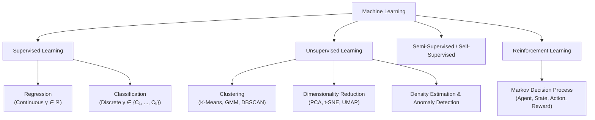
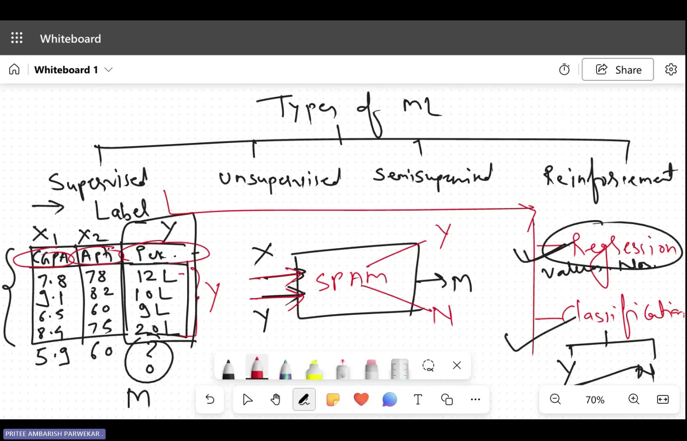

# Module 1: Introduction to Machine Learning & Designing a Learning System

**Course**: AIML ZG565 — Machine Learning  
**Prescribed References**: Tom M. Mitchell (T1, Chapter 1); Christopher M. Bishop (R1, Chapter 1); Tan et al. (R2, Chapter 1)  
**Syllabus module**: **M01** — Introduction & Designing a Learning System (see `Notes/AI Notes/module_map.yaml`)  
**Canonical video**: `Videos/Lecture_01_Intro_to_ML_and_Design_of_Learning_Systems.mp4`  
**Contact sessions** (reference only): Session 2 (2026-08-02); Session 1 orientation. Annotated deck: Prof. Pritee Narendra Raole, CS1.

> **Exam note (Prof. Sharon Christa, Session 8)**: Mid-semester coverage is numerical and conceptual — **no Python coding questions**. Practice manual calculations (confusion matrix, trees, gradient steps, Normal Equation vs. gradient descent).

---

## 1. Executive Summary & Foundational Definitions

Machine Learning (ML) is an engineering and scientific discipline focused on the development of mathematical models and algorithmic architectures that automatically extract latent patterns, deduce decision boundaries, and optimize task performance directly from empirical data without being explicitly programmed with static rule heuristics.

Historically, classical artificial intelligence relied on **symbolic reasoning and expert systems** where human domain experts handcrafted deterministic if-else rules. This paradigm collapses in high-dimensional perceptual domains (computer vision, natural language understanding, speech recognition, and complex tabular prediction) due to the combinatorial explosion of edge cases and intra-class variance. Machine learning fundamentally inverts this pipeline: rather than feeding rules and data into a compute engine to produce outputs, machine learning feeds inputs and historical ground-truth outputs into an optimization engine to deduce the underlying computational rules.

```
Classical Programming Paradigm:
┌──────────────┐     ┌──────────────┐
│     Data     │───> │              │
└──────────────┘     │   Computer   │───> [ Output / Decisions ]
┌──────────────┐     │              │
│    Rules     │───> │              │
└──────────────┘     └──────────────┘

Machine Learning Paradigm:
┌──────────────┐     ┌──────────────┐
│     Data     │───> │   Learning   │
└──────────────┘     │  Algorithm   │───> [ Learned Model / Rules ]
┌──────────────┐     │ (Optimizer)  │
│    Output    │───> │              │
└──────────────┘     └──────────────┘
```

### 1.1 Formal Definitions of Learning

**Arthur Samuel (1959)** — field of study that gives computers the ability to **learn without being explicitly programmed**.

**Tom M. Mitchell (1997)** — a computer program is said to **learn** from experience $E$ with respect to some class of tasks $T$ and performance measure $P$, if its performance at tasks in $T$, as measured by $P$, improves with experience $E$.

$$\text{Learning} \iff P(T, E_{\text{new}}) > P(T, E_{\text{old}})$$

#### Four canonical $\langle T, P, E \rangle$ formulations (BITS lecture deck)
| # | Task $T$ | Performance $P$ | Experience $E$ |
| :--- | :--- | :--- | :--- |
| 1 | Recognize handwritten words | % words correctly classified | Database of human-labelled handwritten images |
| 2 | Categorize email as spam or ham | % emails correctly classified | Labelled email corpus |
| 3 | Play checkers | % games won vs. opponents | Games played against itself |
| 4 | Drive on public highways (ALVINN) | Avg. distance before human must correct steering | Recorded images + steering commands while observing a human driver |

### 1.2 Traditional programming vs. machine learning (spam filter)

| Approach | Pipeline | Spam example |
| :--- | :--- | :--- |
| **Traditional** | Data + hand-crafted Program → Output | Engineers maintain keyword lists ("free", "4U", "credit card"); brittle as vocabulary shifts |
| **Machine learning** | Data + labelled Output → learned Program | Model learns word/statistical patterns from labelled mail and adapts automatically |

### 1.3 When and why use machine learning?

- Human expertise does not exist (e.g. Mars rover navigation).
- Humans cannot fully explain their skill (speech, face, biometrics) — Geoffrey Hinton: *"It is very hard to say what makes a 2 — what distinguishes a 2 from a 7 mathematically?"*
- Environment changes (personalized medicine, dynamic pricing, recommendations).
- Hidden structure in large data (medical diagnostics, genomics) exceeds manual rule design.

---

## 2. Taxonomy of Machine Learning Paradigms




*Figure 1.1: Types of machine learning as drawn in lecture — supervised (labelled), unsupervised, semi-supervised, and reinforcement learning, with regression versus classification.*

### 2.1 Supervised Learning
The training dataset consists of input-output pairs $\mathcal{D} = \{(\mathbf{x}_i, y_i)\}_{i=1}^N$, where $\mathbf{x}_i \in \mathcal{X} \subseteq \mathbb{R}^d$ denotes the feature vector and $y_i \in \mathcal{Y}$ represents the ground-truth supervisor label.
- **Regression**: The label space is continuous: $\mathcal{Y} \subseteq \mathbb{R}$. The goal is to estimate a continuous mapping function $\hat{f}: \mathbb{R}^d \to \mathbb{R}$ minimizing a distance metric such as Mean Squared Error (MSE).
- **Classification**: The label space is discrete: $\mathcal{Y} = \{1, 2, \dots, K\}$ (or $\{-1, +1\}$ in binary classification). The goal is to partition the input space into $K$ decision regions separated by decision boundaries.

### 2.2 Unsupervised Learning
The dataset consists exclusively of unlabelled feature vectors $\mathcal{D} = \{\mathbf{x}_i\}_{i=1}^N$ with no supervisor signals. The objective is to uncover internal structure, probability distributions, or low-dimensional manifolds:
- **Clustering**: Discovering natural groupings based on pairwise topological proximity or density.
- **Dimensionality Reduction**: Discovering low-dimensional embeddings $\mathbf{z}_i \in \mathbb{R}^k$ ($k \ll d$) that preserve variance or neighborhood structure.

### 2.3 Reinforcement Learning
An autonomous agent interacts dynamically with an environment through discrete or continuous time steps. At step $t$, the agent observes state $s_t \in \mathcal{S}$, executes action $a_t \in \mathcal{A}$, receives scalar feedback reward $r_t \in \mathbb{R}$, and transitions to state $s_{t+1} \sim \mathcal{P}(s_{t+1} \mid s_t, a_t)$. The mathematical objective is to discover an optimal policy $\pi^*: \mathcal{S} \to \mathcal{A}$ maximizing expected cumulative discounted return:

$$R_t = \sum_{k=0}^{\infty} \gamma^k r_{t+k+1}, \quad \gamma \in [0, 1)$$

### 2.4 Semi-supervised learning

A small labelled set plus a large unlabelled set (e.g. medical imaging, web page classification). Labels are expensive; unlabelled data still constrains the hypothesis space.

### 2.5 Operational learning paradigms (lecture taxonomy)

| Paradigm | Description |
| :--- | :--- |
| **Batch (offline)** | Train on a fixed dataset; periodic full retraining |
| **Online (streaming)** | Incremental updates as new data arrives |
| **Instance-based** | Memorize training points; predict by similarity ($k$-NN) |
| **Model-based** | Fit a parameterized function (linear models, trees, neural nets) |

### 2.6 Lecture tabular datasets

**Employability (classification)**

| CGPA | Communication | Aptitude | Programming | Job offered |
| :---: | :---: | :---: | :---: | :---: |
| 8.5 | High | High | High | Yes |
| 7.0 | Medium | High | Medium | Yes |
| 6.0 | Low | Medium | Low | No |
| 9.0 | High | Medium | High | Yes |
| 5.5 | Medium | Low | Medium | No |

**Used car price (regression)** — features: Brand, Mfg. year, engine capacity, mileage, distance travelled, cab flag → continuous **Price (Rs.)**.

---

## 3. Designing a learning system (lecture scope)

Tom Mitchell's textbook discusses full checkers architectures (Performance System, Critic, Generalizer, Experiment Generator, LMS updates). **In BITS live lectures, checkers appears only as the $\langle T,P,E \rangle$ row above** — not as a graded derivation. For exams, prioritize:

1. **Specify** $\langle T, P, E \rangle$ for a given application.
2. **Partition data** — train / validation / test sizes and $k$-fold CV counts (see Module 11).
3. **Choose** supervised vs. unsupervised vs. reinforcement framing and instance- vs. model-based deployment.

High-level design stages still apply: define experience, target function, representation, and learning algorithm — without requiring the full Mitchell checkers credit-assignment derivation.

---

## 4. Fundamental Machine Learning Workflow

An end-to-end machine learning engineering workflow consists of six tightly coupled stages:

```
┌─────────────────────────────────────────────────────────────────────────┐
│ 1. Problem Formulation & Task Definition (Define T, P, E)               │
└────────────────────────────────────┬────────────────────────────────────┘
                                     │
                                     ▼
┌─────────────────────────────────────────────────────────────────────────┐
│ 2. Data Acquisition, Ingestion & Audit                                  │
│    - Verification of ground-truth integrity and provenance              │
└────────────────────────────────────┬────────────────────────────────────┘
                                     │
                                     ▼
┌─────────────────────────────────────────────────────────────────────────┐
│ 3. Exploratory Data Analysis & Data Preprocessing                       │
│    - Handling missing values (imputation), outlier clipping             │
│    - Feature scaling: MinMax Normalization vs. Z-Score Standardization  │
│    - Class imbalance handling: SMOTE, Random Under-sampling             │
└────────────────────────────────────┬────────────────────────────────────┘
                                     │
                                     ▼
┌─────────────────────────────────────────────────────────────────────────┐
│ 4. Hypothesis Space Selection & Model Training                          │
│    - Establishing baseline models (Linear, Tree-based)                  │
│    - Formulating objective loss function J(θ)                           │
│    - Iterative numerical optimization via Gradient Descent              │
└────────────────────────────────────┬────────────────────────────────────┘
                                     │
                                     ▼
┌─────────────────────────────────────────────────────────────────────────┐
│ 5. Validation, Regularization & Hyperparameter Optimization             │
│    - Stratified K-Fold Cross-Validation                                 │
│    - Regularization (L1 Lasso, L2 Ridge) to penalize capacity           │
└────────────────────────────────────┬────────────────────────────────────┘
                                     │
                                     ▼
┌─────────────────────────────────────────────────────────────────────────┐
│ 6. Model Evaluation, Bias-Fairness Audit & Production Deployment        │
│    - Generalization bounds on unseen Test Split                         │
│    - Precision, Recall, ROC-AUC, Calibration curves                     │
└─────────────────────────────────────────────────────────────────────────┘
```

---

### 4.1 Challenges in Machine Learning

In the first lecture, Prof. Pritee Narendra Raole framed the subject as having two sides: the methods are powerful, but each one carries issues that have to be anticipated before they appear in a deployed system. The table lists the challenges that recur through this course. Each one is developed in the module shown.

| Challenge | How it shows up | Remedy | Where it is covered |
| :--- | :--- | :--- | :--- |
| Insufficient or unrepresentative data | High variance; the model fails on groups missing from the sample | More data, stratified sampling | Module 2 (workflow), Module 11 |
| Poor data quality | Noise, duplicates, wrong labels, missing values | Provenance audit, imputation, label checks | Module 2, §3.1 |
| Overfitting and underfitting | Low training error with high test error (overfitting), or high error on both (underfitting) | Regularization, cross-validation, simpler model | Module 3, §2.4; Module 11 |
| Curse of dimensionality | Distances lose contrast; neighbourhoods become empty | Feature selection, dimensionality reduction | Module 6, §2.6 |
| Class imbalance | Accuracy looks high while the minority class is missed | Resampling (SMOTE), class weights, precision-recall metrics | Module 2, §3.1; Module 11 |
| Distribution shift | The model is accurate at training time and degrades after deployment | Time-based splits, monitoring, retraining | Module 1 (this section) |
| Interpretability, fairness, accountability | Predictions cannot be explained or audited across groups | Explanation methods (SHAP), fairness audits | Module 11 |
| Computation and memory cost | The matrix inverse costs $\mathcal{O}(M^3)$; $k$-NN inference scans all stored points | Iterative optimizers, approximate neighbour search | Module 3, §2.3; Module 6 |

**Distribution shift in practice.** A fraud model trained on last year's card transactions can perform well on held-out data from that year and still fail once fraudsters adopt a new pattern. A random train/test split hides this problem. A time-ordered split, with the test set drawn from later than the training set, exposes it.

**No Free Lunch.** Wolpert and Macready (1997) showed that, averaged over all possible learning problems, no algorithm outperforms any other. A learner's advantage comes from matching its assumptions to the problem. For this reason the workflow in Section 4 compares candidate models on held-out data rather than assuming one model is best.

---

## 5. Solved Numerical Examples (Exam Pattern)

### 5.1 Mitchell $\langle T, P, E \rangle$ for loan approval (4 marks)

- **$T$**: Classify applicant as approve / reject.
- **$P$**: Percentage of decisions matching expert underwriter labels on held-out applications.
- **$E$**: Historical applications with features (income, credit score, employment) and final underwriter decisions.

### 5.2 Train / validation / test sizing (2 marks)

$N = 10{,}000$, split **70% / 15% / 15%**:

| Split | Count |
| :--- | :---: |
| Train | $0.70 \times 10{,}000 = 7{,}000$ |
| Validation | $0.15 \times 10{,}000 = 1{,}500$ |
| Test | $0.15 \times 10{,}000 = 1{,}500$ |

Check: $7{,}000 + 1{,}500 + 1{,}500 = 10{,}000$.

### 5.3 $k$-fold cross-validation sizing (4 marks)

$N = 5{,}000$, $k = 5$:

- Validation fold size: $5{,}000 / 5 = 1{,}000$
- Training size per fold: $5{,}000 - 1{,}000 = 4{,}000$
- Models trained: $5$ (one per fold)

### 5.4 Accuracy → error count (2 marks)

Test set $N = 2{,}000$, reported accuracy $92\%$:

$$\text{Errors} = (1 - 0.92) \times 2{,}000 = 160$$

---

## 6. Common Pitfalls, Trade-offs & Practical Guidelines

1. **Data leakage in workflow setup**:
   - Performing feature scaling, imputation, or outlier removal on the *entire dataset* before splitting into train/test leaks test distribution parameters $(\mu_{\text{test}}, \sigma_{\text{test}})$ into training.
   - *Rule*: Fit preprocessing transformers strictly on `X_train`, then call `transform()` on `X_val` and `X_test`.

