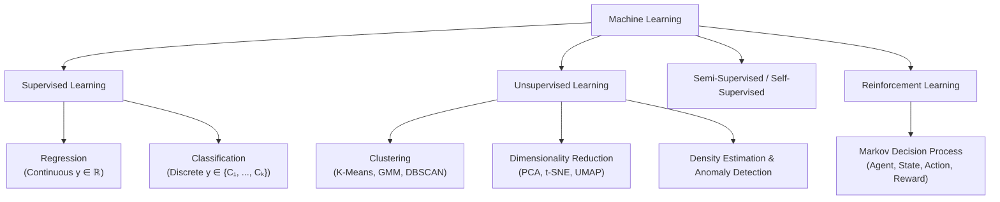

# Module 1: Introduction to Machine Learning & Designing a Learning System

**Course**: AIML ZG565 — Machine Learning  
**Prescribed References**: Tom M. Mitchell (T1, Chapter 1); Christopher M. Bishop (R1, Chapter 1); Tan et al. (R2, Chapter 1)  
**Primary Teacher Followed**: Prof. Pritee Narendra Raole (Session 1: 2026-07-26)

---

## 1. Executive Summary & Foundational Definitions

Machine Learning (ML) is an engineering and scientific discipline focused on the development of mathematical models and algorithmic architectures that automatically extract latent patterns, deduce decision boundaries, and optimize task performance directly from empirical data without being explicitly programmed with static rule heuristics.

Historically, classical artificial intelligence relied on **symbolic reasoning and expert systems** where human domain experts handcrafted deterministic if-else rules. This paradigm collapses in high-dimensional perceptual domains (computer vision, natural language understanding, speech recognition, and complex tabular prediction) due to the combinatorial explosion of edge cases and intra-class variance. Machine learning fundamentally inverts this pipeline: rather than feeding rules and data into a compute engine to produce outputs, machine learning feeds inputs and historical ground-truth outputs into an optimization engine to deduce the underlying computational rules.

```
Classical Programming Paradigm:
┌──────────────┐     ┌──────────────┐
│     Data     │───> │              │
└──────────────┘     │   Computer   │───> [ Output / Decisions ]
┌──────────────┐     │              │
│    Rules     │───> │              │
└──────────────┘     └──────────────┘

Machine Learning Paradigm:
┌──────────────┐     ┌──────────────┐
│     Data     │───> │   Learning   │
└──────────────┘     │  Algorithm   │───> [ Learned Model / Rules ]
┌──────────────┐     │ (Optimizer)  │
│    Output    │───> │              │
└──────────────┘     └──────────────┘
```

### 1.1 Formal Definition of Learning (Tom M. Mitchell, 1997)

A computer program is said to **learn** from experience $E$ with respect to some class of tasks $T$ and performance measure $P$, if its performance at tasks in $T$, as measured by $P$, improves with experience $E$.

$$\text{Learning} \iff P(T, E_{\text{new}}) > P(T, E_{\text{old}})$$

#### Canonical Examples of the $(T, P, E)$ Triplet:
1. **Autonomous Vehicle Navigation**:
   - **Task $T$**: Steering, braking, and throttling along public highways while maintaining lane centering and collision avoidance.
   - **Performance Measure $P$**: Average distance traveled without human safety intervention, passenger ride smoothness, and compliance with traffic regulations.
   - **Experience $E$**: Terabytes of multi-modal sensory streams (LiDAR point clouds, radar echoes, stereoscopic camera feeds, wheel odometry) collected across thousands of driving hours.
2. **Medical Diagnostics (Mammography Screening)**:
   - **Task $T$**: Identifying malignant neoplastic tissue in digital mammograms.
   - **Performance Measure $P$**: Area Under the ROC Curve (ROC-AUC), Sensitivity (Recall) at fixed high specificity, and false negative rate minimization.
   - **Experience $E$**: Biopsy-verified historical medical imaging database with ground-truth pathological labels.
3. **Credit Default Prediction**:
   - **Task $T$**: Classifying whether a revolving retail credit applicant will default within a 12-month window.
   - **Performance Measure $P$**: Normalized Gini coefficient, F1-Score, and financial expected loss reduction.
   - **Experience $E$**: Historical credit bureau files, debt-to-income metrics, and repayment tracking records.

---

## 2. Taxonomy of Machine Learning Paradigms



### 2.1 Supervised Learning
The training dataset consists of input-output pairs $\mathcal{D} = \{(\mathbf{x}_i, y_i)\}_{i=1}^N$, where $\mathbf{x}_i \in \mathcal{X} \subseteq \mathbb{R}^d$ denotes the feature vector and $y_i \in \mathcal{Y}$ represents the ground-truth supervisor label.
- **Regression**: The label space is continuous: $\mathcal{Y} \subseteq \mathbb{R}$. The goal is to estimate a continuous mapping function $\hat{f}: \mathbb{R}^d \to \mathbb{R}$ minimizing a distance metric such as Mean Squared Error (MSE).
- **Classification**: The label space is discrete: $\mathcal{Y} = \{1, 2, \dots, K\}$ (or $\{-1, +1\}$ in binary classification). The goal is to partition the input space into $K$ decision regions separated by decision boundaries.

### 2.2 Unsupervised Learning
The dataset consists exclusively of unlabelled feature vectors $\mathcal{D} = \{\mathbf{x}_i\}_{i=1}^N$ with no supervisor signals. The objective is to uncover internal structure, probability distributions, or low-dimensional manifolds:
- **Clustering**: Discovering natural groupings based on pairwise topological proximity or density.
- **Dimensionality Reduction**: Discovering low-dimensional embeddings $\mathbf{z}_i \in \mathbb{R}^k$ ($k \ll d$) that preserve variance or neighborhood structure.

### 2.3 Reinforcement Learning
An autonomous agent interacts dynamically with an environment through discrete or continuous time steps. At step $t$, the agent observes state $s_t \in \mathcal{S}$, executes action $a_t \in \mathcal{A}$, receives scalar feedback reward $r_t \in \mathbb{R}$, and transitions to state $s_{t+1} \sim \mathcal{P}(s_{t+1} \mid s_t, a_t)$. The mathematical objective is to discover an optimal policy $\pi^*: \mathcal{S} \to \mathcal{A}$ maximizing expected cumulative discounted return:

$$R_t = \sum_{k=0}^{\infty} \gamma^k r_{t+k+1}, \quad \gamma \in [0, 1)$$

---

## 3. Systematic Design of a Learning System

Designing a production-grade machine learning system requires a disciplined sequence of mathematical and architectural decisions. Mitchell formalizes this via a 4-stage pipeline (demonstrated here on an autonomous Checkers learning agent):

```
┌────────────────────────────────────────────────────────┐
│  Stage 1: Choose the Training Experience (E)          │
│  - Direct feedback (board + optimal move) vs. Indirect │
│  - Degree of agent control (Teacher vs. Self-play)     │
│  - Representativeness vs. Distribution Shift           │
└──────────────────────────┬─────────────────────────────┘
                           │
                           ▼
┌────────────────────────────────────────────────────────┐
│  Stage 2: Choose the Target Function (V)              │
│  - Operational target mapping: V: Board → ℝ            │
│  - Terminal state payoff: +100 (win), -100 (loss), 0   │
│  - Intermediate states: Expected win probability       │
└──────────────────────────┬─────────────────────────────┘
                           │
                           ▼
┌────────────────────────────────────────────────────────┐
│  Stage 3: Choose Function Representation (V̂)          │
│  - Lookup table vs. Linear combination vs. Deep Net   │
│  - Feature extraction: x₁ (pawns), x₂ (kings), etc.    │
│  - Linear Hypothesis: V̂(b) = w₀ + ∑ wᵢ xᵢ              │
└──────────────────────────┬─────────────────────────────┘
                           │
                           ▼
┌────────────────────────────────────────────────────────┐
│  Stage 4: Choose Function Approximation Algorithm     │
│  - Loss Formulation: E = ∑ (V_train(b) - V̂(b))²        │
│  - Optimization: Least Mean Squares (LMS) / SGD        │
│  - Weight Update: wᵢ ← wᵢ + η (V_train(b) - V̂(b)) xᵢ   │
└────────────────────────────────────────────────────────┘
```


*Figure 1.1: Formal learning system architecture and feedback optimization cycle as presented in lecture.*

### 3.1 The Complete Checkers Learning Architecture (Mitchell Model)
The complete operational system comprises four interconnected modules:

```
┌─────────────────┐       ┌─────────────────┐
│                 │ <──── │                 │
│                 │ ───── │                 │
│    Executive    │ Board │ Performance     │
│    System       │ Trace │ System          │
│                 │ ────> │                 │
└────────┬────────┘       └────────┬────────┘
         │                         │
  Training │ Experience        Experiment │ Generation
         ▼                         ▼
┌─────────────────┐       ┌─────────────────┐
│                 │ Board │                 │
│  Generalizer    │ Value │   Experiment    │
│  (LMS Algorithm)│ <──── │    Generator    │
│                 │       │                 │
└─────────────────┘       └─────────────────┘
```

1. **Performance System**: The operational agent that takes a current game state and executes a legal move by evaluating prospective board positions using current evaluation function $\hat{V}$.
2. **Critic**: Translates the raw game history (history of moves and terminal win/loss outcome) into training pairs $(b, V_{\text{train}}(b))$. It solves the **Credit Assignment Problem** using temporal difference bootstrapping:
   $$V_{\text{train}}(b) \leftarrow \hat{V}(\text{Successor}(b))$$
3. **Generalizer**: Takes the training examples from the Critic and updates the parameter vector $\mathbf{w}$ using stochastic gradient descent.
4. **Experiment Generator**: Formulates new initial board states and explores novel moves to guarantee sufficient exploration of the state space.

---

## 4. Fundamental Machine Learning Workflow

An end-to-end machine learning engineering workflow consists of six tightly coupled stages:

```
┌─────────────────────────────────────────────────────────────────────────┐
│ 1. Problem Formulation & Task Definition (Define T, P, E)               │
└────────────────────────────────────┬────────────────────────────────────┘
                                     │
                                     ▼
┌─────────────────────────────────────────────────────────────────────────┐
│ 2. Data Acquisition, Ingestion & Audit                                  │
│    - Verification of ground-truth integrity and provenance              │
└────────────────────────────────────┬────────────────────────────────────┘
                                     │
                                     ▼
┌─────────────────────────────────────────────────────────────────────────┐
│ 3. Exploratory Data Analysis & Data Preprocessing                       │
│    - Handling missing values (imputation), outlier clipping             │
│    - Feature scaling: MinMax Normalization vs. Z-Score Standardization  │
│    - Class imbalance handling: SMOTE, Random Under-sampling             │
└────────────────────────────────────┬────────────────────────────────────┘
                                     │
                                     ▼
┌─────────────────────────────────────────────────────────────────────────┐
│ 4. Hypothesis Space Selection & Model Training                          │
│    - Establishing baseline models (Linear, Tree-based)                  │
│    - Formulating objective loss function J(θ)                           │
│    - Iterative numerical optimization via Gradient Descent              │
└────────────────────────────────────┬────────────────────────────────────┘
                                     │
                                     ▼
┌─────────────────────────────────────────────────────────────────────────┐
│ 5. Validation, Regularization & Hyperparameter Optimization             │
│    - Stratified K-Fold Cross-Validation                                 │
│    - Regularization (L1 Lasso, L2 Ridge) to penalize capacity           │
└────────────────────────────────────┬────────────────────────────────────┘
                                     │
                                     ▼
┌─────────────────────────────────────────────────────────────────────────┐
│ 6. Model Evaluation, Bias-Fairness Audit & Production Deployment        │
│    - Generalization bounds on unseen Test Split                         │
│    - Precision, Recall, ROC-AUC, Calibration curves                     │
└─────────────────────────────────────────────────────────────────────────┘
```

---

## 5. Mathematical Vectorized Implementation (From Scratch)

Here is a vectorized NumPy implementation of the **Least Mean Squares (LMS)** learning algorithm for linear value function approximation in Mitchell's learning system:

```python
import numpy as np

class LinearGeneralizerLMS:
    """
    Least Mean Squares (LMS) Generalizer for Linear Function Approximation.
    Hypothesis: V_hat(x) = w^T x = w_0 + w_1 x_1 + ... + w_d x_d
    """
    def __init__(self, learning_rate: float = 0.01, fit_intercept: bool = True):
        self.eta = learning_rate
        self.fit_intercept = fit_intercept
        self.weights = None

    def fit(self, X: np.ndarray, y: np.ndarray, epochs: int = 100):
        """
        X: Feature matrix of shape (N, d)
        y: Target training values of shape (N,)
        """
        N, d = X.shape
        if self.fit_intercept:
            # Augment X with leading column of ones for bias w_0
            X_aug = np.hstack([np.ones((N, 1)), X])
            self.weights = np.zeros(d + 1)
        else:
            X_aug = X
            self.weights = np.zeros(d)

        loss_history = []
        for epoch in range(epochs):
            # Forward pass: Compute predictions V_hat(b)
            y_pred = np.dot(X_aug, self.weights)
            
            # Compute Residual Error: e = V_train(b) - V_hat(b)
            error = y - y_pred
            mse = np.mean(error ** 2)
            loss_history.append(mse)

            # Gradient of 0.5 * MSE w.r.t weights: grad = - (1/N) * X_aug^T error
            gradient = -np.dot(X_aug.T, error) / N

            # LMS Weight Update Rule: w <- w - eta * gradient
            self.weights -= self.eta * gradient

        return loss_history

    def predict(self, X: np.ndarray) -> np.ndarray:
        if self.fit_intercept:
            X_aug = np.hstack([np.ones((X.shape[0], 1)), X])
        else:
            X_aug = X
        return np.dot(X_aug, self.weights)


# Verification test on synthetic checkers board states
if __name__ == "__main__":
    np.random.seed(42)
    # 5 board features: [x1: black pawns, x2: red pawns, x3: black kings, x4: red kings, x5: threatened pieces]
    X_train = np.array([
        [12, 12, 0, 0, 0],
        [10, 8,  1, 0, 1],
        [6,  11, 0, 2, 3],
        [2,  0,  4, 0, 0],
        [0,  5,  0, 3, 2]
    ], dtype=float)
    # Ground-truth board values from game outcomes
    y_train = np.array([0.0, 35.0, -45.0, 100.0, -90.0])

    model = LinearGeneralizerLMS(learning_rate=0.005)
    losses = model.fit(X_train, y_train, epochs=500)
    print(f"Learned Parameters [w0, w1..w5]:\n{model.weights.round(3)}")
    preds = model.predict(X_train)
    print(f"Predicted Board Values:\n{preds.round(2)}")
```

---

## 6. Solved Numerical Example (Exam Pattern)

**Problem Statement (University Mid-Semester Exam Pattern, 6 Marks)**:  
Consider a learning agent for a board game utilizing a linear evaluation hypothesis:

$$\hat{V}(b) = w_0 + w_1 x_1 + w_2 x_2$$

Where:
- $x_1$: Net piece advantage ($x_1 = \text{Own Pieces} - \text{Opponent Pieces}$)
- $x_2$: Net mobility advantage ($x_2 = \text{Own Legal Moves} - \text{Opponent Legal Moves}$)

Initial weight vector is $\mathbf{w}^{(0)} = [0.0, 10.0, 2.0]^T$.  
The learning rate is $\eta = 0.1$.  
The agent observes a training board state $b_1$ with features: $x_1 = +2, x_2 = -1$.  
The Critic assigns a target value $V_{\text{train}}(b_1) = +25.0$.

Calculate:
1. The initial predicted board score $\hat{V}(b_1)$.
2. The estimation error $E(b_1) = V_{\text{train}}(b_1) - \hat{V}(b_1)$.
3. The updated weight vector $\mathbf{w}^{(1)}$ using the LMS weight update rule.
4. The revised predicted board score $\hat{V}_{\text{new}}(b_1)$ verifying convergence.

---

### Step-by-Step Solution:

#### Step 1: Augment Feature Vector and Compute $\hat{V}(b_1)$
The augmented feature vector including the bias term is:
$$\mathbf{x} = [x_0, x_1, x_2]^T = [1.0, 2.0, -1.0]^T$$

The predicted score is:
$$\hat{V}(b_1) = \mathbf{w}^{(0)T} \mathbf{x} = w_0^{(0)} x_0 + w_1^{(0)} x_1 + w_2^{(0)} x_2$$
$$\hat{V}(b_1) = (0.0)(1.0) + (10.0)(2.0) + (2.0)(-1.0) = 0 + 20 - 2 = 18.0$$

#### Step 2: Compute Estimation Error
$$E(b_1) = V_{\text{train}}(b_1) - \hat{V}(b_1) = 25.0 - 18.0 = +7.0$$

#### Step 3: Apply LMS Weight Update Rule
The LMS update rule for each parameter $w_i$ is:
$$w_i^{(1)} \leftarrow w_i^{(0)} + \eta \cdot \left(V_{\text{train}}(b_1) - \hat{V}(b_1)\right) \cdot x_i$$
$$w_i^{(1)} \leftarrow w_i^{(0)} + 0.1 \cdot (7.0) \cdot x_i = w_i^{(0)} + 0.7 \cdot x_i$$

Computing component-wise:
- **Bias ($w_0$)**:
  $$w_0^{(1)} = 0.0 + 0.7 \times (1.0) = \mathbf{0.70}$$
- **Piece Advantage Weight ($w_1$)**:
  $$w_1^{(1)} = 10.0 + 0.7 \times (2.0) = 10.0 + 1.4 = \mathbf{11.40}$$
- **Mobility Advantage Weight ($w_2$)**:
  $$w_2^{(1)} = 2.0 + 0.7 \times (-1.0) = 2.0 - 0.7 = \mathbf{1.30}$$

Updated weight vector:
$$\mathbf{w}^{(1)} = [0.70, 11.40, 1.30]^T$$

#### Step 4: Verify Convergence on Revised Prediction
$$\hat{V}_{\text{new}}(b_1) = (0.70)(1.0) + (11.40)(2.0) + (1.30)(-1.0) = 0.70 + 22.80 - 1.30 = \mathbf{22.20}$$

The prediction shifted monotonically from $18.00 \to 22.20$, successfully reducing error $|25.0 - 22.20| = 2.80 < 7.00$.

---

## 7. Common Pitfalls, Trade-offs & Practical Guidelines

1. **Credit Assignment Trap in Indirect Feedback**:
   - In board games and sequential control, reward is delayed until terminal victory or defeat. Updating intermediate board evaluations naively with $\pm 100$ produces catastrophic parameter explosion.
   - *Remedy*: Use temporal difference bootstrapping: $V_{\text{train}}(b) \leftarrow \hat{V}(\text{Successor}(b))$.
2. **Exploration vs. Exploitation Dilemma**:
   - If the agent only plays moves evaluated highest by its current imperfect $\hat{V}$, it risks settling into suboptimal local equilibria.
   - *Remedy*: Employ $\epsilon$-greedy action selection or Boltzmann softmax exploration.
3. **Data Leakage in Workflow Setup**:
   - Performing feature scaling, imputation, or outlier removal on the *entire dataset* before splitting into train/test leaks test distribution parameters $(\mu_{\text{test}}, \sigma_{\text{test}})$ into training.
   - *Rule*: Fit preprocessing transformers strictly on `X_train`, then call `transform()` on `X_val` and `X_test`.

