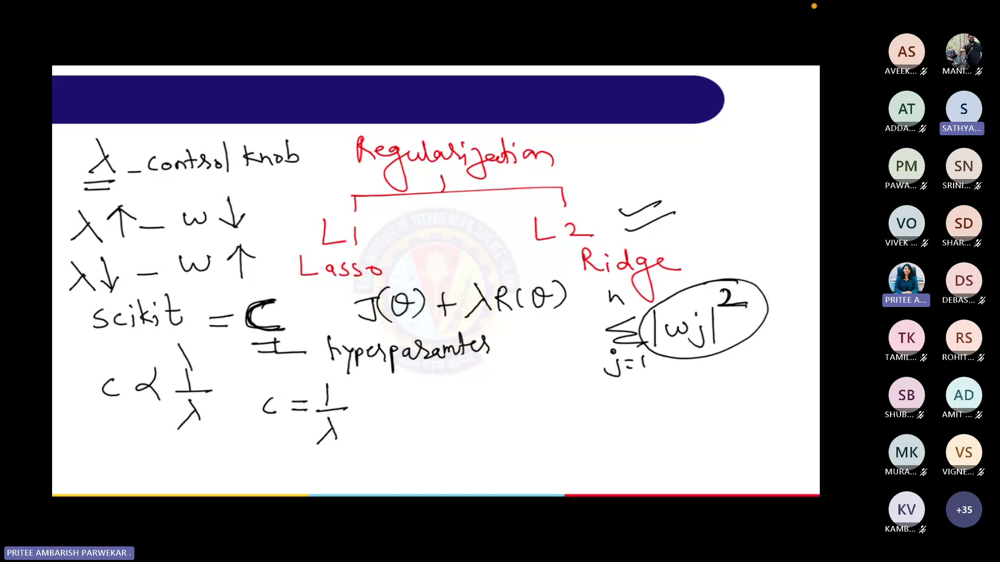

# Module 3: Linear Models for Regression

**Course**: AIML ZG565 — Machine Learning  
**Prescribed References**: Christopher M. Bishop (R1, Chapter 3); Tan et al. (R2, Chapter 4)  
**Syllabus module**: **M03** — Linear Models for Regression (`module_map.yaml`)  
**Canonical video**: `Videos/Lecture_03_Linear_Models_for_Regression.mp4`  
**Contact sessions** (reference): Sessions 3–6.

---

## 1. Executive Summary & Foundational Definitions

Linear regression represents the cornerstone parametric methodology for modeling the relationship between a continuous scalar dependent variable $y \in \mathbb{R}$ and a $d$-dimensional vector of explanatory covariates $\mathbf{x} \in \mathbb{R}^d$.

While the relationship between the inputs $\mathbf{x}$ and the target $y$ can be non-linear in data space, the model is strictly **linear in parameters** $\mathbf{w}$. By projecting the raw features into non-linear feature representations via basis functions $\boldsymbol{\phi}(\mathbf{x})$, linear regression spans an expressive hypothesis class while retaining closed-form convex analytical tractability.

```
Raw Input Space x ∈ ℝᵈ ───> [ Non-linear Basis Φ(x) ] ───> [ Linear Projection wᵀΦ(x) ] ───> Prediction ŷ
                                                                       │
                                                       Loss Minimization (OLS / Ridge / Lasso)
                                                                       ▼
                                                       Optimal Parameter Vector w*
```

---

## 2. Theoretical Motivation & Mathematical Derivations

### 2.1 The Linear Regression Model Formulation

Let the training dataset comprise $N$ observations $\mathcal{D} = \{(\mathbf{x}_i, y_i)\}_{i=1}^N$. The generative assumption specifies:

$$y_i = \mathbf{w}^T \boldsymbol{\phi}(\mathbf{x}_i) + \epsilon_i, \quad \epsilon_i \stackrel{\text{i.i.d.}}{\sim} \mathcal{N}(0, \sigma^2)$$

Where:
- $\mathbf{w} \in \mathbb{R}^{M}$: Parameter weight vector (including intercept $w_0$)
- $\boldsymbol{\phi}(\mathbf{x}) = [\phi_0(\mathbf{x}), \phi_1(\mathbf{x}), \dots, \phi_{M-1}(\mathbf{x})]^T \in \mathbb{R}^M$ with $\phi_0(\mathbf{x}) = 1$
- $\epsilon_i$: Additive Gaussian noise modeling unobserved environmental disturbances

In design matrix notation, collecting all $N$ observations:
$$\mathbf{y} = \begin{bmatrix} y_1 \\ y_2 \\ \vdots \\ y_N \end{bmatrix} \in \mathbb{R}^N, \quad \mathbf{\Phi} = \begin{bmatrix} \boldsymbol{\phi}(\mathbf{x}_1)^T \\ \boldsymbol{\phi}(\mathbf{x}_2)^T \\ \vdots \\ \boldsymbol{\phi}(\mathbf{x}_N)^T \end{bmatrix} \in \mathbb{R}^{N \times M}$$

---

### 2.2 Direct Closed-Form Solution: The Normal Equations

The Residual Sum of Squares (RSS) objective function is:

$$\mathcal{L}(\mathbf{w}) = \frac{1}{2} \|\mathbf{y} - \mathbf{\Phi}\mathbf{w}\|_2^2 = \frac{1}{2} (\mathbf{y} - \mathbf{\Phi}\mathbf{w})^T (\mathbf{y} - \mathbf{\Phi}\mathbf{w})$$

Expanding $(\mathbf{y} - \mathbf{\Phi}\mathbf{w})^T(\mathbf{y} - \mathbf{\Phi}\mathbf{w})$ (Session 5 lecture):
$$\mathcal{L}(\mathbf{w}) = \frac{1}{2}\left(\mathbf{y}^T\mathbf{y} - \mathbf{y}^T\mathbf{\Phi}\mathbf{w} - \mathbf{w}^T\mathbf{\Phi}^T\mathbf{y} + \mathbf{w}^T\mathbf{\Phi}^T\mathbf{\Phi}\mathbf{w}\right)$$
Because $\mathbf{y}^T\mathbf{\Phi}\mathbf{w}$ is a scalar, $\mathbf{y}^T\mathbf{\Phi}\mathbf{w} = \mathbf{w}^T\mathbf{\Phi}^T\mathbf{y}$, so:
$$\mathcal{L}(\mathbf{w}) = \frac{1}{2} \left[ \mathbf{y}^T\mathbf{y} - 2\mathbf{w}^T\mathbf{\Phi}^T\mathbf{y} + \mathbf{w}^T\mathbf{\Phi}^T\mathbf{\Phi}\mathbf{w} \right]$$

Taking the vector gradient with respect to $\mathbf{w}$ and setting to $\mathbf{0}$:
$$\nabla_{\mathbf{w}} \mathcal{L}(\mathbf{w}) = -\mathbf{\Phi}^T\mathbf{y} + \mathbf{\Phi}^T\mathbf{\Phi}\mathbf{w} = \mathbf{0}$$

$$\mathbf{\Phi}^T\mathbf{\Phi}\mathbf{w} = \mathbf{\Phi}^T\mathbf{y} \quad \text{(The Normal Equations)}$$

If the Gram matrix $\mathbf{\Phi}^T\mathbf{\Phi} \in \mathbb{R}^{M \times M}$ is non-singular (full rank: $\text{rank}(\mathbf{\Phi}) = M$ with $N \ge M$), the unique Ordinary Least Squares (OLS) estimator is:

$$\mathbf{w}_{\text{OLS}} = (\mathbf{\Phi}^T\mathbf{\Phi})^{-1}\mathbf{\Phi}^T\mathbf{y}$$

#### Geometric Interpretation:
The OLS prediction vector $\hat{\mathbf{y}} = \mathbf{\Phi}\mathbf{w}_{\text{OLS}} = \mathbf{\Phi}(\mathbf{\Phi}^T\mathbf{\Phi})^{-1}\mathbf{\Phi}^T\mathbf{y} = \mathbf{P}_{\mathbf{\Phi}}\mathbf{y}$ is the **orthogonal projection** of target vector $\mathbf{y} \in \mathbb{R}^N$ onto the $M$-dimensional subspace spanned by the column vectors of $\mathbf{\Phi}$. The residual vector $\mathbf{e} = \mathbf{y} - \hat{\mathbf{y}}$ is strictly orthogonal to the column space: $\mathbf{\Phi}^T \mathbf{e} = \mathbf{0}$.

---

### 2.3 Iterative Numerical Optimization: Gradient Descent

When feature dimension $M$ is large ($M > 10^4$), computing matrix inversion $(\mathbf{\Phi}^T\mathbf{\Phi})^{-1}$ requires $\mathcal{O}(M^3)$ operations and becomes computationally intractable. Iterative gradient descent optimizes $\mathbf{w}$ via first-order loss surface descent:

$$\mathbf{w}^{(t+1)} = \mathbf{w}^{(t)} - \eta \nabla_{\mathbf{w}} \mathcal{L}(\mathbf{w}^{(t)})$$

Where:
$$\nabla_{\mathbf{w}} \mathcal{L}(\mathbf{w}) = -\mathbf{\Phi}^T (\mathbf{y} - \mathbf{\Phi}\mathbf{w}) = \mathbf{\Phi}^T (\hat{\mathbf{y}} - \mathbf{y})$$

This gradient matches the $\tfrac{1}{2}\|\mathbf{y}-\mathbf{\Phi}\mathbf{w}\|_2^2$ loss defined above. If the objective is instead the mean loss $\tfrac{1}{2N}\|\mathbf{y}-\mathbf{\Phi}\mathbf{w}\|_2^2$, every gradient is divided by $N$. That constant can be absorbed into the learning rate $\eta$.

#### Optimization Paradigms:
1. **Batch Gradient Descent (BGD)**:
   - Computes gradient over all $N$ training examples per step.
   - Guaranteed asymptotic convergence to global minimum for convex quadratic loss.
   - Computational cost per step: $\mathcal{O}(NM)$. Memory-bound for massive datasets.
2. **Stochastic Gradient Descent (SGD)**:
   - Updates weights immediately upon processing a single sample $i$:
     $$\mathbf{w}^{(t+1)} = \mathbf{w}^{(t)} + \eta (y_i - \mathbf{w}^T\boldsymbol{\phi}(\mathbf{x}_i))\boldsymbol{\phi}(\mathbf{x}_i)$$
   - High variance; exhibits noisy oscillations around the minimum.
3. **Mini-Batch Gradient Descent (MBGD)**:
   - Computes gradients across subsets $\mathcal{B} \subset \{1, \dots, N\}$ of batch size $B$ (typically $32 \le B \le 512$).
   - Maximizes hardware vectorized parallelism (SIMD/GPU tensor cores) while dampening SGD variance.

**Simultaneous update rule**: compute all partial derivatives using weights $\mathbf{w}^{(t)}$ before applying any update (not in-place Gauss–Seidel).

#### Exam decision: Normal Equation vs. gradient descent

| Criterion | Normal Equation | Gradient descent |
| :--- | :--- | :--- |
| Nature | Closed form | Iterative |
| Hyperparameters | None | Learning rate $\alpha$ |
| Feature scaling | Not required | **Required** |
| Cost | $\mathcal{O}(d^3)$ inversion | $\mathcal{O}(k \cdot n \cdot d)$ per run |
| When $d$ is large | Poor if $d \gtrsim 10^4$ | Scales to $d \gg 10^5$ |
| Singular $X^TX$ | Fails | Converges with suitable $\alpha$ |

#### Worked example: meal bill → tip (1D OLS, Session 4)

| Bill $x$ | Tip $y$ |
| :---: | :---: |
| 34 | 5.00 |
| 10 | 1.50 |
| 25 | 3.00 |
| 50 | 7.00 |
| 15 | 2.00 |

$\bar{x}=26.8$, $\bar{y}=3.7$; $\hat{\theta}_1 = \frac{\sum(x_i-\bar{x})(y_i-\bar{y})}{\sum(x_i-\bar{x})^2} \approx 0.146$; $\hat{\theta}_0 = \bar{y} - \hat{\theta}_1\bar{x} \approx -0.82$ (lecture rounded values).

---

### 2.4 The Bias-Variance Decomposition

Let a target variable be generated by $y = f(\mathbf{x}) + \epsilon$ with $\mathbb{E}[\epsilon] = 0$ and $\text{Var}(\epsilon) = \sigma^2$.  
Given an estimator $\hat{f}(\mathbf{x}; \mathcal{D})$ trained on dataset $\mathcal{D}$, the expected squared prediction error at point $\mathbf{x}$ across all possible training realizations $\mathcal{D}$ decomposes into three distinct components:

$$\mathbb{E}_{\mathcal{D}}[(y - \hat{f}(\mathbf{x}))^2] = \text{Bias}[\hat{f}(\mathbf{x})]^2 + \text{Var}[\hat{f}(\mathbf{x})] + \sigma^2$$

#### Complete Derivation:
Let $\bar{f}(\mathbf{x}) = \mathbb{E}_{\mathcal{D}}[\hat{f}(\mathbf{x})]$. Adding and subtracting $\bar{f}(\mathbf{x})$:
$$y - \hat{f}(\mathbf{x}) = (f(\mathbf{x}) - \bar{f}(\mathbf{x})) + (\bar{f}(\mathbf{x}) - \hat{f}(\mathbf{x})) + \epsilon$$

Squaring and taking expectation $\mathbb{E}_{\mathcal{D}, \epsilon}[\cdot]$:
$$\mathbb{E}[(y - \hat{f}(\mathbf{x}))^2] = \underbrace{(f(\mathbf{x}) - \bar{f}(\mathbf{x}))^2}_{\text{Bias}^2} + \underbrace{\mathbb{E}_{\mathcal{D}}[(\hat{f}(\mathbf{x}) - \bar{f}(\mathbf{x}))^2]}_{\text{Variance}} + \underbrace{\mathbb{E}[\epsilon^2]}_{\text{Irreducible Noise } \sigma^2}$$
*(All cross-product terms evaluate to 0 because noise $\epsilon$ is independent and $\mathbb{E}[\hat{f} - \bar{f}] = 0$.)*

- **High Bias (Underfitting)**: Overly simplistic model class unable to capture underlying signal (e.g., linear model fitting cubic curve).
- **High Variance (Overfitting)**: Overly complex model with excessive degrees of freedom fitting idiosyncrasies and random noise in the training set.

---

### 2.5 Regularized Linear Models: Ridge ($L_2$) and Lasso ($L_1$)


*Figure 3.1: Regularization as taught on 23 August 2026 — L1 Lasso, L2 Ridge, penalty $J(\theta)+\lambda R(\theta)$, and the scikit-learn relationship $C = 1/\lambda$.*

To control model variance and combat multicollinearity:

#### 1. Ridge Regression ($L_2$ Regularization / Tikhonov Regularization):
Penalizes the squared Euclidean $L_2$ norm of parameters:

$$\mathcal{L}_{\text{Ridge}}(\mathbf{w}) = \frac{1}{2} \|\mathbf{y} - \mathbf{\Phi}\mathbf{w}\|_2^2 + \frac{\lambda}{2} \|\mathbf{w}\|_2^2$$

Taking gradient and setting to $\mathbf{0}$:
$$\nabla_{\mathbf{w}} \mathcal{L}_{\text{Ridge}} = -\mathbf{\Phi}^T(\mathbf{y} - \mathbf{\Phi}\mathbf{w}) + \lambda \mathbf{w} = \mathbf{0}$$
$$(\mathbf{\Phi}^T\mathbf{\Phi} + \lambda \mathbf{I})\mathbf{w} = \mathbf{\Phi}^T\mathbf{y}$$

$$\mathbf{w}_{\text{Ridge}} = (\mathbf{\Phi}^T\mathbf{\Phi} + \lambda \mathbf{I}_M)^{-1} \mathbf{\Phi}^T\mathbf{y}$$

> **Theorem (Guaranteed Invertibility)**: For any $\lambda > 0$, the matrix $(\mathbf{\Phi}^T\mathbf{\Phi} + \lambda \mathbf{I})$ is strictly positive definite and always invertible, even if $\mathbf{\Phi}$ is rank-deficient ($N < M$) or features are collinear.

#### 2. Lasso Regression ($L_1$ Regularization):
Penalizes the absolute $L_1$ norm of parameters:

$$\mathcal{L}_{\text{Lasso}}(\mathbf{w}) = \frac{1}{2} \|\mathbf{y} - \mathbf{\Phi}\mathbf{w}\|_2^2 + \lambda \|\mathbf{w}\|_1 = \frac{1}{2} \|\mathbf{y} - \mathbf{\Phi}\mathbf{w}\|_2^2 + \lambda \sum_{j=1}^M |w_j|$$

Because the absolute value function $|w_j|$ has a non-differentiable kink at $w_j = 0$, the gradient does not exist at zero. Lasso produces **exact feature sparsity** ($w_j = 0$), performing automated feature selection.

For orthonormal design matrices ($\mathbf{\Phi}^T\mathbf{\Phi} = \mathbf{I}$), Lasso has an analytical closed form via the **Soft-Thresholding Operator**:
$$w_j^{\text{Lasso}} = \text{sign}(w_j^{\text{OLS}}) \max(|w_j^{\text{OLS}}| - \lambda, 0)$$

```
Geometry of Sparsity:
Ridge (L2 Constraint):                 Lasso (L1 Constraint):
Contour hits smooth circle ->          Contour hits sharp corner ->
w₁ ≠ 0, w₂ ≠ 0 (Shrinkage)             w₁ = 0, w₂ ≠ 0 (Exact Zero / Sparsity)

          w₂                                     w₂
          │      ╱───╲                           │        ◇
          │     │  *  │                          │       ╱*╲
    ──────┼─────┼─┼───┼────── w₁           ──────┼──────◇───◇──── w₁
          │      ╲───╱                           │       ╲ ╱
          │     Circle                           │        ◇  Diamond
```

**Elastic Net (lecture)**
$$J = \frac{1}{2m}\|\mathbf{y}-\mathbf{\Phi}\mathbf{w}\|^2 + \frac{\lambda}{2m}\left[r\|\mathbf{w}\|_1 + (1-r)\|\mathbf{w}\|_2^2\right]$$

**Early stopping**
Stop gradient descent when **validation** error rises — reduces overfitting without an explicit penalty.

**Linear basis function models**
Non-linear in features, linear in $\mathbf{w}$: $y = \mathbf{w}^T\boldsymbol{\phi}(\mathbf{x})$.

- Polynomial: $\phi_j(x) = x^j$
- Gaussian RBF: $\phi_j(x) = \exp\left(-\frac{(x-\mu_j)^2}{2s^2}\right)$
- Sigmoid: $\phi_j(x) = \sigma\left(\frac{x-\mu_j}{s}\right)$

**Ridge gradient — weight decay**
$$\mathbf{w} \leftarrow \mathbf{w}\left(1 - \frac{\alpha\lambda}{m}\right) - \frac{\alpha}{m}\mathbf{\Phi}^T(\mathbf{\Phi}\mathbf{w}-\mathbf{y})$$
(intercept $\theta_0$ typically not regularized in closed-form ridge)

**Goodness of fit ($R^2$)**
$$R^2 = 1 - \frac{\sum_i (y_i-\hat{y}_i)^2}{\sum_i (y_i-\bar{y})^2}$$

---

## 3. Implementation note

Closed-form and one-step GD calculations are exam staples; full training loops are not. Use simultaneous updates and feature scaling before GD.

*Optional reference implementation (abbreviated):*

```python
import numpy as np

class AdvancedLinearRegressor:
    """Vectorized OLS, Ridge, and Mini-Batch SGD Regression."""
    def __init__(self, method: str = 'ols', alpha: float = 1.0, lr: float = 0.01, epochs: int = 1000):
        self.method = method.lower()
        self.alpha = alpha  # Regularization strength λ
        self.lr = lr
        self.epochs = epochs
        self.weights = None

    def fit(self, X: np.ndarray, y: np.ndarray, batch_size: int = 32):
        N, d = X.shape
        X_aug = np.hstack([np.ones((N, 1)), X])
        M = d + 1

        if self.method == 'ols':
            # Analytical Normal Equation: w = (X^T X)^-1 X^T y
            self.weights = np.linalg.inv(X_aug.T @ X_aug) @ X_aug.T @ y

        elif self.method == 'ridge':
            # Analytical Ridge: w = (X^T X + λ I)^-1 X^T y
            I = np.eye(M)
            I[0, 0] = 0.0  # Do not penalize the bias intercept w_0
            self.weights = np.linalg.inv(X_aug.T @ X_aug + self.alpha * I) @ X_aug.T @ y

        elif self.method == 'sgd':
            # Mini-Batch Gradient Descent
            self.weights = np.zeros(M)
            for epoch in range(self.epochs):
                indices = np.random.permutation(N)
                X_shuffled = X_aug[indices]
                y_shuffled = y[indices]

                for start_idx in range(0, N, batch_size):
                    end_idx = min(start_idx + batch_size, N)
                    X_b = X_shuffled[start_idx:end_idx]
                    y_b = y_shuffled[start_idx:end_idx]

                    y_pred = X_b @ self.weights
                    grad = (X_b.T @ (y_pred - y_b)) / len(y_b)
                    self.weights -= self.lr * grad

        return self

    def predict(self, X: np.ndarray) -> np.ndarray:
        X_aug = np.hstack([np.ones((X.shape[0], 1)), X])
        return X_aug @ self.weights


if __name__ == "__main__":
    np.random.seed(42)
    # Generate linear synthetic data with noise: y = 3 + 2.5 x_1 - 1.8 x_2 + noise
    X = np.random.randn(200, 2)
    true_w = np.array([3.0, 2.5, -1.8])
    y = true_w[0] + X @ true_w[1:] + np.random.normal(0, 0.2, size=200)

    ols_model = AdvancedLinearRegressor(method='ols').fit(X, y)
    ridge_model = AdvancedLinearRegressor(method='ridge', alpha=10.0).fit(X, y)
    sgd_model = AdvancedLinearRegressor(method='sgd', lr=0.05, epochs=200).fit(X, y)

    print("True Parameters:   [3.00,  2.50, -1.80]")
    print("OLS Parameters:   ", ols_model.weights.round(3))
    print("Ridge Parameters: ", ridge_model.weights.round(3))
    print("SGD Parameters:   ", sgd_model.weights.round(3))
```

---

## 4. Solved Numerical Example (Exam Pattern)

**Problem Statement (University Examination Pattern, 6 Marks)**:  
Given the following bivariate training dataset of 3 points:

| Point ($i$) | Feature $x$ | Target $y$ |
| :---: | :---: | :---: |
| 1 | 1 | 2 |
| 2 | 2 | 3 |
| 3 | 3 | 5 |

We fit a simple linear model: $\hat{y} = w_0 + w_1 x$.
1. Set up the design matrix $\mathbf{X}$ and target vector $\mathbf{y}$.
2. Compute $\mathbf{X}^T\mathbf{X}$, $\mathbf{X}^T\mathbf{y}$, and find the exact OLS parameter vector $\mathbf{w}_{\text{OLS}}$ via the normal equation.
3. Compute the Ridge parameter vector $\mathbf{w}_{\text{Ridge}}$ with regularization penalty $\lambda = 2.0$ (penalizing only $w_1$).
4. Calculate the Mean Squared Error (MSE) for both models.

---

### Step-by-Step Solution:

#### Step 1: Matrix Formulation
$$\mathbf{X} = \begin{bmatrix} 1 & 1 \\ 1 & 2 \\ 1 & 3 \end{bmatrix}, \quad \mathbf{y} = \begin{bmatrix} 2 \\ 3 \\ 5 \end{bmatrix}$$

#### Step 2: Compute OLS via Normal Equations
$$\mathbf{X}^T\mathbf{X} = \begin{bmatrix} 1 & 1 & 1 \\ 1 & 2 & 3 \end{bmatrix} \begin{bmatrix} 1 & 1 \\ 1 & 2 \\ 1 & 3 \end{bmatrix} = \begin{bmatrix} 1+1+1 & 1+2+3 \\ 1+2+3 & 1^2+2^2+3^2 \end{bmatrix} = \begin{bmatrix} 3 & 6 \\ 6 & 14 \end{bmatrix}$$

$$\mathbf{X}^T\mathbf{y} = \begin{bmatrix} 1 & 1 & 1 \\ 1 & 2 & 3 \end{bmatrix} \begin{bmatrix} 2 \\ 3 \\ 5 \end{bmatrix} = \begin{bmatrix} 2+3+5 \\ 2(1)+3(2)+5(3) \end{bmatrix} = \begin{bmatrix} 10 \\ 23 \end{bmatrix}$$

Determinant of $\mathbf{X}^T\mathbf{X}$:
$$\det(\mathbf{X}^T\mathbf{X}) = (3)(14) - (6)(6) = 42 - 36 = 6$$

Matrix Inverse $(\mathbf{X}^T\mathbf{X})^{-1}$:
$$(\mathbf{X}^T\mathbf{X})^{-1} = \frac{1}{6} \begin{bmatrix} 14 & -6 \\ -6 & 3 \end{bmatrix}$$

Compute $\mathbf{w}_{\text{OLS}}$:
$$\mathbf{w}_{\text{OLS}} = \frac{1}{6} \begin{bmatrix} 14 & -6 \\ -6 & 3 \end{bmatrix} \begin{bmatrix} 10 \\ 23 \end{bmatrix} = \frac{1}{6} \begin{bmatrix} 14(10) - 6(23) \\ -6(10) + 3(23) \end{bmatrix} = \frac{1}{6} \begin{bmatrix} 140 - 138 \\ -60 + 69 \end{bmatrix} = \frac{1}{6} \begin{bmatrix} 2 \\ 9 \end{bmatrix} = \begin{bmatrix} \mathbf{0.333} \\ \mathbf{1.500} \end{bmatrix}$$

The fitted line is:
$$\hat{y} = 0.333 + 1.500 x$$

---

#### Step 3: Compute Ridge Regression with $\lambda = 2.0$ (penalizing $w_1$)
$$\mathbf{X}^T\mathbf{X} + \lambda \mathbf{I}_{\text{reg}} = \begin{bmatrix} 3 & 6 \\ 6 & 14 \end{bmatrix} + \begin{bmatrix} 0 & 0 \\ 0 & 2 \end{bmatrix} = \begin{bmatrix} 3 & 6 \\ 6 & 16 \end{bmatrix}$$

Determinant:
$$\det = (3)(16) - (6)(6) = 48 - 36 = 12$$

Inverse:
$$(\mathbf{X}^T\mathbf{X} + \lambda \mathbf{I}_{\text{reg}})^{-1} = \frac{1}{12} \begin{bmatrix} 16 & -6 \\ -6 & 3 \end{bmatrix}$$

Compute $\mathbf{w}_{\text{Ridge}}$:
$$\mathbf{w}_{\text{Ridge}} = \frac{1}{12} \begin{bmatrix} 16 & -6 \\ -6 & 3 \end{bmatrix} \begin{bmatrix} 10 \\ 23 \end{bmatrix} = \frac{1}{12} \begin{bmatrix} 160 - 138 \\ -60 + 69 \end{bmatrix} = \frac{1}{12} \begin{bmatrix} 22 \\ 9 \end{bmatrix} = \begin{bmatrix} \mathbf{1.833} \\ \mathbf{0.750} \end{bmatrix}$$

*Observation: The slope parameter $w_1$ shrank from $1.500 \to 0.750$ under $L_2$ penalty.*

---

#### Step 4: MSE Comparison on Training Data
- For OLS:
  - $\hat{y}_1 = 0.333 + 1.5(1) = 1.833 \implies (2 - 1.833)^2 = 0.0278$
  - $\hat{y}_2 = 0.333 + 1.5(2) = 3.333 \implies (3 - 3.333)^2 = 0.1111$
  - $\hat{y}_3 = 0.333 + 1.5(3) = 4.833 \implies (5 - 4.833)^2 = 0.0278$
  $$\text{MSE}_{\text{OLS}} = \frac{0.0278 + 0.1111 + 0.0278}{3} = \frac{0.1667}{3} = \mathbf{0.0556}$$

- For Ridge:
  - $\hat{y}_1 = 1.833 + 0.75(1) = 2.583 \implies (2 - 2.583)^2 = 0.340$
  - $\hat{y}_2 = 1.833 + 0.75(2) = 3.333 \implies (3 - 3.333)^2 = 0.111$
  - $\hat{y}_3 = 1.833 + 0.75(3) = 4.083 \implies (5 - 4.083)^2 = 0.841$
  $$\text{MSE}_{\text{Ridge}} = \frac{0.340 + 0.111 + 0.841}{3} = \mathbf{0.4307}$$

*OLS strictly minimizes in-sample MSE; Ridge trades in-sample training error for reduced generalization variance.*

---

## 5. Common Pitfalls, Trade-offs & Practical Guidelines

1. **Multicollinearity Inflation**:
   - Highly correlated input features cause the condition number $\kappa(\mathbf{X}^T\mathbf{X}) = \frac{\sigma_{\max}}{\sigma_{\min}}$ to explode, making $(\mathbf{X}^T\mathbf{X})^{-1}$ numerically unstable and blowing up parameter variances.
   - *Diagnostic*: Variance Inflation Factor $\text{VIF}_j = \frac{1}{1 - R_j^2} > 10$.
   - *Fix*: Apply Ridge regression ($\lambda > 0$) or eliminate collinear features with PCA.
2. **Penalizing the Intercept $w_0$**:
   - Never penalize $w_0$ in Ridge or Lasso ($I_{00} = 0$). Penalizing the bias forces predictions towards zero even if the true target mean $\bar{y} \gg 0$.
3. **Feature Scaling Requirement**:
   - Regularized models are scale-dependent. If feature $x_1 \in [0, 1]$ and $x_2 \in [0, 10^6]$, the penalty penalizes $w_2$ unevenly. Always standardize features before applying Ridge or Lasso.

