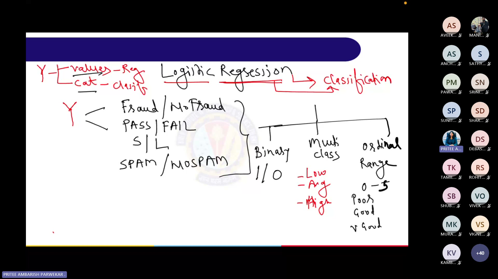

# Module 4: Linear Models for Classification & Logistic Regression

**Course**: AIML ZG565 — Machine Learning  
**Prescribed References**: Christopher M. Bishop (R1, Chapter 4); Tan et al. (R2, Chapter 4)  
**Primary Teacher Followed**: Prof. Pritee Narendra Raole (Sessions 4 & 5: 2026-08-16 & 2026-08-23)

---

## 1. Executive Summary & Foundational Definitions

Classification is the supervised learning task of mapping input vectors $\mathbf{x} \in \mathbb{R}^d$ to discrete categorical class labels $y \in \mathcal{C} = \{C_1, C_2, \dots, C_K\}$. Unlike regression where target outputs are continuous real numbers, classification decision boundaries partition the input space $\mathbb{R}^d$ into disjoint **decision regions** separated by $(d-1)$-dimensional manifolds known as **decision surfaces** or **hyperplanes**.

Linear classification models are characterized by decision boundaries that are linear functions of the input coordinates $\mathbf{x}$. When classes can be perfectly separated by a flat $(d-1)$-dimensional hyperplane, the data is termed **linearly separable**.

```
Input Vector x ∈ ℝᵈ ───> [ Linear Transformation z = wᵀx + b ] ───> [ Non-Linear Link σ(z) ] ───> Posterior P(y=1|x)
                                                                                  │
                                                                       Decision Threshold τ = 0.5
                                                                                  ▼
                                                                       Predicted Class ŷ ∈ {0, 1}
```

---

## 2. Theoretical Motivation & Core Principles

### 2.1 Discriminant Functions & Geometric Hyperplanes

A linear discriminant function computes a scalar activation score:

$$y(\mathbf{x}) = \mathbf{w}^T \mathbf{x} + w_0$$

Where $\mathbf{w}$ is the parameter weight vector and $w_0$ is the bias (or intercept).
- The decision boundary is the locus of all points where $y(\mathbf{x}) = 0$:
  $$\mathcal{S} = \{\mathbf{x} \in \mathbb{R}^d \mid \mathbf{w}^T \mathbf{x} + w_0 = 0\}$$
- **Orthogonality**: For any two points $\mathbf{x}_A, \mathbf{x}_B$ lying on the decision boundary $\mathcal{S}$:
  $$y(\mathbf{x}_A) = y(\mathbf{x}_B) = 0 \implies \mathbf{w}^T (\mathbf{x}_A - \mathbf{x}_B) = 0$$
  Therefore, the parameter vector $\mathbf{w}$ is strictly **orthogonal (normal)** to every vector lying within the decision boundary.
- **Signed Perpendicular Distance**: The normal distance $r$ from an arbitrary query point $\mathbf{x}$ to the decision hyperplane is given by:
  $$r = \frac{y(\mathbf{x})}{\|\mathbf{w}\|_2} = \frac{\mathbf{w}^T \mathbf{x} + w_0}{\|\mathbf{w}\|_2}$$

---

### 2.2 Fisher's Linear Discriminant Analysis (LDA)

Rather than simply finding a separating hyperplane, Ronald Fisher (1936) formulated linear classification as optimal **dimensionality reduction**: projecting high-dimensional data $\mathbf{x} \in \mathbb{R}^d$ down to a scalar $y = \mathbf{w}^T \mathbf{x}$ such that classes are maximally separated while internal class variance is minimized.

Let $N_1, N_2$ denote class sample sizes with class mean vectors $\mathbf{m}_1, \mathbf{m}_2 \in \mathbb{R}^d$.
- **Between-Class Scatter Matrix**:
  $$\mathbf{S}_B = (\mathbf{m}_1 - \mathbf{m}_2)(\mathbf{m}_1 - \mathbf{m}_2)^T \in \mathbb{R}^{d \times d}$$
- **Within-Class Scatter Matrix**:
  $$\mathbf{S}_W = \sum_{i \in \mathcal{C}_1} (\mathbf{x}_i - \mathbf{m}_1)(\mathbf{x}_i - \mathbf{m}_1)^T + \sum_{j \in \mathcal{C}_2} (\mathbf{x}_j - \mathbf{m}_2)(\mathbf{x}_j - \mathbf{m}_2)^T$$

Fisher defined the objective criterion $J(\mathbf{w})$ as the ratio of between-class variance to within-class variance:
$$J(\mathbf{w}) = \frac{\mathbf{w}^T \mathbf{S}_B \mathbf{w}}{\mathbf{w}^T \mathbf{S}_W \mathbf{w}}$$

Differentiating $J(\mathbf{w})$ with respect to $\mathbf{w}$ and setting to zero yields the generalized eigenvalue problem:
$$\mathbf{S}_B \mathbf{w} = \lambda \mathbf{S}_W \mathbf{w} \implies \mathbf{w} \propto \mathbf{S}_W^{-1} (\mathbf{m}_1 - \mathbf{m}_2)$$

---

### 2.3 Generative vs. Discriminative Paradigms

```
Generative Approach:
p(x|Cₖ), P(Cₖ) ───[ Bayes' Theorem ]───> P(Cₖ|x) = p(x|Cₖ)P(Cₖ) / ∑ p(x|Cⱼ)P(Cⱼ)
(Models full joint distribution P(x, y); e.g., Gaussian Discriminant Analysis, Naïve Bayes)

Discriminative Approach:
x ───[ Parametric Optimization ]───> P(Cₖ|x) directly
(Models conditional posterior P(y|x) directly; e.g., Logistic Regression, Neural Networks)
```

**Why Discriminative Modeling is Preferred for Tabular Classification**:  
As Vladimir Vapnik formulated: *"If you possess a restricted amount of data, solve the target problem directly and never solve a more general problem as an intermediate step."* Generative models waste modeling capacity estimating the input feature distribution $p(\mathbf{x})$, which can be extraordinarily complex, whereas the classification decision boundary itself may be simple.

---

## 3. Logistic Regression Formulation


*Figure 4.1: Logistic Regression introduction — Y categorical values (Fraud/NotFraud, Pass/Fail), Binary, Multi-class and Ordinal classification types (Aug 23 session).*

### 3.1 The Log-Odds and the Sigmoid Function

In binary classification ($y \in \{0, 1\}$), we desire a probabilistic output $p(\mathbf{x}) = P(y = 1 \mid \mathbf{x}) \in [0, 1]$.  
The **odds ratio** is defined as $\frac{p(\mathbf{x})}{1 - p(\mathbf{x})} \in [0, \infty)$.  
Taking the natural logarithm yields the **logit** (log-odds), which maps to the entire real line $(-\infty, \infty)$:

$$\ln \left( \frac{P(y = 1 \mid \mathbf{x})}{1 - P(y = 1 \mid \mathbf{x})} \right) = \mathbf{w}^T \mathbf{x} + w_0$$

Solving for posterior probability $P(y = 1 \mid \mathbf{x})$:
$$P(y = 1 \mid \mathbf{x}) = \sigma(\mathbf{w}^T \mathbf{x} + w_0) = \frac{1}{1 + e^{-(\mathbf{w}^T \mathbf{x} + w_0)}}$$

Where $\sigma(z)$ is the **Standard Logistic Sigmoid Function**:
$$\sigma(z) = \frac{1}{1 + e^{-z}} = \frac{e^z}{1 + e^z}$$

#### Essential Mathematical Properties of $\sigma(z)$:
1. **Symmetry**: $\sigma(-z) = 1 - \sigma(z)$
2. **Derivative**:
   $$\frac{d\sigma}{dz} = \frac{d}{dz} (1 + e^{-z})^{-1} = -(1 + e^{-z})^{-2} (-e^{-z}) = \frac{1}{1 + e^{-z}} \left( \frac{e^{-z}}{1 + e^{-z}} \right) = \sigma(z)(1 - \sigma(z))$$

---

### 3.2 Maximum Likelihood Estimation & Binary Cross-Entropy Loss

Given independent training dataset $\mathcal{D} = \{(\mathbf{x}_i, y_i)\}_{i=1}^N$ with $y_i \in \{0, 1\}$, the target labels follow a Bernoulli distribution:
$$P(y_i \mid \mathbf{x}_i; \mathbf{w}) = \hat{y}_i^{y_i} (1 - \hat{y}_i)^{1 - y_i}, \quad \text{where } \hat{y}_i = \sigma(\mathbf{w}^T \mathbf{x}_i)$$

The Likelihood function is the joint product:
$$L(\mathbf{w}) = \prod_{i=1}^N P(y_i \mid \mathbf{x}_i; \mathbf{w}) = \prod_{i=1}^N \hat{y}_i^{y_i} (1 - \hat{y}_i)^{1 - y_i}$$

Taking the negative log-likelihood defines the **Binary Cross-Entropy Loss (Log-Loss)**:
$$\mathcal{L}(\mathbf{w}) = -\ln L(\mathbf{w}) = -\sum_{i=1}^N \left[ y_i \ln \hat{y}_i + (1 - y_i) \ln(1 - \hat{y}_i) \right]$$

---

### 3.3 Complete Gradient Derivation via the Chain Rule

To minimize $\mathcal{L}(\mathbf{w})$ via gradient descent, compute $\frac{\partial \mathcal{L}}{\partial w_j}$ for parameter $w_j$:

Using the chain rule:
$$\frac{\partial \mathcal{L}_i}{\partial w_j} = \frac{\partial \mathcal{L}_i}{\partial \hat{y}_i} \cdot \frac{\partial \hat{y}_i}{\partial z_i} \cdot \frac{\partial z_i}{\partial w_j}$$

Where $z_i = \mathbf{w}^T \mathbf{x}_i = \sum_{k} w_k x_{ik}$.

1. **Loss derivative w.r.t prediction**:
   $$\frac{\partial \mathcal{L}_i}{\partial \hat{y}_i} = -\left[ \frac{y_i}{\hat{y}_i} - \frac{1 - y_i}{1 - \hat{y}_i} \right] = -\frac{y_i(1 - \hat{y}_i) - (1 - y_i)\hat{y}_i}{\hat{y}_i (1 - \hat{y}_i)} = \frac{\hat{y}_i - y_i}{\hat{y}_i (1 - \hat{y}_i)}$$
2. **Sigmoid derivative w.r.t linear logit $z_i$**:
   $$\frac{\partial \hat{y}_i}{\partial z_i} = \hat{y}_i (1 - \hat{y}_i)$$
3. **Linear logit derivative w.r.t weight $w_j$**:
   $$\frac{\partial z_i}{\partial w_j} = x_{ij}$$

Multiplying all three terms:
$$\frac{\partial \mathcal{L}_i}{\partial w_j} = \left[ \frac{\hat{y}_i - y_i}{\hat{y}_i (1 - \hat{y}_i)} \right] \cdot \left[ \hat{y}_i (1 - \hat{y}_i) \right] \cdot x_{ij} = (\hat{y}_i - y_i) x_{ij}$$

Summing over all $N$ training examples in vector matrix form:
$$\nabla_{\mathbf{w}} \mathcal{L}(\mathbf{w}) = \mathbf{X}^T (\hat{\mathbf{y}} - \mathbf{y}) \in \mathbb{R}^M$$

> **Profound Architectural Insight**: The gradient of binary cross-entropy for logistic regression has the *identical mathematical structure* as the gradient of least-squares linear regression: $\mathbf{X}^T(\hat{\mathbf{y}} - \mathbf{y})$! The only difference is that $\hat{\mathbf{y}} = \sigma(\mathbf{X}\mathbf{w})$ instead of $\mathbf{X}\mathbf{w}$.

---

### 3.4 Convexity and the Hessian Matrix

The second derivative matrix (Hessian) is:
$$\mathbf{H} = \nabla_{\mathbf{w}}^2 \mathcal{L}(\mathbf{w}) = \mathbf{X}^T \mathbf{R} \mathbf{X}$$

Where $\mathbf{R} \in \mathbb{R}^{N \times N}$ is a diagonal weighting matrix with elements:
$$R_{ii} = \hat{y}_i (1 - \hat{y}_i)$$

Since $0 < \hat{y}_i < 1$ for all real $z_i$, $R_{ii} > 0$ strictly. Therefore, for any non-zero vector $\mathbf{u} \in \mathbb{R}^M$:
$$\mathbf{u}^T \mathbf{H} \mathbf{u} = \mathbf{u}^T \mathbf{X}^T \mathbf{R} \mathbf{X} \mathbf{u} = (\mathbf{X}\mathbf{u})^T \mathbf{R} (\mathbf{X}\mathbf{u}) = \sum_{i=1}^N R_{ii} (\mathbf{x}_i^T \mathbf{u})^2 \ge 0$$

The Hessian $\mathbf{H}$ is strictly positive semi-definite everywhere. **Consequently, the cross-entropy loss landscape is strictly convex, guaranteeing that gradient descent cannot become trapped in non-global local minima.**

---

### 3.5 Multi-Class Generalization: Softmax Regression

For $K > 2$ mutually exclusive classes, the logit vector $\mathbf{z} = [\mathbf{w}_1^T \mathbf{x}, \dots, \mathbf{w}_K^T \mathbf{x}]^T$ is normalized via the **Softmax function**:

$$P(y = k \mid \mathbf{x}) = \frac{e^{\mathbf{w}_k^T \mathbf{x}}}{\sum_{j=1}^K e^{\mathbf{w}_j^T \mathbf{x}}}$$

The Categorical Cross-Entropy loss is:
$$\mathcal{L}(\mathbf{W}) = -\sum_{i=1}^N \sum_{k=1}^K y_{ik} \ln \hat{y}_{ik}$$

---

## 4. Vectorized Implementation (From Scratch)

```python
import numpy as np

class VectorizedLogisticRegression:
    """Vectorized Binary Logistic Regression with L2 Regularization."""
    def __init__(self, lr: float = 0.1, epochs: int = 1000, lambda_reg: float = 0.01):
        self.lr = lr
        self.epochs = epochs
        self.lambda_reg = lambda_reg
        self.w = None

    @staticmethod
    def _sigmoid(z: np.ndarray) -> np.ndarray:
        # Numerically stable sigmoid to prevent overflow
        return np.where(z >= 0, 
                        1.0 / (1.0 + np.exp(-z)), 
                        np.exp(z) / (1.0 + np.exp(z)))

    def fit(self, X: np.ndarray, y: np.ndarray):
        N, d = X.shape
        X_aug = np.hstack([np.ones((N, 1)), X])
        self.w = np.zeros(d + 1)

        loss_history = []
        for epoch in range(self.epochs):
            # Forward pass: logits & probabilities
            z = X_aug @ self.w
            y_hat = self._sigmoid(z)

            # Prevent log(0) numerical underflow
            eps = 1e-15
            y_hat_clipped = np.clip(y_hat, eps, 1.0 - eps)
            
            # Binary Cross Entropy Loss + L2 penalty (excluding bias w_0)
            bce = -np.mean(y * np.log(y_hat_clipped) + (1.0 - y) * np.log(1.0 - y_hat_clipped))
            reg_penalty = (self.lambda_reg / (2 * N)) * np.sum(self.w[1:] ** 2)
            loss_history.append(bce + reg_penalty)

            # Gradient: (1/N) * X^T (y_hat - y) + (lambda/N) * w
            grad = (X_aug.T @ (y_hat - y)) / N
            grad[1:] += (self.lambda_reg / N) * self.w[1:]

            # Parameter update
            self.w -= self.lr * grad

        return loss_history

    def predict_proba(self, X: np.ndarray) -> np.ndarray:
        X_aug = np.hstack([np.ones((X.shape[0], 1)), X])
        return self._sigmoid(X_aug @ self.w)

    def predict(self, X: np.ndarray, threshold: float = 0.5) -> np.ndarray:
        return (self.predict_proba(X) >= threshold).astype(int)


if __name__ == "__main__":
    np.random.seed(42)
    # Generate 2D linearly separable clusters
    X_c0 = np.random.normal(loc=[-2, -2], scale=1.0, size=(100, 2))
    X_c1 = np.random.normal(loc=[+2, +2], scale=1.0, size=(100, 2))
    X = np.vstack([X_c0, X_c1])
    y = np.array([0] * 100 + [1] * 100)

    clf = VectorizedLogisticRegression(lr=0.5, epochs=500, lambda_reg=0.1)
    losses = clf.fit(X, y)
    print(f"Final Weights [w0, w1, w2]: {clf.w.round(4)}")
    acc = np.mean(clf.predict(X) == y) * 100.0
    print(f"Training Accuracy: {acc:.2f}%")
```

---

## 5. Solved Numerical Example (Exam Pattern)

**Problem Statement (University Examination Pattern, 6 Marks)**:  
Given a binary logistic regression model with weight vector $\mathbf{w} = [w_0, w_1, w_2]^T = [-1.0, 0.5, 1.5]^T$ and learning rate $\eta = 0.2$.  
We observe two training samples:
- Sample 1: $\mathbf{x}_1 = [2, 1]^T$, true label $y_1 = 1$
- Sample 2: $\mathbf{x}_2 = [1, 0]^T$, true label $y_2 = 0$

1. Compute the linear score $z_i$ and predicted posterior probability $\hat{y}_i = \sigma(z_i)$ for both samples.
2. Compute the total Binary Cross-Entropy Loss across the two samples.
3. Compute the batch gradient $\nabla_{\mathbf{w}} \mathcal{L}$.
4. Update the weight vector $\mathbf{w}$ using 1 step of gradient descent.

---

### Step-by-Step Solution:

#### Step 1: Compute $z_i$ and $\hat{y}_i$
Augmented inputs: $\mathbf{x}_1 = [1, 2, 1]^T$ and $\mathbf{x}_2 = [1, 1, 0]^T$.

- **For Sample 1**:
  $$z_1 = \mathbf{w}^T \mathbf{x}_1 = w_0(1) + w_1(2) + w_2(1) = -1.0(1) + 0.5(2) + 1.5(1) = -1.0 + 1.0 + 1.5 = +1.50$$
  $$\hat{y}_1 = \sigma(1.50) = \frac{1}{1 + e^{-1.50}} = \frac{1}{1 + 0.2231} = \frac{1}{1.2231} \approx \mathbf{0.8176}$$

- **For Sample 2**:
  $$z_2 = \mathbf{w}^T \mathbf{x}_2 = w_0(1) + w_1(1) + w_2(0) = -1.0(1) + 0.5(1) + 1.5(0) = -1.0 + 0.5 + 0 = -0.50$$
  $$\hat{y}_2 = \sigma(-0.50) = \frac{1}{1 + e^{0.50}} = \frac{1}{1 + 1.6487} = \frac{1}{2.6487} \approx \mathbf{0.3775}$$

---

#### Step 2: Compute Total Binary Cross-Entropy Loss
$$\mathcal{L}_1 = -[1 \ln(0.8176) + 0] = -\ln(0.8176) = -(-0.2014) = \mathbf{0.2014}$$
$$\mathcal{L}_2 = -[0 + 1 \ln(1 - 0.3775)] = -\ln(0.6225) = -(-0.4740) = \mathbf{0.4740}$$

$$\mathcal{L}_{\text{total}} = \frac{\mathcal{L}_1 + \mathcal{L}_2}{2} = \frac{0.2014 + 0.4740}{2} = \frac{0.6754}{2} = \mathbf{0.3377}$$

---

#### Step 3: Compute Gradient Vector $\nabla_{\mathbf{w}} \mathcal{L}$
Prediction errors ($e_i = \hat{y}_i - y_i$):
- $e_1 = 0.8176 - 1.0 = \mathbf{-0.1824}$
- $e_2 = 0.3775 - 0.0 = \mathbf{+0.3775}$

$$\nabla_{\mathbf{w}} \mathcal{L} = \frac{1}{N} \sum_{i=1}^2 e_i \mathbf{x}_i = \frac{1}{2} \left[ (-0.1824)\begin{bmatrix} 1 \\ 2 \\ 1 \end{bmatrix} + (0.3775)\begin{bmatrix} 1 \\ 1 \\ 0 \end{bmatrix} \right]$$

Component-wise:
- Bias ($w_0$):
  $$\frac{\partial \mathcal{L}}{\partial w_0} = \frac{1}{2} [-0.1824(1) + 0.3775(1)] = \frac{1}{2} [+0.1951] = \mathbf{+0.09755}$$
- Weight $w_1$:
  $$\frac{\partial \mathcal{L}}{\partial w_1} = \frac{1}{2} [-0.1824(2) + 0.3775(1)] = \frac{1}{2} [-0.3648 + 0.3775] = \frac{1}{2} [+0.0127] = \mathbf{+0.00635}$$
- Weight $w_2$:
  $$\frac{\partial \mathcal{L}}{\partial w_2} = \frac{1}{2} [-0.1824(1) + 0.3775(0)] = \frac{1}{2} [-0.1824] = \mathbf{-0.09120}$$

$$\nabla_{\mathbf{w}} \mathcal{L} = \begin{bmatrix} +0.09755 \\ +0.00635 \\ -0.09120 \end{bmatrix}$$

---

#### Step 4: Gradient Descent Weight Update
With $\eta = 0.2$:
$$\mathbf{w}^{(1)} = \mathbf{w}^{(0)} - \eta \nabla_{\mathbf{w}} \mathcal{L}$$

- $w_0^{(1)} = -1.0 - 0.2(+0.09755) = -1.0 - 0.01951 = \mathbf{-1.0195}$
- $w_1^{(1)} = 0.5 - 0.2(+0.00635) = 0.5 - 0.00127 = \mathbf{0.4987}$
- $w_2^{(1)} = 1.5 - 0.2(-0.09120) = 1.5 + 0.01824 = \mathbf{1.5182}$

$$\mathbf{w}^{(1)} = [-1.0195, 0.4987, 1.5182]^T$$

---

## 6. Common Pitfalls, Trade-offs & Practical Guidelines

1. **Numerical Instability in Cross-Entropy Evaluation**:
   - As $z \to \infty$, $\hat{y} \to 1.0 \implies \ln(1 - \hat{y}) = \ln(0) = -\infty$, triggering NaN errors.
   - *Fix*: Always use `np.logaddexp` or clip $\hat{y} \in [\epsilon, 1 - \epsilon]$ where $\epsilon = 10^{-15}$.
2. **Complete Separation & Exploding Weights**:
   - If training data is perfectly linearly separable, maximum likelihood drives $\|\mathbf{w}\| \to \infty$ because $\sigma(\infty) = 1.0$ yields zero loss. The decision boundary remains correct, but probability estimates become overconfident step functions.
   - *Remedy*: Always apply $L_2$ regularization ($\lambda > 0$) to keep weights bounded.
3. **Threshold Selection vs. Cost Asymmetry**:
   - Default threshold $\tau = 0.5$ assumes equal cost for False Positives (FP) and False Negatives (FN). In medical diagnostics or fraud detection where FN is catastrophic, lower the decision threshold ($\tau = 0.1 \sim 0.2$) to maximize recall.

