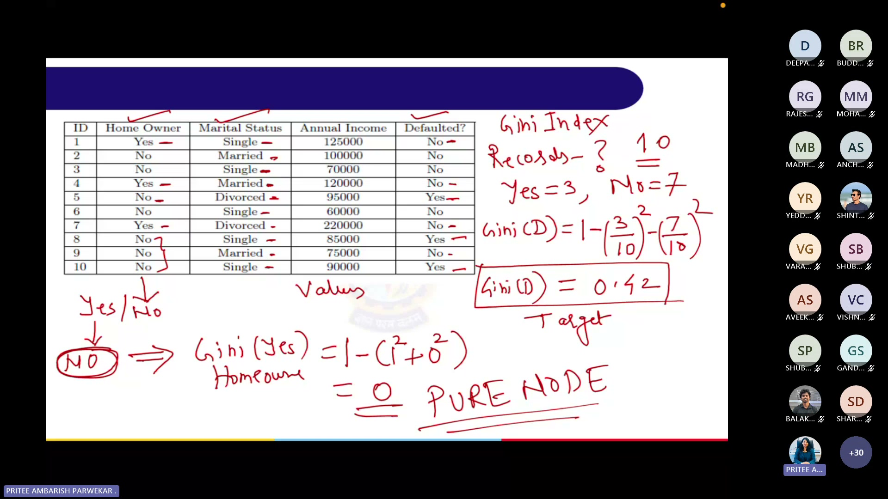

# Module 5: Decision Trees & Information Theory

**Course**: AIML ZG565 — Machine Learning  
**Prescribed References**: Tom M. Mitchell (T1, Chapter 3); Tan et al. (R2, Chapter 3)  
**Primary Teacher Followed**: Prof. Pritee Narendra Raole (Session 6: 2026-08-30)

---

## 1. Executive Summary & Foundational Definitions

A Decision Tree is a non-parametric supervised learning algorithm that performs hierarchical recursive partitioning of the feature space into axis-aligned hyper-rectangles. Each internal node represents an orthogonal decision predicate on an attribute, each branch corresponds to an outcome of that test, and each leaf node assigns a terminal class label (in classification) or a real-valued mean prediction (in regression).

Decision trees possess unique pedagogical and industrial advantages:
1. **White-Box Interpretability**: Decision paths translate directly into human-readable logical rules in Disjunctive Normal Form (DNF): $\text{IF } (x_1 > \theta_1) \land (x_2 \le \theta_2) \implies \text{Class } C$.
2. **Invariance to Monotonic Transformations**: Because splitting evaluates ranking order rather than numerical distances, scale normalization (MinMax or Z-Score) is unnecessary.
3. **Implicit Feature Selection**: Irrelevant features are ignored by information-theoretic split criteria.

```
                     ┌──────────────────┐
                     │ Feature X₁ ≤ θ₁? │ (Root Node)
                     └────────┬─────────┘
                   Yes        │        No
            ┌─────────────────┴─────────────────┐
            ▼                                   ▼
   ┌──────────────────┐                ┌──────────────────┐
   │ Feature X₂ ≤ θ₂? │                │ Leaf: Class C₂   │
   └────────┬─────────┘                └──────────────────┘
      Yes   │   No
   ┌────────┴────────┐
   ▼                 ▼
┌──────────────┐  ┌──────────────┐
│ Leaf: Cls C₁ │  │ Leaf: Cls C₃ │
└──────────────┘  └──────────────┘
```

---

## 2. Theoretical Motivation & Information-Theoretic Criteria


*Figure 5.1: Gini Index CART calculation on defaulted loan dataset — Gini(D)=0.42, pure node derivation (Oct 04 session).*

### 2.1 Shannon Entropy
Entropy quantifies the average uncertainty, impurity, or information content contained within a sample set $S$. For a discrete random variable with $C$ classes and empirical class proportions $p_i = \frac{|S_i|}{|S|}$:

$$H(S) = - \sum_{i=1}^C p_i \log_2 p_i$$

*(By convention, if $p_i = 0$, $0 \log_2 0 \equiv 0$.)*

- For a binary classification task ($C = 2$):
  - If all samples belong to one class ($p_1 = 1, p_2 = 0$): $H(S) = -1 \log_2 1 - 0 = \mathbf{0}$ (Pure state, zero uncertainty).
  - If samples are evenly split ($p_1 = 0.5, p_2 = 0.5$): $H(S) = -0.5 \log_2 0.5 - 0.5 \log_2 0.5 = \mathbf{1.0}$ (Maximum impurity).

```
Entropy Curve for Binary Classification:
H(p)
1.0 ┤         ╭───────╮
    │       ╭─╯       ╰─╮
0.5 ┤      ╭╯           ╰╮
    │     ╭╯             ╰╮
0.0 ┼─────┴───────────────┴───── p
   0.0           0.5           1.0
```

---

### 2.2 Gini Impurity (CART)
Used in Breiman's Classification and Regression Trees (CART), Gini Impurity measures the probability of misclassifying a randomly chosen element from the set if it were randomly labeled according to the empirical class distribution:

$$I_G(S) = 1 - \sum_{i=1}^C p_i^2$$

- For binary classification: $I_G(S) = 1 - (p^2 + (1-p)^2) = 2p(1-p)$.
- Maximum value for binary split: $I_G(0.5) = 2(0.5)(0.5) = \mathbf{0.50}$.
- **Computational Benefit**: Avoids evaluating computationally expensive $\log_2$ operations during large-scale node evaluations.

---

### 2.3 Information Gain (ID3 Algorithm)
Information Gain measures the expected reduction in entropy achieved by partitioning dataset $S$ according to candidate attribute $A$:

$$\text{Gain}(S, A) = H(S) - \sum_{v \in \text{Values}(A)} \frac{|S_v|}{|S|} H(S_v)$$

Where:
- $\text{Values}(A)$ is the set of all possible distinct categorical values of attribute $A$.
- $S_v$ is the subset of $S$ where attribute $A$ takes value $v$.

The ID3 algorithm greedily selects the attribute maximizing Information Gain at each node:
$$A^* = \arg\max_{A} \text{Gain}(S, A)$$

---

### 2.4 Gain Ratio (C4.5 Algorithm)

#### The Pathological Flaw of Information Gain:
Information Gain exhibits an extreme mathematical bias towards attributes with large numbers of distinct values. For example, if a unique identifier feature `Customer_ID` is included, partitioning on `Customer_ID` creates $|S|$ singleton subsets, each containing exactly 1 instance ($H(S_v) = 0$). The Information Gain evaluates to the maximum possible value $\text{Gain}(S, \text{ID}) = H(S)$, yet the resulting tree has zero generalization ability!

Ross Quinlan (1993) introduced **Gain Ratio** in C4.5 to penalize high-cardinality attributes by normalizing Information Gain with **Split Information**:

$$\text{SplitInfo}(S, A) = - \sum_{v \in \text{Values}(A)} \frac{|S_v|}{|S|} \log_2 \left( \frac{|S_v|}{|S|} \right)$$

$$\text{GainRatio}(S, A) = \frac{\text{Gain}(S, A)}{\text{SplitInfo}(S, A)}$$

---

## 3. Advanced Algorithmic Mechanics

### 3.1 Handling Continuous-Valued Attributes
To split a continuous numerical attribute $A$ (e.g., Temperature, Income):
1. Sort all unique values observed in dataset $S$ in ascending order: $\{a_1, a_2, \dots, a_m\}$.
2. Identify candidate split thresholds $c_j$ as midpoints between adjacent distinct values where the target label changes:
   $$c_j = \frac{a_j + a_{j+1}}{2}$$
3. Evaluate binary split predicate $A \le c_j$ vs. $A > c_j$ for all candidate thresholds and select the threshold $c^*$ maximizing Information Gain.

---

### 3.2 Handling Missing Values
In C4.5:
- **During Split Evaluation**: Assign fractional weights to instances with missing values proportional to the observed frequency of each branch.
- **During Classification**: Pass the query instance down all branches where attribute is missing, and aggregate leaf predictions weighted by branch probabilities.

---

### 3.3 Overfitting Avoidance & Pruning Strategies

Decision trees grown to 100% purity inevitably overfit, modeling noise and idiosyncrasies. Two complementary regularization mechanisms exist:

```
                          ┌───────────────────────────┐
                          │   Pruning Paradigms       │
                          └─────────────┬─────────────┘
                                        │
             ┌──────────────────────────┴──────────────────────────┐
             ▼                                                     ▼
┌───────────────────────────┐                         ┌───────────────────────────┐
│ Pre-Pruning (Early Stop)  │                         │ Post-Pruning (Cost-Comp)  │
│ - Max Depth               │                         │ - Grow full tree T₀       │
│ - Min Samples per Split   │                         │ - Minimize Cost-Complexity│
│ - Min Impurity Decrease   │                         │   R_α(T) = R(T) + α |T|   │
└───────────────────────────┘                         └───────────────────────────┘
```

1. **Pre-Pruning (Early Stopping)**: Halt tree growth prematurely if maximum depth is reached, sample size falls below threshold, or impurity reduction is statistically insignificant.
2. **Post-Pruning (Reduced Error Pruning / Cost-Complexity Pruning)**:
   - Grow full tree $T_0$ to zero training error.
   - Define cost-complexity objective:
     $$\mathcal{R}_\alpha(T) = \mathcal{R}(T) + \alpha |T|$$
     where $\mathcal{R}(T)$ is misclassification error, $|T|$ is the number of terminal leaf nodes, and $\alpha \ge 0$ is the regularization parameter governing tree complexity penalty.

---

### 3.4 Minimum Description Length (MDL) Principle

The MDL principle formalizes Occam's razor: **The best model is that which produces the shortest overall transmission code length of the model plus the data given the model.**

$$\text{Description Length} = L(h) + L(\mathcal{D} \mid h)$$

- $L(h)$: Number of bits required to encode tree structure $h$ (nodes, splits, leaf labels).
- $L(\mathcal{D} \mid h)$: Number of bits required to encode training errors and residuals given tree $h$.

A complex overfitted tree has small $L(\mathcal{D} \mid h)$ but massive $L(h)$. An underfitted single-node tree has minimal $L(h)$ but large $L(\mathcal{D} \mid h)$. The optimal tree minimizes their sum.

---

## 4. Vectorized Implementation (From Scratch)

```python
import numpy as np

class TreeNode:
    def __init__(self, feature=None, threshold=None, left=None, right=None, *, value=None):
        self.feature = feature          # Index of split feature
        self.threshold = threshold      # Threshold value for split
        self.left = left                # Left child subtree
        self.right = right              # Right child subtree
        self.value = value              # Terminal class if leaf node

    @property
    def is_leaf(self) -> bool:
        return self.value is not None


class DecisionTreeCART:
    """Vectorized Classification Tree using Gini Impurity."""
    def __init__(self, max_depth: int = 5, min_samples_split: int = 2):
        self.max_depth = max_depth
        self.min_samples_split = min_samples_split
        self.root = None

    def _gini(self, y: np.ndarray) -> float:
        if len(y) == 0:
            return 0.0
        p = np.bincount(y) / len(y)
        return 1.0 - np.sum(p ** 2)

    def _best_split(self, X: np.ndarray, y: np.ndarray):
        best_gain = -1.0
        split_feat, split_thresh = None, None
        current_gini = self._gini(y)
        n_samples, n_features = X.shape

        for feat in range(n_features):
            thresholds = np.unique(X[:, feat])
            for thresh in thresholds:
                left_mask = X[:, feat] <= thresh
                right_mask = ~left_mask

                if np.sum(left_mask) == 0 or np.sum(right_mask) == 0:
                    continue

                n_l, n_r = np.sum(left_mask), np.sum(right_mask)
                gini_split = (n_l / n_samples) * self._gini(y[left_mask]) + \
                             (n_r / n_samples) * self._gini(y[right_mask])

                gain = current_gini - gini_split
                if gain > best_gain:
                    best_gain = gain
                    split_feat = feat
                    split_thresh = thresh

        return split_feat, split_thresh

    def _build_tree(self, X: np.ndarray, y: np.ndarray, depth: int = 0):
        n_samples, n_features = X.shape
        n_labels = len(np.unique(y))

        # Stopping criteria: max depth reached, single class, or sample limit
        if depth >= self.max_depth or n_labels == 1 or n_samples < self.min_samples_split:
            leaf_value = np.bincount(y).argmax()
            return TreeNode(value=leaf_value)

        feat, thresh = self._best_split(X, y)
        if feat is None:
            return TreeNode(value=np.bincount(y).argmax())

        left_mask = X[:, feat] <= thresh
        right_mask = ~left_mask

        left_child = self._build_tree(X[left_mask], y[left_mask], depth + 1)
        right_child = self._build_tree(X[right_mask], y[right_mask], depth + 1)
        return TreeNode(feature=feat, threshold=thresh, left=left_child, right=right_child)

    def fit(self, X: np.ndarray, y: np.ndarray):
        self.root = self._build_tree(X, y)
        return self

    def _predict_sample(self, node: TreeNode, x: np.ndarray) -> int:
        if node.is_leaf:
            return node.value
        if x[node.feature] <= node.threshold:
            return self._predict_sample(node.left, x)
        return self._predict_sample(node.right, x)

    def predict(self, X: np.ndarray) -> np.ndarray:
        return np.array([self._predict_sample(self.root, x) for x in X])


if __name__ == "__main__":
    np.random.seed(42)
    # Synthetic XOR non-linear classification dataset
    X = np.random.randn(200, 2)
    y = np.logical_xor(X[:, 0] > 0, X[:, 1] > 0).astype(int)

    tree = DecisionTreeCART(max_depth=4)
    tree.fit(X, y)
    preds = tree.predict(X)
    print(f"CART Tree Training Accuracy on XOR: {np.mean(preds == y)*100:.1f}%")
```

---

## 5. Solved Numerical Example (Exam Pattern)

**Problem Statement (University Examination Pattern, 6 Marks)**:  
Given the following dataset of 10 bank loan applicants with target label **Default** ($y \in \{\text{Yes}, \text{No}\}$):

| ID | Credit Score ($A_1$) | Income Level ($A_2$) | Collateral ($A_3$) | Default ($y$) |
| :---: | :---: | :---: | :---: | :---: |
| 1 | High | High | None | No |
| 2 | High | Medium | None | No |
| 3 | Medium | High | None | No |
| 4 | Low | Low | None | Yes |
| 5 | Low | Medium | Adequate | No |
| 6 | Low | Low | None | Yes |
| 7 | Medium | Low | None | Yes |
| 8 | High | Low | None | No |
| 9 | Medium | Medium | None | No |
| 10 | Low | Medium | None | Yes |

1. Calculate the base entropy $H(S)$ of the target variable **Default**.
2. Calculate the Information Gain $\text{Gain}(S, \text{Collateral})$ for attribute $A_3$.
3. Calculate the Information Gain $\text{Gain}(S, \text{Credit Score})$ for attribute $A_1$.
4. Determine which attribute is selected as the primary root split.

---

### Step-by-Step Solution:

#### Step 1: Base Entropy $H(S)$
Total instances $N = 10$.
- Default = Yes: 4 instances (IDs: 4, 6, 7, 10) $\implies p_{\text{yes}} = \frac{4}{10} = 0.40$.
- Default = No: 6 instances (IDs: 1, 2, 3, 5, 8, 9) $\implies p_{\text{no}} = \frac{6}{10} = 0.60$.

$$H(S) = - [p_{\text{yes}} \log_2(p_{\text{yes}}) + p_{\text{no}} \log_2(p_{\text{no}})]$$
$$H(S) = - [0.40 \log_2(0.40) + 0.60 \log_2(0.60)]$$
$$H(S) = - [0.40(-1.3219) + 0.60(-0.7370)] = - [-0.5288 - 0.4422] = \mathbf{0.9710 \text{ bits}}$$

---

#### Step 2: Information Gain for $A_3$ (Collateral)
Attribute $A_3$ has 2 values:
- `Adequate`: 1 instance (ID 5, Default = No).
  - Subset $S_{\text{Adequate}}$: 0 Yes, 1 No $\implies p_{\text{yes}} = 0, p_{\text{no}} = 1$.
  - $H(S_{\text{Adequate}}) = \mathbf{0.00}$.
- `None`: 9 instances (IDs 1, 2, 3, 4, 6, 7, 8, 9, 10).
  - 4 Yes, 5 No $\implies p_{\text{yes}} = \frac{4}{9} \approx 0.4444, p_{\text{no}} = \frac{5}{9} \approx 0.5556$.
  - $H(S_{\text{None}}) = - [0.4444 \log_2(0.4444) + 0.5556 \log_2(0.5556)]$
  - $H(S_{\text{None}}) = - [0.4444(-1.1699) + 0.5556(-0.8480)] = - [-0.5200 - 0.4711] = \mathbf{0.9911 \text{ bits}}$.

Conditional Entropy:
$$H(S \mid \text{Collateral}) = \frac{1}{10} H(S_{\text{Adequate}}) + \frac{9}{10} H(S_{\text{None}}) = \frac{1}{10}(0) + 0.9(0.9911) = \mathbf{0.8920 \text{ bits}}$$

Information Gain:
$$\text{Gain}(S, \text{Collateral}) = H(S) - H(S \mid \text{Collateral}) = 0.9710 - 0.8920 = \mathbf{0.0790 \text{ bits}}$$

---

#### Step 3: Information Gain for $A_1$ (Credit Score)
Attribute $A_1$ takes 3 values:
1. `High`: 3 instances (IDs 1, 2, 8).
   - All 3 Default = No (0 Yes, 3 No) $\implies$ Pure set.
   - $H(S_{\text{High}}) = \mathbf{0.00}$.
2. `Medium`: 3 instances (IDs 3, 7, 9).
   - 1 Yes (ID 7), 2 No (IDs 3, 9).
   - $p_{\text{yes}} = \frac{1}{3}, p_{\text{no}} = \frac{2}{3}$.
   - $H(S_{\text{Medium}}) = - [\frac{1}{3} \log_2(\frac{1}{3}) + \frac{2}{3} \log_2(\frac{2}{3})] = - [\frac{1}{3}(-1.585) + \frac{2}{3}(-0.585)] = 0.5283 + 0.3900 = \mathbf{0.9183 \text{ bits}}$.
3. `Low`: 4 instances (IDs 4, 5, 6, 10).
   - 3 Yes (IDs 4, 6, 10), 1 No (ID 5).
   - $p_{\text{yes}} = \frac{3}{4} = 0.75, p_{\text{no}} = \frac{1}{4} = 0.25$.
   - $H(S_{\text{Low}}) = - [0.75 \log_2(0.75) + 0.25 \log_2(0.25)] = - [0.75(-0.415) + 0.25(-2.0)] = 0.3113 + 0.5000 = \mathbf{0.8113 \text{ bits}}$.

Conditional Entropy:
$$H(S \mid \text{Credit Score}) = \frac{3}{10}(0.00) + \frac{3}{10}(0.9183) + \frac{4}{10}(0.8113)$$
$$H(S \mid \text{Credit Score}) = 0 + 0.2755 + 0.3245 = \mathbf{0.6000 \text{ bits}}$$

Information Gain:
$$\text{Gain}(S, \text{Credit Score}) = 0.9710 - 0.6000 = \mathbf{0.3710 \text{ bits}}$$

---

#### Step 4: Comparison & Root Selection
$$\text{Gain}(S, \text{Credit Score}) = \mathbf{0.3710} > \text{Gain}(S, \text{Collateral}) = \mathbf{0.0790}$$

**Conclusion**: **Credit Score ($A_1$)** is selected as the primary root splitting attribute because it achieves the highest reduction in systemic entropy.

---

## 6. Common Pitfalls, Trade-offs & Practical Guidelines

1. **Greedy Horizon Effect**:
   - Because standard decision tree algorithms (ID3, C4.5, CART) evaluate splits greedily one level at a time, they cannot look ahead to evaluate combinatorial interactions (e.g., XOR parity problems).
2. **Axis-Aligned Rigidity**:
   - Decision boundaries are constrained to orthogonal axis-aligned steps ($\mathbf{x}_j \le \theta$). For diagonal decision boundaries ($x_1 + x_2 \ge 1$), a single oblique hyperplane requires an expansive staircase of hundreds of axis-aligned splits, producing severe variance.
   - *Fix*: Apply PCA rotation before tree construction, or use Linear Discriminant Trees.
3. **High Variance & Instability**:
   - A minute perturbation in a single training sample can cause a completely different root attribute to be selected, radically altering all descendant subtrees.
   - *Fix*: Ensemble aggregation via Random Forests or Gradient Boosting (Module 9).

