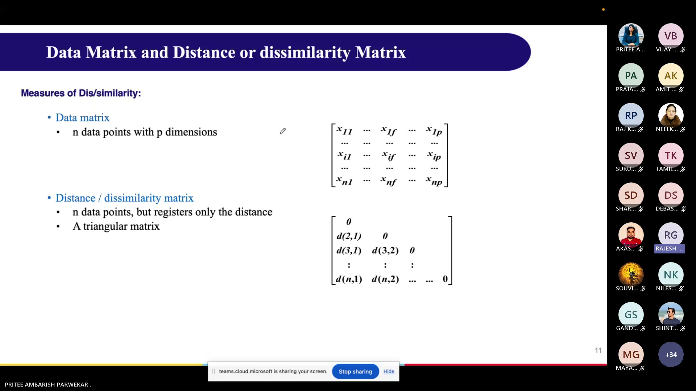

# Module 6: Instance-Based Learning

**Course**: AIML ZG565 — Machine Learning  
**Prescribed References**: Tom M. Mitchell (T1, Chapter 8); Tan et al. (R2, Chapter 4)  
**Primary Teacher Followed**: Prof. Pritee Narendra Raole (Session 7: 2026-09-06)

---

## 1. Executive Summary & Foundational Definitions

Instance-Based Learning (also termed **Memory-Based Learning** or **Lazy Learning**) represents a distinct philosophical and computational paradigm within machine learning. While **Eager Learning** algorithms (such as Linear Regression, Logistic Regression, Neural Networks, and Decision Trees) process training data upfront to abstract an explicit, compact parametric hypothesis $f(\mathbf{x}; \boldsymbol{\theta})$ and discard the training set prior to inference, Lazy Learners store training instances directly in memory.

When presented with a novel query instance $\mathbf{x}_q$, an instance-based model retrieves a local neighborhood of historically observed instances topologically proximate to $\mathbf{x}_q$ and synthesizes a local prediction.

```
Eager Learning Paradigm:
Training Set D ───[ Global Optimization ]───> Compact Model θ (Data D Discarded)
                                                        │
Query Point x_q ────────────────────────────────────────┴───> Prediction ŷ (Fast O(1) Inference)

Lazy Learning Paradigm:
Training Set D ───[ Memory Ingestion ]──────> Stored In-Memory Dataset D
                                                        │
Query Point x_q ───[ Distance Metric d(x_q, xᵢ) ]───────┴───> Local Approximation around x_q (Slow O(Nd))
```

### 1.1 Comparative Architectural Trade-offs: Eager vs. Lazy

| Dimension | Eager Learners (Linear, Trees, Nets) | Lazy Learners ($k$-NN, LWR, CBR) |
| :--- | :--- | :--- |
| **Training Complexity** | High ($\mathcal{O}(N d^2)$ to $\mathcal{O}(N d \cdot \text{epochs})$) | Zero ($\mathcal{O}(1)$ memory storage) |
| **Inference Latency** | Instantaneous ($\mathcal{O}(d)$ dot product or tree traversal) | Costly ($\mathcal{O}(N d)$ pairwise distance calculations) |
| **Memory Footprint** | Minimal (Stores only parameter vector $\mathbf{w}$ or tree graph) | Substantial (Must maintain complete dataset $\mathcal{D}$ in RAM) |
| **Hypothesis Topology** | Constrained global functional form (planar, axis-aligned) | Arbitrarily complex, piece-wise non-linear local decision surfaces |
| **Adaptability** | Must retrain or fine-tune when new data points arrive | Dynamically incorporates new observations instantaneously |

---

## 2. The $k$-Nearest Neighbors ($k$-NN) Algorithm


*Figure 6.1: Data Matrix (n×p) vs Dissimilarity Matrix (triangular) — foundation of instance-based learning distance metrics (Oct 11 session).*

### 2.1 Formal Formulation
Given training dataset $\mathcal{D} = \{(\mathbf{x}_i, y_i)\}_{i=1}^N \subset \mathbb{R}^d \times \mathcal{Y}$ and a distance metric $d: \mathbb{R}^d \times \mathbb{R}^d \to \mathbb{R}_{\ge 0}$:
1. For query point $\mathbf{x}_q$, compute pairwise distances to all training points: $\{d(\mathbf{x}_q, \mathbf{x}_i)\}_{i=1}^N$.
2. Sort distances in ascending order and select the $k$ closest observations: $\mathcal{N}_k(\mathbf{x}_q) = \{\mathbf{x}_{(1)}, \mathbf{x}_{(2)}, \dots, \mathbf{x}_{(k)}\}$.
3. **Classification Decision Rule (Majority Voting)**:
   $$\hat{y}(\mathbf{x}_q) = \arg\max_{c \in \mathcal{Y}} \sum_{i \in \mathcal{N}_k(\mathbf{x}_q)} \mathbb{I}(y_i = c)$$
4. **Regression Decision Rule (Local Mean)**:
   $$\hat{y}(\mathbf{x}_q) = \frac{1}{k} \sum_{i \in \mathcal{N}_k(\mathbf{x}_q)} y_i$$

---

### 2.2 Mathematical Distance Metrics

The predictive behavior of instance-based models is entirely dictated by the choice of metric space $(\mathcal{X}, d)$:

1. **Euclidean Distance ($L_2$ Norm)**:
   $$d_2(\mathbf{x}, \mathbf{z}) = \|\mathbf{x} - \mathbf{z}\|_2 = \sqrt{\sum_{j=1}^d (x_j - z_j)^2}$$
2. **Manhattan Distance ($L_1$ Norm / Taxicab Metric)**:
   $$d_1(\mathbf{x}, \mathbf{z}) = \|\mathbf{x} - \mathbf{z}\|_1 = \sum_{j=1}^d |x_j - z_j|$$
3. **Minkowski Distance ($L_p$ Metric Generalization)**:
   $$d_p(\mathbf{x}, \mathbf{z}) = \left( \sum_{j=1}^d |x_j - z_j|^p \right)^{\frac{1}{p}}$$
   *(Reduces to Manhattan for $p=1$, Euclidean for $p=2$, and Chebyshev $L_\infty = \max |x_j - z_j|$ as $p \to \infty$.)*
4. **Mahalanobis Distance (Covariance-Aware Metric)**:
   $$d_M(\mathbf{x}, \mathbf{z}) = \sqrt{(\mathbf{x} - \mathbf{z})^T \mathbf{\Sigma}^{-1} (\mathbf{x} - \mathbf{z})}$$
   Where $\mathbf{\Sigma} \in \mathbb{R}^{d \times d}$ is the empirical covariance matrix. Unlike Euclidean distance which assumes spherical clusters, Mahalanobis distance warps coordinate space along hyper-ellipsoidal axes, accounting for feature correlations and unequal feature variances.
5. **Gower's Distance for Heterogeneous (Mixed) Tabular Data**:
   $$S_G(\mathbf{x}_i, \mathbf{x}_j) = \frac{\sum_{k=1}^d w_k s_{ijk}}{\sum_{k=1}^d w_k \delta_{ijk}}$$
   Where $s_{ijk}$ computes distance based on attribute type:
   - Numerical: $s_{ijk} = 1 - \frac{|x_{ik} - x_{jk}|}{R_k}$ (where $R_k = \max_k - \min_k$).
   - Categorical / Nominal: $s_{ijk} = 1$ if $x_{ik} = x_{jk}$, else $0$.

---

### 2.3 Theoretical Performance Bound: Cover and Hart Theorem (1967)

One of the foundational theorems of non-parametric pattern recognition governs the asymptotic asymptotic performance of the simple 1-Nearest Neighbor classifier:

> **Cover & Hart Theorem**: Let $R^*$ denote the optimal Bayes risk (the irreducible minimum theoretical error achievable by any classifier knowing the true posterior distributions). In the infinite data limit ($N \to \infty$), the asymptotic probability of error of the 1-NN rule $R_{1-\text{NN}}$ is tightly bounded by:
> 
> $$R^* \le R_{1-\text{NN}} \le 2 R^* (1 - R^*) \le 2 R^*$$

**Profound Theoretical Implication**: No matter how complex or non-linear the underlying probability distributions are, the simplest 1-NN classifier with enough data is guaranteed to have an error rate **at most twice the Bayes optimal error**!

---

### 2.4 Distance-Weighted $k$-NN (Shepard's Method)

In standard $k$-NN, a neighbor lying at distance $d = 0.001$ has identical voting power as a neighbor at distance $d = 10.0$. Distance-weighted $k$-NN weights each neighbor's contribution inversely proportional to its distance:

$$w_i = \frac{1}{d(\mathbf{x}_q, \mathbf{x}_i)^2 + \epsilon}$$

$$\hat{y}(\mathbf{x}_q) = \arg\max_{c \in \mathcal{Y}} \sum_{i \in \mathcal{N}_k(\mathbf{x}_q)} w_i \mathbb{I}(y_i = c)$$

---

### 2.5 Locally Weighted Regression (LWR)

Locally Weighted Regression fits a separate linear model $y = \mathbf{w}^T \mathbf{x}$ dynamically for each query point $\mathbf{x}_q$ by minimizing a locally weighted squared error objective:

$$\mathcal{L}_{\mathbf{x}_q}(\mathbf{w}) = \sum_{i=1}^N K(\mathbf{x}_i, \mathbf{x}_q) (y_i - \mathbf{w}^T \mathbf{x}_i)^2$$

Where $K(\mathbf{x}_i, \mathbf{x}_q)$ is typically the Gaussian bell kernel:
$$K(\mathbf{x}_i, \mathbf{x}_q) = \exp \left( - \frac{\|\mathbf{x}_i - \mathbf{x}_q\|_2^2}{2 \tau^2} \right)$$
Here, $\tau > 0$ is the **bandwidth hyperparameter** controlling the effective width of the local neighborhood.

The optimal closed-form parameter vector $\mathbf{w}(\mathbf{x}_q)$ is:
$$\mathbf{w}^*(\mathbf{x}_q) = (\mathbf{X}^T \mathbf{W}_{\mathbf{x}_q} \mathbf{X})^{-1} \mathbf{X}^T \mathbf{W}_{\mathbf{x}_q} \mathbf{y}$$
where $\mathbf{W}_{\mathbf{x}_q} \in \mathbb{R}^{N \times N}$ is the diagonal weight matrix: $W_{ii} = K(\mathbf{x}_i, \mathbf{x}_q)$.

---

### 2.6 The Curse of Dimensionality

As feature dimension $d \to \infty$, geometric properties in $\mathbb{R}^d$ become severely counter-intuitive:
1. **Exponential Sparsity**: To maintain fixed sample density, required sample size scales exponentially: $N \propto \mathcal{O}(C^d)$.
2. **Empty Space Phenomenon**: Consider a hypersphere of radius $r$ inscribed within a hypercube of side length $2r$.  
   $$\frac{\text{Volume of Hypersphere}}{\text{Volume of Hypercube}} = \frac{\frac{\pi^{d/2}}{\Gamma(d/2 + 1)} r^d}{(2r)^d} \xrightarrow{d \to \infty} 0$$
   Virtually 100% of the volume of high-dimensional hypercubes is concentrated in the corners!
3. **Distance Concentration**: As $d \to \infty$, the distance to the nearest neighbor converges to the distance to the furthest neighbor:
   $$\lim_{d \to \infty} \frac{d_{\max} - d_{\min}}{d_{\min}} \to 0$$
   Every point becomes equidistant from every other point, rendering distance-based neighborhood comparisons meaningless.

---

## 3. Vectorized Implementation (From Scratch)

```python
import numpy as np

class VectorizedKNN:
    """Vectorized k-Nearest Neighbors classifier supporting L1, L2, and distance-weighting."""
    def __init__(self, k: int = 3, metric: str = 'euclidean', weighted: bool = False):
        self.k = k
        self.metric = metric.lower()
        self.weighted = weighted
        self.X_train = None
        self.y_train = None

    def fit(self, X: np.ndarray, y: np.ndarray):
        self.X_train = X
        self.y_train = y
        return self

    def _compute_pairwise_distances(self, X_query: np.ndarray) -> np.ndarray:
        """
        Computes pairwise distance matrix between query points (M, d) and train (N, d).
        Output shape: (M, N)
        """
        if self.metric == 'euclidean':
            # Fast vectorized L2 distance using matrix expansion: ||u - v||^2 = ||u||^2 + ||v||^2 - 2 u^T v
            q_sq = np.sum(X_query ** 2, axis=1, keepdims=True)
            t_sq = np.sum(self.X_train ** 2, axis=1, keepdims=True).T
            dot = X_query @ self.X_train.T
            dist_sq = np.maximum(q_sq + t_sq - 2 * dot, 0.0)
            return np.sqrt(dist_sq)

        elif self.metric == 'manhattan':
            # L1 distance: |u - v|
            return np.sum(np.abs(X_query[:, np.newaxis, :] - self.X_train[np.newaxis, :, :]), axis=-1)

        else:
            raise ValueError(f"Unsupported metric: {self.metric}")

    def predict(self, X_query: np.ndarray) -> np.ndarray:
        dists = self._compute_pairwise_distances(X_query)
        # Partition indices to obtain top k smallest distances
        k_indices = np.argsort(dists, axis=1)[:, :self.k]

        predictions = []
        for row_idx, neighbors in enumerate(k_indices):
            neighbor_labels = self.y_train[neighbors]
            neighbor_dists = dists[row_idx, neighbors]

            if not self.weighted:
                # Majority vote
                pred_label = np.bincount(neighbor_labels).argmax()
            else:
                # Weighted vote: 1 / (d^2 + eps)
                weights = 1.0 / (neighbor_dists ** 2 + 1e-10)
                classes = np.unique(self.y_train)
                weighted_scores = [np.sum(weights[neighbor_labels == c]) for c in classes]
                pred_label = classes[np.argmax(weighted_scores)]

            predictions.append(pred_label)

        return np.array(predictions)


if __name__ == "__main__":
    np.random.seed(42)
    # Synthetic 2D classification
    X_train = np.random.randn(150, 2)
    y_train = (X_train[:, 0] * X_train[:, 1] > 0).astype(int)

    X_test = np.random.randn(50, 2)
    y_test = (X_test[:, 0] * X_test[:, 1] > 0).astype(int)

    knn = VectorizedKNN(k=5, metric='euclidean', weighted=True)
    knn.fit(X_train, y_train)
    y_pred = knn.predict(X_test)
    print(f"k-NN Test Accuracy: {np.mean(y_pred == y_test)*100:.1f}%")
```

---

## 4. Solved Numerical Example (Exam Pattern)

**Problem Statement (University Examination Pattern, 6 Marks)**:  
Given the following training dataset of 6 points with two real-valued features and a binary class label:

| Instance ($i$) | Feature $x_1$ | Feature $x_2$ | Class Label ($y$) |
| :---: | :---: | :---: | :---: |
| 1 | 2.0 | 3.0 | 0 |
| 2 | 3.0 | 4.0 | 0 |
| 3 | 4.0 | 5.0 | 0 |
| 4 | 6.0 | 6.0 | 1 |
| 5 | 7.0 | 8.0 | 1 |
| 6 | 8.0 | 7.0 | 1 |

A new query point arrives: $\mathbf{x}_q = [5.0, 5.0]^T$.
1. Compute the Euclidean distance $d_2(\mathbf{x}_q, \mathbf{x}_i)$ from $\mathbf{x}_q$ to all 6 training points.
2. Compute the Manhattan distance $d_1(\mathbf{x}_q, \mathbf{x}_i)$ to all 6 points.
3. Predict the class for $\mathbf{x}_q$ using:
   - 1-NN (Euclidean)
   - 3-NN (Euclidean, unweighted majority vote)
   - 3-NN (Euclidean, distance-weighted with $w_i = \frac{1}{d_i^2}$)

---

### Step-by-Step Solution:

#### Step 1: Compute Euclidean Distances
For $\mathbf{x}_q = [5, 5]$:
- Point 1: $[2, 3] \implies d_2 = \sqrt{(5-2)^2 + (5-3)^2} = \sqrt{9 + 4} = \sqrt{13} \approx \mathbf{3.606}$
- Point 2: $[3, 4] \implies d_2 = \sqrt{(5-3)^2 + (5-4)^2} = \sqrt{4 + 1} = \sqrt{5} \approx \mathbf{2.236}$
- Point 3: $[4, 5] \implies d_2 = \sqrt{(5-4)^2 + (5-5)^2} = \sqrt{1 + 0} = \sqrt{1} = \mathbf{1.000}$
- Point 4: $[6, 6] \implies d_2 = \sqrt{(5-6)^2 + (5-6)^2} = \sqrt{1 + 1} = \sqrt{2} \approx \mathbf{1.414}$
- Point 5: $[7, 8] \implies d_2 = \sqrt{(5-7)^2 + (5-8)^2} = \sqrt{4 + 9} = \sqrt{13} \approx \mathbf{3.606}$
- Point 6: $[8, 7] \implies d_2 = \sqrt{(5-8)^2 + (5-7)^2} = \sqrt{9 + 4} = \sqrt{13} \approx \mathbf{3.606}$

---

#### Step 2: Compute Manhattan Distances
- Point 1: $|5-2| + |5-3| = 3 + 2 = \mathbf{5.0}$
- Point 2: $|5-3| + |5-4| = 2 + 1 = \mathbf{3.0}$
- Point 3: $|5-4| + |5-5| = 1 + 0 = \mathbf{1.0}$
- Point 4: $|5-6| + |5-6| = 1 + 1 = \mathbf{2.0}$
- Point 5: $|5-7| + |5-8| = 2 + 3 = \mathbf{5.0}$
- Point 6: $|5-8| + |5-7| = 3 + 2 = \mathbf{5.0}$

---

#### Step 3: Classification Predictions
Ranking all instances by Euclidean distance:
1. **Rank 1**: Point 3 ($d_2 = 1.000$), Label = **0**
2. **Rank 2**: Point 4 ($d_2 = 1.414$), Label = **1**
3. **Rank 3**: Point 2 ($d_2 = 2.236$), Label = **0**
4. Rank 4, 5, 6: Points 1, 5, 6 ($d_2 = 3.606$)

- **1-NN Prediction**:
  Nearest point is Point 3 ($d_2 = 1.000$) with label 0 $\implies \hat{y} = \mathbf{0}$.
- **3-NN Unweighted Majority Vote**:
  Top 3 neighbors are Points 3, 4, and 2.
  - Votes for Class 0: Points 3 and 2 $\implies$ **2 votes**.
  - Votes for Class 1: Point 4 $\implies$ **1 vote**.
  - Winner: $\hat{y} = \mathbf{0}$.
- **3-NN Distance-Weighted Vote ($w_i = \frac{1}{d_i^2}$)**:
  - Weight for Point 3 ($y=0$): $w_3 = \frac{1}{1.0^2} = \mathbf{1.000}$
  - Weight for Point 4 ($y=1$): $w_4 = \frac{1}{(\sqrt{2})^2} = \frac{1}{2} = \mathbf{0.500}$
  - Weight for Point 2 ($y=0$): $w_2 = \frac{1}{(\sqrt{5})^2} = \frac{1}{5} = \mathbf{0.200}$

  Aggregating class scores:
  - Total score for Class 0: $w_3 + w_2 = 1.000 + 0.200 = \mathbf{1.200}$
  - Total score for Class 1: $w_4 = \mathbf{0.500}$
  - Since $1.200 > 0.500$, the predicted class is $\hat{y} = \mathbf{0}$.

---

## 5. Common Pitfalls, Trade-offs & Practical Guidelines

1. **Failure to Standardize Features**:
   - If feature 1 is Salary in Rupees $[10^5, 10^7]$ and feature 2 is Age in Years $[18, 65]$, Euclidean distance is 99.999% dominated by Salary. Always apply Z-score standardization before passing features into $k$-NN.
2. **Odd vs. Even Choice of $k$**:
   - For binary classification, always set $k$ to an **odd integer** ($k = 3, 5, 7, \dots$) to prevent 50-50 voting ties.
3. **Inference Acceleration via Spatial Indexing Trees**:
   - For large $N$, brute-force $\mathcal{O}(Nd)$ distance scans become unacceptably slow. Use **$k$-d Trees** (for $d \le 20$) or **Ball Trees** / Approximate Nearest Neighbors (**HNSW**, **FAISS**) for high-dimensional embedding search.

