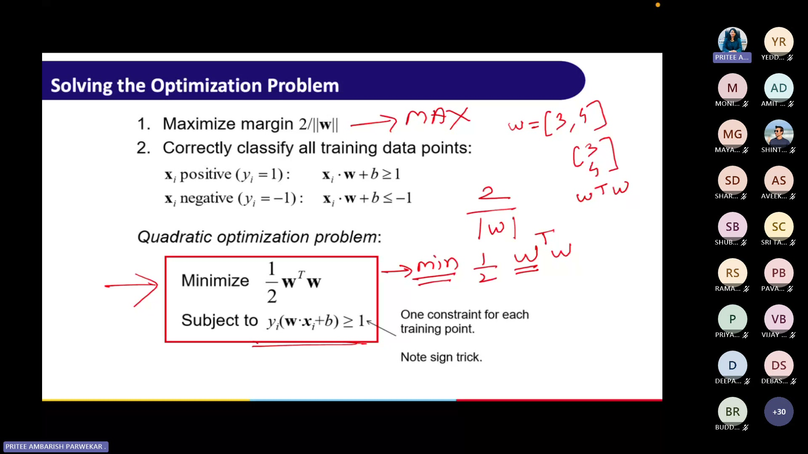

# Module 7: Support Vector Machines

**Course**: AIML ZG565 — Machine Learning  
**Prescribed References**: Christopher J.C. Burges (R3: Tutorial on SVM, pp. 1–43); Tan et al. (R2, Chapter 4); Bishop (R1, Chapter 7)  
**Primary Teacher Followed**: Prof. Pritee Narendra Raole (Sessions 9 & 10: 2026-10-04 & 2026-10-11)

---

## 1. Executive Summary & Foundational Definitions

Support Vector Machines (SVM), developed by Vladimir Vapnik and Alexey Chervonenkis, are maximum-margin discriminative classifiers founded upon **Structural Risk Minimization (SRM)** from statistical learning theory.

While algorithms such as the Perceptron or Logistic Regression seek *any* separating hyperplane that separates two classes, an infinite number of valid separating hyperplanes exist for linearly separable data. SVM uniquely identifies the **optimal canonical hyperplane** that maximizes the geometric distance (margin) to the closest training data points of either class. Maximizing this margin provably minimizes the upper bound on the model's out-of-sample generalization error.

```
       x₂
       ▲                 Class +1
       │                  ●     ●  ● (x⁺)
       │               ●     ●  ▲
       │             ───────────│────────── wᵀx + b = +1 (Positive Margin Boundary)
       │               /        │  
       │              /  Margin │  γ = 2 / ||w||
       │             /   Width  │  
       │            /           ▼
       │           ●─────────────────────── wᵀx + b = 0  (Decision Hyperplane)
       │          /             ▲
       │         /       Margin │  γ = 2 / ||w||
       │        /        Width  │  
       │       /                ▼
       │      /      ■───────────────────── wᵀx + b = -1 (Negative Margin Boundary)
       │     /     ■      ■  ■ (x⁻)
       │    /   ■      ■
       │   /             Class -1
       └──┼───────────────────────────────► x₁
```

---

## 2. Theoretical Motivation & Mathematical Derivations

### 2.1 The Hard-Margin Primal Formulation (Linearly Separable Case)

Let the training dataset be $\mathcal{D} = \{(\mathbf{x}_i, y_i)\}_{i=1}^N$, where $\mathbf{x}_i \in \mathbb{R}^d$ and $y_i \in \{-1, +1\}$.  
A linear decision hyperplane is defined by:

$$\mathbf{w}^T \mathbf{x} + b = 0$$

Where $\mathbf{w} \in \mathbb{R}^d$ is the weight vector normal to the hyperplane, and $b \in \mathbb{R}$ is the bias.

- **Canonical Hyperplane Scaling**: We can scale $(\mathbf{w}, b)$ by an arbitrary constant without altering the geometry of the plane. We fix the scale such that the closest points (the support vectors) satisfy:
  $$|\mathbf{w}^T \mathbf{x}_i + b| = 1$$
- Combining both classes ($y_i = \pm 1$), the separation constraint becomes:
  $$y_i (\mathbf{w}^T \mathbf{x}_i + b) \ge 1, \quad \forall i \in \{1, 2, \dots, N\}$$
- **Geometric Margin Calculation**:
  The perpendicular distance from a point $\mathbf{x}$ to the hyperplane is $\frac{|\mathbf{w}^T \mathbf{x} + b|}{\|\mathbf{w}\|_2}$.  
  For support vectors lying on the canonical boundaries $\mathbf{w}^T \mathbf{x} + b = \pm 1$, this distance is $\frac{1}{\|\mathbf{w}\|_2}$.  
  Therefore, the total geometric margin between the positive and negative margin boundaries is:
  $$\text{Margin } \gamma = \frac{1}{\|\mathbf{w}\|_2} - \left( -\frac{1}{\|\mathbf{w}\|_2} \right) = \frac{2}{\|\mathbf{w}\|_2}$$

Maximizing the margin $\frac{2}{\|\mathbf{w}\|_2}$ is mathematically equivalent to minimizing $\frac{1}{2} \|\mathbf{w}\|_2^2$.

#### The Primal Optimization Problem:
$$\min_{\mathbf{w}, b} \frac{1}{2} \|\mathbf{w}\|_2^2$$
$$\text{subject to } y_i (\mathbf{w}^T \mathbf{x}_i + b) \ge 1, \quad \forall i = 1, \dots, N$$

This is a **strictly convex quadratic programming (QP)** problem with linear inequality constraints, guaranteeing a unique global minimum.

---

### 2.2 Lagrangian Formulation & Karush-Kuhn-Tucker (KKT) Conditions

To solve the constrained optimization, we introduce Lagrange multipliers $\alpha_i \ge 0$ for each constraint:

$$\mathcal{L}_P(\mathbf{w}, b, \boldsymbol{\alpha}) = \frac{1}{2} \|\mathbf{w}\|_2^2 - \sum_{i=1}^N \alpha_i \left[ y_i (\mathbf{w}^T \mathbf{x}_i + b) - 1 \right]$$

Setting the partial derivatives with respect to primal variables $\mathbf{w}$ and $b$ to zero:
$$\nabla_{\mathbf{w}} \mathcal{L}_P = \mathbf{w} - \sum_{i=1}^N \alpha_i y_i \mathbf{x}_i = \mathbf{0} \implies \mathbf{w} = \sum_{i=1}^N \alpha_i y_i \mathbf{x}_i$$
$$\frac{\partial \mathcal{L}_P}{\partial b} = - \sum_{i=1}^N \alpha_i y_i = 0 \implies \sum_{i=1}^N \alpha_i y_i = 0$$

#### The Karush-Kuhn-Tucker (KKT) Dual Conditions:
1. **Primal Feasibility**: $y_i (\mathbf{w}^T \mathbf{x}_i + b) - 1 \ge 0, \ \forall i$
2. **Dual Feasibility**: $\alpha_i \ge 0, \ \forall i$
3. **Complementary Slackness**:
   $$\alpha_i \left[ y_i (\mathbf{w}^T \mathbf{x}_i + b) - 1 \right] = 0, \quad \forall i$$

#### The Significance of Complementary Slackness:
For every training point $i$, either:
- $\alpha_i = 0$: The point lies strictly outside the margin ($y_i(\mathbf{w}^T\mathbf{x}_i + b) > 1$). It has **zero influence** on the decision boundary $\mathbf{w}$.
- $\alpha_i > 0$: The bracketed term must be exactly zero: $y_i(\mathbf{w}^T\mathbf{x}_i + b) = 1$. This point lies **exactly on the margin**. These critical points are the **Support Vectors**!

---

### 2.3 The Dual Optimization Problem

Substituting $\mathbf{w} = \sum \alpha_i y_i \mathbf{x}_i$ and $\sum \alpha_i y_i = 0$ back into the Lagrangian $\mathcal{L}_P$:

$$\mathcal{L}_D(\boldsymbol{\alpha}) = \frac{1}{2} \sum_{i=1}^N \sum_{j=1}^N \alpha_i \alpha_j y_i y_j (\mathbf{x}_i^T \mathbf{x}_j) - \sum_{i=1}^N \sum_{j=1}^N \alpha_i \alpha_j y_i y_j (\mathbf{x}_i^T \mathbf{x}_j) - b \underbrace{\sum_{i=1}^N \alpha_i y_i}_{0} + \sum_{i=1}^N \alpha_i$$

$$\max_{\boldsymbol{\alpha}} \mathcal{L}_D(\boldsymbol{\alpha}) = \sum_{i=1}^N \alpha_i - \frac{1}{2} \sum_{i=1}^N \sum_{j=1}^N \alpha_i \alpha_j y_i y_j (\mathbf{x}_i^T \mathbf{x}_j)$$
$$\text{subject to } \alpha_i \ge 0, \ \forall i \quad \text{and} \quad \sum_{i=1}^N \alpha_i y_i = 0$$

> **Key Observation**: The dual problem depends on the data **exclusively through inner products** $\mathbf{x}_i^T \mathbf{x}_j$. This enables the Kernel Trick!

---

### 2.4 Soft-Margin SVM (Non-Separable Case)

When data contains overlap or noise, no hard-margin hyperplane exists. Corinna Cortes and Vladimir Vapnik (1995) introduced non-negative **slack variables** $\xi_i \ge 0$ allowing margin violations:

$$y_i (\mathbf{w}^T \mathbf{x}_i + b) \ge 1 - \xi_i, \quad \xi_i \ge 0$$
- $\xi_i = 0$: Correctly classified and outside or on margin.
- $0 < \xi_i \le 1$: Correctly classified but falls inside the margin.
- $\xi_i > 1$: Misclassified point.


*Figure 7.1: SVM Optimization — Maximize 2/‖w‖, Minimize ½wᵀw subject to yᵢ(w·xᵢ+b)≥1 (primal QP formulation, Oct 25 session).*

#### The Soft-Margin Primal Objective:
$$\min_{\mathbf{w}, b, \boldsymbol{\xi}} \frac{1}{2} \|\mathbf{w}\|_2^2 + C \sum_{i=1}^N \xi_i$$
$$\text{subject to } y_i(\mathbf{w}^T \mathbf{x}_i + b) \ge 1 - \xi_i, \quad \xi_i \ge 0$$

Where $C > 0$ is the **regularization penalty parameter**:
- **Large $C$**: Heavy penalty on margin violations $\implies$ Narrower margin, lower bias, higher variance (risk of overfitting).
- **Small $C$**: Tolerates margin violations $\implies$ Wider margin, higher bias, lower variance (robust to noise).

#### The Soft-Margin Dual Problem:
$$\max_{\boldsymbol{\alpha}} \sum_{i=1}^N \alpha_i - \frac{1}{2} \sum_{i=1}^N \sum_{j=1}^N \alpha_i \alpha_j y_i y_j (\mathbf{x}_i^T \mathbf{x}_j)$$
$$\text{subject to } 0 \le \alpha_i \le C \quad \text{and} \quad \sum_{i=1}^N \alpha_i y_i = 0$$
*(The only mathematical modification to the dual is the upper bound $\alpha_i \le C$, creating a **box constraint**!)*

---

### 2.5 The Kernel Trick & Mercer's Theorem

If data is non-linearly separable in original input space $\mathbb{R}^d$, we map it into a higher-dimensional feature space $\mathcal{H}$ via non-linear mapping $\boldsymbol{\phi}(\mathbf{x})$:
$$\mathbf{x} \mapsto \boldsymbol{\phi}(\mathbf{x}) \in \mathcal{H}$$

The dual objective requires evaluating inner products $\boldsymbol{\phi}(\mathbf{x}_i)^T \boldsymbol{\phi}(\mathbf{x}_j)$. In high or infinite dimensions, computing $\boldsymbol{\phi}(\mathbf{x})$ explicitly is computationally impossible.

A **Kernel function** $K(\mathbf{x}, \mathbf{z})$ computes the inner product directly in low-dimensional input coordinates:
$$K(\mathbf{x}, \mathbf{z}) = \langle \boldsymbol{\phi}(\mathbf{x}), \boldsymbol{\phi}(\mathbf{z}) \rangle_{\mathcal{H}}$$

> **Mercer's Theorem**: A continuous symmetric function $K(\mathbf{x}, \mathbf{z})$ is a valid inner-product kernel in some Hilbert space if and only if the Gram matrix $\mathbf{K} \in \mathbb{R}^{N \times N}$ ($K_{ij} = K(\mathbf{x}_i, \mathbf{x}_j)$) is **positive semi-definite** for all finite point configurations:
> $$\sum_{i=1}^N \sum_{j=1}^N c_i c_j K(\mathbf{x}_i, \mathbf{x}_j) \ge 0, \quad \forall \mathbf{c} \in \mathbb{R}^N$$

#### Canonical Kernel Functions:
1. **Linear Kernel**: $K(\mathbf{x}, \mathbf{z}) = \mathbf{x}^T \mathbf{z}$
2. **Polynomial Kernel**: $K(\mathbf{x}, \mathbf{z}) = (\mathbf{x}^T \mathbf{z} + c)^p, \quad c \ge 0, p \in \mathbb{N}$
3. **Radial Basis Function (RBF / Gaussian Kernel)**:
   $$K(\mathbf{x}, \mathbf{z}) = \exp \left( -\gamma \|\mathbf{x} - \mathbf{z}\|_2^2 \right) = \exp \left( -\frac{\|\mathbf{x} - \mathbf{z}\|_2^2}{2 \sigma^2} \right)$$
   *(Maps data implicitly into an **infinite-dimensional** Hilbert space!)*
4. **Sigmoid (Hyperbolic Tangent) Kernel**: $K(\mathbf{x}, \mathbf{z}) = \tanh(\kappa \mathbf{x}^T \mathbf{z} + c)$

---

## 3. Vectorized Implementation: Sequential Minimal Optimization (SMO)

```python
import numpy as np

class SimplifiedSVM:
    """Simplified Support Vector Machine with RBF/Linear Kernel."""
    def __init__(self, C: float = 1.0, kernel: str = 'rbf', gamma: float = 0.5, tol: float = 1e-3, max_passes: int = 20):
        self.C = C
        self.kernel = kernel
        self.gamma = gamma
        self.tol = tol
        self.max_passes = max_passes
        self.alphas = None
        self.b = 0.0
        self.X = None
        self.y = None

    def _kernel_func(self, X1: np.ndarray, X2: np.ndarray) -> np.ndarray:
        if self.kernel == 'linear':
            return X1 @ X2.T
        elif self.kernel == 'rbf':
            # Pairwise squared Euclidean distance
            sq1 = np.sum(X1 ** 2, axis=1, keepdims=True)
            sq2 = np.sum(X2 ** 2, axis=1, keepdims=True).T
            dist_sq = sq1 + sq2 - 2 * (X1 @ X2.T)
            return np.exp(-self.gamma * np.maximum(dist_sq, 0.0))

    def fit(self, X: np.ndarray, y: np.ndarray):
        # Convert y to {-1, +1}
        self.X = X
        self.y = np.where(y <= 0, -1.0, 1.0)
        N, d = X.shape
        self.alphas = np.zeros(N)
        self.b = 0.0

        K = self._kernel_func(X, X)
        passes = 0

        while passes < self.max_passes:
            num_changed_alphas = 0
            for i in range(N):
                # Compute prediction and error E_i
                f_i = np.sum(self.alphas * self.y * K[:, i]) + self.b
                E_i = f_i - self.y[i]

                # Check KKT conditions violation
                if (self.y[i] * E_i < -self.tol and self.alphas[i] < self.C) or \
                   (self.y[i] * E_i > self.tol and self.alphas[i] > 0):

                    # Select random second multiplier j != i
                    j = np.random.choice([idx for idx in range(N) if idx != i])
                    f_j = np.sum(self.alphas * self.y * K[:, j]) + self.b
                    E_j = f_j - self.y[j]

                    alpha_i_old = self.alphas[i]
                    alpha_j_old = self.alphas[j]

                    # Compute bounding box [L, H]
                    if self.y[i] != self.y[j]:
                        L = max(0.0, self.alphas[j] - self.alphas[i])
                        H = min(self.C, self.C + self.alphas[j] - self.alphas[i])
                    else:
                        L = max(0.0, self.alphas[i] + self.alphas[j] - self.C)
                        H = min(self.C, self.alphas[i] + self.alphas[j])

                    if L == H:
                        continue

                    # Compute second derivative eta
                    eta = 2.0 * K[i, j] - K[i, i] - K[j, j]
                    if eta >= 0:
                        continue

                    # Update alpha_j
                    self.alphas[j] -= (self.y[j] * (E_i - E_j)) / eta
                    self.alphas[j] = np.clip(self.alphas[j], L, H)

                    if abs(self.alphas[j] - alpha_j_old) < 1e-5:
                        continue

                    # Update alpha_i
                    self.alphas[i] += self.y[i] * self.y[j] * (alpha_j_old - self.alphas[j])

                    # Compute threshold b
                    b1 = self.b - E_i - self.y[i] * (self.alphas[i] - alpha_i_old) * K[i, i] - \
                         self.y[j] * (self.alphas[j] - alpha_j_old) * K[i, j]
                    b2 = self.b - E_j - self.y[i] * (self.alphas[i] - alpha_i_old) * K[i, j] - \
                         self.y[j] * (self.alphas[j] - alpha_j_old) * K[j, j]

                    if 0 < self.alphas[i] < self.C:
                        self.b = b1
                    elif 0 < self.alphas[j] < self.C:
                        self.b = b2
                    else:
                        self.b = (b1 + b2) / 2.0

                    num_changed_alphas += 1

            passes = passes + 1 if num_changed_alphas == 0 else 0

        # Retain only support vectors
        sv_mask = self.alphas > 1e-4
        print(f"Convergence achieved: {np.sum(sv_mask)} Support Vectors identified.")
        return self

    def predict(self, X_query: np.ndarray) -> np.ndarray:
        K_q = self._kernel_func(X_query, self.X)
        scores = (K_q @ (self.alphas * self.y)) + self.b
        return np.where(scores >= 0, 1, 0)


if __name__ == "__main__":
    np.random.seed(42)
    # Concentric circles dataset (linearly non-separable)
    r_inner = np.random.uniform(0, 1.5, size=80)
    theta_inner = np.random.uniform(0, 2*np.pi, size=80)
    X_inner = np.column_stack([r_inner * np.cos(theta_inner), r_inner * np.sin(theta_inner)])

    r_outer = np.random.uniform(2.5, 4.0, size=80)
    theta_outer = np.random.uniform(0, 2*np.pi, size=80)
    X_outer = np.column_stack([r_outer * np.cos(theta_outer), r_outer * np.sin(theta_outer)])

    X = np.vstack([X_inner, X_outer])
    y = np.array([1] * 80 + [0] * 80)

    svm = SimplifiedSVM(C=2.0, kernel='rbf', gamma=0.5)
    svm.fit(X, y)
    acc = np.mean(svm.predict(X) == y) * 100.0
    print(f"RBF Kernel SVM Classification Accuracy: {acc:.1f}%")
```

---

## 4. Solved Numerical Example (Exam Pattern)

**Problem Statement (University Examination Pattern, 6 Marks)**:  
Given the following 3 training points in $\mathbb{R}^2$:
- $\mathbf{x}_1 = [2, 0]^T$ with label $y_1 = +1$
- $\mathbf{x}_2 = [0, 2]^T$ with label $y_2 = +1$
- $\mathbf{x}_3 = [0, 0]^T$ with label $y_3 = -1$

1. Formulate the dual Lagrangian function $\mathcal{L}_D(\alpha_1, \alpha_2, \alpha_3)$.
2. Solve for the optimal Lagrange multipliers $\alpha_1^*, \alpha_2^*, \alpha_3^*$.
3. Compute the optimal weight vector $\mathbf{w}^*$ and bias $b^*$.
4. Calculate the geometric margin $\gamma$.
5. Classify the test point $\mathbf{x}_{\text{test}} = [1, 1]^T$.

---

### Step-by-Step Solution:

#### Step 1: Compute Dot Products and Constraints
Data points:
- $\mathbf{x}_1^T \mathbf{x}_1 = 2^2 + 0^2 = 4$
- $\mathbf{x}_2^T \mathbf{x}_2 = 0^2 + 2^2 = 4$
- $\mathbf{x}_3^T \mathbf{x}_3 = 0^2 + 0^2 = 0$
- $\mathbf{x}_1^T \mathbf{x}_2 = 2(0) + 0(2) = 0$
- $\mathbf{x}_1^T \mathbf{x}_3 = 2(0) + 0(0) = 0$
- $\mathbf{x}_2^T \mathbf{x}_3 = 0(0) + 2(0) = 0$

All cross-products between different points evaluate to $0$!

The dual equality constraint is:
$$\sum_{i=1}^3 \alpha_i y_i = 0 \implies \alpha_1(+1) + \alpha_2(+1) + \alpha_3(-1) = 0 \implies \mathbf{\alpha_3 = \alpha_1 + \alpha_2}$$

---

#### Step 2: Formulate and Maximize Dual Objective
$$\mathcal{L}_D = (\alpha_1 + \alpha_2 + \alpha_3) - \frac{1}{2} \sum_{i=1}^3 \sum_{j=1}^3 \alpha_i \alpha_j y_i y_j (\mathbf{x}_i^T \mathbf{x}_j)$$

Since $\mathbf{x}_i^T \mathbf{x}_j = 0$ for $i \neq j$ and $\mathbf{x}_3^T \mathbf{x}_3 = 0$:
$$\mathcal{L}_D = \alpha_1 + \alpha_2 + \alpha_3 - \frac{1}{2} \left[ \alpha_1^2 (+1)^2 (4) + \alpha_2^2 (+1)^2 (4) + \alpha_3^2 (-1)^2 (0) \right]$$
$$\mathcal{L}_D = \alpha_1 + \alpha_2 + \alpha_3 - 2\alpha_1^2 - 2\alpha_2^2$$

Substitute $\alpha_3 = \alpha_1 + \alpha_2$:
$$\mathcal{L}_D(\alpha_1, \alpha_2) = \alpha_1 + \alpha_2 + (\alpha_1 + \alpha_2) - 2\alpha_1^2 - 2\alpha_2^2 = 2\alpha_1 + 2\alpha_2 - 2\alpha_1^2 - 2\alpha_2^2$$

Taking partial derivatives and setting to zero:
$$\frac{\partial \mathcal{L}_D}{\partial \alpha_1} = 2 - 4\alpha_1 = 0 \implies \alpha_1^* = \frac{2}{4} = \mathbf{0.50}$$
$$\frac{\partial \mathcal{L}_D}{\partial \alpha_2} = 2 - 4\alpha_2 = 0 \implies \alpha_2^* = \frac{2}{4} = \mathbf{0.50}$$

Compute $\alpha_3^*$:
$$\alpha_3^* = \alpha_1^* + \alpha_2^* = 0.50 + 0.50 = \mathbf{1.00}$$

Since $\alpha_1^*, \alpha_2^*, \alpha_3^* > 0$, **all three points are Support Vectors!**

---

#### Step 3: Compute Weight Vector $\mathbf{w}^*$ and Bias $b^*$
$$\mathbf{w}^* = \sum_{i=1}^3 \alpha_i y_i \mathbf{x}_i = (0.5)(+1)\begin{bmatrix} 2 \\ 0 \end{bmatrix} + (0.5)(+1)\begin{bmatrix} 0 \\ 2 \end{bmatrix} + (1.0)(-1)\begin{bmatrix} 0 \\ 0 \end{bmatrix}$$
$$\mathbf{w}^* = \begin{bmatrix} 1.0 \\ 0 \end{bmatrix} + \begin{bmatrix} 0 \\ 1.0 \end{bmatrix} + \begin{bmatrix} 0 \\ 0 \end{bmatrix} = \begin{bmatrix} \mathbf{1.0} \\ \mathbf{1.0} \end{bmatrix}$$

For any support vector, $y_i(\mathbf{w}^T \mathbf{x}_i + b) = 1$.  
Using support vector $\mathbf{x}_3 = [0, 0]^T$ with $y_3 = -1$:
$$-1(\mathbf{w}^T \mathbf{x}_3 + b) = 1 \implies -(0 + b) = 1 \implies b^* = \mathbf{-1.0}$$

Verification using support vector $\mathbf{x}_1 = [2, 0]^T$ with $y_1 = +1$:
$$+1(\mathbf{w}^T \mathbf{x}_1 + b) = 1(1(2) + 1(0) - 1) = 2 - 1 = +1 \quad \text{(Verified!)}$$

The optimal decision boundary equation is:
$$x_1 + x_2 - 1 = 0$$

---

#### Step 4: Geometric Margin $\gamma$
$$\|\mathbf{w}^*\|_2 = \sqrt{1.0^2 + 1.0^2} = \sqrt{2} \approx 1.414$$
$$\text{Margin } \gamma = \frac{2}{\|\mathbf{w}^*\|_2} = \frac{2}{\sqrt{2}} = \sqrt{2} \approx \mathbf{1.414}$$

---

#### Step 5: Classify Query Point $\mathbf{x}_{\text{test}} = [1, 1]^T$
$$f(\mathbf{x}_{\text{test}}) = \mathbf{w}^T \mathbf{x}_{\text{test}} + b = 1.0(1) + 1.0(1) - 1.0 = 2 - 1 = \mathbf{+1.0}$$

Since $f(\mathbf{x}_{\text{test}}) = +1.0 > 0$, the predicted class is:
$$\hat{y}_{\text{test}} = \mathbf{+1}$$

---

## 5. Common Pitfalls, Trade-offs & Practical Guidelines

1. **Kernel Trick Computational Scaling**:
   - The kernel Gram matrix $\mathbf{K} \in \mathbb{R}^{N \times N}$ requires $\mathcal{O}(N^2)$ memory and $\mathcal{O}(N^3)$ training compute. For large datasets ($N > 100,000$), standard kernel SVM is infeasible.
   - *Fix*: Use Linear SVM with SGD, or approximate kernels via **Random Fourier Features (RFF)**.
2. **Hyperparameter Grid-Search Pairing ($C$ and $\gamma$)**:
   - For RBF kernels, $C$ and $\gamma = \frac{1}{2\sigma^2}$ must be tuned jointly via cross-validation.
   - High $\gamma$ creates narrow Gaussian peaks around individual training points, producing extreme overfitting.
   - Low $\gamma$ causes Gaussian peaks to blur into a flat plane, causing underfitting.
3. **Multi-Class Strategy**:
   - SVM is inherently binary. For $K$-class problems, use **One-vs-One (OvO)** (trains $\frac{K(K-1)}{2}$ binary classifiers) or **One-vs-Rest (OvR)** (trains $K$ binary classifiers).

