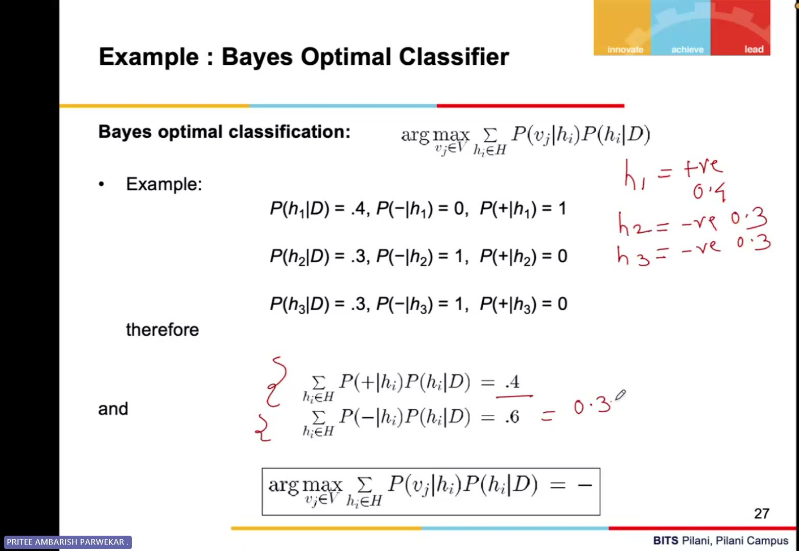

# Module 8: Bayesian Learning

**Course**: AIML ZG565 — Machine Learning  
**Prescribed References**: Tom M. Mitchell (T1, Chapter 6); Christopher M. Bishop (R1, Chapters 1 & 4)  
**Primary Teacher Followed**: Prof. Pritee Narendra Raole (Session 11: 2026-10-18)

---

## 1. Executive Summary & Foundational Definitions

Bayesian learning provides a principled probabilistic framework for inductive inference. Unlike frequentist methods that treat model parameters as fixed, deterministic unknown constants to be optimized, Bayesian reasoning explicitly models parameters and hypotheses as **random variables governed by probability distributions**.

Prior knowledge or domain beliefs are encoded mathematically as a **Prior Probability Distribution** $P(h)$. When empirical observations $D$ arrive, Bayes' Theorem dynamically updates this prior into a **Posterior Probability Distribution** $P(h \mid D)$.

```
   ┌────────────────────────────────┐
   │ Prior Beliefs: P(h)            │
   └───────────────┬────────────────┘
                   │
                   ▼
   ┌────────────────────────────────┐
   │ Observed Evidence / Data: D    │
   └───────────────┬────────────────┘
                   │
                   ▼
┌──────────────────────────────────────┐
│ Bayes' Theorem Engine:               │
│ P(h|D) = [ P(D|h) · P(h) ] / P(D)    │
└──────────────────┬───────────────────┘
                   │
                   ▼
   ┌────────────────────────────────┐
   │ Updated Posterior: P(h|D)      │
   └────────────────────────────────┘
```

---

## 2. Theoretical Motivation & Mathematical Formulations

### 2.1 Bayes' Theorem and Hypothesis Selection

Let $\mathcal{H}$ be a candidate hypothesis space, and let $D = \{(\mathbf{x}_1, y_1), \dots, (\mathbf{x}_N, y_N)\}$ be the observed training dataset. Bayes' theorem states:

$$P(h \mid D) = \frac{P(D \mid h) P(h)}{P(D)} = \frac{P(D \mid h) P(h)}{\sum_{h' \in \mathcal{H}} P(D \mid h') P(h')}$$

Where:
- $P(h)$: **Prior probability** of hypothesis $h$ before seeing dataset $D$.
- $P(D \mid h)$: **Likelihood** of observing dataset $D$ given hypothesis $h$ is true.
- $P(D)$: **Marginal probability (Evidence)** of the data across all hypotheses.
- $P(h \mid D)$: **Posterior probability** of hypothesis $h$ given observed data $D$.

#### 1. Maximum A Posteriori (MAP) Hypothesis:
Selects the hypothesis maximizing the posterior distribution:

$$h_{\text{MAP}} = \arg\max_{h \in \mathcal{H}} P(h \mid D) = \arg\max_{h \in \mathcal{H}} \frac{P(D \mid h) P(h)}{P(D)} = \arg\max_{h \in \mathcal{H}} P(D \mid h) P(h)$$
*(The evidence $P(D)$ is dropped because it is independent of $h$.)*

#### 2. Maximum Likelihood (ML) Hypothesis:
If all hypotheses in $\mathcal{H}$ are assumed equally likely *a priori* ($P(h_i) = P(h_j)$ uniform prior), the MAP objective reduces to maximizing likelihood alone:

$$h_{\text{ML}} = \arg\max_{h \in \mathcal{H}} P(D \mid h)$$

---

### 2.2 Derivation: Least Squares Regression as Maximum Likelihood under Gaussian Noise

Why is the Mean Squared Error (MSE) the standard loss function for regression? Bayesian analysis provides the formal mathematical proof.

Suppose target values $y_i$ are generated by a deterministic function $f(\mathbf{x}_i)$ perturbed by independent additive zero-mean Gaussian noise:

$$y_i = f(\mathbf{x}_i) + \epsilon_i, \quad \epsilon_i \stackrel{\text{i.i.d.}}{\sim} \mathcal{N}(0, \sigma^2)$$

Then the conditional distribution of $y_i$ given $\mathbf{x}_i$ and hypothesis $h$ is:
$$p(y_i \mid \mathbf{x}_i, h) = \frac{1}{\sqrt{2\pi\sigma^2}} \exp \left( - \frac{(y_i - h(\mathbf{x}_i))^2}{2\sigma^2} \right)$$

Assuming identically distributed independent observations, the Likelihood of the dataset $D = \{(x_1, y_1), \dots, (x_N, y_N)\}$ is:
$$P(D \mid h) = \prod_{i=1}^N p(y_i \mid \mathbf{x}_i, h) = \prod_{i=1}^N \frac{1}{\sqrt{2\pi\sigma^2}} \exp \left( - \frac{(y_i - h(\mathbf{x}_i))^2}{2\sigma^2} \right)$$

Maximizing $P(D \mid h)$ is equivalent to maximizing the Log-Likelihood $\ln P(D \mid h)$:
$$\ln P(D \mid h) = \sum_{i=1}^N \left[ \ln \left(\frac{1}{\sqrt{2\pi\sigma^2}}\right) - \frac{(y_i - h(\mathbf{x}_i))^2}{2\sigma^2} \right] = - N \ln(\sqrt{2\pi}\sigma) - \frac{1}{2\sigma^2} \sum_{i=1}^N (y_i - h(\mathbf{x}_i))^2$$

To maximize this quantity with respect to $h$, discard constants and negate the sign:
$$h_{\text{ML}} = \arg\min_{h \in \mathcal{H}} \sum_{i=1}^N (y_i - h(\mathbf{x}_i))^2$$

> **Theorem**: Minimizing sum-of-squared errors is mathematically identical to finding the Maximum Likelihood estimator under the assumption of independent additive Gaussian noise.

---

### 2.3 The Bayes Optimal Classifier

Given a novel instance $\mathbf{x}$, which target label $v_j \in V$ is most probable?  
A naive approach would select the single best hypothesis $h_{\text{MAP}}$ and predict $h_{\text{MAP}}(\mathbf{x})$. However, other hypotheses in $\mathcal{H}$ might also have high posterior probability and predict a different label!

The **Bayes Optimal Classifier** combines the predictions of *all* hypotheses in $\mathcal{H}$, weighted by their posterior probabilities:

$$P(v_j \mid D) = \sum_{h_i \in \mathcal{H}} P(v_j \mid h_i) P(h_i \mid D)$$

$$v_{\text{BayesOptimal}} = \arg\max_{v_j \in V} \sum_{h_i \in \mathcal{H}} P(v_j \mid h_i) P(h_i \mid D)$$

> **Fundamental Optimality Theorem**: No other classification algorithm using the same hypothesis space and prior knowledge can outperform the Bayes Optimal Classifier on average.


*Figure 8.1: Bayes optimal classifier example from 1 November 2026. Posteriors are $P(h_1\mid D)=0.4$, $P(h_2\mid D)=0.3$, $P(h_3\mid D)=0.3$. Only $h_1$ votes positive, so the posterior mass on the negative class is $0.6$ and the Bayes optimal label is negative.*

---

## 3. The Naïve Bayes Classifier

### 3.1 The Conditional Independence Assumption

In practice, evaluating the true Bayes classifier is computationally impossible because calculating the joint likelihood $P(\mathbf{x} \mid v_j) = P(x_1, x_2, \dots, x_d \mid v_j)$ requires estimating $2^d - 1$ parameters for binary features.

The **Naïve Bayes Classifier** makes the simplifying assumption that **all input features are conditionally independent given the target class label $v_j$**:

$$P(x_1, x_2, \dots, x_d \mid v_j) = \prod_{k=1}^d P(x_k \mid v_j)$$

#### Mathematical Classification Rule:
$$v_{\text{NB}} = \arg\max_{v_j \in V} P(v_j) \prod_{k=1}^d P(x_k \mid v_j)$$

Where:
- $P(v_j)$: Prior probability of class $v_j$, estimated by simple frequency: $\frac{N_{v_j}}{N}$.
- $P(x_k \mid v_j)$: Conditional probability of feature $k$ taking value $x_k$ given class $v_j$.

---

### 3.2 The Zero Probability Problem & Laplace Smoothing

If a specific feature value $x_k$ never co-occurs with class $v_j$ in the training set ($N_{jk} = 0$), the empirical conditional probability evaluates to:
$$P(x_k \mid v_j) = \frac{0}{N_{v_j}} = 0$$

Because Naïve Bayes multiplies all conditional probabilities together in a product chain:
$$P(v_j) \prod_{k=1}^d P(x_k \mid v_j) = P(v_j) \cdot (\dots) \cdot 0 \cdot (\dots) = \mathbf{0}$$

A single unobserved feature completely wipes out all other strong predictive evidence!

#### Solution: Laplace Smoothing (Lidstone Add-1 Smoothing)
We add a pseudo-count $\alpha > 0$ (typically $\alpha = 1$) to all feature counts:

$$\hat{P}(x_k = c \mid v_j) = \frac{N_{jk} + \alpha}{N_{v_j} + \alpha K_k}$$

Where:
- $N_{jk}$: Observed count of feature $k$ having value $c$ in class $v_j$.
- $N_{v_j}$: Total count of instances in class $v_j$.
- $K_k$: Total number of distinct possible categorical values of feature $k$.
- $\alpha$: Smoothing parameter ($\alpha = 1$ is Laplace smoothing; $\alpha < 1$ is Lidstone smoothing).

---

### 3.3 Continuous Features: Gaussian Naïve Bayes

When features $x_k$ are continuous real values ($x_k \in \mathbb{R}$), we model class-conditional densities via a univariate Gaussian distribution:

$$P(x_k \mid v_j) = \frac{1}{\sqrt{2\pi\sigma_{jk}^2}} \exp \left( - \frac{(x_k - \mu_{jk})^2}{2\sigma_{jk}^2} \right)$$

Where $\mu_{jk}$ and $\sigma_{jk}^2$ are the empirical sample mean and variance of feature $k$ computed exclusively over training instances belonging to class $v_j$.

---

### 3.4 Bayesian Linear Regression

> This is a syllabus topic that the lectures did not derive by name. The treatment below is the standard one (Bishop, §3.3). It connects directly to the MAP and ridge results in Sections 2.1 and Module 3, §2.5.

**Model.**
- Prior over weights: $p(\mathbf{w}) = \mathcal{N}(\mathbf{w} \mid \mathbf{0}, \alpha^{-1}\mathbf{I})$
- Likelihood: $p(\mathbf{y} \mid \mathbf{\Phi}, \mathbf{w}) = \mathcal{N}(\mathbf{y} \mid \mathbf{\Phi}\mathbf{w}, \beta^{-1}\mathbf{I})$, where the noise precision is $\beta = 1/\sigma^2$.

**Posterior.** Taking the logarithm of prior times likelihood gives, up to a constant,
$$\ln p(\mathbf{w} \mid \mathcal{D}) = -\frac{\beta}{2}\|\mathbf{y} - \mathbf{\Phi}\mathbf{w}\|_2^2 - \frac{\alpha}{2}\|\mathbf{w}\|_2^2 + \text{const}$$
This is quadratic in $\mathbf{w}$, so the posterior is Gaussian, $p(\mathbf{w} \mid \mathcal{D}) = \mathcal{N}(\mathbf{w} \mid \mathbf{m}_N, \mathbf{S}_N)$. Completing the square gives
$$\mathbf{S}_N^{-1} = \alpha\mathbf{I} + \beta\mathbf{\Phi}^T\mathbf{\Phi}, \qquad \mathbf{m}_N = \beta\,\mathbf{S}_N\mathbf{\Phi}^T\mathbf{y}$$

**Link to MAP and ridge.** The mean $\mathbf{m}_N$ is also the posterior mode, so it is the MAP estimate:
$$\mathbf{m}_N = \left(\mathbf{\Phi}^T\mathbf{\Phi} + \frac{\alpha}{\beta}\mathbf{I}\right)^{-1}\mathbf{\Phi}^T\mathbf{y}$$
This is ridge regression with $\lambda = \alpha/\beta$. A Gaussian prior on the weights is exactly what turns MAP into ridge.

**Predictive distribution.** For a new input with feature vector $\boldsymbol{\phi}_*$:
$$p(y_* \mid \mathbf{x}_*, \mathcal{D}) = \mathcal{N}\!\left(y_* \mid \mathbf{m}_N^T\boldsymbol{\phi}_*,\ \sigma_N^2(\mathbf{x}_*)\right), \qquad \sigma_N^2(\mathbf{x}_*) = \frac{1}{\beta} + \boldsymbol{\phi}_*^T\mathbf{S}_N\boldsymbol{\phi}_*$$
The first term, $1/\beta$, is irreducible noise. The second term is parameter uncertainty. It grows for inputs far from the training data, so the model is honest about what it does not know.

**Worked example.** One training point has $\phi = 1$ and $y = 2$, with $\alpha = \beta = 1$.
- $\mathbf{S}_N^{-1} = 1 + 1 \cdot 1 \cdot 1 = 2$, so $S_N = 0.5$
- $m_N = 1 \cdot 0.5 \cdot 1 \cdot 2 = 1.0$
- MAP check: $(1 + 1)^{-1} \cdot 2 = 1.0$, which matches

Predictions at two inputs:
- $\phi_* = 1$ (same as the training input): mean $1.0$, variance $1 + 0.5 = 1.5$
- $\phi_* = 3$ (far from the training input): mean $3.0$, variance $1 + 9(0.5) = 5.5$

The predictive variance grows from 1.5 to 5.5 as the input moves away from the data.

---

## 4. Vectorized Implementation (From Scratch)

```python
import numpy as np

class VectorizedGaussianNaiveBayes:
    """Vectorized Gaussian Naive Bayes Classifier."""
    def __init__(self, eps: float = 1e-9):
        self.eps = eps  # Numerical stability variance floor
        self.classes = None
        self.priors = None
        self.means = None
        self.vars = None

    def fit(self, X: np.ndarray, y: np.ndarray):
        N, d = X.shape
        self.classes = np.unique(y)
        K = len(self.classes)

        self.priors = np.zeros(K)
        self.means = np.zeros((K, d))
        self.vars = np.zeros((K, d))

        for idx, c in enumerate(self.classes):
            X_c = X[y == c]
            self.priors[idx] = len(X_c) / N
            self.means[idx] = np.mean(X_c, axis=0)
            self.vars[idx] = np.var(X_c, axis=0) + self.eps

        return self

    def _calculate_log_likelihood(self, X: np.ndarray) -> np.ndarray:
        """
        Computes log posterior for all classes across queries:
        log P(c | x) ~ log P(c) + sum_k log P(x_k | c)
        """
        N, d = X.shape
        K = len(self.classes)
        log_posteriors = np.zeros((N, K))

        for idx in range(K):
            prior_term = np.log(self.priors[idx])
            mean = self.means[idx]
            var = self.vars[idx]

            # Vectorized Gaussian log probability density
            log_prob = -0.5 * np.sum(np.log(2.0 * np.pi * var) + ((X - mean) ** 2) / var, axis=1)
            log_posteriors[:, idx] = prior_term + log_prob

        return log_posteriors

    def predict(self, X: np.ndarray) -> np.ndarray:
        log_post = self._calculate_log_likelihood(X)
        return self.classes[np.argmax(log_post, axis=1)]


if __name__ == "__main__":
    np.random.seed(42)
    # Synthetic 3-class 2D dataset
    X_0 = np.random.normal(loc=[-3, -3], scale=1.0, size=(50, 2))
    X_1 = np.random.normal(loc=[0, 3], scale=1.2, size=(50, 2))
    X_2 = np.random.normal(loc=[3, -2], scale=0.8, size=(50, 2))
    X = np.vstack([X_0, X_1, X_2])
    y = np.array([0] * 50 + [1] * 50 + [2] * 50)

    gnb = VectorizedGaussianNaiveBayes().fit(X, y)
    acc = np.mean(gnb.predict(X) == y) * 100.0
    print(f"Gaussian Naive Bayes Training Accuracy: {acc:.1f}%")
```

---

## 5. Solved Numerical Example (Exam Pattern)

**Problem Statement (University Examination Pattern, 6 Marks)**:  
Given the following medical diagnostic dataset of 10 patients with target condition **Disease Present** ($y \in \{\text{Yes}, \text{No}\}$):

| Patient | Fever ($x_1$) | Cough ($x_2$) | Chills ($x_3$) | Disease ($y$) |
| :---: | :---: | :---: | :---: | :---: |
| 1 | High | Mild | Yes | Yes |
| 2 | High | Severe | Yes | Yes |
| 3 | Normal | Mild | No | No |
| 4 | High | None | Yes | Yes |
| 5 | Normal | Severe | No | Yes |
| 6 | Normal | None | No | No |
| 7 | Low | Severe | Yes | Yes |
| 8 | Low | Mild | No | No |
| 9 | High | Mild | No | Yes |
| 10 | Low | None | No | No |

A new patient arrives with symptoms:  
$$\mathbf{x}_{\text{query}} = [\text{Fever} = \text{Low}, \text{Cough} = \text{Severe}, \text{Chills} = \text{No}]$$

Using the Naïve Bayes Classifier with Laplace Smoothing ($\alpha = 1$):
1. Compute the prior probabilities $P(\text{Disease} = \text{Yes})$ and $P(\text{Disease} = \text{No})$.
2. Compute all smoothed conditional likelihoods for $\mathbf{x}_{\text{query}}$.
3. Compute the unnormalized posterior score for both classes.
4. Normalize the posteriors into true probabilities and predict the final diagnosis.

---

### Step-by-Step Solution:

#### Step 1: Prior Probabilities
Total instances $N = 10$.
- Disease = Yes: 6 patients (IDs: 1, 2, 4, 5, 7, 9) $\implies P(\text{Yes}) = \frac{6}{10} = \mathbf{0.60}$.
- Disease = No: 4 patients (IDs: 3, 6, 8, 10) $\implies P(\text{No}) = \frac{4}{10} = \mathbf{0.40}$.

---

#### Step 2: Smoothed Conditional Likelihoods ($\alpha = 1$)

Number of distinct categories:
- Fever ($x_1$): $K_1 = 3$ (`High`, `Normal`, `Low`).
- Cough ($x_2$): $K_2 = 3$ (`Severe`, `Mild`, `None`).
- Chills ($x_3$): $K_3 = 2$ (`Yes`, `No`).

Formula:
$$P(x_k = c \mid y) = \frac{\text{Count}(x_k = c \land y) + 1}{\text{Count}(y) + K_k}$$

##### For Class Disease = Yes ($N_{\text{Yes}} = 6$):
- **Fever = Low**:
  Count = 1 (Patient 7)
  $$P(\text{Low} \mid \text{Yes}) = \frac{1 + 1}{6 + 3} = \frac{2}{9} \approx \mathbf{0.2222}$$
- **Cough = Severe**:
  Count = 3 (Patients 2, 5, 7)
  $$P(\text{Severe} \mid \text{Yes}) = \frac{3 + 1}{6 + 3} = \frac{4}{9} \approx \mathbf{0.4444}$$
- **Chills = No**:
  Count = 2 (Patients 5, 9)
  $$P(\text{No} \mid \text{Yes}) = \frac{2 + 1}{6 + 2} = \frac{3}{8} = \mathbf{0.3750}$$

##### For Class Disease = No ($N_{\text{No}} = 4$):
- **Fever = Low**:
  Count = 2 (Patients 8, 10)
  $$P(\text{Low} \mid \text{No}) = \frac{2 + 1}{4 + 3} = \frac{3}{7} \approx \mathbf{0.4286}$$
- **Cough = Severe**:
  Count = 0 (Unobserved in No class!)
  $$P(\text{Severe} \mid \text{No}) = \frac{0 + 1}{4 + 3} = \frac{1}{7} \approx \mathbf{0.1429}$$
  *(Laplace smoothing successfully avoided a zero-probability collapse!)*
- **Chills = No**:
  Count = 4 (Patients 3, 6, 8, 10)
  $$P(\text{No} \mid \text{No}) = \frac{4 + 1}{4 + 2} = \frac{5}{6} \approx \mathbf{0.8333}$$

---

#### Step 3: Unnormalized Posterior Scores
- **For Disease = Yes**:
  $$\text{Score}(\text{Yes}) = P(\text{Yes}) \times P(\text{Low} \mid \text{Yes}) \times P(\text{Severe} \mid \text{Yes}) \times P(\text{No} \mid \text{Yes})$$
  $$\text{Score}(\text{Yes}) = 0.60 \times \left(\frac{2}{9}\right) \times \left(\frac{4}{9}\right) \times \left(\frac{3}{8}\right) = 0.60 \times 0.2222 \times 0.4444 \times 0.3750 \approx \mathbf{0.02222}$$

- **For Disease = No**:
  $$\text{Score}(\text{No}) = P(\text{No}) \times P(\text{Low} \mid \text{No}) \times P(\text{Severe} \mid \text{No}) \times P(\text{No} \mid \text{No})$$
  $$\text{Score}(\text{No}) = 0.40 \times \left(\frac{3}{7}\right) \times \left(\frac{1}{7}\right) \times \left(\frac{5}{6}\right) = 0.40 \times 0.4286 \times 0.1429 \times 0.8333 \approx \mathbf{0.02041}$$

---

#### Step 4: Normalization & Final Classification
Total Evidence:
$$P(\mathbf{x}_{\text{query}}) = 0.02222 + 0.02041 = \mathbf{0.04263}$$

Normalized Posterior Probabilities:
$$P(\text{Yes} \mid \mathbf{x}_{\text{query}}) = \frac{0.02222}{0.04263} = \mathbf{52.12\%}$$
$$P(\text{No} \mid \mathbf{x}_{\text{query}}) = \frac{0.02041}{0.04263} = \mathbf{47.88\%}$$

**Prediction**: Since $P(\text{Yes} \mid \mathbf{x}_{\text{query}}) = 52.12\% > 47.88\%$, the patient is classified as **Disease Present (Yes)**.

---

## 6. Common Pitfalls, Trade-offs & Practical Guidelines

1. **Log-Space Computation Requirement**:
   - In text classification with documents containing 5,000 words, multiplying 5,000 fractional probabilities $\prod p_k$ triggers arithmetic floating-point underflow ($p \to 0.0$). Always sum log-probabilities:
     $$\ln P(v_j) + \sum_{k=1}^d \ln P(x_k \mid v_j)$$
2. **Feature Redundancy & Correlation Breakdown**:
   - If two features are perfectly correlated ($x_2 = x_1$), Naïve Bayes double-counts the evidence, artificially squaring that feature's predictive influence. Remove collinear features via correlation thresholding.
3. **Probability Calibration**:
   - Because the conditional independence assumption rarely holds strictly in empirical data, Naïve Bayes pushes predicted probabilities towards extreme values ($0.0$ or $1.0$). While ranking order is typically excellent (yielding high ROC-AUC), raw output probabilities require **Platt Scaling** or **Isotonic Regression** before being used as calibrated confidence scores.

