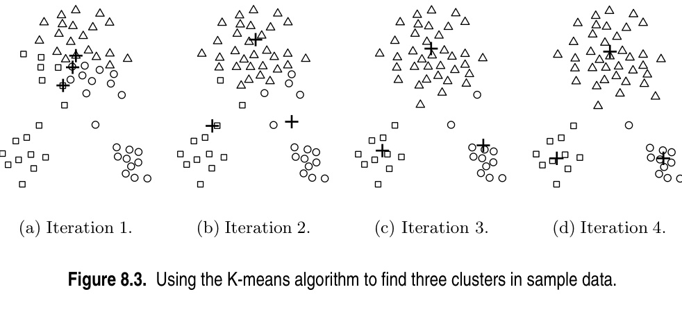

# Module 10: Unsupervised Learning & Clustering

**Course**: AIML ZG565 — Machine Learning  
**Prescribed References**: Tom M. Mitchell (T1, Chapter 6); Christopher M. Bishop (R1, Chapter 9); Tan et al. (R2, Chapters 8 & 9)  
**Primary Teacher Followed**: Prof. Pritee Narendra Raole (Session 13: 2026-11-01)

---

## 1. Executive Summary & Foundational Definitions

Unsupervised learning addresses the problem of uncovering intrinsic patterns, latent cluster structures, density manifolds, and low-dimensional representations directly from unlabelled feature sets $\mathcal{D} = \{\mathbf{x}_i\}_{i=1}^N \subset \mathbb{R}^d$ without external supervisory teaching signals.

Clustering is the primary unsupervised task: partitioning $N$ observations into $K$ discrete subsets (clusters) $\mathcal{C} = \{C_1, C_2, \dots, C_K\}$ such that:
1. **Intra-cluster Homogeneity**: Instances assigned to the same cluster exhibit maximal mutual topological proximity or statistical similarity.
2. **Inter-cluster Heterogeneity**: Instances belonging to differing clusters exhibit maximal geometric separation.

```
Unlabelled Observations x ∈ ℝᵈ
         │
         ├──> [ Hard Partitioning: k-Means ] ──────> Deterministic Cluster IDs {1, ..., K}
         │                                           (Voronoi Polygonal Cells)
         │
         └──> [ Soft Probabilistic: GMM / EM ] ────> Posterior Responsibilities γᵢₖ ∈ [0, 1]
                                                     (Overlapping Gaussian Densities)
```

---

## 2. The $k$-Means Clustering Algorithm


*Figure 10.1: Four iterations of the $k$-Means clustering algorithm on sample 2D data demonstrating centroid movement and convergence to cluster centers (Reference Book R2: Tan, Steinbach & Kumar, Introduction to Data Mining).*

### 2.1 Formal Formulation & Objective Function

Let $\mathbf{r}_i \in \{0, 1\}^K$ be a 1-of-$K$ binary assignment indicator vector, where $r_{ik} = 1$ if instance $\mathbf{x}_i$ is assigned to cluster $k$, and $r_{ik} = 0$ otherwise.  
Let $\boldsymbol{\mu}_k \in \mathbb{R}^d$ denote the geometric centroid of cluster $k$.

The objective is to minimize the **Within-Cluster Sum of Squares (WCSS)**, also termed the **Distortion Measure** or **Inertia**:

$$J(\mathbf{R}, \boldsymbol{\mu}) = \sum_{i=1}^N \sum_{k=1}^K r_{ik} \|\mathbf{x}_i - \boldsymbol{\mu}_k\|_2^2$$

$$\text{subject to } r_{ik} \in \{0, 1\} \quad \text{and} \quad \sum_{k=1}^K r_{ik} = 1, \ \forall i$$

---

### 2.2 Coordinate Descent: Lloyd's Algorithm (1957)

Direct global minimization of $J$ is NP-hard. Lloyd's algorithm optimizes $J$ via alternating two-step coordinate descent:

#### Step 1: Expectation / Assignment Step (Optimize $\mathbf{R}$ holding $\boldsymbol{\mu}$ fixed)
Differentiating $J$ with respect to $r_{ik}$ reveals that each point must be assigned strictly to its closest centroid:
$$r_{ik} = \begin{cases} 1 & \text{if } k = \arg\min_j \|\mathbf{x}_i - \boldsymbol{\mu}_j\|_2^2 \\ 0 & \text{otherwise} \end{cases}$$

#### Step 2: Maximization / Centroid Update Step (Optimize $\boldsymbol{\mu}$ holding $\mathbf{R}$ fixed)
Setting the gradient of $J$ with respect to centroid $\boldsymbol{\mu}_k$ to zero:
$$\nabla_{\boldsymbol{\mu}_k} J = -2 \sum_{i=1}^N r_{ik} (\mathbf{x}_i - \boldsymbol{\mu}_k) = \mathbf{0} \implies \boldsymbol{\mu}_k = \frac{\sum_{i=1}^N r_{ik} \mathbf{x}_i}{\sum_{i=1}^N r_{ik}} = \frac{1}{|C_k|} \sum_{i \in C_k} \mathbf{x}_i$$
Each centroid $\boldsymbol{\mu}_k$ is updated to the exact arithmetic mean of all data points currently assigned to cluster $k$.

> **Monotonic Convergence Theorem**: Because both Step 1 and Step 2 strictly decrease (or maintain) the non-negative objective value $J$, and because the number of distinct partitions of $N$ points into $K$ clusters is finite ($S(N, K)$ Stirling numbers of the second kind), **Lloyd's algorithm is guaranteed to converge to a local minimum in a finite number of iterations**.

---

### 2.3 The $k$-Means++ Initialization Algorithm

Standard $k$-Means randomly picks initial centroids uniformly from the dataset. If two initial centroids land in the same true natural cluster, $k$-Means gets trapped in catastrophic suboptimal local equilibria.

David Arthur and Sergei Vassilvitskii (2007) introduced **$k$-Means++**:
1. Choose the first centroid $\boldsymbol{\mu}_1$ uniformly at random from $\mathcal{D}$.
2. For each remaining centroid $k = 2, \dots, K$:
   - For every point $\mathbf{x}_i \in \mathcal{D}$, compute the shortest squared distance to the closest centroid already chosen:
     $$D(\mathbf{x}_i)^2 = \min_{j < k} \|\mathbf{x}_i - \boldsymbol{\mu}_j\|_2^2$$
   - Select the next centroid $\boldsymbol{\mu}_k$ from $\mathcal{D}$ using a weighted probability distribution proportional to $D(\mathbf{x})^2$:
     $$P(\mathbf{x}_i = \boldsymbol{\mu}_k) = \frac{D(\mathbf{x}_i)^2}{\sum_{m=1}^N D(\mathbf{x}_m)^2}$$

> **Theorem ($k$-Means++ Optimality Bound)**: Let $J_{\text{opt}}$ be the global minimum distortion. The expected distortion of $k$-Means++ initialization satisfies:
> 
> $$\mathbb{E}[J] \le 8(\ln K + 2) J_{\text{opt}}$$
> 
> guaranteeing an $\mathcal{O}(\log K)$ competitive bound prior to running Lloyd's iterations.

---

## 3. Gaussian Mixture Models (GMM) & The EM Algorithm

While $k$-Means enforces hard, binary assignments and assumes spherical, isotropic clusters of equal variance, **Gaussian Mixture Models (GMM)** perform soft probabilistic clustering, accommodating clusters of arbitrary ellipsoidal covariance geometry.

### 3.1 Mathematical Mixture Formulation
A GMM models the marginal density $p(\mathbf{x})$ as a convex linear superposition of $K$ multivariate Gaussian components:

$$p(\mathbf{x}) = \sum_{k=1}^K \pi_k \mathcal{N}(\mathbf{x} \mid \boldsymbol{\mu}_k, \mathbf{\Sigma}_k)$$

Where:
- $\pi_k = P(z_k = 1)$: **Mixing coefficients (priors)** satisfying $\sum_{k=1}^K \pi_k = 1$ and $0 \le \pi_k \le 1$.
- $\mathcal{N}(\mathbf{x} \mid \boldsymbol{\mu}_k, \mathbf{\Sigma}_k)$: Multivariate Gaussian density with mean $\boldsymbol{\mu}_k \in \mathbb{R}^d$ and covariance matrix $\mathbf{\Sigma}_k \in \mathbb{R}^{d \times d}$:
  $$\mathcal{N}(\mathbf{x} \mid \boldsymbol{\mu}_k, \mathbf{\Sigma}_k) = \frac{1}{(2\pi)^{d/2} |\mathbf{\Sigma}_k|^{1/2}} \exp \left( -\frac{1}{2} (\mathbf{x} - \boldsymbol{\mu}_k)^T \mathbf{\Sigma}_k^{-1} (\mathbf{x} - \boldsymbol{\mu}_k) \right)$$

---

### 3.2 The Expectation-Maximization (EM) Derivation

The Log-Likelihood of the complete dataset is:
$$\ln p(\mathbf{X} \mid \boldsymbol{\pi}, \boldsymbol{\mu}, \mathbf{\Sigma}) = \sum_{i=1}^N \ln \left( \sum_{k=1}^K \pi_k \mathcal{N}(\mathbf{x}_i \mid \boldsymbol{\mu}_k, \mathbf{\Sigma}_k) \right)$$
Due to the summation inside the logarithm, direct differentiation yields no analytical closed form. The EM algorithm introduces binary latent indicator variables $\mathbf{z}_i \in \{0, 1\}^K$.

#### E-Step (Expectation):
Evaluate the posterior probabilities (termed **responsibilities**) that component $k$ generated observation $\mathbf{x}_i$, using Bayes' Theorem:

$$\gamma_{ik} = \mathbb{E}[z_{ik} \mid \mathbf{x}_i] = P(z_{ik} = 1 \mid \mathbf{x}_i) = \frac{\pi_k \mathcal{N}(\mathbf{x}_i \mid \boldsymbol{\mu}_k, \mathbf{\Sigma}_k)}{\sum_{j=1}^K \pi_j \mathcal{N}(\mathbf{x}_i \mid \boldsymbol{\mu}_j, \mathbf{\Sigma}_j)}$$

#### M-Step (Maximization):
Update parameters using the computed responsibilities $\gamma_{ik}$:
- Effective number of points assigned to cluster $k$:
  $$N_k = \sum_{i=1}^N \gamma_{ik}$$
- Updated Centroid Means:
  $$\boldsymbol{\mu}_k^{\text{new}} = \frac{1}{N_k} \sum_{i=1}^N \gamma_{ik} \mathbf{x}_i$$
- Updated Covariance Matrices:
  $$\mathbf{\Sigma}_k^{\text{new}} = \frac{1}{N_k} \sum_{i=1}^N \gamma_{ik} (\mathbf{x}_i - \boldsymbol{\mu}_k^{\text{new}})(\mathbf{x}_i - \boldsymbol{\mu}_k^{\text{new}})^T$$
- Updated Mixing Proportions:
  $$\pi_k^{\text{new}} = \frac{N_k}{N}$$

> **Profound Equivalence**: $k$-Means is a degenerate, hard-limit special case of GMM where all covariance matrices are constrained to be isotropic $\mathbf{\Sigma}_k = \sigma^2 \mathbf{I}$, and the noise variance limit is taken to zero: $\sigma^2 \to 0$.

---

## 4. Cluster Validation & Evaluation Metrics

```
Internal Validation Metrics (No Ground Truth Required):
1. Inertia / Elbow Criterion: J = ∑ ||xᵢ - μₖ||² (Decreases monotonically with K)
2. Silhouette Analysis: s(i) = [b(i) - a(i)] / max(a(i), b(i)) ∈ [-1, +1]
3. Davies-Bouldin Index: DB = (1/K) ∑ max_{j ≠ i} (sᵢ + sⱼ) / d(μᵢ, μⱼ) (Lower is better)

External Validation Metrics (When Ground Truth Labels Y Exist):
1. Adjusted Rand Index (ARI): Corrected-for-chance pairwise assignment agreement
2. Normalized Mutual Information (NMI): NMI(U, V) = 2 I(U; V) / [H(U) + H(V)] ∈ [0, 1]
```

### 4.1 Silhouette Coefficient
For instance $i$:
- $a(i)$: Mean intra-cluster distance to all other points in the same cluster.
- $b(i)$: Mean distance to points in the nearest neighboring cluster.

$$s(i) = \frac{b(i) - a(i)}{\max(a(i), b(i))}$$

- $s(i) \approx +1$: Point is well matched to its own cluster and distant from neighbors.
- $s(i) \approx 0$: Point lies on the boundary between two clusters.
- $s(i) < 0$: Point is misclassified into the wrong cluster.

---

## 5. Vectorized Implementation (From Scratch)

```python
import numpy as np

class VectorizedKMeans:
    """Vectorized k-Means with k-Means++ Initialization."""
    def __init__(self, K: int = 3, max_iters: int = 300, tol: float = 1e-4):
        self.K = K
        self.max_iters = max_iters
        self.tol = tol
        self.centroids = None
        self.inertia_ = None

    def _init_kmeans_plus_plus(self, X: np.ndarray):
        N, d = X.shape
        centroids = [X[np.random.choice(N)]]

        for _ in range(1, self.K):
            # Compute squared distance of each point to nearest existing centroid
            dist_sq = np.min([np.sum((X - c) ** 2, axis=1) for c in centroids], axis=0)
            probs = dist_sq / np.sum(dist_sq)
            next_centroid = X[np.random.choice(N, p=probs)]
            centroids.append(next_centroid)

        return np.array(centroids)

    def fit(self, X: np.ndarray):
        N, d = X.shape
        self.centroids = self._init_kmeans_plus_plus(X)

        for iteration in range(self.max_iters):
            # E-step: Compute pairwise Euclidean distances (N, K)
            dists = np.sum((X[:, np.newaxis, :] - self.centroids[np.newaxis, :, :]) ** 2, axis=-1)
            labels = np.argmin(dists, axis=1)

            # M-step: Re-compute centroids
            new_centroids = np.zeros_like(self.centroids)
            for k in range(self.K):
                cluster_pts = X[labels == k]
                if len(cluster_pts) > 0:
                    new_centroids[k] = np.mean(cluster_pts, axis=0)
                else:
                    new_centroids[k] = X[np.random.choice(N)]

            # Check convergence
            shift = np.sum((new_centroids - self.centroids) ** 2)
            self.centroids = new_centroids
            if shift < self.tol:
                break

        # Calculate final inertia
        final_dists = np.min([np.sum((X - c) ** 2, axis=1) for c in self.centroids], axis=0)
        self.inertia_ = np.sum(final_dists)
        return self

    def predict(self, X: np.ndarray) -> np.ndarray:
        dists = np.sum((X[:, np.newaxis, :] - self.centroids[np.newaxis, :, :]) ** 2, axis=-1)
        return np.argmin(dists, axis=1)


if __name__ == "__main__":
    np.random.seed(42)
    # Generate 3 distinct 2D Gaussian clusters
    c1 = np.random.normal(loc=[-4, -4], scale=0.8, size=(100, 2))
    c2 = np.random.normal(loc=[0, 4], scale=0.8, size=(100, 2))
    c3 = np.random.normal(loc=[5, 0], scale=0.8, size=(100, 2))
    X = np.vstack([c1, c2, c3])

    kmeans = VectorizedKMeans(K=3).fit(X)
    print("Learned Centroids:\n", kmeans.centroids.round(3))
    print(f"Final Within-Cluster Inertia: {kmeans.inertia_:.2f}")
```

---

## 6. Solved Numerical Example (Exam Pattern)

**Problem Statement (University Examination Pattern, 6 Marks)**:  
Given the following 5 data points in 1D space:
$$x_1 = 2.0, \quad x_2 = 4.0, \quad x_3 = 10.0, \quad x_4 = 12.0, \quad x_5 = 20.0$$

We run $k$-Means with $K = 2$.  
Initial centroids are initialized to:  
$$\mu_1^{(0)} = 2.0 \quad (x_1), \qquad \mu_2^{(0)} = 10.0 \quad (x_3)$$

1. Execute **Iteration 1**:
   - Compute distance of each point to both centroids.
   - Assign each point to its closest cluster.
   - Compute the new centroids $\mu_1^{(1)}$ and $\mu_2^{(1)}$.
2. Execute **Iteration 2**:
   - Re-evaluate cluster memberships.
   - Determine whether the algorithm has converged.
3. Compute the final **Distortion Measure (Inertia)** $J$.

---

### Step-by-Step Solution:

#### Step 1: Iteration 1 — Distance Evaluation & Cluster Assignment
Centroids: $\mu_1 = 2.0$, $\mu_2 = 10.0$.

Distance table $|x_i - \mu_k|$:
- Point $x_1 = 2.0$:
  - $|2.0 - 2.0| = 0.0$ vs $|2.0 - 10.0| = 8.0 \implies$ **Cluster 1**
- Point $x_2 = 4.0$:
  - $|4.0 - 2.0| = 2.0$ vs $|4.0 - 10.0| = 6.0 \implies$ **Cluster 1**
- Point $x_3 = 10.0$:
  - $|10.0 - 2.0| = 8.0$ vs $|10.0 - 10.0| = 0.0 \implies$ **Cluster 2**
- Point $x_4 = 12.0$:
  - $|12.0 - 2.0| = 10.0$ vs $|12.0 - 10.0| = 2.0 \implies$ **Cluster 2**
- Point $x_5 = 20.0$:
  - $|20.0 - 2.0| = 18.0$ vs $|20.0 - 10.0| = 10.0 \implies$ **Cluster 2**

Cluster Partitions:
- Cluster 1: $\{x_1, x_2\} = \{2.0, 4.0\}$
- Cluster 2: $\{x_3, x_4, x_5\} = \{10.0, 12.0, 20.0\}$

---

#### Step 2: Iteration 1 — Centroid Re-computation
$$\mu_1^{(1)} = \frac{2.0 + 4.0}{2} = \frac{6.0}{2} = \mathbf{3.00}$$
$$\mu_2^{(1)} = \frac{10.0 + 12.0 + 20.0}{3} = \frac{42.0}{3} = \mathbf{14.00}$$

---

#### Step 3: Iteration 2 — Re-evaluate Memberships
New centroids: $\mu_1 = 3.0$, $\mu_2 = 14.0$.

Distance table $|x_i - \mu_k|$:
- $x_1 = 2.0$: $|2 - 3| = 1.0$ vs $|2 - 14| = 12.0 \implies$ **Cluster 1**
- $x_2 = 4.0$: $|4 - 3| = 1.0$ vs $|4 - 14| = 10.0 \implies$ **Cluster 1**
- $x_3 = 10.0$: $|10 - 3| = 7.0$ vs $|10 - 14| = 4.0 \implies$ **Cluster 2**
- $x_4 = 12.0$: $|12 - 3| = 9.0$ vs $|12 - 14| = 2.0 \implies$ **Cluster 2**
- $x_5 = 20.0$: $|20 - 3| = 17.0$ vs $|20 - 14| = 6.0 \implies$ **Cluster 2**

**Convergence Check**: The cluster assignments remain completely unchanged ($\{x_1, x_2\}$ and $\{x_3, x_4, x_5\}$). Therefore, centroids do not change:
$$\mu_1^* = \mathbf{3.00}, \quad \mu_2^* = \mathbf{14.00}$$
**The algorithm has converged in 2 iterations.**

---

#### Step 4: Compute Final Distortion Measure (Inertia) $J$
$$J = \sum_{i \in C_1} (x_i - \mu_1)^2 + \sum_{i \in C_2} (x_i - \mu_2)^2$$

- For Cluster 1:
  $$(2.0 - 3.0)^2 + (4.0 - 3.0)^2 = (-1.0)^2 + (1.0)^2 = 1.0 + 1.0 = \mathbf{2.00}$$
- For Cluster 2:
  $$(10.0 - 14.0)^2 + (12.0 - 14.0)^2 + (20.0 - 14.0)^2 = (-4.0)^2 + (-2.0)^2 + (6.0)^2 = 16.0 + 4.0 + 36.0 = \mathbf{56.00}$$

Total Inertia:
$$J = 2.00 + 56.00 = \mathbf{58.00}$$

---

## 7. Common Pitfalls, Trade-offs & Practical Guidelines

1. **Non-Globular / Manifold Clusters Failure**:
   - $k$-Means strictly assumes convex, spherical clusters. When applied to concentric rings or half-moon manifolds, $k$-Means fails catastrophically.
   - *Fix*: Use **Spectral Clustering** or **DBSCAN** (Density-Based Spatial Clustering of Applications with Noise).
2. **The Outlier Trap**:
   - Because $k$-Means minimizes squared Euclidean distances, a single extreme outlier pulls the centroid heavily towards itself, distorting all legitimate cluster boundaries.
   - *Fix*: Preprocess with outlier clipping, or use **$k$-Medoids (PAM)** which uses the $L_1$ median instead of the mean.
3. **Choosing the Optimal $K$**:
   - Never rely on the Elbow method alone as the inflection point is often ambiguous. Compute the **Silhouette Score** across $K \in [2, 10]$ and select the $K$ maximizing the mean silhouette width.

