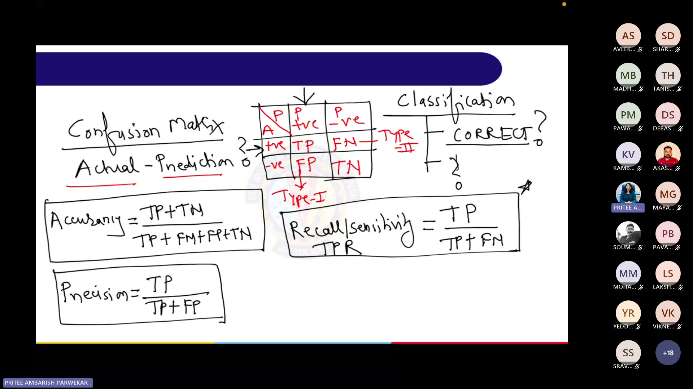

# Module 11: Machine Learning Model Evaluation & Comparison

**Course**: AIML ZG565 — Machine Learning  
**Prescribed References**: Tom M. Mitchell (T1, Chapter 5); Christopher M. Bishop (R1, Chapter 1); Tan et al. (R2, Chapter 4)  
**Primary Teacher Followed**: Prof. Pritee Narendra Raole (Session 13: 2026-11-01)

---

## 1. Executive Summary & Foundational Definitions

The ultimate objective of any machine learning model is **generalization**: achieving high predictive accuracy on novel, unseen data generated from the same underlying data-generating distribution $p(\mathbf{x}, y)$ as the training set.

Evaluating a model naively on its training data produces severely biased, over-optimistic performance estimates. Rigorous empirical evaluation requires:
1. **Unbiased Resampling Protocols**: Partitioning data into mutually exclusive subsets to prevent data leakage and evaluate true expected risk.
2. **Loss-Aligned Performance Metrics**: Selecting scalar metrics that reflect operational asymmetric costs (e.g., distinguishing the cost of a false positive from a fatal false negative).
3. **Statistical Hypothesis Testing**: Establishing whether an observed difference in performance between two competing algorithms is statistically significant or merely an artifact of random sampling variance.
4. **Algorithmic Fairness & Interpretability Auditing**: Guaranteeing models do not propagate demographic disparities or historical societal bias.

```
                  ┌──────────────────────────────────────┐
                  │ Entire Dataset D (N Samples)         │
                  └──────────────────┬───────────────────┘
                                     │
             ┌───────────────────────┴───────────────────────┐
             ▼                                               ▼
┌─────────────────────────┐                     ┌─────────────────────────┐
│ Train + Validation (80%)│                     │ Held-Out Test Set (20%) │
│ (Model Tuning & K-Fold) │                     │ (Untouched until Final) │
└────────────┬────────────┘                     └────────────┬────────────┘
             │                                               │
             ▼                                               ▼
┌─────────────────────────┐                     ┌─────────────────────────┐
│ Hypothesis Selection    │                     │ Generalization Error:   │
│ & Hyperparameter Search │                     │ Precision, Recall, AUC, │
│ via Cross-Validation    │                     │ Fairness & McNemar Test │
└─────────────────────────┘                     └─────────────────────────┘
```

---

## 2. Resampling Protocols & Validation Schemes

### 2.1 The Hold-Out Protocol
The dataset $\mathcal{D}$ is partitioned into three disjoint sets:
- **Training Set (60–70%)**: Used by the numerical optimizer to learn parameter weights $\mathbf{w}$.
- **Validation Set (15–20%)**: Used to evaluate competing model classes, tune hyperparameters ($\lambda, C, \gamma, \text{depth}$), and trigger early stopping.
- **Test Set (15–20%)**: Held in strict isolation; evaluated **exactly once** to report unbiased out-of-sample performance.

---

### 2.2 $K$-Fold Cross-Validation & Stratified $K$-Fold

When dataset size $N$ is limited, a single hold-out split suffers from high variance depending on which samples fall into validation.  
In **$K$-Fold Cross-Validation**:
1. Partition dataset $\mathcal{D}$ into $K$ equal-sized disjoint folds: $\mathcal{D}_1, \mathcal{D}_2, \dots, \mathcal{D}_K$.
2. For $k = 1, \dots, K$:
   - Train model on the union of $K-1$ folds: $\mathcal{D}_{\setminus k} = \bigcup_{j \neq k} \mathcal{D}_j$.
   - Evaluate model performance $S_k$ on the remaining validation fold $\mathcal{D}_k$.
3. Aggregate the cross-validation score:
   $$\bar{S}_{\text{CV}} = \frac{1}{K} \sum_{k=1}^K S_k, \quad \text{SE} = \frac{\sigma_{\text{CV}}}{\sqrt{K}}$$

> **Stratified $K$-Fold Requirement**: In class-imbalanced datasets (e.g., fraud with 1% positives), random splitting can create validation folds containing zero positive instances. **Stratification** enforces that every fold preserves the exact class proportion as the overall population.

---

## 3. Confusion Matrix & Classification Metrics


*Figure 11.1: Confusion Matrix whiteboard — TP/FP/FN/TN quadrants, Accuracy=(TP+TN)/(TP+FN+FP+TN), Recall=TP/(TP+FN), Precision=TP/(TP+FP) (Aug 30 session).*

For binary classification with Positive ($P$, $y=1$) and Negative ($N$, $y=0$):

```
                       Actual Class (Ground Truth)
                       Positive (y = 1)      Negative (y = 0)
Predicted  Pos (ŷ = 1) │ True Positive (TP)  │ False Positive (FP) │ -> Precision = TP / (TP + FP)
Class      Neg (ŷ = 0) │ False Negative (FN) │ True Negative (TN)  │
                       ─────────────────────────────────────────
                       │ Recall = TP / P     │ Specificity = TN / N
```

### 3.1 Scalar Performance Metrics

1. **Accuracy**:
   $$\text{Accuracy} = \frac{\text{TP} + \text{TN}}{\text{TP} + \text{TN} + \text{FP} + \text{FN}}$$
   *Severe Pathological Failure*: On 99% majority class data, a dummy classifier predicting negative for all inputs achieves 99% accuracy while having zero clinical or practical utility!
2. **Precision (Positive Predictive Value)**:
   $$\text{Precision} = \frac{\text{TP}}{\text{TP} + \text{FP}}$$
   *Answers: "Of all instances predicted positive, what proportion was truly positive?"* (Critical in spam filtering, where false alarms destroy user trust).
3. **Recall (Sensitivity / True Positive Rate - TPR)**:
   $$\text{Recall} = \text{TPR} = \frac{\text{TP}}{\text{TP} + \text{FN}}$$
   *Answers: "Of all actual positive instances, what proportion did the model identify?"* (Critical in cancer detection and fraud screening, where a False Negative is catastrophic).
4. **Specificity (True Negative Rate - TNR)**:
   $$\text{Specificity} = \text{TNR} = \frac{\text{TN}}{\text{TN} + \text{FP}}$$
5. **False Positive Rate (FPR / Fall-Out)**:
   $$\text{FPR} = 1 - \text{Specificity} = \frac{\text{FP}}{\text{TN} + \text{FP}}$$
6. **$F_1$-Score (Harmonic Mean)**:
   $$F_1 = \frac{2}{\frac{1}{\text{Precision}} + \frac{1}{\text{Recall}}} = 2 \cdot \frac{\text{Precision} \cdot \text{Recall}}{\text{Precision} + \text{Recall}} = \frac{2\text{TP}}{2\text{TP} + \text{FP} + \text{FN}}$$
   *(Harmonic mean severely penalizes extreme trade-offs: if either Precision or Recall drops to 0, $F_1 \to 0$ regardless of how large the other metric is).*
7. **$F_\beta$-Score (Weighted Asymmetry)**:
   $$F_\beta = (1 + \beta^2) \cdot \frac{\text{Precision} \cdot \text{Recall}}{\beta^2 \text{Precision} + \text{Recall}}$$
   - $\beta = 2$ ($F_2$): Recall is weighted twice as heavily as precision.
   - $\beta = 0.5$ ($F_{0.5}$): Precision is weighted twice as heavily as recall.

---

### 3.2 Curve Analysis: ROC and Precision-Recall Curves

Classifiers output continuous confidence scores $s(\mathbf{x}) \in [0, 1]$. Varying the classification decision threshold $\tau \in [0, 1]$ generates a parametric curve of performance:

#### 1. The Receiver Operating Characteristic (ROC) Curve:
- Plots **True Positive Rate (Recall)** on the y-axis versus **False Positive Rate ($1 - \text{Specificity}$)** on the x-axis across all thresholds $\tau \in [0, 1]$.
- **Area Under the ROC Curve (ROC-AUC)**:
  $$\text{AUC} = \int_0^1 \text{TPR}(\tau) d(\text{FPR}(\tau)) \in [0, 1]$$
  - $\text{AUC} = 1.0$: Perfect separation.
  - $\text{AUC} = 0.5$: Equivalent to random coin tossing.
- **Probabilistic Meaning of ROC-AUC**:
  $$\text{AUC} = P(s(\mathbf{x}^+) > s(\mathbf{x}^-))$$
  The probability that the model ranks a randomly chosen positive instance higher than a randomly chosen negative instance.

#### 2. The Precision-Recall (PR) Curve:
- Plots **Precision** versus **Recall**.
- **When to Use PR Curves**: In extreme class imbalance, the negative class size $N \gg P$. Even a massive influx of False Positives barely shifts FPR because the denominator $(\text{TN} + \text{FP})$ is dominated by TN. The ROC curve looks deceptively optimistic, whereas the PR curve reveals catastrophic drops in Precision.

---

## 4. Statistical Hypothesis Testing for Classifier Comparison

When comparing Classifier $A$ against Classifier $B$, we must determine whether $A$'s higher test accuracy is statistically significant.

### 4.1 McNemar's Test (Paired Nominal Test)
Evaluates two classifiers evaluated on the exact same test dataset of size $N$.  
Construct a $2 \times 2$ contingency table of joint predictions:

```
                          Classifier B
                          Correct (1)     Incorrect (0)
Classifier A  Correct (1) │ e₀₀           │ e₀₁ (A right, B wrong)
              Incorrect(0)│ e₁₀ (A wrong, │ e₁₁ (Both wrong)
                          │      B right) │
```

Under null hypothesis $H_0$: The two algorithms have equal error rates ($P(e_{01}) = P(e_{10})$).  
The discordant pairs $(e_{01}, e_{10})$ follow a binomial distribution. For large counts ($e_{01} + e_{10} \ge 25$), the continuity-corrected test statistic is:

$$\chi^2 = \frac{(|e_{01} - e_{10}| - 1)^2}{e_{01} + e_{10}} \sim \chi^2_1 \quad (\text{Chi-square with 1 degree of freedom})$$

If $\chi^2 > 3.841$ (for significance level $\alpha = 0.05$), we reject the null hypothesis and conclude that the performance difference is statistically significant.

---

## 5. Emerging Requirements: Algorithmic Fairness & Model Interpretability

### 5.1 Algorithmic Fairness Metrics
Let $A \in \{0, 1\}$ denote a protected demographic attribute (e.g., gender, race), and let $\hat{Y} \in \{0, 1\}$ denote the model's prediction.
1. **Demographic Parity (Statistical Parity)**:
   $$P(\hat{Y} = 1 \mid A = 0) = P(\hat{Y} = 1 \mid A = 1)$$
   *Selection rates must be identical across protected groups, regardless of true target distributions.*
2. **Equal Opportunity**:
   $$P(\hat{Y} = 1 \mid A = 0, Y = 1) = P(\hat{Y} = 1 \mid A = 1, Y = 1)$$
   *True Positive Rates (Recall) must be equal across protected groups.*
3. **Equalized Odds**: Both True Positive Rate and False Positive Rate must be equal across protected groups.

---

### 5.2 Model Interpretability: SHAP (Shapley Additive Explanations)
Based on cooperative game theory (Lloyd Shapley, 1953), SHAP assigns each feature an additive importance value $\phi_i$ representing its marginal contribution to the prediction:

$$f(\mathbf{x}) = \phi_0 + \sum_{i=1}^d \phi_i(\mathbf{x})$$

$$\phi_i = \sum_{S \subseteq F \setminus \{i\}} \frac{|S|! (|F| - |S| - 1)!}{|F|!} \left[ f(S \cup \{i\}) - f(S) \right]$$

SHAP is the **only** local feature attribution method that provably satisfies three essential axioms: **Efficiency**, **Symmetry**, and **Additivity**.

---

## 6. Vectorized Implementation (From Scratch)

```python
import numpy as np

class ModelEvaluator:
    """Vectorized calculation of confusion matrix, scalar metrics, and ROC-AUC."""
    @staticmethod
    def confusion_matrix(y_true: np.ndarray, y_pred: np.ndarray) -> dict:
        TP = int(np.sum((y_true == 1) & (y_pred == 1)))
        FP = int(np.sum((y_true == 0) & (y_pred == 1)))
        TN = int(np.sum((y_true == 0) & (y_pred == 0)))
        FN = int(np.sum((y_true == 1) & (y_pred == 0)))
        return {'TP': TP, 'FP': FP, 'TN': TN, 'FN': FN}

    @staticmethod
    def classification_report(cm: dict) -> dict:
        TP, FP, TN, FN = cm['TP'], cm['FP'], cm['TN'], cm['FN']
        acc = (TP + TN) / (TP + TN + FP + FN)
        prec = TP / (TP + FP) if (TP + FP) > 0 else 0.0
        rec = TP / (TP + FN) if (TP + FN) > 0 else 0.0
        spec = TN / (TN + FP) if (TN + FP) > 0 else 0.0
        f1 = 2 * (prec * rec) / (prec + rec) if (prec + rec) > 0 else 0.0
        return {'Accuracy': acc, 'Precision': prec, 'Recall': rec, 'Specificity': spec, 'F1': f1}

    @staticmethod
    def roc_auc_score(y_true: np.ndarray, y_scores: np.ndarray) -> float:
        """Computes exact ROC-AUC via rank-sum Wilcoxon-Mann-Whitney formulation."""
        pos_scores = y_scores[y_true == 1]
        neg_scores = y_scores[y_true == 0]
        n_pos = len(pos_scores)
        n_neg = len(neg_scores)

        if n_pos == 0 or n_neg == 0:
            return 0.5

        # Pairwise ranking comparison: I(score_pos > score_neg)
        pairwise_matrix = pos_scores[:, np.newaxis] - neg_scores[np.newaxis, :]
        auc = (np.sum(pairwise_matrix > 0) + 0.5 * np.sum(pairwise_matrix == 0)) / (n_pos * n_neg)
        return float(auc)


if __name__ == "__main__":
    y_true = np.array([1, 0, 1, 1, 0, 0, 1, 0, 1, 0])
    y_scores = np.array([0.9, 0.4, 0.8, 0.7, 0.2, 0.6, 0.85, 0.1, 0.65, 0.3])
    y_pred = (y_scores >= 0.5).astype(int)

    cm = ModelEvaluator.confusion_matrix(y_true, y_pred)
    metrics = ModelEvaluator.classification_report(cm)
    auc = ModelEvaluator.roc_auc_score(y_true, y_scores)

    print("Confusion Matrix:", cm)
    for k, v in metrics.items():
        print(f"{k:12}: {v:.4f}")
    print(f"ROC-AUC     : {auc:.4f}")
```

---

## 7. Solved Numerical Example (Exam Pattern)

**Problem Statement (University Examination Pattern, 6 Marks)**:  
A machine learning fraud detection model is evaluated on a held-out test set of 1,000 transactions. The resulting confusion matrix is:

| | Actual Fraud ($y = 1$) | Actual Legitimate ($y = 0$) |
| :---: | :---: | :---: |
| **Predicted Fraud ($\hat{y} = 1$)** | $\text{TP} = 80$ | $\text{FP} = 40$ |
| **Predicted Legitimate ($\hat{y} = 0$)** | $\text{FN} = 20$ | $\text{TN} = 860$ |

1. Calculate the Accuracy, Precision, Recall, Specificity, and $F_1$-score.
2. Calculate the $F_2$-score (where Recall is weighted twice as heavily as Precision).
3. A baseline rule-based system evaluated on the same 1,000 samples yielded:
   - Transactions where ML was correct and Rules were wrong: $e_{01} = 45$.
   - Transactions where ML was wrong and Rules were correct: $e_{10} = 15$.
   Perform **McNemar's Test** with continuity correction to determine whether the ML model is statistically significantly superior at significance level $\alpha = 0.05$ ($\chi^2_{\text{critical}} = 3.841$).

---

### Step-by-Step Solution:

#### Step 1: Scalar Performance Metrics
Total samples $N = 80 + 40 + 20 + 860 = 1,000$.

- **Accuracy**:
  $$\text{Accuracy} = \frac{\text{TP} + \text{TN}}{N} = \frac{80 + 860}{1000} = \frac{940}{1000} = \mathbf{94.00\%}$$

- **Precision**:
  $$\text{Precision} = \frac{\text{TP}}{\text{TP} + \text{FP}} = \frac{80}{80 + 40} = \frac{80}{120} = \frac{2}{3} \approx \mathbf{66.67\%}$$

- **Recall (Sensitivity)**:
  $$\text{Recall} = \frac{\text{TP}}{\text{TP} + \text{FN}} = \frac{80}{80 + 20} = \frac{80}{100} = \mathbf{80.00\%}$$

- **Specificity**:
  $$\text{Specificity} = \frac{\text{TN}}{\text{TN} + \text{FP}} = \frac{860}{860 + 40} = \frac{860}{900} \approx \mathbf{95.56\%}$$

- **$F_1$-Score**:
  $$F_1 = 2 \cdot \frac{\text{Precision} \cdot \text{Recall}}{\text{Precision} + \text{Recall}} = 2 \cdot \frac{0.6667 \times 0.8000}{0.6667 + 0.8000} = 2 \cdot \frac{0.5333}{1.4667} = \frac{1.0667}{1.4667} \approx \mathbf{72.73\%}$$

---

#### Step 2: Calculate $F_2$-Score ($\beta = 2$)
$$F_2 = (1 + 2^2) \cdot \frac{\text{Precision} \cdot \text{Recall}}{2^2 \cdot \text{Precision} + \text{Recall}} = 5 \cdot \frac{0.6667 \times 0.8000}{4(0.6667) + 0.8000}$$
$$F_2 = 5 \cdot \frac{0.5333}{2.6667 + 0.8000} = 5 \cdot \frac{0.5333}{3.4667} = \frac{2.6667}{3.4667} \approx \mathbf{76.92\%}$$

---

#### Step 3: McNemar's Hypothesis Test
Discordant pair counts:
- $e_{01} = 45$ (ML correct, Rules incorrect)
- $e_{10} = 15$ (ML incorrect, Rules correct)

Check sample size condition: $e_{01} + e_{10} = 45 + 15 = 60 \ge 25$ (Gaussian approximation holds).

Apply McNemar's Chi-square statistic with Yates' continuity correction:
$$\chi^2 = \frac{(|e_{01} - e_{10}| - 1)^2}{e_{01} + e_{10}} = \frac{(|45 - 15| - 1)^2}{45 + 15} = \frac{(30 - 1)^2}{60} = \frac{29^2}{60} = \frac{841}{60} \approx \mathbf{14.017}$$

Decision:
$$\chi^2_{\text{calculated}} = \mathbf{14.017} > \chi^2_{\text{critical}} = \mathbf{3.841} \quad (p < 0.001)$$

**Conclusion**: We decisively reject the null hypothesis $H_0$. The performance improvement achieved by the machine learning fraud model over the baseline rule-based system is **statistically significant at the $\alpha = 0.05$ confidence level**.

---

## 8. Common Pitfalls, Trade-offs & Practical Guidelines

1. **Reporting Only Accuracy on Imbalanced Data**:
   - In rare-event domains (fraud, disease, click-through rates), accuracy is completely meaningless. Always report **Precision-Recall AUC (PR-AUC)**, **$F_1$-score**, and the full confusion matrix.
2. **Threshold Leakage**:
   - Selecting the optimal classification decision threshold $\tau^*$ on the **test set** invalidates generalization bounds. The decision threshold must be tuned exclusively on the **validation set** and evaluated blindly on the test set.
3. **Data Splitting on Clustered / Temporal Data**:
   - Standard random $k$-fold cross-validation leaks information when data has temporal structure (stock prices, sensor feeds) or grouped structure (multiple medical records from the same patient). Always use **Time-Series Split (Forward Chaining)** or **GroupKFold** to ensure entire patient groups or future time periods remain strictly in validation.

