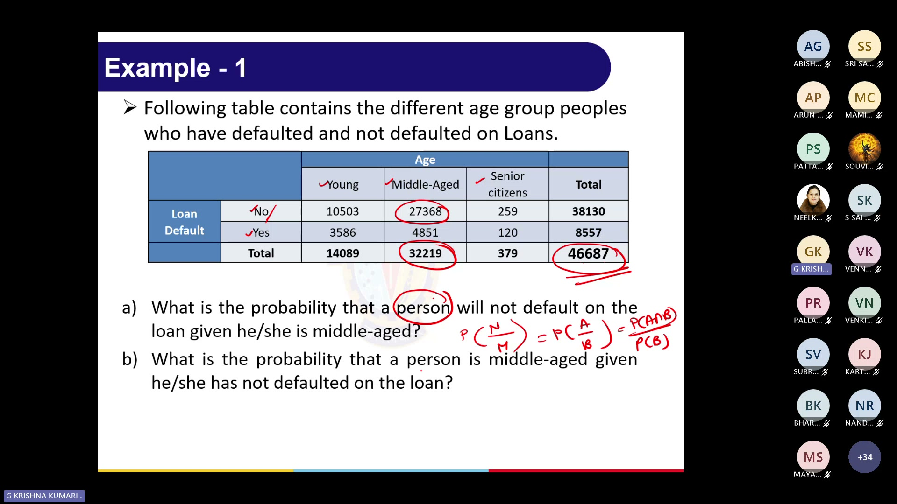

# Module 2: Conditional Probability, Bayes Theorem & Naive Bayes

**Course**: AIML ZC418 — Introduction to Statistical Methods  
**Prescribed References**: Devore (T2, Ch. 3); Kaptein (T1, Bayesian chapters)  
**Primary Teacher**: Prof. G. Krishna Kumari — **Contact Sessions 3–4** (`Stats_G.Krishna Kumari_3.md`, `_4.md`)  
**Slides**: `ISM_CS-3_PPT`, `ISM_CS-4_PPT`

---

## 1. Executive Summary

**Conditional probability** revises beliefs when partial evidence is known. **Total probability** decomposes an event across a partition. **Bayes' theorem** inverts conditioning (likelihood → posterior) — the engine behind **Naive Bayes** classifiers in machine learning (spam, sentiment, document tags). Prof. Krishna Kumari emphasises **denominator = given condition already occurred** and Laplace smoothing when a product term hits zero.

---

## 2. Conditional Probability

**Definition**: For $P(B)>0$,
$$P(A\mid B) = \frac{P(A\cap B)}{P(B)}$$

**Multiplication rule** (general):
$$P(A\cap B) = P(B)\,P(A\mid B) = P(A)\,P(B\mid A)$$

**$n$ events**:
$$P(A_1\cap\cdots\cap A_n) = P(A_1)\prod_{k=2}^{n} P(A_k\mid A_1\cap\cdots\cap A_{k-1})$$

### 2.1 Loan defaulter table (lecture CS3)

Given age-stratified counts, compute $P(\text{non-defaulter}\mid\text{middle-aged})$ via:

$$P(N\mid M) = \frac{P(N\cap M)}{P(M)} = \frac{27368/46687}{32219/46687} = \frac{27368}{32219} \approx 0.85$$

**Exam tip**: Show $P(N)$, $P(M)$, $P(N\cap M)$ separately first (general method), then note shortcut $P(N\mid M)=n_{NM}/n_M$.

### 2.2 Subset events

If $B \subset A$, then $P(A\cap B)=P(B)$. Example: repair shop — CD player ⊂ audio component ⇒ $P(B\mid A)=0.05/0.6$.

---

## 3. Independent Events

$A$ and $B$ independent iff $P(A\mid B)=P(A)$ (equivalently $P(A\cap B)=P(A)P(B)$).

**With replacement** (272 right-handers / 300 adults, pick 3 RH):
$$\left(\frac{272}{300}\right)^3$$

**Without replacement** (distinct RH): $\frac{272}{300}\cdot\frac{271}{299}\cdot\frac{270}{298}$.

**Spam features (independent assumption stated)**: $P(\text{offer}\cap\text{link})=0.6\times 0.4$; $P(\text{offer}\cup\text{link})=0.6+0.4-0.24=0.76$; neither: $1-0.76=0.24$.

---

## 4. Law of Total Probability

Partition $S = \bigcup_{i=1}^k A_i$ with $A_i$ mutually exclusive, $P(A_i)>0$. Then
$$P(B) = \sum_{i=1}^{k} P(B\mid A_i)\,P(A_i)$$

**Gas station tanks (CS3)**: Regular 40%, Plus 35%, Premium 25%; fill probabilities 0.30, 0.60, 0.50 ⇒
$$P(\text{fill}) = 0.4(0.3)+0.35(0.6)+0.25(0.5) = 0.455$$

---

## 5. Bayes' Theorem

$$P(A_i\mid B) = \frac{P(B\mid A_i)\,P(A_i)}{\sum_j P(B\mid A_j)\,P(A_j)}$$

**Thumb rule (lecture)**: swap conditioning — numerator uses **same index** on likelihood and prior.

**Manager / bonus (CS4)**: $P(X)=4/9$, $P(Y)=2/9$, $P(Z)=1/3$; bonuses $3/10$, $1/2$, $4/5$ ⇒ total $P(B)$ then $P(X\mid B)$.

**Medical diagnosis (Exam Q8 — 6 marks)**: rare disease + imperfect test → posterior after positive screen.

| Symbol | Meaning | Value |
| :--- | :--- | :---: |
| $D$ | disease present | $P(D)=0.01$ |
| $+$ | test positive | — |
| — | sensitivity | $P(+\mid D)=0.95$ |
| — | specificity | $P(-\mid D^c)=0.90 \Rightarrow P(+\mid D^c)=0.10$ |

1. **Total probability**: $P(+) = 0.95(0.01) + 0.10(0.99) = 0.1085$.
2. **Bayes**: $P(D\mid+) = \dfrac{0.95 \times 0.01}{0.1085} \approx 0.088$ (**~8.8%**).
3. **Interpretation**: when prevalence is low, most positives are **false alarms** (compare with ML Module 11 cancer paradox).

**Spam filter false positive**: $P(\text{not spam}\mid\text{flagged spam})$ using $P(\text{spam})=0.5$, detection rates — links to **confusion matrix** in ML.

---

## 6. Naive Bayes & Laplace Smoothing

For class $C$ and features $x_1,\ldots,x_d$, **naive** conditional independence:
$$P(C\mid \mathbf{x}) \propto P(C)\prod_{j=1}^{d} P(x_j\mid C)$$

**Supermarket bread (lecture)**: estimate $P(\text{jam}\mid \text{bread})$, etc., from receipts; multiply for basket prediction.

**Zero-frequency problem**: if $P(x_j\mid C)=0$, entire product is 0 → **Laplace smoothing** (add-one): 
$$\hat{P}(x_j\mid C) = \frac{n_{j,C}+1}{n_C + |V|}$$

**ML bridge (CS4)**: Naive Bayes = supervised generative classifier; prior/posterior vocabulary matches **Type I/II** and **precision/recall** discussion in later modules.

---

## 7. Solved Numerical (Bayes — spam word "offer")

Given: $P(S)=0.3$, $P(\bar{S})=0.7$, $P(\text{offer}\mid S)=0.8$, $P(\text{offer}\mid\bar{S})=0.1$.

$$P(\text{offer}) = 0.8(0.3)+0.1(0.7)=0.31$$

$$P(S\mid \text{offer}) = \frac{0.8\times 0.3}{0.31} = \frac{0.24}{0.31} \approx 0.774$$

**Interpretation**: Seeing "offer" shifts belief from 30% to ~77% spam — justify with Bayes narrative (2 marks).

---

## 8. Exam Writing Checklist

1. Define events with symbols ($N,M,B,\ldots$).
2. State **given** condition in words.
3. Show $P(A\cap B)$, marginals, then ratio — or shortcut if equivalent.
4. One-line **business / ML** interpretation.
5. Bayes problems are **mandatory** in assessments (faculty).