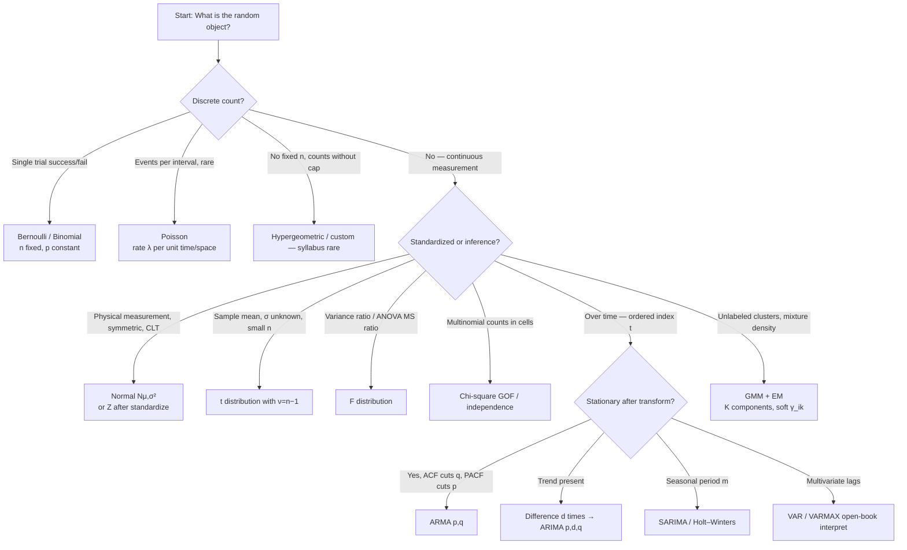

# AIML ZC418: Introduction to Statistical Methods — Master Formula Sheet & Study Guide

**Course**: AIML ZC418 — Introduction to Statistical Methods  
**Target Audience**: Mid-Semester (Closed Book, CS1–8), Comprehensive (Open Book), Viva / Oral Defense, Quick Revision  
**Primary Teacher Followed**: Prof. G. Krishna Kumari (Lead ISM, BITS Pilani WILP)  
**Prescribed References**: Kaptein et al. (T1); Devore (T2); Brockwell & Davis (T3 — time series)

---

## 1. Master Formula Reference Table

| Module & Concept | Canonical Mathematical Formulation | Key Parameters & Dimensions | Operational Bounds & Remarks |
| :--- | :--- | :--- | :--- |
| **M1: Sample mean** | $\bar{x} = \frac{1}{n}\sum_{i=1}^n x_i$ | $x_i \in \mathbb{R}$ | Sensitive to outliers; use with symmetric data |
| **M1: Sample variance** | $s^2 = \frac{1}{n-1}\sum_{i=1}^n (x_i - \bar{x})^2$ | Bessel correction $n-1$ | Exam: **sample** (not population) $n-1$ |
| **M1: IQR & Tukey outliers** | $\mathrm{IQR}=Q_3-Q_1$; fences $Q_1-1.5\,\mathrm{IQR}$, $Q_3+1.5\,\mathrm{IQR}$ | Five-number summary | Flag **both** tails; box-plot whiskers |
| **M1: Classical probability** | $P(A)=\frac{\|A\|}{\|S\|}$ | Equally likely outcomes | Deck / die / urn problems |
| **M1: Kolmogorov axioms** | $P(A)\ge 0$, $P(S)=1$, countable additivity on disjoint events | — | Complement: $P(A^c)=1-P(A)$ |
| **M1: Combination** | $\binom{n}{r}=\frac{n!}{r!(n-r)!}$ | Order irrelevant | Choose $r$ from $n$ |
| **M1: Permutation** | ${}_nP_r=\frac{n!}{(n-r)!}$ | Order matters | Sequences without repetition |
| **M2: Conditional probability** | $P(A\mid B)=\frac{P(A\cap B)}{P(B)}$, $P(B)>0$ | — | **Not** symmetric in $A,B$ |
| **M2: Independent events** | $P(A\cap B)=P(A)P(B)$ | vs. mutually exclusive $P(A\cap B)=0$ | Independent $\neq$ exclusive |
| **M2: Bayes' theorem** | $P(H\mid E)=\frac{P(E\mid H)P(H)}{P(E)}$ | $P(E)=\sum_j P(E\mid H_j)P(H_j)$ | Diagnostics, spam, QA |
| **M2: Total probability** | $P(E)=\sum_i P(E\mid A_i)P(A_i)$ | Partition $\{A_i\}$ | Denominator of Bayes |
| **M2: Naïve Bayes score** | $\hat{c}=\arg\max_c P(c)\prod_{k=1}^d P(x_k\mid c)$ | Conditional independence | Log-sum for stability |
| **M2: Laplace smoothing** | $\hat{P}(x_k\mid c)=\frac{N_{ck}+1}{N_c+V_k}$ | $V_k$: feature support size | Avoids zero product |
| **M3: PMF axioms** | $0\le p(x)\le 1$, $\sum_x p(x)=1$ | Discrete $X$ | — |
| **M3: PDF axioms** | $f(x)\ge 0$, $\int_{-\infty}^{\infty} f(x)\,dx=1$ | Continuous $X$ | $P(a\le X\le b)=\int_a^b f(x)\,dx$ |
| **M3: Expectation** | $\mathbb{E}[X]=\sum_x x\,p(x)$ or $\int x f(x)\,dx$ | Linearity: $\mathbb{E}[aX+b]=a\mathbb{E}[X]+b$ | — |
| **M3: Variance** | $\mathrm{Var}(X)=\mathbb{E}[(X-\mu)^2]=\mathbb{E}[X^2]-\mu^2$ | $\sigma=\sqrt{\mathrm{Var}(X)}$ | $\mathrm{Var}(aX+b)=a^2\mathrm{Var}(X)$ |
| **M3: Covariance** | $\mathrm{Cov}(X,Y)=\mathbb{E}[(X-\mu_X)(Y-\mu_Y)]$ | $\mathrm{Cov}(X,X)=\mathrm{Var}(X)$ | $\mathrm{Cov}(X,Y)=\mathrm{Cov}(Y,X)$ |
| **M3: Bernoulli** | $P(X=1)=p$, $P(X=0)=1-p$ | $\mathbb{E}[X]=p$, $\mathrm{Var}(X)=p(1-p)$ | Single trial |
| **M3: Binomial** | $P(X=k)=\binom{n}{k}p^k(1-p)^{n-k}$ | $\mathbb{E}[X]=np$, $\mathrm{Var}(X)=np(1-p)$ | $n$ i.i.d. Bernoulli |
| **M3: Poisson** | $P(X=k)=\frac{e^{-\lambda}\lambda^k}{k!}$ | $\mathbb{E}[X]=\mathrm{Var}(X)=\lambda$ | Rare events per interval |
| **M3: Normal** | $f(x)=\frac{1}{\sqrt{2\pi}\sigma}e^{-(x-\mu)^2/(2\sigma^2)}$ | $Z=\frac{X-\mu}{\sigma}\sim\mathcal{N}(0,1)$ | CLT limit |
| **M3: $t$ distribution** | $T=\frac{\bar{X}-\mu}{S/\sqrt{n}}$ with $\nu=n-1$ df | Heavier tails than $Z$ | Small-sample unknown $\sigma$ |
| **M3: $\chi^2$** | $\chi^2=\sum_{i=1}^k\frac{(O_i-E_i)^2}{E_i}$ (goodness-of-fit) | df $=k-1$ (cells $-1$) | Variance / GOF |
| **M3: $F$ distribution** | $F=\frac{s_1^2/\sigma_1^2}{s_2^2/\sigma_2^2}$ | ANOVA ratio of MS | One-tailed on $F$ |
| **M3: $Z$-score standardize** | $z=\frac{x-\mu}{\sigma}$ | — | Link to normal table |
| **M4: CLT (informal)** | $\bar{X}\overset{\cdot}{\sim}\mathcal{N}(\mu,\sigma^2/n)$ for large $n$ | i.i.d. finite $\sigma^2$ | Justifies $Z$ for large $n$ |
| **M4: CI (mean, $\sigma$ known)** | $\bar{x}\pm z_{\alpha/2}\frac{\sigma}{\sqrt{n}}$ | $1-\alpha$ confidence | Two-sided critical $z$ |
| **M4: CI (mean, $\sigma$ unknown)** | $\bar{x}\pm t_{\alpha/2,\nu}\frac{s}{\sqrt{n}}$, $\nu=n-1$ | Use $t$ table | Small sample |
| **M4: CI (proportion)** | $\hat{p}\pm z_{\alpha/2}\sqrt{\hat{p}(1-\hat{p})/n}$ | $\hat{p}=x/n$ | Large $n$, $np,n(1-p)\ge 5$ |
| **M4: $z$-test (mean)** | $z=\frac{\bar{x}-\mu_0}{\sigma/\sqrt{n}}$ | $H_0:\mu=\mu_0$ | Known $\sigma$ |
| **M4: $t$-test (one mean)** | $t=\frac{\bar{x}-\mu_0}{s/\sqrt{n}}$ | $H_0:\mu=\mu_0$ | Unknown $\sigma$ |
| **M4: Two-sample $t$** | $t=\frac{\bar{x}_1-\bar{x}_2}{s_p\sqrt{1/n_1+1/n_2}}$ (pooled) | Equal variance assumption | Or Welch unpooled |
| **M4: $z$-test (proportion)** | $z=\frac{\hat{p}-p_0}{\sqrt{p_0(1-p_0)/n}}$ | $H_0:p=p_0$ | — |
| **M4: Type I / II error** | $\alpha=P(\text{reject }H_0\mid H_0\text{ true})$; $\beta=P(\text{fail reject}\mid H_1\text{ true})$ | Power $=1-\beta$ | Screening vs. confirmation trade-off |
| **M4: MLE (Bernoulli)** | $\hat{p}_{\text{MLE}}=\frac{1}{n}\sum x_i$ | Log-likelihood $\sum[x_i\log p+(1-x_i)\log(1-p)]$ | Set derivative to 0 |
| **M4: MLE (Normal $\mu$)** | $\hat{\mu}_{\text{MLE}}=\bar{x}$ | $\hat{\sigma}^2_{\text{MLE}}=\frac{1}{n}\sum(x_i-\bar{x})^2$ | MLE $\sigma^2$ uses $n$ not $n-1$ |
| **M4: One-way ANOVA $F$** | $F=\frac{\mathrm{MSB}}{\mathrm{MSW}}=\frac{\mathrm{SSB}/(k-1)}{\mathrm{SSW}/(N-k)}$ | $k$ groups, $N$ total | $H_0:\mu_1=\cdots=\mu_k$ |
| **M4: SSB / SSW** | $\mathrm{SSB}=\sum_{j=1}^k n_j(\bar{x}_j-\bar{x})^2$; $\mathrm{SSW}=\sum_{i,j}(x_{ij}-\bar{x}_j)^2$ | — | Partition SST |
| **M4: Two-way ANOVA** | Test $A$, $B$, $A\times B$ with separate $F$ ratios | Factors $a,b$ levels | Interaction critical in ISM |
| **M5: Pearson $r$** | $r=\frac{\sum(x_i-\bar{x})(y_i-\bar{y})}{\sqrt{\sum(x_i-\bar{x})^2\sum(y_i-\bar{y})^2}}$ | $r\in[-1,1]$ | Linear association only |
| **M5: Sample regression line** | $\hat{y}=\hat{\beta}_0+\hat{\beta}_1 x$ | $\hat{\beta}_1=\frac{s_{xy}}{s_x^2}$, $\hat{\beta}_0=\bar{y}-\hat{\beta}_1\bar{x}$ | OLS through $(\bar{x},\bar{y})$ |
| **M5: $R^2$** | $R^2=1-\frac{\mathrm{SSE}}{\mathrm{SST}}=r^2$ (simple) | $\mathrm{SSE}=\sum(y_i-\hat{y}_i)^2$ | Explained fraction of $y$ variance |
| **M5: MA$(q)$** | $X_t=\mu+\varepsilon_t+\theta_1\varepsilon_{t-1}+\cdots+\theta_q\varepsilon_{t-q}$ | $\varepsilon_t$ white noise | Forecast = weighted past errors |
| **M5: AR$(p)$** | $X_t=c+\phi_1 X_{t-1}+\cdots+\phi_p X_{t-p}+\varepsilon_t$ | Stationarity: roots outside unit circle | PACF cuts at $p$ |
| **M5: ARMA$(p,q)$** | AR + MA combined | Model ID via ACF/PACF | — |
| **M5: ARIMA$(p,d,q)$** | Differencing $d$ times then ARMA on $\nabla^d X_t$ | $d$ removes trend | $(1-B)^d$ operator |
| **M5: ACF** | $\rho_k=\mathrm{Corr}(X_t,X_{t-k})$ | Box-Jenkins diagnostics | MA: ACF cuts at $q$ |
| **M5: SES (level)** | $\hat{X}_{t+1}=\alpha X_t+(1-\alpha)\hat{X}_t$ | $0<\alpha<1$ | Simple exponential smoothing |
| **M5: Holt (trend)** | Level $L_t$, trend $T_t$ with $\alpha,\beta$ | Double exponential | Linear trend extension |
| **M5: Holt–Winters** | Adds seasonal $S_t$ with period $m$ | $\alpha,\beta,\gamma$ | SARIMA seasonal analogue |
| **M5: Stationarity** | Mean/variance/covariance invariant in $t$ | Weak stationarity standard in T3 | Differencing if non-stationary |
| **M5: White noise** | $\mathbb{E}[\varepsilon_t]=0$, $\mathrm{Var}(\varepsilon_t)=\sigma^2$, uncorrelated lags | Building block of ARMA | Residual diagnostics |
| **M6: GMM density** | $p(\mathbf{x})=\sum_{k=1}^K \pi_k\,\mathcal{N}(\mathbf{x}\mid\boldsymbol{\mu}_k,\boldsymbol{\Sigma}_k)$ | $\sum_k\pi_k=1$, $\pi_k\ge 0$ | Soft clustering |
| **M6: Responsibility** | $\gamma_{ik}=\frac{\pi_k\mathcal{N}(\mathbf{x}_i\mid\boldsymbol{\mu}_k,\boldsymbol{\Sigma}_k)}{\sum_j \pi_j\mathcal{N}(\mathbf{x}_i\mid\boldsymbol{\mu}_j,\boldsymbol{\Sigma}_j)}$ | $\sum_k\gamma_{ik}=1$ | E-step |
| **M6: EM M-step ($\pi_k$)** | $\pi_k^{\text{new}}=\frac{1}{n}\sum_{i=1}^n \gamma_{ik}$ | — | Mixture weight update |
| **M6: EM M-step ($\boldsymbol{\mu}_k$)** | $\boldsymbol{\mu}_k^{\text{new}}=\frac{\sum_i \gamma_{ik}\mathbf{x}_i}{\sum_i \gamma_{ik}}$ | Weighted centroid | Same form as $k$-means hard |
| **M6: Log-likelihood (observed)** | $\ell(\theta)=\sum_{i=1}^n \log p(\mathbf{x}_i\mid\theta)$ | Non-decreasing under EM | Stop when $\Delta\ell$ small |

---

## 2. Critical Values & Table Usage (Exam Protocol)

| Statistic | Typical $H_0$ context | Rejection rule (two-sided unless noted) | Table inputs |
| :--- | :--- | :--- | :--- |
| **$z_{\alpha/2}$** | Known $\sigma$, large-$n$ proportion/mean | $\|z_{\text{obs}}\|>z_{\alpha/2}$ | $\alpha$ only (e.g. 1.96 at $\alpha=0.05$) |
| **$t_{\alpha/2,\nu}$** | One/two mean, unknown $\sigma$ | $\|t_{\text{obs}}\|>t_{\alpha/2,\nu}$ | $\nu=n-1$ (or Welch df) |
| **$\chi^2_{\alpha,\nu}$** | Goodness-of-fit, variance test | $\chi^2_{\text{obs}}>\chi^2_{\alpha,\nu}$ (upper tail) | $\nu=$ df from problem |
| **$F_{\alpha}(\nu_1,\nu_2)$** | ANOVA, equality of variances | $F_{\text{obs}}>F_{\alpha}(\nu_1,\nu_2)$ | Numerator/denominator df |
| **Normal CDF** | $P(Z\le z)$ for standardization | Shade tail area $=\alpha$ or $p$-value | $Z$-score from $x$ |

**Worked habit (BITS style)**:
1. State $H_0$, $H_1$, $\alpha$, and test type (one-/two-tailed).
2. Check **sampling model** (independence, $np$ rule, normality / CLT).
3. Compute test statistic **with units** in numerator/denominator.
4. Compare to critical value **or** report $p$-value and **business interpretation** (not only “reject”).

---

## 3. Distribution Selection Flowchart

**Quick mnemonics**:
- **Binomial**: fixed $n$ identical trials, two outcomes.
- **Poisson**: $\lambda$ = expected count **per interval**; variance = mean.
- **Normal**: residuals, measurement error, $\bar{X}$ for large $n$.
- **$t$**: one sample mean when $\sigma$ estimated by $s$.
- **$F$**: ANOVA — always **between** MS over **within** MS.
- **ARIMA**: if series drifts, difference first; if seasonal spike every $m$, add seasonal $D,P,Q$.

---

## 4. Viva / Oral Examination Checklist

### Hypothesis testing literacy
- [ ] Define **Type I error** ($\alpha$): reject true $H_0$ (false alarm).
- [ ] Define **Type II error** ($\beta$): fail to reject false $H_0$ (missed detection).
- [ ] State **power** $1-\beta$; what increases power (larger $n$, larger $\alpha$, smaller $\sigma$, larger effect).
- [ ] Distinguish **statistical significance** vs **practical significance** (effect size, business cost).
- [ ] One-tailed vs two-tailed: direction fixed **before** seeing data.

### Naïve Bayes & Bayes
- [ ] Write Bayes with **likelihood × prior / evidence**.
- [ ] State **conditional independence**: features independent **given class** (not globally).
- [ ] Why log scores: $\log P(c)+\sum_k\log P(x_k\mid c)$ avoids underflow.
- [ ] **Zero probability** problem and **Laplace (additive-1)** smoothing.
- [ ] Contrasts: **generative** (NB) vs **discriminative** logistic — same posterior goal, different modeling.

### Stationarity & time series
- [ ] **Weak stationarity**: constant mean, constant variance, $\mathrm{Cov}(X_t,X_{t-h})$ depends only on lag $h$.
- [ ] Components: **trend, seasonal, cyclical, irregular** (lecture decomposition).
- [ ] **ACF vs PACF** for AR/MA order hints (AR: PACF cuts; MA: ACF cuts).
- [ ] **Differencing** removes polynomial trend; **seasonal differencing** $(1-B^m)$.
- [ ] Residuals should look like **white noise**; large autocorrelation in residuals ⇒ model misspec.

### EM & GMM
- [ ] GMM = **weighted sum of Gaussians**; $\pi_k$ are mixing weights.
- [ ] **E-step**: posterior $\gamma_{ik}=P(Z_i=k\mid\mathbf{x}_i)$.
- [ ] **M-step**: update $\pi_k,\boldsymbol{\mu}_k,\boldsymbol{\Sigma}_k$ as responsibility-weighted statistics.
- [ ] **EM convergence**: observed log-likelihood **non-decreasing**; may converge to local max.
- [ ] **vs $k$-means**: GMM gives **soft** assignments and elliptical clusters (full $\boldsymbol{\Sigma}_k$).

### ANOVA & regression bridges
- [ ] ANOVA $F$ tests **equality of group means**, not variance homogeneity alone (though assume equal $\sigma$ in standard one-way).
- [ ] Regression $R^2$ is **explained variation**; high $R^2$ does not imply causation.
- [ ] **MLE** principle: choose $\theta$ maximizing $L(\theta)=\prod_i f(x_i\mid\theta)$; same as minimizing $-\ell(\theta)$.

### Sampling & CLT
- [ ] **Random** vs **stratified** sampling — when stratify by key subpopulations.
- [ ] CLT: $\bar{X}$ approximately normal for large $n$ even if parent not normal (conditions stated).
- [ ] Use **$t$** when $\sigma$ unknown and sample modest; **$Z$** when $\sigma$ known or huge $n$ with known variance logic.

---

## 5. High-Yield Conceptual Viva Q&A (Statistics)

**Q1: Mutual exclusivity vs independence — give one example of each.**  
*A*: **Mutually exclusive**: drawing one card — “heart” and “spade” cannot co-occur ($P(A\cap B)=0$). **Independent**: two fair dice — outcome on die 1 does not change die 2 ($P(A\cap B)=P(A)P(B)$). Exclusive events with $P(A),P(B)>0$ cannot be independent.

**Q2: Why does Poisson have $\mathbb{E}[X]=\mathrm{Var}(X)=\lambda$?**  
*A*: **Counting process with rare events at rate $\lambda$ per unit** implies both average level and fluctuation scale with $\lambda$. Exam applications: defects per meter, calls per hour — sanity-check sample mean ≈ sample variance.

**Q3: When do you use $t$ instead of $Z$ for a mean test?**  
*A*: **When population standard deviation $\sigma$ is unknown and replaced by sample $s$.** The extra uncertainty inflates tails; $t_{\nu}$ critical values exceed $z$ for modest $n$. With very large $n$, $t$ ≈ $Z$.

**Q4: What does ANOVA $F$ large mean operationally?**  
*A*: **Between-group variation is large relative to within-group variation.** Reject equal-means $H_0$ — at least one group mean differs. Follow with diagnostic plots and (if syllabus allows) post-hoc comparisons; state practical impact (e.g. training program A vs B).

**Q5: Explain EM in one sentence for a non-technical audience.**  
*A*: **Guess hidden cluster memberships probabilistically, then refit cluster centres and spreads using those soft guesses, and repeat until the fit stops improving.**

---

## 6. Operational Rules & Exam Shortcuts

| Rule | Detail |
| :--- | :--- |
| **Tukey IQR** | Always report lower **and** upper fence; one outlier can justify median over mean |
| **Bayes denominators** | Expand $P(E)$ with total probability on a **partition** |
| **Hypothesis tests** | State assumptions (independence, normality/CLT, $np\ge 5$ for proportions) |
| **Correlation ≠ causation** | $r$ measures linear co-movement only; check leverage points |
| **ARIMA building** | Plot → difference if needed → ACF/PACF → fit → residual ACF |
| **GMM init** | Poor init ⇒ local max; lecture: $k$-means centroids as $\boldsymbol{\mu}_k^{(0)}$ |
| **Closed-book mid** | Axioms, IQR, Bayes, core PMF/PDF means-variances, test statistic templates |
| **Open-book comp** | Interpretation, model choice, time-series notation, two-way ANOVA tables |

---

## 7. Module-to-Contact-Session Map (Revision)

| Module | CS alignment | Exam emphasis |
| :---: | :--- | :--- |
| M1 | CS1–2 | Descriptive stats, axioms, counting |
| M2 | CS3–4 | Bayes, total probability, Naïve Bayes |
| M3 | CS5–6 | Distributions, $Z$, $t$, $\chi^2$, $F$ roles |
| M4 | CS7, 9–10 | CIs, tests, MLE, ANOVA |
| M5 | CS11–14 | $r$, regression, MA/AR/ARIMA, smoothing |
| M6 | CS15 | GMM density, EM E/M steps |

---

*End of study guide — pair with `50_Exam_Question_Answer_Bank.md` for point-wise 6-mark solutions.*